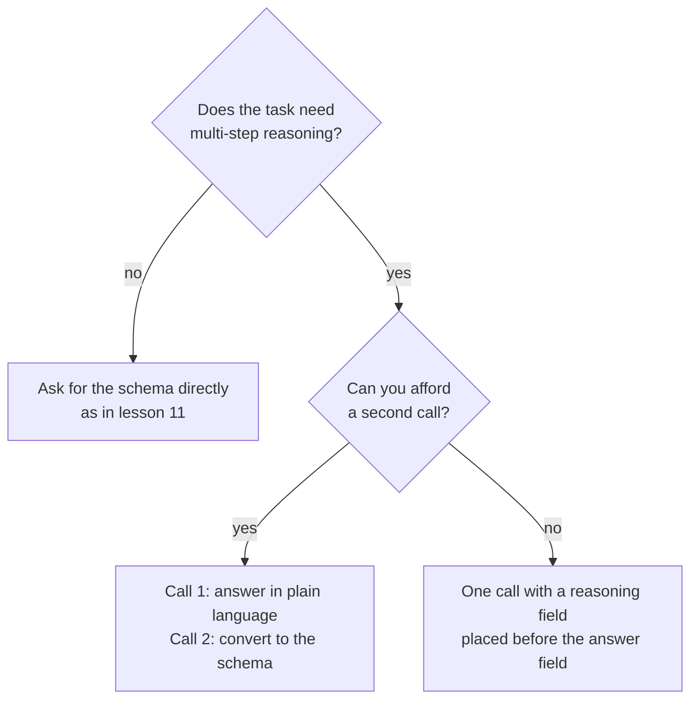

# 第 12 课：格式约束与推理

**使命关联:** 如果强制格式会让答案变差，那么程序能解析的输出就没有多大价值，所以本课说明这个代价出现在哪里，以及两种避免付出代价的办法。
**主要来源:** [论文：“Let Me Speak Freely? A Study on the Impact of Format Restrictions on Performance of Large Language Models”，Tam 等，2024](https://arxiv.org/abs/2408.02442)
**前置知识:** [第 11 课](0011-structured-output-from-the-prompt.md)、[思维链](../GLOSSARY.md)、[结构化输出](../GLOSSARY.md)

## 热身

1. ▢ 第 8 课问过中间推理何时能改进答案。说出一个推理有帮助的任务，和一个只会增加 token 的任务。

<details markdown="1"><summary>检查</summary>

它对多步骤问题有帮助，比如算术应用题，每一步都为下一步提供输入。对一步就能回答的任务帮助很小，比如给一个明显的句子选标签。

</details>

2. ▢ 第 9 课说过，写出来的推理并不是对答案的忠实解释。这是否意味着它对写出它的模型也毫无用处？

<details markdown="1"><summary>检查</summary>

并非如此。忠实性说的是这段文字能否向读者解释答案的真实成因。推理 token 仍然会影响模型接下来写什么，所以即使它们并不是好的解释，要求给出推理也可以改进答案。

</details>

3. ▢ 第 11 课以“解析、校验、重试”的循环收尾。这个循环防范的是什么？

<details markdown="1"><summary>检查</summary>

防范的是无法解析或与 schema 不匹配的回复。对于一条合法回复里的答案是否正确，它什么也没说，而这正是本课的主题。

</details>

## 要点

### 论文测量了什么

Tam 等人在不同程度的格式限制下比较了相同的问题。他们的三种设置，从最严格到最宽松，分别是：JSON-mode（约束解码，生成过程中输出被限制为合法的 JSON）、格式限制指令（要求某种格式和 schema 的提示词，如第 11 课）、以及 NL-to-Format，这是一个两步的过程，先用自然语言回答，再把答案转换成该格式。

他们的摘要报告说，在格式限制下推理能力显著下降，而且约束越严格，推理任务上的退化通常越大。在推理任务（GSM8K、Last Letter Concatenation、Shuffled Objects）上，更宽松的提示词通常表现更好，JSON-mode 在大多数情况下最差。NL-to-Format 在大多数模型上的表现与不受限制的自然语言几乎相同。

### 值得记住的两点提醒

论文自己的结论说，约束解码可能妨碍推理，同时提高分类准确率。所以这个代价并不是普遍的：它出现在推理任务上，而单纯的分类任务用严格的格式反而可能更好。

这项研究使用的是当时的模型，并说明了自身的局限：它聚焦于推理密集的任务，把较简单的推理留给未来的工作。把它当作要在你的任务上做测量的理由，而不是“结构总是有害”的规则。

### 字段顺序也是提示词的一部分

JSON 对象是从左到右生成的，所以一个字段会写在它后面的字段之前。论文发现，在 Last Letter 任务上，GPT-3.5 Turbo 的 JSON-mode 回复 100% 都把 `answer` 键放在 `reason` 键之前，所以模型是直接作答，而不是先推理。

把推理字段放在答案字段之前，推理才能为答案提供依据。

```json
{
  "reasoning": "The order has 3 items at 12 each, which is 36. Shipping is 5, so the total is 41.",
  "answer": 41
}
```

关于厂商的一点说明：Anthropic 的结构化输出页面警告说，要求提供模型思考过程或逐步推理的属性可能导致拒绝回答，并建议改为要求一段简短的解释。它还说，schema 语法作用于直接输出，而不作用于思考块，所以有思考阶段的模型会在结构化回复之前自由地推理。

### 或者先推理，再格式化

另一种选择是两次调用。第一次用平实的语言提出问题，让模型推理。第二次把这个答案转换成结构。



第二次调用要多花一次请求，还增加了一个可能引入自身错误的步骤：论文指出，NL-to-Format 偶尔会引入生成错误，导致一个较小的模型性能略有下降。要通过在你的任务上测量两者来做选择。

## 练习

1. ▢ 先预测，再检查。一个提示词要求返回 JSON，键的顺序是先 `answer`，再 `reasoning`。任务是一道三步的算术题。模型会如何对待推理？你会改什么？

<details markdown="1"><summary>提示</summary>

想一想这两个字段中，模型先写的是哪一个。

</details>

<details markdown="1"><summary>检查</summary>

它先写出答案，所以后面的推理不可能产生这个答案：模型是直接作答，然后才解释。把顺序对调，让 `reasoning` 出现在 `answer` 之前。这正是论文在 Last Letter 任务上、GPT-3.5 Turbo 的每一条 JSON-mode 回复中都发现的失败。

</details>

2. ▢ 根据论文的发现，下面哪个任务最可能因为严格的输出格式而损失准确率？

    - a) 把一条简短的评论标注为正面或负面。
    - b) 通过几个书面步骤把三个数相乘。
    - c) 把一张支持工单分到四个队列之一。
    - d) 在一行句子里挑出提到的运动项目。

<details markdown="1"><summary>检查</summary>

b。它属于多步骤推理，正是论文发现会受限制所害的那类任务。其余都是分类类任务，论文报告说约束解码对它们反而可能提高准确率。

</details>

3. ▢ 重写下面这个 schema，让模型先推理再回答，并说明你的顺序为何有效：`{"verdict": "...", "evidence": "...", "confidence": 0.0}`，任务是判断一个论断能否从一段文字中推出。

<details markdown="1"><summary>检查</summary>

把 `evidence` 放在最前，然后是 `verdict`，再是 `confidence`：例如 `{"evidence": "...", "verdict": "...", "confidence": 0.0}`。模型先写证据，所以结论是以证据为条件的。只移动 `confidence`，或者仍把 `verdict` 放在最前面的改写，都没有解决问题。

</details>

4. ▢ 每个请求你只有一次调用，并且有严格的延迟限制，任务是以 JSON 返回的应用题。哪种设计更合适？

    - a) 两次调用：先用平实的语言推理，再转换成 JSON。
    - b) 一次调用，只含 answer 字段的纯 JSON 对象。
    - c) 一次调用，JSON 中 reasoning 字段在 answer 之前。
    - d) 一次调用，JSON 中先 answer 字段，后 reasoning。

<details markdown="1"><summary>检查</summary>

c。它符合调用次数的预算，并且让推理出现在答案之前。选项 a 需要第二次调用。选项 b 去掉了任务所需的推理。选项 d 的顺序会让模型先给出答案。

</details>

## 实战练习

- [ ] 今天：在聊天窗口里提出一道多步骤应用题，要求以 JSON 回复，先 `answer` 后 `reasoning`。再问一次，这次把 `reasoning` 放在前面。记下答案是否不同，以及推理出现在什么位置。
- [ ] 明天：选五个你能检查答案的问题，每个都用两种顺序各运行一次，数一数各自答对的数量。五个太少，不足以证明任何结论，所以把结果当作提示，再到真实的数据集上去测试。
- [ ] 看一看你在用的某个结构化输出提示词，检查它的字段顺序。如果判断字段出现在其依据的证据之前，就把它们对调。

## 延伸阅读

- [论文：“Let Me Speak Freely? A Study on the Impact of Format Restrictions on Performance of Large Language Models”，Tam 等，2024](https://arxiv.org/abs/2408.02442)
- [文档：“Structured outputs”，Claude Platform Docs](https://platform.claude.com/docs/en/build-with-claude/structured-outputs)
- [结构化输出与长上下文](../reference/structured-output-and-long-context.md)
- [资源](../RESOURCES.md)

---

没学明白？请重读顶部的主要来源，因为本课是对它的压缩，而理解正是在压缩中流失的。如果有哪个术语觉得含糊，可以查看[术语表](../GLOSSARY.md)。

如果问题出在课程本身，而不是学习材料，那就是一个缺陷：[提交 issue](https://github.com/TokenCemetery/teach/issues)。
