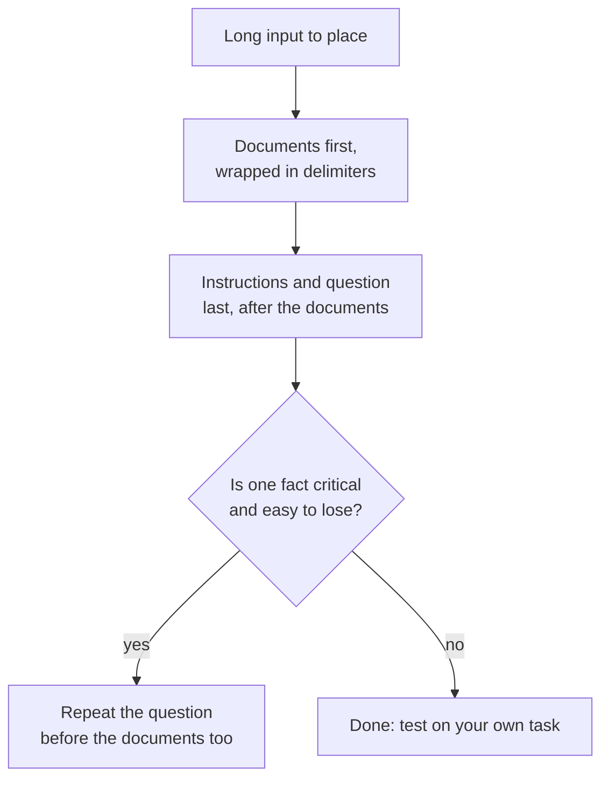

# Lección 13. La posición en el contexto largo

**Vínculo con la misión:** Un prompt largo solo ayuda si el modelo usa lo que hay en él, así que esta lección muestra por qué importa la posición y dónde poner los documentos y la pregunta.
**Fuente principal:** [Artículo: "Lost in the Middle: How Language Models Use Long Contexts", Liu et al., 2023](https://arxiv.org/abs/2307.03172)
**Requisitos previos:** [Lección 12](0012-format-constraints-and-reasoning.md), [Prompt](../GLOSSARY.md), [Delimitador](../GLOSSARY.md)

## Calentamiento

1. ▢ La lección 7 nombró la recencia como un sesgo en los prompts few-shot. ¿Qué parte de un prompt few-shot favorece ese sesgo?

Comprobación

Los ejemplos más cercanos al final del prompt, de modo que los últimos ejemplos arrastran la respuesta hacia sus etiquetas. La posición dentro de un prompt cambia el peso que recibe un fragmento de texto, que es también el tema de esta lección.

2. ▢ La lección 2 decía que el modelo jerarquiza las instrucciones según dónde están. ¿Un documento largo colocado encima de las instrucciones es una instrucción?

Comprobación

No, son datos. Por eso la lección 4 lo envuelve en delimitadores: para que el modelo pueda distinguir el documento de la instrucción incluso cuando el documento es largo y va primero.

3. ▢ La lección 11 terminó con la validación de una respuesta. ¿Por qué una entrada larga hace más importante la validación, y no menos?

Comprobación

Una entrada larga ofrece más formas de pasar por alto o malinterpretar un detalle, y el modelo suena igual de seguro cuando lo hace. Una comprobación sobre la respuesta es la única señal que no depende de la propia seguridad del modelo.

## Qué debes saber

### La curva en forma de U

Liu et al. dieron a los modelos de lenguaje una pregunta y un conjunto de documentos, exactamente uno de los cuales contenía la respuesta, y fueron moviendo ese documento por la lista. La precisión dependía de dónde estuviera. Reportan una curva de rendimiento con una característica forma de U: los modelos suelen ser mucho mejores usando información relevante al principio y al final del contexto, y rinden peor cuando está en el medio.

El tamaño del efecto fue grande. Con GPT-3.5-Turbo, el rendimiento en preguntas y respuestas sobre varios documentos puede caer más de un 20 % en el medio, y en el peor caso, en las configuraciones de 20 y 30 documentos, fue inferior al de no tener ningún documento (rendimiento closed-book, 56,1 %). Tener un documento en el prompt no es lo mismo que el modelo lo use.

También encontraron que los modelos de contexto extendido suelen rendir igual que sus equivalentes de contexto estándar, así que una ventana de contexto mayor no solucionó esto por sí sola.

### Qué muestra y qué no muestra esto

El artículo probó los modelos de 2023 en preguntas y respuestas sobre documentos y en la recuperación de un valor de una lista de pares clave-valor. Es evidencia de un efecto de posición en esos modelos y tareas. No dice que todos los modelos actuales tengan la misma curva, ni qué tan profundo es el valle en el tuyo. La lectura práctica es tratar el medio como el lugar más débil y probar en tu propia tarea.

### Dónde poner cada cosa

De aquí salen dos movimientos, y son afirmaciones separadas de dos fuentes.

- La guía de contexto largo de Anthropic: pon los documentos y entradas largos cerca del inicio del prompt, por encima de la consulta, las instrucciones y los ejemplos. Añade que poner la consulta al final puede mejorar la calidad de la respuesta hasta un 30 por ciento en pruebas, sobre todo con entradas complejas de varios documentos, y lo describe para prompts de 20k tokens o más. Ese es el comportamiento documentado por un solo proveedor.
- El experimento con consulta consciente de Liu et al.: colocar la consulta tanto antes como después de los datos permitió a los modelos alcanzar una precisión casi perfecta en la recuperación de pares clave-valor. La explicación del artículo es que un modelo solo decodificador que lee los datos no puede ver una consulta que viene después, así que repetirla antes de los datos permite leer los documentos con la pregunta a la vista.

Cuando sea posible, mantén también el contexto más corto: menos documentos dejan menos en el medio.

## Práctica

1. ▢ Predice y luego comprueba. Un prompt contiene 20 documentos y la respuesta está en exactamente uno. Ordena estas ubicaciones de mejor a peor precisión esperada según los hallazgos de Liu et al.: documento 1, documento 10, documento 20.

Pista

La curva tiene forma de U, no de línea recta.

Comprobación

Se espera que los documentos 1 y 20 superen al documento 10, que está en el medio. La curva no fija un orden entre los dos extremos, así que "los extremos por encima del medio" es la respuesta segura. Una suposición lineal, como "antes siempre es mejor", pasa por alto el extremo de la recencia.

2. ▢ Un prompt dice: la pregunta, luego 15 informes pegados, luego "Responde usando los informes." Reescribe su disposición siguiendo la guía de Anthropic.

Comprobación

Pon primero los 15 informes, cada uno entre etiquetas, y después de ellos la instrucción y la pregunta: informes, luego "Responde la pregunta usando los informes", luego la pregunta. Mover solo la pregunta al final ya es el cambio principal. Mover los informes por debajo de las instrucciones repite el problema original.

3. ▢ ¿Qué afirmación sobre el resultado de lost-in-the-middle es acertada?

    - a) Una ventana de contexto mayor elimina el problema en todos los modelos.
    - b) El texto relevante en el medio se usó peor que en los extremos.
    - c) Los modelos ignoran todo documento que esté en el medio de un prompt.
    - d) El efecto aparece en toda tarea, modelo y longitud de contexto.

Comprobación

b. El artículo encontró un peor uso de la información del medio en sus pruebas. La opción a se contradice con que los modelos de contexto extendido rindan más o menos igual que sus equivalentes. La opción c exagera una caída de precisión hasta convertirla en descuido total. La opción d afirma una universalidad que el artículo no muestra.

4. ▢ Tienes 30 pasajes recuperados y un dato que importa más que los demás. Nombra dos movimientos de disposición de esta lección que reduzcan el riesgo de que el modelo lo pase por alto.

Comprobación

Cualquiera de estos dos: poner el pasaje con el dato crítico al inicio o al final de la lista y no en el medio; colocar la pregunta después de los documentos; repetir la pregunta también antes de los documentos; pasar menos pasajes. Añadir una frase que diga "presta atención a todo" no es un movimiento de disposición y no lo respalda ninguna de las dos fuentes.

## Prácticas en el mundo real

- [ ] Hoy: en una ventana de chat, pega un texto largo (varias páginas) con un dato distintivo colocado cerca del inicio y haz una pregunta sobre él. Repite con el mismo dato cerca del medio y cerca del final, en chats separados.
- [ ] Mañana: toma una tarea larga que hagas, como resumir un hilo extenso, y coloca la pregunta después del texto pegado en lugar de antes. Compara las dos respuestas en algo que puedas comprobar.
- [ ] Mira un prompt tuyo que pegue muchos documentos y comprueba dónde está la pregunta y si los documentos están en delimitadores.

## Para profundizar

- [Artículo: "Lost in the Middle", Liu et al., 2023](https://arxiv.org/abs/2307.03172)
- [Documentación: "Prompting best practices", Claude Platform Docs](https://platform.claude.com/docs/en/build-with-claude/prompt-engineering/claude-prompting-best-practices)
- [Salida estructurada y contexto largo](../reference/structured-output-and-long-context.md)
- [Recursos](../RESOURCES.md)

---

¿No termina de quedar claro? Vuelve a leer la fuente principal del inicio, porque esta lección la comprime y en la compresión es donde se pierde la comprensión. Consulta el [glosario](../GLOSSARY.md) para cualquier término que te haya parecido resbaladizo.

Si lo poco claro es la lección y no el material, eso es un defecto: [abre un issue](https://github.com/TokenCemetery/teach/issues).
