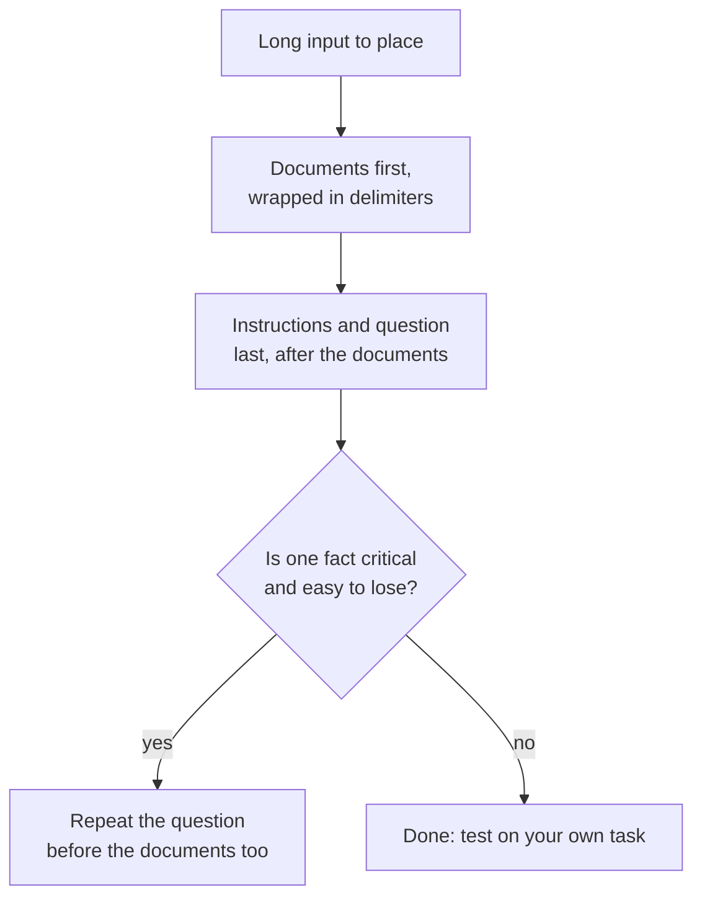

# Leçon 13. La position dans un long contexte

**Lien avec la mission :** Un long prompt n'aide que si le modèle utilise ce qu'il contient. Cette leçon montre pourquoi la position compte et où placer les documents et la question.
**Source primaire :** [Article : "Lost in the Middle: How Language Models Use Long Contexts", Liu et al., 2023](https://arxiv.org/abs/2307.03172)
**Prérequis :** [Leçon 12](0012-format-constraints-and-reasoning.md), [Prompt](../GLOSSARY.md), [Délimiteur](../GLOSSARY.md)

## Échauffement

1. ▢ La leçon 7 nommait la récence comme un biais des prompts few-shot. Quelle partie d'un prompt few-shot ce biais favorise-t-il ?

Vérifier

Les exemples les plus proches de la fin du prompt, de sorte que les derniers exemples tirent la réponse vers leurs labels. La position dans un prompt change le poids qu'obtient un morceau de texte, ce qui est aussi le sujet de cette leçon.

2. ▢ La leçon 2 disait que le modèle classe les instructions selon leur emplacement. Un long document placé au-dessus des instructions est-il une instruction ?

Vérifier

Non, c'est une donnée. C'est pourquoi la leçon 4 l'enveloppe dans des délimiteurs : pour que le modèle puisse distinguer le document de l'instruction même quand le document est long et vient en premier.

3. ▢ La leçon 11 se terminait sur la validation d'une réponse. Pourquoi une longue entrée rend-elle la validation plus importante, et non moins ?

Vérifier

Une longue entrée donne plus de façons de manquer ou de mal lire un détail, et le modèle paraît tout aussi sûr de lui quand cela arrive. Une vérification de la réponse est le seul signal qui ne dépende pas de la confiance du modèle lui-même.

## À savoir

### La courbe en U

Liu et al. ont donné aux modèles de langage une question et un ensemble de documents, dont un seul contenait la réponse, et ont déplacé ce document dans la liste. La précision dépendait de sa position. Ils rapportent une courbe de performance en U caractéristique : les modèles sont souvent bien meilleurs pour utiliser l'information pertinente tout au début et tout à la fin du contexte, et font moins bien quand elle se trouve au milieu.

L'ampleur de l'effet était grande. Pour GPT-3.5-Turbo, la performance en question-réponse multi-documents peut chuter de plus de 20 % au milieu, et dans le pire cas, dans les configurations à 20 et 30 documents, elle était inférieure à celle obtenue sans aucun document (performance en closed-book, 56,1 %). Avoir un document dans le prompt n'est pas la même chose que le modèle l'utilise.

Ils ont aussi constaté que les modèles à contexte étendu se comportent souvent à l'identique de leurs équivalents à contexte standard : une fenêtre de contexte plus grande n'a donc pas, à elle seule, réglé le problème.

### Ce que cela montre et ne montre pas

L'article a testé les modèles de 2023 sur la question-réponse sur documents et sur la récupération d'une valeur dans une liste de paires clé-valeur. C'est une preuve d'un effet de position dans ces modèles et ces tâches. Il ne dit pas que chaque modèle actuel a la même courbe, ni quelle est la profondeur du creux pour le vôtre. La lecture pratique consiste à traiter le milieu comme l'endroit le plus faible et à tester sur votre propre tâche.

### Où placer les choses

Deux gestes en découlent, et ce sont des affirmations distinctes issues de deux sources.

- Les recommandations d'Anthropic sur le long contexte : placer les longs documents et entrées près du haut du prompt, au-dessus de la requête, des instructions et des exemples. Elles ajoutent que placer la requête à la fin peut améliorer la qualité de la réponse jusqu'à 30 pour cent dans les tests, surtout avec des entrées complexes à plusieurs documents, et décrivent cela pour des prompts de 20k tokens ou plus. C'est le comportement documenté d'un seul éditeur.
- L'expérience à requête consciente de Liu et al. : placer la requête à la fois avant et après les données a permis aux modèles d'atteindre une précision quasi parfaite sur la récupération clé-valeur. L'explication de l'article est qu'un modèle decoder-only qui lit les données ne peut pas voir une requête qui vient plus tard, donc la répéter avant les données permet de lire les documents avec la question en vue.

Quand c'est possible, gardez aussi le contexte plus court : moins de documents laissent moins de choses au milieu.

## Pratique

1. ▢ Prédisez, puis vérifiez. Un prompt contient 20 documents et la réponse se trouve dans un seul. Classez ces emplacements du meilleur au pire en précision attendue selon les constats de Liu et al. : document 1, document 10, document 20.

Indice

La courbe est en U, pas une droite.

Vérifier

Les documents 1 et 20 sont tous deux censés battre le document 10, qui se trouve au milieu. La courbe ne fixe pas d'ordre entre les deux extrémités : « extrémités au-dessus du milieu » est donc la réponse sûre. Une estimation linéaire, comme « plus tôt est toujours mieux », passe à côté de l'extrémité de récence.

2. ▢ Un prompt se lit : la question, puis 15 rapports collés, puis « Answer using the reports. » Réécrivez sa disposition en suivant les recommandations d'Anthropic.

Vérifier

Mettez d'abord les 15 rapports, chacun dans des balises, puis l'instruction et la question après eux : les rapports, puis « Answer the question using the reports », puis la question. Déplacer seulement la question à la fin est déjà le changement principal. Placer les rapports sous les instructions reproduit le problème d'origine.

3. ▢ Quelle affirmation sur le résultat « lost in the middle » est exacte ?

    - a) Une fenêtre de contexte plus grande supprime le problème pour tous les modèles.
    - b) Le texte pertinent au milieu était moins bien utilisé qu'aux extrémités.
    - c) Les modèles ignorent tout document situé au milieu d'un prompt.
    - d) L'effet apparaît pour toute tâche, tout modèle et toute longueur de contexte.

Vérifier

b. L'article a constaté une moins bonne utilisation de l'information du milieu dans ses tests. L'option a est contredite par les modèles à contexte étendu qui se comportent à peu près comme leurs équivalents. L'option c exagère une baisse de précision en négligence totale. L'option d revendique une universalité que l'article ne montre pas.

4. ▢ Vous avez 30 passages récupérés et un fait qui compte plus que tout. Nommez deux gestes de disposition de cette leçon qui réduisent le risque que le modèle le manque.

Vérifier

Deux au choix parmi : placer le passage contenant le fait critique au début ou à la fin de la liste et non au milieu ; placer la question après les documents ; répéter la question avant les documents aussi ; passer moins de passages. Ajouter une phrase disant « faites attention à tout » n'est pas un geste de disposition et n'est soutenu par aucune des deux sources.

## Exercices en situation réelle

- [ ] Aujourd'hui : dans une fenêtre de chat, collez un long texte (plusieurs pages) avec un fait distinctif planté près du début, et posez une question à son sujet. Recommencez avec le même fait près du milieu puis près de la fin, dans des chats séparés.
- [ ] Demain : prenez une longue tâche que vous faites, comme résumer un long fil de discussion, et placez la question après le texte collé au lieu d'avant. Comparez les deux réponses sur un point que vous pouvez vérifier.
- [ ] Regardez un de vos prompts qui colle de nombreux documents et vérifiez où se situe la question et si les documents sont dans des délimiteurs.

## Pour aller plus loin

- [Article : "Lost in the Middle", Liu et al., 2023](https://arxiv.org/abs/2307.03172)
- [Doc : "Prompting best practices", Claude Platform Docs](https://platform.claude.com/docs/en/build-with-claude/prompt-engineering/claude-prompting-best-practices)
- [Sortie structurée et long contexte](../reference/structured-output-and-long-context.md)
- [Ressources](../RESOURCES.md)

---

Ça ne passe pas ? Relisez la source primaire en haut de page, car cette leçon la condense et c'est dans la condensation que la compréhension s'échappe. Consultez le [glossaire](../GLOSSARY.md) pour tout terme qui vous a paru glissant.

Si c'est la leçon elle-même qui n'est pas claire plutôt que la matière, c'est un défaut : [ouvrez une issue](https://github.com/TokenCemetery/teach/issues).
