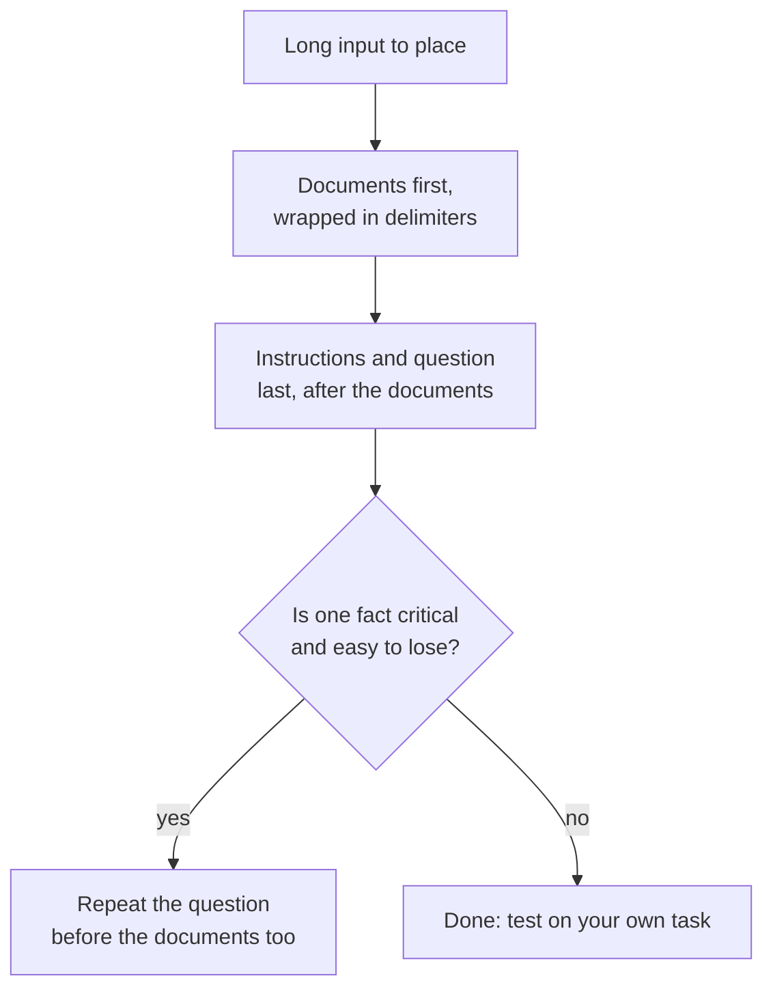

# पाठ 13. लंबे Context में Position

**मिशन से संबंध:** लंबा prompt तभी मदद करता है जब model उसमें मौजूद चीज़ों का इस्तेमाल करे। इसलिए यह पाठ दिखाता है कि position क्यों मायने रखती है और documents व सवाल कहाँ रखने चाहिए।
**मुख्य स्रोत:** [Paper: "Lost in the Middle: How Language Models Use Long Contexts", Liu et al., 2023](https://arxiv.org/abs/2307.03172)
**पूर्व-आवश्यकताएँ:** [पाठ 12](0012-format-constraints-and-reasoning.md), [Prompt](../GLOSSARY.md), [Delimiter](../GLOSSARY.md)

## वार्म-अप

1. ▢ पाठ 7 ने recency को few-shot prompts में एक bias बताया था। वह bias few-shot prompt के किस हिस्से को तरजीह देता है?

जाँचें

Prompt के अंत के सबसे पास वाले examples को, इसलिए आख़िरी examples उत्तर को अपने labels की ओर खींचते हैं। Prompt के भीतर position तय करती है कि text के किसी टुकड़े को कितना वज़न मिलता है, जो इस पाठ का भी विषय है।

2. ▢ पाठ 2 ने कहा था कि model instructions को उनकी जगह के आधार पर क्रम देता है। क्या instructions के ऊपर रखा लंबा document एक instruction है?

जाँचें

नहीं, वह data है। इसीलिए पाठ 4 उसे delimiters में लपेटता है: ताकि model document को instruction से अलग पहचान सके, तब भी जब document लंबा हो और पहले आए।

3. ▢ पाठ 11 reply को validate करने पर ख़त्म हुआ था। लंबा input validation को कम नहीं, ज़्यादा ज़रूरी क्यों बनाता है?

जाँचें

लंबा input किसी ब्योरे को छोड़ने या ग़लत पढ़ने के ज़्यादा रास्ते देता है, और ऐसा होने पर भी model उतना ही आश्वस्त लगता है। Reply की जाँच ही वह अकेला संकेत है जो model के अपने आत्मविश्वास पर निर्भर नहीं।

## यह जानें

### U-आकार का वक्र

Liu et al. ने language models को एक सवाल और documents का एक सेट दिया, जिनमें से ठीक एक में उत्तर था, और उस document को सूची में घुमाया। Accuracy इस पर निर्भर रही कि वह कहाँ बैठा था। वे एक विशिष्ट U-आकार का performance वक्र बताते हैं: models अक्सर context की बिलकुल शुरुआत और बिलकुल अंत की प्रासंगिक जानकारी का इस्तेमाल बहुत बेहतर करते हैं, और बीच में होने पर बदतर।

असर का आकार बड़ा था। GPT-3.5-Turbo के लिए, multi-document question answering का performance बीच में 20% से ज़्यादा गिर सकता है, और सबसे बुरे मामले में, 20 और 30 documents वाली सेटिंग्स में, वह बिना किसी document के (closed-book performance, 56.1%) से भी कम था। Prompt में document का होना और model का उसे इस्तेमाल करना एक बात नहीं है।

उन्होंने यह भी पाया कि extended-context models अक्सर अपने standard-context समकक्षों जैसा ही प्रदर्शन करते हैं, इसलिए बड़ी context window ने अपने-आप इसे ठीक नहीं किया।

### यह क्या दिखाता है और क्या नहीं

पेपर ने 2023 के models को documents पर question answering और key-value जोड़ियों की सूची से मान निकालने पर परखा। यह उन models और tasks में position के असर का प्रमाण है। यह नहीं कहता कि हर मौजूदा model का वही वक्र है, या आपके model के लिए गड्ढा कितना गहरा है। व्यावहारिक पढ़ाई यह है कि बीच को सबसे कमज़ोर जगह मानें और अपने task पर परखें।

### चीज़ें कहाँ रखें

दो क़दम निकलते हैं, और वे दो स्रोतों के अलग दावे हैं।

- Anthropic की long-context मार्गदर्शिका: लंबे documents और inputs को prompt के ऊपर के पास रखें, query, instructions और examples से ऊपर। वह जोड़ती है कि query को अंत में रखना tests में response की गुणवत्ता 30 प्रतिशत तक बेहतर कर सकता है, ख़ासकर जटिल, multi-document inputs के साथ, और इसे 20k tokens या उससे ज़्यादा के prompts के लिए बताती है। यह एक vendor का दस्तावेज़ी व्यवहार है।
- Liu et al. का query-aware प्रयोग: query को data के पहले और बाद, दोनों जगह रखने से models key-value retrieval पर लगभग-पूर्ण accuracy तक पहुँचे। पेपर की व्याख्या यह है कि data पढ़ता हुआ decoder-only model बाद में आने वाली query नहीं देख सकता, इसलिए data से पहले उसे दोहराने से documents सवाल को नज़र में रखकर पढ़े जा सकते हैं।

जहाँ ठीक बैठे, context को छोटा भी रखें: कम documents बीच में कम छोड़ते हैं।

## अभ्यास

1. ▢ पहले अनुमान लगाएँ, फिर जाँचें। एक prompt में 20 documents हैं और उत्तर ठीक एक में है। Liu et al. की खोजों के तहत इन placements को अपेक्षित accuracy में सबसे अच्छे से सबसे बुरे के क्रम में रखें: document 1, document 10, document 20।

संकेत

वक्र U-आकार का है, सीधी रेखा नहीं।

जाँचें

Documents 1 और 20, दोनों से document 10 को हराने की उम्मीद है, जो बीच में बैठा है। वक्र दोनों किनारों के बीच कोई क्रम तय नहीं करता, इसलिए "किनारे बीच से ऊपर" सुरक्षित उत्तर है। सीधी रेखा वाला अंदाज़ा, जैसे "पहले वाला हमेशा बेहतर", recency वाले किनारे को चूक जाता है।

2. ▢ एक prompt यूँ पढ़ता है: सवाल, फिर 15 paste की गई रिपोर्टें, फिर "Answer using the reports." Anthropic की मार्गदर्शिका से इसका layout दोबारा लिखें।

जाँचें

15 रिपोर्टें पहले रखें, हर एक tags में, फिर उनके बाद instruction और सवाल: रिपोर्टें, फिर "Answer the question using the reports", फिर सवाल। सिर्फ़ सवाल को अंत में ले जाना ही मुख्य बदलाव है। रिपोर्टों को instructions के नीचे ले जाना मूल समस्या दोहराता है।

3. ▢ Lost-in-the-middle नतीजे के बारे में कौन-सा कथन सटीक है?

    - a) बड़ी context window सभी models के लिए समस्या हटा देती है।
    - b) बीच के प्रासंगिक text का इस्तेमाल किनारों से कम अच्छा हुआ।
    - c) Models prompt के बीच में बैठे हर document को नज़रअंदाज़ कर देते हैं।
    - d) यह असर हर task, model और context लंबाई पर दिखता है।

जाँचें

b। पेपर ने अपने tests में बीच की जानकारी का ख़राब इस्तेमाल पाया। विकल्प a उस बात से खंडित है कि extended-context models अपने समकक्षों जितना ही प्रदर्शन करते हैं। विकल्प c accuracy में गिरावट को पूरी उपेक्षा तक बढ़ा देता है। विकल्प d ऐसी सार्वभौमिकता का दावा करता है जो पेपर नहीं दिखाता।

4. ▢ आपके पास 30 retrieve किए गए passages हैं और एक तथ्य जो सबसे ज़्यादा मायने रखता है। इस पाठ से दो layout क़दम बताएँ जो model के उसे चूकने का जोखिम घटाते हैं।

जाँचें

इनमें से कोई दो: निर्णायक तथ्य वाला passage सूची के बीच में नहीं, शुरू या अंत में रखें; सवाल को documents के बाद रखें; सवाल को documents से पहले भी दोहराएँ; कम passages भेजें। "सब पर ध्यान दो" वाला वाक्य जोड़ना layout का क़दम नहीं है और किसी भी स्रोत से समर्थित नहीं है।

## असली दुनिया का अभ्यास

- [ ] आज: chat window में एक लंबा text (कई पन्ने) paste करें जिसकी शुरुआत के पास एक अलग दिखने वाला तथ्य डाला गया हो, और उसके बारे में सवाल पूछें। उसी तथ्य को बीच और अंत के पास रखकर अलग chats में दोहराएँ।
- [ ] कल: कोई लंबा काम लें जो आप करते हैं, जैसे लंबे thread का सार, और सवाल को paste किए text से पहले के बजाय उसके बाद रखें। किसी जाँचने लायक बात पर दोनों उत्तरों की तुलना करें।
- [ ] अपना कोई prompt देखें जो कई documents paste करता है और जाँचें कि सवाल कहाँ बैठा है और documents delimiters में हैं या नहीं।

## आगे बढ़ने के लिए

- [Paper: "Lost in the Middle", Liu et al., 2023](https://arxiv.org/abs/2307.03172)
- [Docs: "Prompting best practices", Claude Platform Docs](https://platform.claude.com/docs/en/build-with-claude/prompt-engineering/claude-prompting-best-practices)
- [Structured Output और लंबा Context](../reference/structured-output-and-long-context.md)
- [संसाधन](../RESOURCES.md)

---

बात नहीं बन रही? ऊपर दिए primary source को दोबारा पढ़ें, क्योंकि यह पाठ उसे संक्षिप्त करता है और समझ संक्षेप में ही रिसती है। जो शब्द फिसलन भरा लगे, उसके लिए [शब्दावली](../GLOSSARY.md) देखें।

अगर दिक़्क़त सामग्री की नहीं बल्कि पाठ की ही है, तो वह एक खोट है: [issue खोलें](https://github.com/TokenCemetery/teach/issues)।
