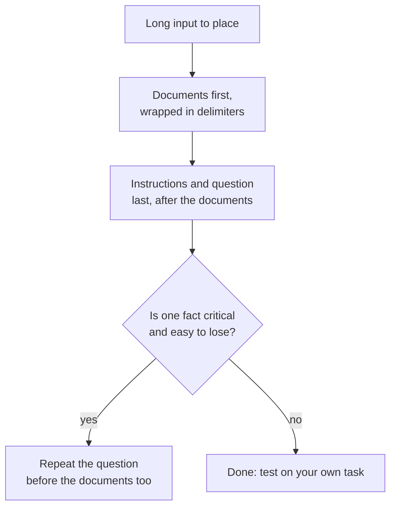

# Lesson 13. Position in Long Context

**Mission link:** A long prompt only helps if the model uses what is in it, so this lesson shows why position matters and where to put the documents and the question.
**Primary source:** [Paper: "Lost in the Middle: How Language Models Use Long Contexts", Liu et al., 2023](https://arxiv.org/abs/2307.03172)
**Prerequisites:** [Lesson 12](0012-format-constraints-and-reasoning.md), [Prompt](../GLOSSARY.md), [Delimiter](../GLOSSARY.md)

## Warm-up

1. ▢ Lesson 7 named recency as a bias in few-shot prompts. Which part of a few-shot prompt does that bias favour?

Check

The examples nearest the end of the prompt, so the last examples pull the answer toward their labels. Position inside a prompt changes how much weight a piece of text gets, which is also this lesson's subject.

2. ▢ Lesson 2 said the model ranks instructions by where they sit. Is a long document placed above the instructions an instruction?

Check

No, it is data. That is why lesson 4 wraps it in delimiters: so the model can tell the document from the instruction even when the document is long and sits first.

3. ▢ Lesson 11 ended with validating a reply. Why does a long input make validation more important, not less?

Check

A long input gives more ways to miss or misread a detail, and the model sounds equally confident when it does. A check on the reply is the only signal that does not depend on the model's own confidence.

## Know this

### The U-shaped curve

Liu et al. gave language models a question and a set of documents, exactly one of which held the answer, and moved that document through the list. Accuracy depended on where it sat. They report a distinctive U-shaped performance curve: models are often much better at using relevant information at the very beginning and the very end of the context, and do worse when it is in the middle.

The size of the effect was large. For GPT-3.5-Turbo, multi-document question answering performance can drop by more than 20% in the middle, and in the worst case, in the 20- and 30-document settings, it was lower than with no documents at all (closed-book performance, 56.1%). Having a document in the prompt is not the same as the model using it.

They also found that extended-context models often perform identically to their standard-context counterparts, so a bigger context window did not by itself fix this.

### What this does and does not show

The paper tested the models of 2023 on question answering over documents and on retrieving a value from a list of key-value pairs. It is evidence for a position effect in those models and tasks. It does not say every current model has the same curve, or how deep the dip is for yours. The practical reading is to treat the middle as the weakest place and to test on your own task.

### Where to put things

Two moves follow, and they are separate claims from two sources.

- Anthropic's long-context guidance: put long documents and inputs near the top of the prompt, above the query, instructions and examples. It adds that putting the query at the end can improve response quality by up to 30 percent in tests, especially with complex, multi-document inputs, and describes this for prompts of 20k tokens or more. That is one vendor's documented behaviour.
- Liu et al.'s query-aware experiment: placing the query both before and after the data let models reach near-perfect accuracy on key-value retrieval. The paper's explanation is that a decoder-only model reading the data cannot see a query that comes later, so repeating it before the data lets the documents be read with the question in view.

When it fits, also keep the context shorter: fewer documents leave less in the middle.

## Practice

1. ▢ Predict, then check. A prompt holds 20 documents and the answer is in exactly one. Rank these placements from best to worst expected accuracy under Liu et al.'s findings: document 1, document 10, document 20.

Hint

The curve is U-shaped, not a straight line.

Check

Documents 1 and 20 are both expected to beat document 10, which sits in the middle. The curve does not fix an order between the two edges, so "edges above middle" is the safe answer. A straight-line guess, such as "earlier is always better", misses the recency edge.

2. ▢ A prompt reads: question, then 15 pasted reports, then "Answer using the reports." Rewrite its layout using Anthropic's guidance.

Check

Put the 15 reports first, each in tags, then the instruction and the question after them: reports, then "Answer the question using the reports", then the question. Moving only the question to the end is already the main change. Moving the reports below the instructions repeats the original problem.

3. ▢ Which statement about the lost-in-the-middle result is accurate?

    - a) A larger context window removes the problem for all models.
    - b) Relevant text in the middle was used less well than at the edges.
    - c) Models ignore every document that sits in the middle of a prompt.
    - d) The effect appears for every task, model and context length.

Check

b. The paper found worse use of middle information in its tests. Option a is contradicted by extended-context models performing about the same as their counterparts. Option c overstates a drop in accuracy into total neglect. Option d claims a universality the paper does not show.

4. ▢ You have 30 retrieved passages and one fact that matters most. Name two layout moves from this lesson that reduce the risk of the model missing it.

Check

Any two of: put the passage with the critical fact at the start or end of the list and not in the middle; place the question after the documents; repeat the question before the documents too; pass fewer passages. Adding a sentence saying "pay attention to everything" is not a layout move and is not backed by either source.

## Real-world reps

- [ ] Today: in a chat window, paste a long text (several pages) with one distinctive fact planted near the start, and ask a question about it. Repeat with the same fact near the middle and near the end, in separate chats.
- [ ] Tomorrow: take a long task you do, such as summarising a long thread, and place the question after the pasted text instead of before it. Compare the two answers on something you can check.
- [ ] Look at a prompt of yours that pastes many documents and check where the question sits and whether the documents are in delimiters.

## Going further

- [Paper: "Lost in the Middle", Liu et al., 2023](https://arxiv.org/abs/2307.03172)
- [Docs: "Prompting best practices", Claude Platform Docs](https://platform.claude.com/docs/en/build-with-claude/prompt-engineering/claude-prompting-best-practices)
- [Structured Output and Long Context](../reference/structured-output-and-long-context.md)
- [Resources](../RESOURCES.md)

---

Not landing? Reread the primary source at the top, since this lesson compresses it and compression is where understanding leaks. Check the [glossary](../GLOSSARY.md) for any term that felt slippery.

If the lesson itself is unclear rather than the material, that is a defect: [open an issue](https://github.com/TokenCemetery/teach/issues).
