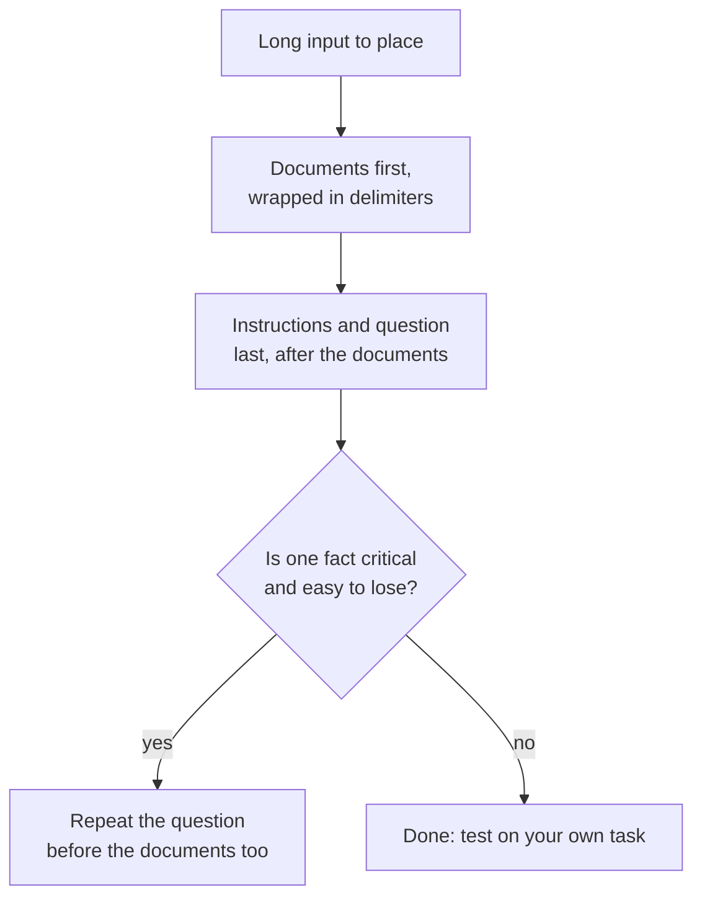

# Lição 13. Posição em contexto longo

**Ligação com a missão:** Um prompt longo só ajuda se o modelo usa o que há nele, então esta lição mostra por que a posição importa e onde colocar os documentos e a pergunta.
**Fonte principal:** [Paper: "Lost in the Middle: How Language Models Use Long Contexts", Liu et al., 2023](https://arxiv.org/abs/2307.03172)
**Pré-requisitos:** [Lição 12](0012-format-constraints-and-reasoning.md), [Prompt](../GLOSSARY.md), [Delimitador](../GLOSSARY.md)

## Aquecimento

1. ▢ A lição 7 apontou a recência como um viés em prompts few-shot. Qual parte de um prompt few-shot esse viés favorece?

Verificação

Os exemplos mais próximos do fim do prompt, de modo que os últimos exemplos puxam a resposta para os seus rótulos. A posição dentro de um prompt muda o peso que um trecho de texto recebe, e esse também é o assunto desta lição.

2. ▢ A lição 2 disse que o modelo ordena as instruções pelo lugar onde elas estão. Um documento longo colocado acima das instruções é uma instrução?

Verificação

Não, é dado. É por isso que a lição 4 o envolve em delimitadores: para que o modelo consiga distinguir o documento da instrução, mesmo quando o documento é longo e vem primeiro.

3. ▢ A lição 11 terminou com a validação de uma resposta. Por que uma entrada longa torna a validação mais importante, e não menos?

Verificação

Uma entrada longa dá mais chances de perder ou entender mal um detalhe, e o modelo soa igualmente confiante quando isso acontece. Uma verificação sobre a resposta é o único sinal que não depende da confiança do próprio modelo.

## Saiba isto

### A curva em U

Liu et al. deram aos modelos de linguagem uma pergunta e um conjunto de documentos, dos quais exatamente um continha a resposta, e moveram esse documento pela lista. A acurácia dependeu de onde ele estava. Eles relatam uma curva de desempenho em formato de U: os modelos costumam usar muito melhor a informação relevante bem no começo e bem no fim do contexto, e vão pior quando ela está no meio.

O tamanho do efeito foi grande. Para o GPT-3.5-Turbo, o desempenho em perguntas e respostas sobre vários documentos pode cair mais de 20% no meio e, no pior caso, nas configurações de 20 e 30 documentos, ficou abaixo do desempenho sem nenhum documento (closed-book, 56,1%). Ter um documento no prompt não é o mesmo que o modelo usá-lo.

Eles também descobriram que modelos de contexto estendido muitas vezes têm desempenho idêntico ao de suas contrapartes de contexto padrão, então uma janela de contexto maior, por si só, não resolveu isso.

### O que isso mostra e o que não mostra

O paper testou os modelos de 2023 em perguntas e respostas sobre documentos e na recuperação de um valor em uma lista de pares chave-valor. É evidência de um efeito de posição nesses modelos e nessas tarefas. Não diz que todo modelo atual tem a mesma curva, nem quão profundo é o vale no seu. A leitura prática é tratar o meio como o lugar mais fraco e testar na sua própria tarefa.

### Onde colocar cada coisa

Duas medidas decorrem disso, e são afirmações separadas, de duas fontes.

- A orientação da Anthropic para contexto longo: coloque documentos e entradas longos perto do topo do prompt, acima da consulta, das instruções e dos exemplos. Ela acrescenta que colocar a consulta no final pode melhorar a qualidade da resposta em até 30 por cento nos testes, especialmente com entradas complexas e de vários documentos, e descreve isso para prompts de 20k tokens ou mais. Esse é o comportamento documentado por um único fornecedor.
- O experimento query-aware de Liu et al.: colocar a consulta antes e depois dos dados permitiu que os modelos alcançassem acurácia quase perfeita na recuperação de chave-valor. A explicação do paper é que um modelo decoder-only que lê os dados não consegue ver uma consulta que vem depois, então repeti-la antes dos dados permite que os documentos sejam lidos com a pergunta em vista.

Quando for possível, mantenha também o contexto mais curto: menos documentos deixam menos coisa no meio.

## Prática

1. ▢ Preveja e depois confira. Um prompt contém 20 documentos e a resposta está em exatamente um. Ordene estas posições da melhor para a pior acurácia esperada segundo as conclusões de Liu et al.: documento 1, documento 10, documento 20.

Dica

A curva tem formato de U, não é uma linha reta.

Verificação

Espera-se que os documentos 1 e 20 superem o documento 10, que fica no meio. A curva não fixa uma ordem entre as duas bordas, então "bordas acima do meio" é a resposta segura. Um palpite em linha reta, como "mais cedo é sempre melhor", ignora a borda da recência.

2. ▢ Um prompt é: pergunta, depois 15 relatórios colados, depois "Responda usando os relatórios." Reescreva o seu layout usando a orientação da Anthropic.

Verificação

Coloque os 15 relatórios primeiro, cada um em tags, depois a instrução e a pergunta depois deles: relatórios, depois "Responda à pergunta usando os relatórios", depois a pergunta. Mover apenas a pergunta para o final já é a mudança principal. Mover os relatórios para baixo das instruções repete o problema original.

3. ▢ Qual afirmação sobre o resultado lost-in-the-middle é correta?

    - a) Uma janela de contexto maior elimina o problema para todos os modelos.
    - b) O texto relevante no meio foi usado pior do que nas bordas.
    - c) Os modelos ignoram todo documento que fica no meio de um prompt.
    - d) O efeito aparece em toda tarefa, modelo e tamanho de contexto.

Verificação

b. O paper encontrou uso pior da informação do meio nos seus testes. A opção a é contradita pelos modelos de contexto estendido terem desempenho parecido com o de suas contrapartes. A opção c exagera uma queda de acurácia até virar negligência total. A opção d afirma uma universalidade que o paper não mostra.

4. ▢ Você tem 30 trechos recuperados e um fato que importa mais que todos. Cite duas medidas de layout desta lição que reduzem o risco de o modelo perdê-lo.

Verificação

Quaisquer duas entre: colocar o trecho com o fato crítico no começo ou no fim da lista, e não no meio; posicionar a pergunta depois dos documentos; repetir a pergunta também antes dos documentos; passar menos trechos. Acrescentar uma frase dizendo "preste atenção em tudo" não é uma medida de layout e não é respaldada por nenhuma das duas fontes.

## Prática no mundo real

- [ ] Hoje: em uma janela de chat, cole um texto longo (várias páginas) com um fato distintivo plantado perto do começo e faça uma pergunta sobre ele. Repita com o mesmo fato perto do meio e perto do fim, em chats separados.
- [ ] Amanhã: pegue uma tarefa longa que você faz, como resumir uma thread longa, e coloque a pergunta depois do texto colado, e não antes. Compare as duas respostas em algo que você consiga verificar.
- [ ] Olhe um prompt seu que cola muitos documentos e confira onde está a pergunta e se os documentos estão em delimitadores.

## Para ir além

- [Paper: "Lost in the Middle", Liu et al., 2023](https://arxiv.org/abs/2307.03172)
- [Docs: "Prompting best practices", Claude Platform Docs](https://platform.claude.com/docs/en/build-with-claude/prompt-engineering/claude-prompting-best-practices)
- [Saída Estruturada e Contexto Longo](../reference/structured-output-and-long-context.md)
- [Recursos](../RESOURCES.md)

---

Não está entrando? Releia a fonte principal no topo, pois esta lição a comprime e é na compressão que a compreensão vaza. Consulte o [glossário](../GLOSSARY.md) para qualquer termo que pareceu escorregadio.

Se o problema é a própria lição, e não o material, isso é um defeito: [abra uma issue](https://github.com/TokenCemetery/teach/issues).
