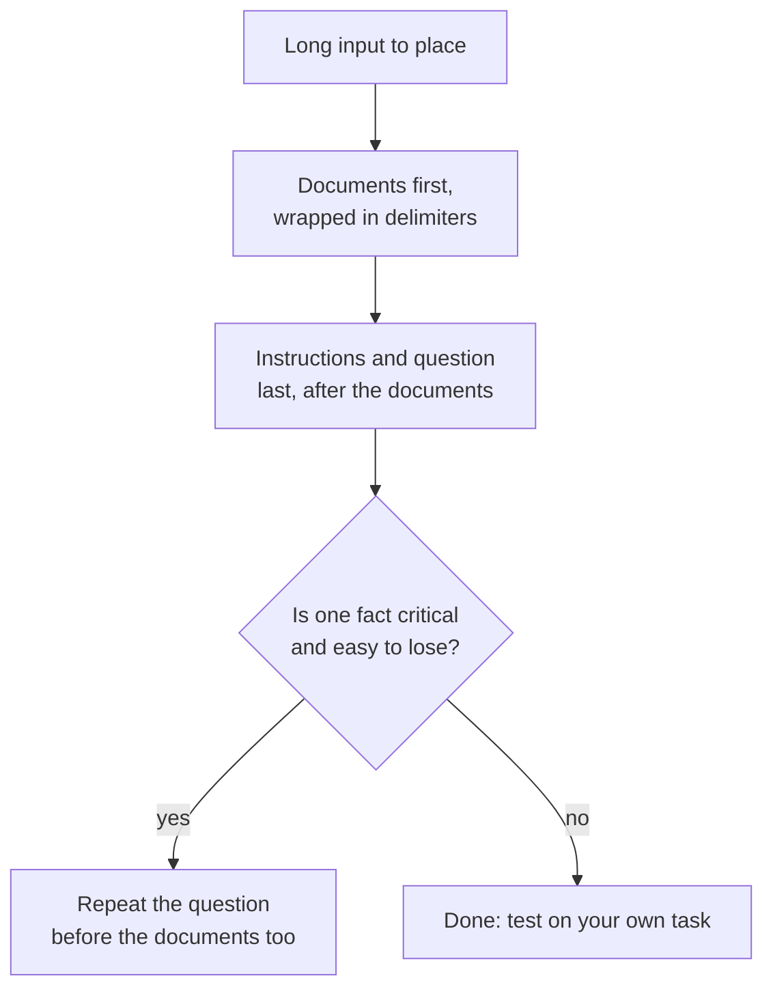

# Урок 13. Позиция в длинном контексте

**Связь с целью курса:** Длинный промпт помогает, только если модель использует то, что в нём есть. Этот урок показывает, почему важна позиция и куда ставить документы и вопрос.
**Первоисточник:** [Статья: «Lost in the Middle: How Language Models Use Long Contexts», Liu et al., 2023](https://arxiv.org/abs/2307.03172)
**Предварительные требования:** [Урок 12](0012-format-constraints-and-reasoning.md), [Промпт](../GLOSSARY.md), [Разделитель](../GLOSSARY.md)

## Разминка

1. ▢ В уроке 7 recency (эффект недавности) был назван смещением few-shot-промптов. Какую часть few-shot-промпта это смещение усиливает?

Проверка

Примеры, ближайшие к концу промпта, поэтому последние примеры тянут ответ к своим меткам. Позиция внутри промпта меняет вес фрагмента текста, и это же тема данного урока.

2. ▢ В уроке 2 говорилось, что модель ранжирует инструкции по тому, где они стоят. Является ли длинный документ, помещённый над инструкциями, инструкцией?

Проверка

Нет, это данные. Поэтому в уроке 4 его оборачивают в разделители: чтобы модель отличала документ от инструкции, даже когда документ длинный и стоит первым.

3. ▢ Урок 11 закончился проверкой ответа. Почему длинный вход делает проверку более важной, а не менее?

Проверка

Длинный вход даёт больше способов пропустить или неверно прочитать деталь, а модель при этом звучит так же уверенно. Проверка ответа остаётся единственным сигналом, не зависящим от собственной уверенности модели.

## Что нужно знать

### U-образная кривая

Liu et al. дали языковым моделям вопрос и набор документов, ровно один из которых содержал ответ, и перемещали этот документ по списку. Точность зависела от того, где он стоял. Авторы сообщают о характерной U-образной кривой качества: модели часто гораздо лучше используют релевантную информацию в самом начале и в самом конце контекста и хуже, когда она находится в середине.

Эффект оказался большим. Для GPT-3.5-Turbo качество многодокументных ответов на вопросы в середине может падать более чем на 20%, а в худшем случае, при 20 и 30 документах, оно было ниже, чем вовсе без документов (качество без доступа к документам, closed-book, 56,1%). Наличие документа в промпте не равно использованию его моделью.

Они также обнаружили, что модели с расширенным контекстом часто работают так же, как их обычные аналоги, поэтому больший контекст сам по себе проблему не решал.

### Что это показывает, а что нет

В статье тестировались модели 2023 года на ответах на вопросы по документам и на извлечении значения из списка пар «ключ-значение». Это свидетельство эффекта позиции у этих моделей и на этих задачах. Оно не говорит, что у каждой современной модели такая же кривая, и не говорит, насколько глубок провал у вашей. Практический вывод: считайте середину самым слабым местом и проверяйте на своей задаче.

### Куда что класть

Отсюда два приёма, и это отдельные утверждения из двух источников.

- Рекомендации Anthropic по длинному контексту: помещайте длинные документы и входные данные ближе к началу промпта, над запросом, инструкциями и примерами. Там же добавлено, что размещение запроса в конце может улучшить качество ответа до 30 процентов в тестах, особенно при сложных многодокументных входах, и это описано для промптов от 20 тысяч токенов. Это задокументированное поведение одного вендора.
- Эксперимент Liu et al. с учётом запроса: размещение запроса и до данных, и после них позволило моделям достичь почти идеальной точности при извлечении по ключу. Объяснение статьи таково: модель только с декодером, читая данные, не видит запрос, который идёт позже, поэтому повтор запроса перед данными позволяет читать документы с вопросом перед глазами.

Когда это уместно, сокращайте и сам контекст: чем меньше документов, тем меньше остаётся в середине.

## Практика

1. ▢ Сначала предскажите, потом проверьте. В промпте 20 документов, ответ ровно в одном. Расставьте эти позиции от лучшей к худшей по ожидаемой точности согласно выводам Liu et al.: документ 1, документ 10, документ 20.

Подсказка

Кривая U-образная, а не прямая линия.

Проверка

Ожидается, что документы 1 и 20 оба превзойдут документ 10, стоящий в середине. Кривая не задаёт порядок между двумя краями, поэтому безопасный ответ: «края выше середины». Догадка по прямой линии, вроде «раньше всегда лучше», упускает край недавности.

2. ▢ Промпт выглядит так: вопрос, затем 15 вставленных отчётов, затем «Ответь, используя отчёты». Перепишите его раскладку по рекомендациям Anthropic.

Проверка

Поставьте 15 отчётов первыми, каждый в тегах, затем инструкцию и вопрос после них: отчёты, затем «Ответь на вопрос, используя отчёты», затем вопрос. Одного переноса вопроса в конец уже достаточно как главного изменения. Если перенести отчёты под инструкции, повторится исходная проблема.

3. ▢ Какое утверждение о результате «lost in the middle» верно?

    - a) Больший контекст убирает проблему у всех моделей.
    - b) Релевантный текст в середине использовался хуже, чем на краях.
    - c) Модели игнорируют каждый документ, стоящий в середине промпта.
    - d) Эффект проявляется для любой задачи, модели и длины контекста.

Проверка

b. Статья обнаружила худшее использование информации из середины в своих тестах. Вариант a опровергается тем, что модели с расширенным контекстом работают примерно так же, как их аналоги. Вариант c преувеличивает снижение точности до полного игнорирования. Вариант d утверждает универсальность, которой статья не показывает.

4. ▢ У вас 30 найденных фрагментов и один самый важный факт. Назовите два приёма раскладки из этого урока, которые снижают риск того, что модель его пропустит.

Проверка

Любые два из: поставить фрагмент с критичным фактом в начало или конец списка, а не в середину; поместить вопрос после документов; повторить вопрос ещё и перед документами; передавать меньше фрагментов. Добавление фразы «обращай внимание на всё» не является приёмом раскладки и не подкреплено ни одним из источников.

## Практика в реальной работе

- [ ] Сегодня: в окне чата вставьте длинный текст (несколько страниц) с одним приметным фактом, спрятанным ближе к началу, и задайте вопрос о нём. Повторите с тем же фактом ближе к середине и ближе к концу, в отдельных чатах.
- [ ] Завтра: возьмите длинную задачу, которую вы выполняете, например краткое изложение длинной переписки, и поставьте вопрос после вставленного текста, а не перед ним. Сравните два ответа по тому, что можно проверить.
- [ ] Посмотрите на свой промпт, который вставляет много документов, и проверьте, где стоит вопрос и заключены ли документы в разделители.

## Что почитать дальше

- [Статья: «Lost in the Middle», Liu et al., 2023](https://arxiv.org/abs/2307.03172)
- [Документация: «Prompting best practices», Claude Platform Docs](https://platform.claude.com/docs/en/build-with-claude/prompt-engineering/claude-prompting-best-practices)
- [Структурированный вывод и длинный контекст](../reference/structured-output-and-long-context.md)
- [Ресурсы](../RESOURCES.md)

---

Не доходит? Перечитайте первоисточник в начале: этот урок его сжимает, а при сжатии понимание как раз и утекает. Загляните в [глоссарий](../GLOSSARY.md), если какой-то термин оказался скользким.

Если неясен сам урок, а не материал, это дефект: [откройте issue](https://github.com/TokenCemetery/teach/issues).
