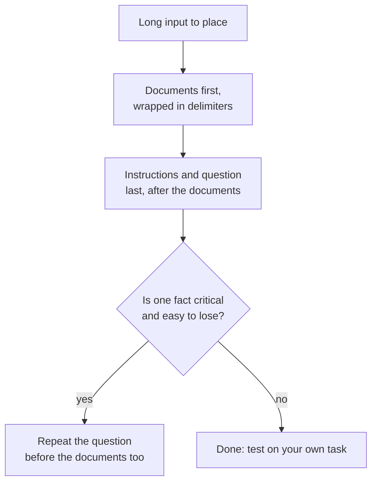

# 第 13 课：长上下文中的位置

**使命关联:** 长提示词只有在模型真正用上其中内容时才有价值，所以本课说明位置为什么重要，以及文档和问题该放在哪里。
**主要来源:** [论文：“Lost in the Middle: How Language Models Use Long Contexts”，Liu 等，2023](https://arxiv.org/abs/2307.03172)
**前置知识:** [第 12 课](0012-format-constraints-and-reasoning.md)、[提示词](../GLOSSARY.md)、[分隔符](../GLOSSARY.md)

## 热身

1. ▢ 第 7 课把近因效应列为少样本提示词中的一种偏差。这种偏差偏向少样本提示词的哪一部分？

检查

偏向最靠近提示词末尾的示例，所以最后几个示例会把答案拉向它们的标签。提示词内部的位置会改变一段文本所获得的权重，这也是本课的主题。

2. ▢ 第 2 课说过，模型会按指令所处的位置给指令排序。放在指令上方的一份长文档算指令吗？

检查

不算，它是数据。这就是第 4 课用分隔符把它包起来的原因：即使文档很长、又排在最前面，模型也能分清文档和指令。

3. ▢ 第 11 课最后讲的是校验回复。为什么输入越长，校验反而越重要？

检查

长输入给了更多遗漏或误读细节的机会，而模型出错时听起来依然同样自信。对回复做检查，是唯一不依赖模型自身信心的信号。

## 要点

### U 形曲线

Liu 等人给语言模型一个问题和一组文档，其中恰好只有一份含有答案，然后让这份文档在列表中移动位置。准确率取决于它所处的位置。他们报告了一条独特的 U 形性能曲线：模型通常能更好地利用上下文最开头和最末尾的相关信息，而当信息位于中间时表现更差。

这种效应的幅度很大。对 GPT-3.5-Turbo 来说，多文档问答的性能在中间位置可能下降超过 20%，在最坏的情况下（20 篇和 30 篇文档的设置），甚至低于完全不给文档时的水平（闭卷性能，56.1%）。提示词里有一份文档，并不等于模型用上了它。

他们还发现，扩展上下文的模型表现往往与其标准上下文的对应版本相同，所以更大的上下文窗口本身并不能解决这个问题。

### 这说明了什么，又没有说明什么

论文测试的是 2023 年的模型，任务是基于文档的问答，以及从键值对列表中检索一个值。它证明了这些模型和任务中存在位置效应。它没有说每个当前的模型都有同样的曲线，也没有说你的模型凹陷得有多深。实际的解读是：把中间当作最薄弱的位置，并在你自己的任务上测试。

### 把东西放在哪里

由此得到两个做法，它们是来自两个来源的不同论断。

- Anthropic 的长上下文指南：把长文档和长输入放在提示词靠上的位置，在查询、指令和示例之上。它补充说，在测试中把查询放在末尾可使回复质量提高多达 30%，在复杂的多文档输入上尤其如此，并且说明这针对 20k token 或更长的提示词。这是一家厂商记录下来的行为。
- Liu 等人的查询感知实验：把查询同时放在数据之前和之后，能让模型在键值检索上达到接近完美的准确率。论文的解释是，仅解码器模型在读取数据时看不到后面才出现的查询，所以把查询在数据之前重复一遍，就能让模型带着问题去读文档。

在合适的时候，还应让上下文更短：文档越少，落在中间的内容就越少。

## 练习

1. ▢ 先预测，再检查。一个提示词里有 20 份文档，答案恰好在其中一份。根据 Liu 等人的发现，把下面这些位置按预期准确率从高到低排序：第 1 份文档、第 10 份文档、第 20 份文档。

提示

曲线是 U 形的，不是一条直线。

检查

第 1 份和第 20 份都预期优于位于中间的第 10 份。曲线并没有规定两端之间的先后，所以“两端高于中间”是稳妥的答案。直线式的猜测，比如“越靠前越好”，会漏掉末尾那一端的近因效应。

2. ▢ 一个提示词的顺序是：问题，然后是 15 份粘贴进来的报告，最后是“Answer using the reports.”。请按 Anthropic 的指南改写它的布局。

检查

把 15 份报告放在最前面，每份都放进标签里，然后在它们之后放指令和问题：报告，接着是“Answer the question using the reports”，再接着是问题。只把问题挪到末尾已经是主要的改动。把报告放到指令下面，则会重蹈原来的问题。

3. ▢ 关于“迷失在中间”这一结果，下面哪个说法是准确的？

    - a) 更大的上下文窗口能为所有模型消除这个问题。
    - b) 位于中间的相关文本，被利用得不如两端的好。
    - c) 模型会忽略提示词中间的每一份文档。
    - d) 这种效应在所有任务、模型和上下文长度下都会出现。

检查

b。论文在它的测试中发现，中间信息被利用得更差。选项 a 与扩展上下文模型表现和对应版本差不多这一点相矛盾。选项 c 把准确率的下降夸大成了完全忽视。选项 d 声称了一种论文并未证明的普遍性。

4. ▢ 你有 30 段检索到的文字，其中有一个事实最重要。说出本课中两种布局做法，能降低模型漏掉它的风险。

检查

以下任意两种：把含有关键事实的段落放在列表的开头或末尾，而不是中间；把问题放在文档之后；在文档之前也重复一遍问题；传入更少的段落。加一句“要注意所有内容”不属于布局做法，两个来源也都没有为它提供依据。

## 实战练习

- [ ] 今天：在聊天窗口里粘贴一段很长的文本（几页），在靠近开头的位置埋入一个独特的事实，并就它提一个问题。分别在不同的聊天中，把同一个事实放在靠近中间和靠近末尾的位置重复这个实验。
- [ ] 明天：拿一个你做的长任务，比如总结一个很长的帖子串，把问题放在粘贴的文本之后，而不是之前。在你能核对的某个方面比较两个答案。
- [ ] 看看你的一个粘贴了许多文档的提示词，检查问题放在哪里，以及文档是否放在分隔符里。

## 延伸阅读

- [论文：“Lost in the Middle: How Language Models Use Long Contexts”，Liu 等，2023](https://arxiv.org/abs/2307.03172)
- [文档：“Prompting best practices”，Claude Platform Docs](https://platform.claude.com/docs/en/build-with-claude/prompt-engineering/claude-prompting-best-practices)
- [结构化输出与长上下文](../reference/structured-output-and-long-context.md)
- [资源](../RESOURCES.md)

---

没学明白？请重读顶部的主要来源，因为本课是对它的压缩，而理解正是在压缩中流失的。如果有哪个术语觉得含糊，可以查看[术语表](../GLOSSARY.md)。

如果问题出在课程本身，而不是学习材料，那就是一个缺陷：[提交 issue](https://github.com/TokenCemetery/teach/issues)。
