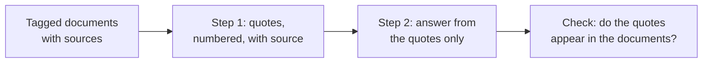

# Lección 14. Trabajar con documentos largos

**Vínculo con la misión:** Una vez que un prompt largo está bien dispuesto, el modelo aún tiene que encontrar el pasaje correcto y decir de dónde salió, así que esta lección etiqueta cada documento y hace que el modelo cite antes de responder.
**Fuente principal:** [Documentación: "Prompting best practices", Claude Platform Docs](https://platform.claude.com/docs/en/build-with-claude/prompt-engineering/claude-prompting-best-practices)
**Requisitos previos:** [Lección 13](0013-position-in-long-context.md), [Delimitador](../GLOSSARY.md), [Chain-of-thought](../GLOSSARY.md)

## Calentamiento

1. ▢ La lección 13 dio una disposición para una entrada larga. Enúnciala en una frase.

<details markdown="1"><summary>Comprobación</summary>

Los documentos primero, envueltos en delimitadores, y después las instrucciones y la pregunta, con la pregunta repetida opcionalmente antes de los documentos cuando un dato es crítico. El medio de un contexto largo es el lugar más débil para la información.

</details>

2. ▢ La lección 8 describió la chain-of-thought como razonamiento escrito antes de la respuesta. ¿En qué se parece un paso de citar primero?

<details markdown="1"><summary>Comprobación</summary>

Ambos ponen texto intermedio delante de la respuesta final para que la respuesta se escriba con ese texto ya en el contexto. Aquí el texto intermedio son pasajes extraídos y no una línea de razonamiento.

</details>

3. ▢ La lección 12 decía que un campo escrito antes de la respuesta puede informarla. ¿Cuál de los dos campos, `quotes` o `answer`, va primero en un esquema de citar primero?

<details markdown="1"><summary>Comprobación</summary>

`quotes`. El modelo escribe primero los pasajes, así que la respuesta queda condicionada por ellos, que es el mismo argumento de orden que poner `reasoning` antes de `answer`.

</details>

## Qué debes saber

### Etiqueta cada documento con sus metadatos

Con más de un documento, envuelve cada uno en su propia etiqueta y pon los metadatos, como la fuente, junto al contenido. La guía de Anthropic da esta forma: un envoltorio `documents`, una etiqueta `document` por documento con un atributo `index`, una etiqueta `source` y una etiqueta `document_content`. Es una estructura documentada por un proveedor, y el principio es la lección de delimitadores aplicada a muchos documentos: las etiquetas le dicen al modelo dónde termina un documento y de cuál salió un pasaje.

```text
<documents>
  <document index="1">
    <source>refund-policy-2024.pdf</source>
    <document_content>
      ...text of the policy...
    </document_content>
  </document>
  <document index="2">
    <source>support-faq.md</source>
    <document_content>
      ...text of the FAQ...
    </document_content>
  </document>
</documents>
```

Los documentos van primero, como estableció la lección 13, y las instrucciones y la pregunta vienen después.

### Cita primero, responde después

La guía de Anthropic para tareas con documentos largos es pedirle al modelo que cite primero las partes relevantes de los documentos, antes de realizar la tarea. Según la documentación, esto ayuda al modelo a centrarse en el contenido relevante e ignorar el resto del documento.

```text
Find the quotes from the documents above that are relevant to the question,
and put them in <quotes> tags. Number each quote and name its source document.
If nothing is relevant, write "no relevant quotes" and stop.

Then answer the question using only those quotes, in <answer> tags.

Question: Can a customer get a refund after 30 days?
```

También te da una comprobación que la respuesta sola no ofrece. Una cita se puede buscar en el texto fuente con un programa o a simple vista, así que una cita inventada es fácil de detectar. Un resumen fluido que se ha alejado de la fuente no lo es.



### Dónde termina esto

Esta es una técnica de prompting para un prompt que ensamblas tú mismo, a partir de documentos que tienes. Cuando los documentos vienen de un paso de recuperación, las preguntas adicionales sobre cuántos pasajes pasar y qué fallos sobreviven a una recuperación correcta pertenecen al track de recuperación: consulta [Generación a partir de la recuperación](../../rag/reference/generation-from-retrieval.md).

El paso de citar cuesta tokens de salida, y la guía es una recomendación, no una garantía medida para toda tarea. Si importa, compara las respuestas con y sin él en tus propios casos.

## Práctica

1. ▢ Predice y luego comprueba. Un prompt pega tres informes sin etiquetas y pregunta "¿Qué concluyó el segundo informe?". ¿Cuál es el problema probable y qué de esta lección lo soluciona?

<details markdown="1"><summary>Pista</summary>

Pregúntate cómo sabría el modelo dónde empieza el segundo informe.

</details>

<details markdown="1"><summary>Comprobación</summary>

Sin delimitadores los informes se mezclan, así que "el segundo informe" no tiene un límite claro y el modelo puede fundirlos. Envuelve cada informe en su propia etiqueta document con un índice y una fuente, de modo que el límite y la identidad sean explícitos.

</details>

2. ▢ Escribe la instrucción que hace que un modelo cite primero y responda después, para una pregunta sobre un contrato pegado. Incluye qué hacer cuando no se encuentra nada relevante.

<details markdown="1"><summary>Comprobación</summary>

Necesita: extraer primero las citas relevantes, en sus propias etiquetas; nombrar la fuente de cada una; responder usando solo esas citas en un segundo bloque; y decir "no relevant quotes" y detenerse cuando no haya ninguna. La instrucción para cuando no hay coincidencias es la parte que más a menudo se omite, y sin ella se empuja al modelo a producir algo.

</details>

3. ▢ ¿Cuál es la razón principal para pedir citas antes de la respuesta en un documento largo?

    - a) Hace que la respuesta final del modelo sea más corta de lo que sería.
    - b) Centra al modelo en los pasajes relevantes y ofrece una comprobación.
    - c) Permite al modelo omitir la lectura de los documentos que vienen después.
    - d) Garantiza que la respuesta del modelo sea correcta y completa.

<details markdown="1"><summary>Comprobación</summary>

b. La documentación dice que citar primero ayuda al modelo a centrarse en el contenido relevante, y una cita se puede comprobar contra la fuente. La opción a no se afirma y la respuesta suele ser más larga. La opción c es incorrecta porque el modelo sigue condicionándose en todo. La opción d exagera, porque el modelo puede citar el pasaje equivocado.

</details>

4. ▢ Una respuesta cita algo que no encuentras en ninguno de los documentos. ¿Qué te dice eso y qué haces?

<details markdown="1"><summary>Comprobación</summary>

La cita fue inventada o alterada, así que la respuesta construida sobre ella no está basada en los documentos. Rechaza la respuesta y reintenta, diciéndole al modelo que la cita no se pudo encontrar, como en el bucle de reparación de la lección 11. Un programa puede hacer la comprobación buscando cada cita en los documentos como cadena de texto.

</details>

## Prácticas en el mundo real

- [ ] Hoy: pega dos o tres documentos cortos en una ventana de chat, envuelve cada uno en una etiqueta document con una fuente y haz una pregunta que solo responda uno de ellos. Pide primero citas numeradas con fuentes y luego la respuesta.
- [ ] Mañana: ejecuta la misma pregunta sin el paso de citar y compara. Comprueba cada cita de la primera respuesta contra el texto y anota si alguna no estaba.
- [ ] Elige un documento largo sobre el que tengas que responder preguntas en el trabajo y escribe su disposición etiquetada y la instrucción de citar primero como un prompt reutilizable.

## Para profundizar

- [Documentación: "Prompting best practices", Claude Platform Docs](https://platform.claude.com/docs/en/build-with-claude/prompt-engineering/claude-prompting-best-practices)
- [Generación a partir de la recuperación](../../rag/reference/generation-from-retrieval.md)
- [Salida estructurada y contexto largo](../reference/structured-output-and-long-context.md)
- [Recursos](../RESOURCES.md)

---

¿No termina de quedar claro? Vuelve a leer la fuente principal del inicio, porque esta lección la comprime y en la compresión es donde se pierde la comprensión. Consulta el [glosario](../GLOSSARY.md) para cualquier término que te haya parecido resbaladizo.

Si lo poco claro es la lección y no el material, eso es un defecto: [abre un issue](https://github.com/TokenCemetery/teach/issues).
