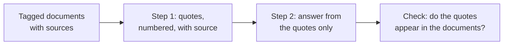

# Leçon 14. Travailler avec de longs documents

**Lien avec la mission :** Une fois un long prompt disposé de façon sensée, le modèle doit encore trouver le bon passage et dire d'où il vient. Cette leçon balise donc chaque document et fait citer le modèle avant qu'il réponde.
**Source primaire :** [Doc : "Prompting best practices", Claude Platform Docs](https://platform.claude.com/docs/en/build-with-claude/prompt-engineering/claude-prompting-best-practices)
**Prérequis :** [Leçon 13](0013-position-in-long-context.md), [Délimiteur](../GLOSSARY.md), [Chain-of-thought](../GLOSSARY.md)

## Échauffement

1. ▢ La leçon 13 donnait une disposition pour une longue entrée. Énoncez-la en une phrase.

<details markdown="1"><summary>Vérifier</summary>

Les documents d'abord, enveloppés dans des délimiteurs, puis les instructions et la question après eux, avec la question éventuellement répétée avant les documents quand un fait est critique. Le milieu d'un long contexte est l'endroit le plus faible pour l'information.

</details>

2. ▢ La leçon 8 décrivait le chain-of-thought comme du raisonnement écrit avant la réponse. En quoi une étape de citation d'abord est-elle semblable ?

<details markdown="1"><summary>Vérifier</summary>

Les deux placent du texte intermédiaire devant la réponse finale, de sorte que la réponse est écrite avec ce texte déjà dans le contexte. Ici, le texte intermédiaire est constitué de passages extraits et non d'une ligne de raisonnement.

</details>

3. ▢ La leçon 12 disait qu'un champ écrit avant la réponse peut l'informer. Lequel des deux champs, `quotes` ou `answer`, vient en premier dans un schéma de citation d'abord ?

<details markdown="1"><summary>Vérifier</summary>

`quotes`. Le modèle écrit d'abord les passages, donc la réponse est conditionnée par eux, ce qui est le même argument d'ordre que de mettre `reasoning` avant `answer`.

</details>

## À savoir

### Baliser chaque document avec ses métadonnées

Dès qu'il y a plus d'un document, enveloppez chacun dans sa propre balise et placez les métadonnées, comme la source, à côté du contenu. Les recommandations d'Anthropic donnent cette forme : une enveloppe `documents`, une balise `document` par document avec un attribut `index`, une balise `source` et une balise `document_content`. C'est une structure documentée par un éditeur, et le principe est la leçon sur les délimiteurs appliquée à de nombreux documents : les balises disent au modèle où un document se termine et de quel document provient un passage.

```text
<documents>
  <document index="1">
    <source>refund-policy-2024.pdf</source>
    <document_content>
      ...text of the policy...
    </document_content>
  </document>
  <document index="2">
    <source>support-faq.md</source>
    <document_content>
      ...text of the FAQ...
    </document_content>
  </document>
</documents>
```

Les documents viennent en premier, comme l'a établi la leçon 13, et les instructions et la question viennent après eux.

### Citer d'abord, répondre ensuite

La recommandation d'Anthropic pour les tâches sur de longs documents est de demander au modèle de citer d'abord les parties pertinentes des documents, avant d'exécuter la tâche. Selon la documentation, cela aide le modèle à se concentrer sur le contenu pertinent et à ignorer le reste du document.

```text
Find the quotes from the documents above that are relevant to the question,
and put them in <quotes> tags. Number each quote and name its source document.
If nothing is relevant, write "no relevant quotes" and stop.

Then answer the question using only those quotes, in <answer> tags.

Question: Can a customer get a refund after 30 days?
```

Cela vous donne aussi une vérification que la réponse seule ne permet pas. Une citation peut être recherchée dans le texte source par un programme ou à l'œil, donc une citation inventée est facile à repérer. Un résumé fluide qui s'est écarté de la source, non.



### Où cela s'arrête

C'est une technique de prompting pour un prompt que vous assemblez vous-même, à partir de documents que vous détenez. Quand les documents proviennent d'une étape de récupération, les questions supplémentaires du nombre de passages à transmettre et des échecs qui survivent à une récupération correcte relèvent du parcours sur la récupération : voir [Génération à partir de la récupération](../../rag/reference/generation-from-retrieval.md).

L'étape de citation coûte des tokens de sortie, et la recommandation est un conseil, pas une garantie mesurée pour toutes les tâches. Si cela compte, comparez les réponses avec et sans elle sur vos propres cas.

## Pratique

1. ▢ Prédisez, puis vérifiez. Un prompt colle trois rapports sans balises et demande « What did the second report conclude? ». Quel est le problème probable, et qu'est-ce qui, dans cette leçon, le corrige ?

<details markdown="1"><summary>Indice</summary>

Demandez-vous comment le modèle saurait où commence le deuxième rapport.

</details>

<details markdown="1"><summary>Vérifier</summary>

Sans délimiteurs, les rapports se confondent, donc « le deuxième rapport » n'a pas de frontière claire et le modèle peut les mélanger. Enveloppez chaque rapport dans sa propre balise document avec un index et une source, pour que la frontière et l'identité soient explicites.

</details>

2. ▢ Écrivez l'instruction qui fait citer d'abord puis répondre un modèle, pour une question sur un contrat collé. Incluez ce qu'il faut faire quand rien de pertinent n'est trouvé.

<details markdown="1"><summary>Vérifier</summary>

Elle doit contenir : extraire d'abord les citations pertinentes, dans leurs propres balises ; nommer la source de chacune ; répondre en utilisant uniquement ces citations dans un second bloc ; et dire « no relevant quotes » puis s'arrêter quand il n'y en a pas. L'instruction pour l'absence de correspondance est la partie le plus souvent omise, et sans elle le modèle est incité à produire quelque chose.

</details>

3. ▢ Quelle est la principale raison de demander des citations avant la réponse sur un long document ?

    - a) Cela rend la réponse finale du modèle plus courte qu'elle ne le serait.
    - b) Cela concentre le modèle sur les passages pertinents et donne une vérification.
    - c) Cela permet au modèle de ne pas lire les documents qui viennent plus tard.
    - d) Cela garantit que la réponse du modèle est correcte et complète.

<details markdown="1"><summary>Vérifier</summary>

b. La documentation dit que citer d'abord aide le modèle à se concentrer sur le contenu pertinent, et une citation peut être vérifiée par rapport à la source. L'option a n'est pas affirmée et la réponse est généralement plus longue. L'option c est fausse puisque le modèle se conditionne quand même sur tout. L'option d exagère, car le modèle peut citer le mauvais passage.

</details>

4. ▢ Une réponse cite une citation que vous ne trouvez dans aucun des documents. Qu'est-ce que cela vous apprend et que faites-vous ?

<details markdown="1"><summary>Vérifier</summary>

La citation a été inventée ou altérée, donc la réponse qui s'appuie dessus n'est pas ancrée dans les documents. Rejetez la réponse et réessayez en disant au modèle que la citation est introuvable, comme dans la boucle de réparation de la leçon 11. Un programme peut faire la vérification en cherchant chaque citation dans les documents comme chaîne de caractères.

</details>

## Exercices en situation réelle

- [ ] Aujourd'hui : collez deux ou trois courts documents dans une fenêtre de chat, enveloppez chacun dans une balise document avec une source, et posez une question à laquelle un seul répond. Demandez d'abord des citations numérotées avec leurs sources, puis la réponse.
- [ ] Demain : exécutez la même question sans l'étape de citation et comparez. Vérifiez chaque citation de la première réponse par rapport au texte, et notez si l'une d'elles n'y figurait pas.
- [ ] Choisissez un long document sur lequel vous devez répondre à des questions au travail et écrivez sa disposition balisée et l'instruction de citation d'abord sous forme de prompt réutilisable.

## Pour aller plus loin

- [Doc : "Prompting best practices", Claude Platform Docs](https://platform.claude.com/docs/en/build-with-claude/prompt-engineering/claude-prompting-best-practices)
- [Génération à partir de la récupération](../../rag/reference/generation-from-retrieval.md)
- [Sortie structurée et long contexte](../reference/structured-output-and-long-context.md)
- [Ressources](../RESOURCES.md)

---

Ça ne passe pas ? Relisez la source primaire en haut de page, car cette leçon la condense et c'est dans la condensation que la compréhension s'échappe. Consultez le [glossaire](../GLOSSARY.md) pour tout terme qui vous a paru glissant.

Si c'est la leçon elle-même qui n'est pas claire plutôt que la matière, c'est un défaut : [ouvrez une issue](https://github.com/TokenCemetery/teach/issues).
