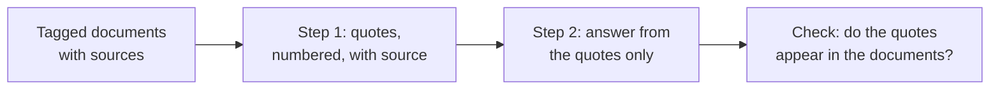

# पाठ 14. लंबे Documents के साथ काम

**मिशन से संबंध:** लंबे prompt का layout समझदारी से बन जाने के बाद भी model को सही अंश खोजना होता है और यह बताना होता है कि वह कहाँ से आया। इसलिए यह पाठ हर document को tag करता है और model से उत्तर देने से पहले quote करवाता है।
**मुख्य स्रोत:** [Docs: "Prompting best practices", Claude Platform Docs](https://platform.claude.com/docs/en/build-with-claude/prompt-engineering/claude-prompting-best-practices)
**पूर्व-आवश्यकताएँ:** [पाठ 13](0013-position-in-long-context.md), [Delimiter](../GLOSSARY.md), [Chain-of-thought](../GLOSSARY.md)

## वार्म-अप

1. ▢ पाठ 13 ने लंबे input का एक layout दिया था। उसे एक वाक्य में बताएँ।

<details markdown="1"><summary>जाँचें</summary>

Documents पहले, delimiters में लपेटे हुए, फिर उनके बाद instructions और सवाल, और जब कोई एक तथ्य निर्णायक हो तो सवाल को documents से पहले भी दोहराया जा सकता है। लंबे context का बीच जानकारी के लिए सबसे कमज़ोर जगह है।

</details>

2. ▢ पाठ 8 ने chain-of-thought को उत्तर से पहले लिखी reasoning बताया था। Quote-first चरण कैसे मिलता-जुलता है?

<details markdown="1"><summary>जाँचें</summary>

दोनों अंतिम उत्तर के आगे बीच का text रखते हैं ताकि उत्तर उस text के context में पहले से मौजूद रहते हुए लिखा जाए। यहाँ बीच का text निकाले हुए अंश हैं, reasoning की पंक्ति नहीं।

</details>

3. ▢ पाठ 12 ने कहा था कि उत्तर से पहले लिखा गया field उसे जानकारी दे सकता है। Quote-first schema में दो fields, `quotes` और `answer`, में से कौन पहले आता है?

<details markdown="1"><summary>जाँचें</summary>

`quotes`। Model पहले अंश लिखता है, इसलिए उत्तर उन पर निर्भर होता है, जो वही क्रम का तर्क है जो `reasoning` को `answer` से पहले रखने का है।

</details>

## यह जानें

### हर document को उसके metadata के साथ tag करें

एक से ज़्यादा documents हों तो हर एक को उसके अपने tag में लपेटें और metadata, जैसे source, content के बगल में रखें। Anthropic की मार्गदर्शिका यह आकार देती है: एक `documents` wrapper, हर document के लिए `index` attribute वाला एक `document` tag, एक `source` tag और एक `document_content` tag। यह एक vendor का दस्तावेज़ी structure है, और सिद्धांत वही है जो delimiter वाले पाठ में था, कई documents पर लागू: tags model को बताते हैं कि एक document कहाँ ख़त्म होता है और कोई अंश किससे आया।

```text
<documents>
  <document index="1">
    <source>refund-policy-2024.pdf</source>
    <document_content>
      ...text of the policy...
    </document_content>
  </document>
  <document index="2">
    <source>support-faq.md</source>
    <document_content>
      ...text of the FAQ...
    </document_content>
  </document>
</documents>
```

Documents पहले जाते हैं, जैसा पाठ 13 ने तय किया, और instructions और सवाल उनके बाद आते हैं।

### पहले quote करें, फिर उत्तर दें

लंबे-document tasks के लिए Anthropic की मार्गदर्शिका है कि model से कहें कि task करने से पहले documents के प्रासंगिक हिस्सों को quote करे। दस्तावेज़ों के अनुसार, इससे model को प्रासंगिक content पर ध्यान देने और document के बाक़ी हिस्से को नज़रअंदाज़ करने में मदद मिलती है।

```text
Find the quotes from the documents above that are relevant to the question,
and put them in <quotes> tags. Number each quote and name its source document.
If nothing is relevant, write "no relevant quotes" and stop.

Then answer the question using only those quotes, in <answer> tags.

Question: Can a customer get a refund after 30 days?
```

यह आपको एक ऐसी जाँच भी देता है जो अकेला उत्तर नहीं दे सकता। किसी quote को source text में program या आँख से खोजा जा सकता है, इसलिए गढ़ा हुआ quote पकड़ना आसान है। स्रोत से भटका हुआ धाराप्रवाह सार नहीं।



### यह कहाँ रुकता है

यह उस prompt के लिए prompting technique है जिसे आप ख़ुद जोड़ते हैं, उन documents से जो आपके पास हैं। जब documents किसी retrieval चरण से आते हैं, तो कितने passages भेजने हैं और सही retrieval के बाद कौन-सी विफलताएँ बचती हैं जैसे अतिरिक्त सवाल retrieval track के हैं: [Retrieval से Generation](../../rag/reference/generation-from-retrieval.md) देखें।

Quote चरण output tokens की क़ीमत लेता है, और मार्गदर्शिका एक सिफ़ारिश है, हर task के लिए मापी हुई गारंटी नहीं। अगर यह मायने रखता है, तो अपने cases पर इसके साथ और इसके बिना उत्तरों की तुलना करें।

## अभ्यास

1. ▢ पहले अनुमान लगाएँ, फिर जाँचें। एक prompt तीन रिपोर्टें बिना tags के paste करता है और पूछता है "What did the second report conclude?". संभावित समस्या क्या है, और इस पाठ का क्या उसे ठीक करता है?

<details markdown="1"><summary>संकेत</summary>

पूछें कि model को कैसे पता चलेगा कि दूसरी रिपोर्ट कहाँ शुरू होती है।

</details>

<details markdown="1"><summary>जाँचें</summary>

Delimiters के बिना रिपोर्टें आपस में घुल जाती हैं, इसलिए "दूसरी रिपोर्ट" की कोई साफ़ सीमा नहीं बचती और model उन्हें मिला सकता है। हर रिपोर्ट को index और source के साथ उसके अपने document tag में लपेटें, ताकि सीमा और पहचान स्पष्ट हों।

</details>

2. ▢ वह instruction लिखें जो model से पहले quote करवाता है और फिर उत्तर दिलवाता है, paste किए हुए अनुबंध के बारे में सवाल के लिए। इसमें शामिल करें कि कुछ प्रासंगिक न मिले तो क्या करना है।

<details markdown="1"><summary>जाँचें</summary>

इसमें चाहिए: प्रासंगिक quotes पहले, उनके अपने tags में निकालें; हर एक का source बताएँ; दूसरे block में सिर्फ़ उन्हीं quotes का इस्तेमाल करके उत्तर दें; और कुछ न मिलने पर "no relevant quotes" लिखकर रुक जाएँ। कुछ न मिलने वाला instruction सबसे अक्सर छूटता है, और उसके बिना model को कुछ न कुछ पैदा करने की ओर धकेला जाता है।

</details>

3. ▢ लंबे document पर उत्तर से पहले quotes माँगने की मुख्य वजह क्या है?

    - a) इससे model का अंतिम reply उससे छोटा हो जाता है जितना वह होता।
    - b) यह model को प्रासंगिक अंशों पर केंद्रित करता है और एक जाँच देता है।
    - c) इससे model बाद में आने वाले documents को पढ़ना छोड़ सकता है।
    - d) यह गारंटी देता है कि model का उत्तर सही और पूरा है।

<details markdown="1"><summary>जाँचें</summary>

b। दस्तावेज़ कहते हैं कि पहले quote करना model को प्रासंगिक content पर केंद्रित करने में मदद करता है, और quote को स्रोत से जाँचा जा सकता है। विकल्प a का दावा नहीं किया गया और reply आमतौर पर लंबा होता है। विकल्प c ग़लत है क्योंकि model अब भी सब कुछ पर निर्भर रहता है। विकल्प d बढ़ा-चढ़ाकर कहता है, क्योंकि model ग़लत अंश भी quote कर सकता है।

</details>

4. ▢ एक reply ऐसा quote देता है जो आपको किसी भी document में नहीं मिलता। यह आपको क्या बताता है और आप क्या करते हैं?

<details markdown="1"><summary>जाँचें</summary>

Quote गढ़ा गया या बदला गया था, इसलिए उस पर बना उत्तर documents में आधारित नहीं है। Reply को ठुकराएँ और model को बताकर दोबारा कोशिश करें कि quote नहीं मिला, जैसे पाठ 11 के सुधार चक्र में। Program यह जाँच हर quote को documents में string के रूप में खोजकर कर सकता है।

</details>

## असली दुनिया का अभ्यास

- [ ] आज: दो या तीन छोटे documents को chat window में paste करें, हर एक को source के साथ document tag में लपेटें, और ऐसा सवाल पूछें जिसका उत्तर सिर्फ़ एक में है। पहले sources के साथ क्रमांकित quotes माँगें, फिर उत्तर।
- [ ] कल: वही सवाल quote चरण के बिना चलाएँ और तुलना करें। पहले reply के हर quote को text से जाँचें, और नोट करें कि कोई वहाँ था ही नहीं।
- [ ] कोई लंबा document चुनें जिसके बारे में आपको काम पर सवालों के जवाब देने पड़ते हैं और उसका tagged layout और quote-first instruction दोबारा इस्तेमाल होने लायक prompt के रूप में लिखें।

## आगे बढ़ने के लिए

- [Docs: "Prompting best practices", Claude Platform Docs](https://platform.claude.com/docs/en/build-with-claude/prompt-engineering/claude-prompting-best-practices)
- [Retrieval से Generation](../../rag/reference/generation-from-retrieval.md)
- [Structured Output और लंबा Context](../reference/structured-output-and-long-context.md)
- [संसाधन](../RESOURCES.md)

---

बात नहीं बन रही? ऊपर दिए primary source को दोबारा पढ़ें, क्योंकि यह पाठ उसे संक्षिप्त करता है और समझ संक्षेप में ही रिसती है। जो शब्द फिसलन भरा लगे, उसके लिए [शब्दावली](../GLOSSARY.md) देखें।

अगर दिक़्क़त सामग्री की नहीं बल्कि पाठ की ही है, तो वह एक खोट है: [issue खोलें](https://github.com/TokenCemetery/teach/issues)।
