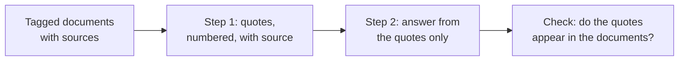

# Lesson 14. Working with Long Documents

**Mission link:** Once a long prompt is laid out sensibly, the model still has to find the right passage and say where it came from, so this lesson tags each document and makes the model quote before it answers.
**Primary source:** [Docs: "Prompting best practices", Claude Platform Docs](https://platform.claude.com/docs/en/build-with-claude/prompt-engineering/claude-prompting-best-practices)
**Prerequisites:** [Lesson 13](0013-position-in-long-context.md), [Delimiter](../GLOSSARY.md), [Chain-of-thought](../GLOSSARY.md)

## Warm-up

1. ▢ Lesson 13 gave a layout for a long input. State it in one sentence.

<details markdown="1"><summary>Check</summary>

Documents first, wrapped in delimiters, then the instructions and the question after them, with the question optionally repeated before the documents when one fact is critical. The middle of a long context is the weakest place for information.

</details>

2. ▢ Lesson 8 described chain-of-thought as reasoning written before the answer. How is a quote-first step similar?

<details markdown="1"><summary>Check</summary>

Both put intermediate text in front of the final answer so that the answer is written with that text already in the context. Here the intermediate text is extracted passages and not a line of reasoning.

</details>

3. ▢ Lesson 12 said a field written before the answer can inform it. Which of two fields, `quotes` or `answer`, comes first in a quote-first schema?

<details markdown="1"><summary>Check</summary>

`quotes`. The model writes the passages first, so the answer is conditioned on them, which is the same ordering argument as putting `reasoning` before `answer`.

</details>

## Know this

### Tag each document with its metadata

With more than one document, wrap each in its own tag and put the metadata, such as the source, next to the content. Anthropic's guidance gives this shape: a `documents` wrapper, one `document` tag per document with an `index` attribute, a `source` tag and a `document_content` tag. This is a vendor's documented structure, and the principle is the delimiter lesson applied to many documents: the tags tell the model where one document ends and which one a passage came from.

```text
<documents>
  <document index="1">
    <source>refund-policy-2024.pdf</source>
    <document_content>
      ...text of the policy...
    </document_content>
  </document>
  <document index="2">
    <source>support-faq.md</source>
    <document_content>
      ...text of the FAQ...
    </document_content>
  </document>
</documents>
```

The documents go first, as lesson 13 set out, and the instructions and question come after them.

### Quote first, then answer

Anthropic's guidance for long-document tasks is to ask the model to quote the relevant parts of the documents first, before carrying out the task. Per the docs, this helps the model focus on the relevant content and ignore the rest of the document.

```text
Find the quotes from the documents above that are relevant to the question,
and put them in <quotes> tags. Number each quote and name its source document.
If nothing is relevant, write "no relevant quotes" and stop.

Then answer the question using only those quotes, in <answer> tags.

Question: Can a customer get a refund after 30 days?
```

It also gives you a check the answer alone cannot. A quote can be searched for in the source text by a program or by eye, so a made-up quote is easy to catch. A fluent summary that has drifted from the source is not.



### Where this stops

This is a prompting technique for a prompt you assemble yourself, from documents you hold. When the documents come from a retrieval step, the extra questions of how many passages to pass and which failures survive correct retrieval belong to the retrieval track: see [Generation from Retrieval](../../rag/reference/generation-from-retrieval.md).

The quote step costs output tokens, and the guidance is a recommendation, not a measured guarantee for every task. If it matters, compare answers with and without it on your own cases.

## Practice

1. ▢ Predict, then check. A prompt pastes three reports with no tags and asks "What did the second report conclude?". What is the likely problem, and what in this lesson fixes it?

<details markdown="1"><summary>Hint</summary>

Ask how the model would know where the second report starts.

</details>

<details markdown="1"><summary>Check</summary>

Without delimiters the reports run together, so "the second report" has no clear boundary and the model may blend them. Wrap each report in its own document tag with an index and a source, so the boundary and the identity are explicit.

</details>

2. ▢ Write the instruction that makes a model quote first and then answer, for a question about a pasted contract. Include what to do when nothing relevant is found.

<details markdown="1"><summary>Check</summary>

It needs: extract the relevant quotes first, in their own tags; name the source of each; answer using only those quotes in a second block; and say "no relevant quotes" and stop when there are none. The no-match instruction is the part most often left out, and without it the model is nudged to produce something.

</details>

3. ▢ What is the main reason to ask for quotes before the answer on a long document?

    - a) It makes the model's final reply shorter than it would be.
    - b) It focuses the model on relevant passages and gives a check.
    - c) It lets the model skip reading the documents that come later.
    - d) It guarantees that the model's answer is correct and complete.

<details markdown="1"><summary>Check</summary>

b. The docs say quoting first helps the model focus on relevant content, and a quote can be checked against the source. Option a is not claimed and the reply is usually longer. Option c is wrong since the model still conditions on everything. Option d overstates, because the model can quote the wrong passage.

</details>

4. ▢ A reply cites a quote that you cannot find in any of the documents. What does that tell you and what do you do?

<details markdown="1"><summary>Check</summary>

The quote was invented or altered, so the answer built on it is not grounded in the documents. Reject the reply and retry, telling the model the quote could not be found, as in lesson 11's repair loop. A program can do the check by searching each quote in the documents as a string.

</details>

## Real-world reps

- [ ] Today: paste two or three short documents into a chat window, wrap each in a document tag with a source, and ask a question that only one of them answers. Ask for numbered quotes with sources first, then the answer.
- [ ] Tomorrow: run the same question without the quote step and compare. Check each quote in the first reply against the text, and note whether any was not there.
- [ ] Pick a long document you have to answer questions about at work and write its tagged layout and the quote-first instruction as a reusable prompt.

## Going further

- [Docs: "Prompting best practices", Claude Platform Docs](https://platform.claude.com/docs/en/build-with-claude/prompt-engineering/claude-prompting-best-practices)
- [Generation from Retrieval](../../rag/reference/generation-from-retrieval.md)
- [Structured Output and Long Context](../reference/structured-output-and-long-context.md)
- [Resources](../RESOURCES.md)

---

Not landing? Reread the primary source at the top, since this lesson compresses it and compression is where understanding leaks. Check the [glossary](../GLOSSARY.md) for any term that felt slippery.

If the lesson itself is unclear rather than the material, that is a defect: [open an issue](https://github.com/TokenCemetery/teach/issues).
