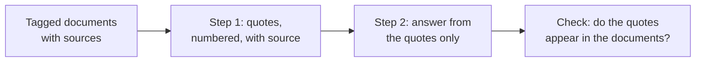

# Lição 14. Trabalhando com documentos longos

**Ligação com a missão:** Depois que um prompt longo está bem organizado, o modelo ainda precisa encontrar o trecho certo e dizer de onde ele veio, então esta lição marca cada documento com tags e faz o modelo citar antes de responder.
**Fonte principal:** [Docs: "Prompting best practices", Claude Platform Docs](https://platform.claude.com/docs/en/build-with-claude/prompt-engineering/claude-prompting-best-practices)
**Pré-requisitos:** [Lição 13](0013-position-in-long-context.md), [Delimitador](../GLOSSARY.md), [Chain-of-thought](../GLOSSARY.md)

## Aquecimento

1. ▢ A lição 13 deu um layout para uma entrada longa. Enuncie-o em uma frase.

<details markdown="1"><summary>Verificação</summary>

Documentos primeiro, envolvidos em delimitadores, depois as instruções e a pergunta, com a pergunta opcionalmente repetida antes dos documentos quando um fato é crítico. O meio de um contexto longo é o lugar mais fraco para a informação.

</details>

2. ▢ A lição 8 descreveu chain-of-thought como um raciocínio escrito antes da resposta. Em que um passo de citar primeiro é parecido?

<details markdown="1"><summary>Verificação</summary>

Ambos colocam texto intermediário na frente da resposta final, de modo que a resposta é escrita com esse texto já no contexto. Aqui o texto intermediário são trechos extraídos, e não uma linha de raciocínio.

</details>

3. ▢ A lição 12 disse que um campo escrito antes da resposta pode informá-la. Entre os dois campos, `quotes` e `answer`, qual vem primeiro em um schema que cita primeiro?

<details markdown="1"><summary>Verificação</summary>

`quotes`. O modelo escreve os trechos primeiro, então a resposta é condicionada a eles, que é o mesmo argumento de ordem de colocar `reasoning` antes de `answer`.

</details>

## Saiba isto

### Marque cada documento com seus metadados

Com mais de um documento, envolva cada um em sua própria tag e coloque os metadados, como a fonte, junto do conteúdo. A orientação da Anthropic dá este formato: um wrapper `documents`, uma tag `document` por documento com um atributo `index`, uma tag `source` e uma tag `document_content`. Essa é uma estrutura documentada por um fornecedor, e o princípio é a lição sobre delimitadores aplicada a muitos documentos: as tags dizem ao modelo onde um documento termina e de qual veio um trecho.

```text
<documents>
  <document index="1">
    <source>refund-policy-2024.pdf</source>
    <document_content>
      ...text of the policy...
    </document_content>
  </document>
  <document index="2">
    <source>support-faq.md</source>
    <document_content>
      ...text of the FAQ...
    </document_content>
  </document>
</documents>
```

Os documentos vêm primeiro, como a lição 13 estabeleceu, e as instruções e a pergunta vêm depois deles.

### Cite primeiro, depois responda

A orientação da Anthropic para tarefas com documentos longos é pedir ao modelo que cite as partes relevantes dos documentos primeiro, antes de executar a tarefa. Segundo a documentação, isso ajuda o modelo a se concentrar no conteúdo relevante e a ignorar o resto do documento.

```text
Find the quotes from the documents above that are relevant to the question,
and put them in <quotes> tags. Number each quote and name its source document.
If nothing is relevant, write "no relevant quotes" and stop.

Then answer the question using only those quotes, in <answer> tags.

Question: Can a customer get a refund after 30 days?
```

Isso também dá uma verificação que a resposta sozinha não oferece. Uma citação pode ser procurada no texto de origem por um programa ou a olho, então uma citação inventada é fácil de pegar. Um resumo fluente que se afastou da fonte não é.



### Onde isso para

Esta é uma técnica de prompting para um prompt que você mesmo monta, a partir de documentos que você tem em mãos. Quando os documentos vêm de uma etapa de recuperação, as perguntas adicionais de quantos trechos passar e quais falhas sobrevivem a uma recuperação correta pertencem à trilha de recuperação: veja [Geração a partir da recuperação](../../rag/reference/generation-from-retrieval.md).

O passo de citação custa tokens de saída, e a orientação é uma recomendação, não uma garantia medida para toda tarefa. Se isso importa, compare as respostas com e sem ele nos seus próprios casos.

## Prática

1. ▢ Preveja e depois confira. Um prompt cola três relatórios sem tags e pergunta "O que o segundo relatório concluiu?". Qual é o provável problema e o que nesta lição o resolve?

<details markdown="1"><summary>Dica</summary>

Pergunte-se como o modelo saberia onde o segundo relatório começa.

</details>

<details markdown="1"><summary>Verificação</summary>

Sem delimitadores, os relatórios se misturam, então "o segundo relatório" não tem uma fronteira clara e o modelo pode mesclá-los. Envolva cada relatório em sua própria tag document com um índice e uma fonte, para que a fronteira e a identidade fiquem explícitas.

</details>

2. ▢ Escreva a instrução que faz um modelo citar primeiro e depois responder, para uma pergunta sobre um contrato colado. Inclua o que fazer quando nada relevante for encontrado.

<details markdown="1"><summary>Verificação</summary>

Ela precisa de: extrair primeiro as citações relevantes, em suas próprias tags; nomear a fonte de cada uma; responder usando apenas essas citações em um segundo bloco; e dizer "no relevant quotes" e parar quando não houver nenhuma. A instrução para o caso sem resultado é a parte mais esquecida, e sem ela o modelo é empurrado a produzir alguma coisa.

</details>

3. ▢ Qual é o principal motivo para pedir citações antes da resposta em um documento longo?

    - a) Faz a resposta final do modelo ser mais curta do que seria.
    - b) Concentra o modelo nos trechos relevantes e dá uma verificação.
    - c) Permite que o modelo pule a leitura dos documentos que vêm depois.
    - d) Garante que a resposta do modelo seja correta e completa.

<details markdown="1"><summary>Verificação</summary>

b. A documentação diz que citar primeiro ajuda o modelo a se concentrar no conteúdo relevante, e uma citação pode ser conferida com a fonte. A opção a não é afirmada e a resposta costuma ficar mais longa. A opção c está errada, pois o modelo continua condicionado a tudo. A opção d exagera, porque o modelo pode citar o trecho errado.

</details>

4. ▢ Uma resposta cita uma passagem que você não encontra em nenhum dos documentos. O que isso diz e o que você faz?

<details markdown="1"><summary>Verificação</summary>

A citação foi inventada ou alterada, então a resposta construída sobre ela não está fundamentada nos documentos. Rejeite a resposta e tente de novo, dizendo ao modelo que a citação não foi encontrada, como no loop de reparo da lição 11. Um programa pode fazer a verificação procurando cada citação nos documentos como string.

</details>

## Prática no mundo real

- [ ] Hoje: cole dois ou três documentos curtos em uma janela de chat, envolva cada um em uma tag document com uma fonte e faça uma pergunta que só um deles responde. Peça primeiro citações numeradas com fontes, depois a resposta.
- [ ] Amanhã: execute a mesma pergunta sem o passo de citação e compare. Confira cada citação da primeira resposta no texto e anote se alguma não estava lá.
- [ ] Escolha um documento longo sobre o qual você precisa responder perguntas no trabalho e escreva o seu layout com tags e a instrução de citar primeiro como um prompt reutilizável.

## Para ir além

- [Docs: "Prompting best practices", Claude Platform Docs](https://platform.claude.com/docs/en/build-with-claude/prompt-engineering/claude-prompting-best-practices)
- [Geração a partir da recuperação](../../rag/reference/generation-from-retrieval.md)
- [Saída Estruturada e Contexto Longo](../reference/structured-output-and-long-context.md)
- [Recursos](../RESOURCES.md)

---

Não está entrando? Releia a fonte principal no topo, pois esta lição a comprime e é na compressão que a compreensão vaza. Consulte o [glossário](../GLOSSARY.md) para qualquer termo que pareceu escorregadio.

Se o problema é a própria lição, e não o material, isso é um defeito: [abra uma issue](https://github.com/TokenCemetery/teach/issues).
