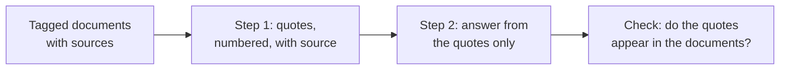

# Урок 14. Работа с длинными документами

**Связь с целью курса:** Даже когда длинный промпт разумно разложен, модели всё равно нужно найти нужный фрагмент и сказать, откуда он взят. Поэтому этот урок помечает каждый документ тегом и заставляет модель цитировать до ответа.
**Первоисточник:** [Документация: «Prompting best practices», Claude Platform Docs](https://platform.claude.com/docs/en/build-with-claude/prompt-engineering/claude-prompting-best-practices)
**Предварительные требования:** [Урок 13](0013-position-in-long-context.md), [Разделитель](../GLOSSARY.md), [Цепочка рассуждений](../GLOSSARY.md)

## Разминка

1. ▢ Урок 13 дал раскладку для длинного входа. Сформулируйте её одним предложением.

<details markdown="1"><summary>Проверка</summary>

Сначала документы, обёрнутые в разделители, затем инструкции и вопрос после них, а вопрос при необходимости повторяется и перед документами, если один факт критичен. Середина длинного контекста является самым слабым местом для информации.

</details>

2. ▢ В уроке 8 цепочка рассуждений описывалась как рассуждение, записанное перед ответом. Чем похож шаг «сначала цитаты»?

<details markdown="1"><summary>Проверка</summary>

В обоих случаях промежуточный текст ставится перед окончательным ответом, так что ответ пишется, когда этот текст уже в контексте. Здесь промежуточный текст состоит из извлечённых фрагментов, а не из хода рассуждения.

</details>

3. ▢ В уроке 12 говорилось, что поле, написанное перед ответом, может повлиять на него. Какое из двух полей, `quotes` или `answer`, идёт первым в схеме «сначала цитаты»?

<details markdown="1"><summary>Проверка</summary>

`quotes`. Модель сначала пишет фрагменты, поэтому ответ опирается на них. Это тот же довод о порядке, что и при постановке `reasoning` перед `answer`.

</details>

## Что нужно знать

### Помечайте каждый документ его метаданными

Если документов больше одного, оберните каждый в собственный тег и поместите метаданные, например источник, рядом с содержимым. Рекомендации Anthropic дают такую форму: обёртка `documents`, по одному тегу `document` на документ с атрибутом `index`, тег `source` и тег `document_content`. Это задокументированная структура одного вендора, а принцип тот же, что в уроке о разделителях, применённый ко многим документам: теги подсказывают модели, где кончается один документ и из какого взят фрагмент.

```text
<documents>
  <document index="1">
    <source>refund-policy-2024.pdf</source>
    <document_content>
      ...text of the policy...
    </document_content>
  </document>
  <document index="2">
    <source>support-faq.md</source>
    <document_content>
      ...text of the FAQ...
    </document_content>
  </document>
</documents>
```

Документы идут первыми, как изложено в уроке 13, а инструкции и вопрос следуют за ними.

### Сначала цитаты, потом ответ

Рекомендация Anthropic для задач с длинными документами: попросить модель сначала процитировать релевантные части документов и только потом выполнять задачу. По документации, это помогает модели сосредоточиться на релевантном содержимом и игнорировать остальную часть документа.

```text
Find the quotes from the documents above that are relevant to the question,
and put them in <quotes> tags. Number each quote and name its source document.
If nothing is relevant, write "no relevant quotes" and stop.

Then answer the question using only those quotes, in <answer> tags.

Question: Can a customer get a refund after 30 days?
```

Это также даёт проверку, которой не даёт один ответ. Цитату можно найти в исходном тексте программой или глазами, поэтому выдуманную цитату легко поймать. Гладкое изложение, ушедшее от источника, поймать нельзя.



### Где это заканчивается

Это приём промптинга для промпта, который вы собираете сами из документов, которые у вас есть. Когда документы приходят с этапа поиска, дополнительные вопросы о том, сколько фрагментов передавать и какие сбои переживают корректный поиск, относятся к треку о поиске: см. [Генерация по результатам поиска](../../rag/reference/generation-from-retrieval.md).

Шаг с цитатами стоит выходных токенов, а рекомендация остаётся рекомендацией, а не измеренной гарантией для любой задачи. Если это важно, сравните ответы с ним и без него на своих случаях.

## Практика

1. ▢ Сначала предскажите, потом проверьте. Промпт вставляет три отчёта без тегов и спрашивает: «К какому выводу пришёл второй отчёт?». В чём вероятная проблема и что в этом уроке её исправляет?

<details markdown="1"><summary>Подсказка</summary>

Спросите себя, как модель узнает, где начинается второй отчёт.

</details>

<details markdown="1"><summary>Проверка</summary>

Без разделителей отчёты сливаются, поэтому у «второго отчёта» нет чёткой границы, и модель может их смешать. Оберните каждый отчёт в собственный тег document с индексом и источником, чтобы граница и принадлежность были явными.

</details>

2. ▢ Напишите инструкцию, которая заставляет модель сначала цитировать, а потом отвечать, для вопроса о вставленном договоре. Включите, что делать, если ничего релевантного не найдено.

<details markdown="1"><summary>Проверка</summary>

Нужно: сначала извлечь релевантные цитаты в отдельных тегах; назвать источник каждой; ответить, используя только эти цитаты, во втором блоке; и написать «no relevant quotes» и остановиться, если их нет. Инструкцию на случай отсутствия совпадений чаще всего упускают, а без неё модель подталкивается к тому, чтобы что-нибудь выдать.

</details>

3. ▢ Какова главная причина просить цитаты перед ответом по длинному документу?

    - a) Это делает окончательный ответ модели короче, чем он был бы.
    - b) Это сосредоточивает модель на релевантных фрагментах и даёт проверку.
    - c) Это позволяет модели не читать документы, идущие позже.
    - d) Это гарантирует, что ответ модели верен и полон.

<details markdown="1"><summary>Проверка</summary>

b. В документации сказано, что цитирование сначала помогает модели сосредоточиться на релевантном содержимом, а цитату можно сверить с источником. Вариант a никто не утверждает, и ответ обычно получается длиннее. Вариант c неверен, поскольку модель всё равно опирается на всё. Вариант d преувеличивает, потому что модель может процитировать не тот фрагмент.

</details>

4. ▢ В ответе приведена цитата, которую вы не можете найти ни в одном из документов. О чём это говорит и что вы делаете?

<details markdown="1"><summary>Проверка</summary>

Цитата выдумана или изменена, поэтому ответ, построенный на ней, не опирается на документы. Отклоните ответ и повторите, сообщив модели, что цитату найти не удалось, как в цикле исправления из урока 11. Программа может выполнить проверку, ища каждую цитату в документах как строку.

</details>

## Практика в реальной работе

- [ ] Сегодня: вставьте два-три коротких документа в окно чата, оберните каждый в тег document с источником и задайте вопрос, на который отвечает только один из них. Сначала попросите пронумерованные цитаты с источниками, затем ответ.
- [ ] Завтра: прогоните тот же вопрос без шага с цитатами и сравните. Проверьте каждую цитату из первого ответа по тексту и отметьте, не оказалось ли такой, которой там нет.
- [ ] Выберите длинный документ, по которому вам на работе приходится отвечать на вопросы, и запишите его размеченную раскладку и инструкцию «сначала цитаты» как переиспользуемый промпт.

## Что почитать дальше

- [Документация: «Prompting best practices», Claude Platform Docs](https://platform.claude.com/docs/en/build-with-claude/prompt-engineering/claude-prompting-best-practices)
- [Генерация по результатам поиска](../../rag/reference/generation-from-retrieval.md)
- [Структурированный вывод и длинный контекст](../reference/structured-output-and-long-context.md)
- [Ресурсы](../RESOURCES.md)

---

Не доходит? Перечитайте первоисточник в начале: этот урок его сжимает, а при сжатии понимание как раз и утекает. Загляните в [глоссарий](../GLOSSARY.md), если какой-то термин оказался скользким.

Если неясен сам урок, а не материал, это дефект: [откройте issue](https://github.com/TokenCemetery/teach/issues).
