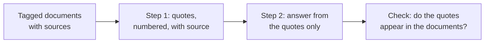

# 第 14 课：处理长文档

**使命关联:** 长提示词布局合理之后，模型仍然要找到正确的段落并说明出处，所以本课给每份文档加标签，并让模型在回答之前先引用原文。
**主要来源:** [文档：“Prompting best practices”，Claude Platform Docs](https://platform.claude.com/docs/en/build-with-claude/prompt-engineering/claude-prompting-best-practices)
**前置知识:** [第 13 课](0013-position-in-long-context.md)、[分隔符](../GLOSSARY.md)、[思维链](../GLOSSARY.md)

## 热身

1. ▢ 第 13 课给出了长输入的布局。用一句话说出来。

<details markdown="1"><summary>检查</summary>

文档放最前面，用分隔符包起来，然后在它们之后放指令和问题；当有一个事实至关重要时，可以在文档之前把问题再重复一遍。长上下文的中间是信息最薄弱的位置。

</details>

2. ▢ 第 8 课把思维链描述为写在答案之前的推理。先引用原文的步骤与它有什么相似之处？

<details markdown="1"><summary>检查</summary>

两者都把中间文本放在最终答案之前，使答案是在这段文本已经进入上下文的情况下写出来的。区别在于，这里的中间文本是摘录出来的段落，而不是一段推理。

</details>

3. ▢ 第 12 课说过，写在答案之前的字段可以影响答案。在先引用原文的 schema 里，`quotes` 和 `answer` 这两个字段哪个排在前面？

<details markdown="1"><summary>检查</summary>

`quotes`。模型先写出段落，答案就以它们为条件，这和把 `reasoning` 放在 `answer` 之前是同一个顺序论证。

</details>

## 要点

### 给每份文档加上元数据标签

文档不止一份时，把每份都包在各自的标签里，并把来源之类的元数据放在内容旁边。Anthropic 的指南给出了这样的结构：一个 `documents` 外层标签，每份文档一个带 `index` 属性的 `document` 标签，再加上一个 `source` 标签和一个 `document_content` 标签。这是一家厂商记录下来的结构，而背后的原则就是分隔符那一课在多份文档上的应用：标签告诉模型一份文档在哪里结束，以及某段文字出自哪一份。

```text
<documents>
  <document index="1">
    <source>refund-policy-2024.pdf</source>
    <document_content>
      ...text of the policy...
    </document_content>
  </document>
  <document index="2">
    <source>support-faq.md</source>
    <document_content>
      ...text of the FAQ...
    </document_content>
  </document>
</documents>
```

文档放在最前面，如第 13 课所述，指令和问题放在它们之后。

### 先引用，再回答

Anthropic 对长文档任务的指导是，让模型在执行任务之前，先引用文档中的相关部分。按文档所说，这有助于模型聚焦相关内容，忽略文档的其余部分。

```text
Find the quotes from the documents above that are relevant to the question,
and put them in <quotes> tags. Number each quote and name its source document.
If nothing is relevant, write "no relevant quotes" and stop.

Then answer the question using only those quotes, in <answer> tags.

Question: Can a customer get a refund after 30 days?
```

它还提供了一种只看答案本身得不到的检查。引文可以由程序或肉眼到源文本中搜索，所以编造的引文很容易被发现。而一段已经偏离了原文的流畅摘要，就不容易发现。



### 它的适用边界

这是一种提示词技巧，适用于你自己拼装的提示词，文档也在你手里。当文档来自检索步骤时，还会多出几个问题：该传入多少段文字，以及检索正确之后哪些失败仍然存在。这些属于检索那个系列：参见[基于检索的生成速查表](../../rag/reference/generation-from-retrieval.md)。

引用这一步会消耗输出 token，而且这条指导是一个建议，不是对每项任务都实测过的保证。如果它很重要，就在你自己的案例上比较有这一步和没有这一步的答案。

## 练习

1. ▢ 先预测，再检查。一个提示词粘贴了三份没有标签的报告，然后问“What did the second report conclude?”。可能出什么问题，本课中的什么办法能解决它？

<details markdown="1"><summary>提示</summary>

想一想，模型怎么知道第二份报告从哪里开始。

</details>

<details markdown="1"><summary>检查</summary>

没有分隔符，几份报告会连成一片，所以“第二份报告”没有清晰的边界，模型可能把它们混在一起。把每份报告包在各自带索引和来源的 document 标签里，边界和身份就都明确了。

</details>

2. ▢ 针对一份粘贴进来的合同提问，写出让模型先引用再回答的指令。要包括找不到相关内容时该怎么做。

<details markdown="1"><summary>检查</summary>

它需要：先把相关引文摘录出来，放在各自的标签里；标明每条引文的来源；只用这些引文，在第二个块里作答；没有相关引文时，写“no relevant quotes”并停止。没有匹配时的指令是最常被漏掉的部分，缺了它，模型会被推着去硬生成点什么。

</details>

3. ▢ 在长文档上要求先给出引文再作答，主要原因是什么？

    - a) 这会让模型的最终回复比原来更短。
    - b) 它让模型聚焦相关段落，并提供了一种检查手段。
    - c) 它让模型可以跳过后面的文档不读。
    - d) 它保证模型的答案正确而完整。

<details markdown="1"><summary>检查</summary>

b。文档说先引用有助于模型聚焦相关内容，而且引文可以对照源文本检查。选项 a 没有这种说法，回复通常反而更长。选项 c 是错的，因为模型仍然以全部内容为条件。选项 d 夸大了，因为模型可能引用了错误的段落。

</details>

4. ▢ 一条回复引用了一段你在任何文档里都找不到的引文。这说明了什么，你该怎么做？

<details markdown="1"><summary>检查</summary>

这段引文是编造或改动过的，所以建立在它之上的答案没有以文档为依据。拒绝这条回复并重试，告诉模型那段引文找不到，就像第 11 课的修复循环那样。程序可以通过把每条引文当作字符串到文档中搜索来完成这项检查。

</details>

## 实战练习

- [ ] 今天：把两三份简短的文档粘贴到聊天窗口里，每份都包在带来源的 document 标签中，然后提一个只有其中一份能回答的问题。先要求给出带编号和来源的引文，再给出答案。
- [ ] 明天：不加引用这一步，用同样的问题再运行一次并比较。对照文本检查第一条回复中的每条引文，记下有没有哪条在文本中并不存在。
- [ ] 选一份你在工作中需要回答相关问题的长文档，把它的带标签布局和先引用的指令写成一个可复用的提示词。

## 延伸阅读

- [文档：“Prompting best practices”，Claude Platform Docs](https://platform.claude.com/docs/en/build-with-claude/prompt-engineering/claude-prompting-best-practices)
- [基于检索的生成速查表](../../rag/reference/generation-from-retrieval.md)
- [结构化输出与长上下文](../reference/structured-output-and-long-context.md)
- [资源](../RESOURCES.md)

---

没学明白？请重读顶部的主要来源，因为本课是对它的压缩，而理解正是在压缩中流失的。如果有哪个术语觉得含糊，可以查看[术语表](../GLOSSARY.md)。

如果问题出在课程本身，而不是学习材料，那就是一个缺陷：[提交 issue](https://github.com/TokenCemetery/teach/issues)。
