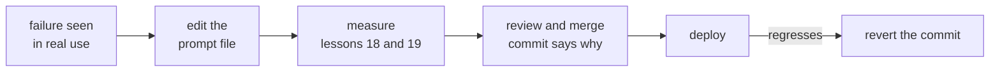

# Lección 16. Versionado de prompts

**Vínculo con la misión:** Un prompt del que dependen otros tiene que poder cambiarse y revertirse, así que vive en el control de versiones junto al modelo exacto con el que se afinó, y un cambio en cualquiera de los dos es un commit revisado.
**Fuente principal:** [Documentación: "Model IDs and versioning", Claude Platform Docs](https://platform.claude.com/docs/en/about-claude/models/model-ids-and-versions)
**Requisitos previos:** [Lección 15](0015-prompt-templates.md), [Plantilla de prompt](../GLOSSARY.md)

## Calentamiento

1. ▢ La lección 5 mostró que un cambio de formato sin significado puede mover la precisión. ¿En qué convierte eso cada edición de un prompt?

<details markdown="1"><summary>Comprobación</summary>

En una afirmación que probar. Como una edición de apariencia inofensiva puede cambiar los resultados, no se puede juzgar leyéndola, y debe tratarse como un cambio de comportamiento.

</details>

2. ▢ La lección 2 puso algunas instrucciones en el system prompt y otras en el turno del usuario. En un archivo de plantilla, ¿cuál de los dos es la parte estable y cuál contiene los huecos por petición?

<details markdown="1"><summary>Comprobación</summary>

El system prompt contiene la tarea, las restricciones y el contexto estables, así que es sobre todo texto fijo. El turno del usuario lleva el contenido por petición, así que la mayoría de los huecos están ahí.

</details>

## Qué debes saber

### Una nota honesta sobre la fuente

Ningún estudio revisado por pares mide el versionado de prompts. Esta lección lo enseña a partir de dos cosas: la documentación de Anthropic sobre cómo se comportan sus IDs de modelo, y la práctica habitual de software (archivos, revisión, historial). Los datos sobre los IDs de modelo son de un solo proveedor. Lo demás valdría para cualquier prompt en cualquier código base.

### Los prompts son archivos bajo control de versiones

Guarda cada plantilla de prompt de la lección 15 en su propio archivo del repositorio, cargado en tiempo de ejecución, en lugar de como una cadena enterrada en una función. Así un cambio de prompt es un diff: revisable línea por línea, atribuible a una persona y reversible con la misma herramienta que cualquier otro código.

```text
prompts/
  summarise_ticket.txt        the template, fixed text and slots
  summarise_ticket.md         what it is for, what it was tuned on
config.py                     MODEL = the exact model ID the prompt was tested on
```

El prompt y el ajuste del modelo se versionan juntos como un único par probado, porque las mismas palabras pueden comportarse de forma distinta en otro modelo. Un cambio en uno sigue siendo su propio commit, de modo que una regresión se pueda rastrear.

### Fija el modelo, no el apodo

La documentación de Anthropic dice que cada ID de modelo identifica una versión fija del modelo, con los pesos constantes durante toda la vida de ese ID. Eso vale para los IDs, no para los alias de conveniencia. Los modelos anteriores a la generación 4.6 llevan una fecha de snapshot en el ID, como `claude-sonnet-4-5-20250929`, y también tienen un alias más corto como `claude-sonnet-4-5` que apunta al snapshot con fecha más reciente. Por tanto, un alias puede empezar a significar un modelo distinto sin ningún cambio en tu repositorio. A partir de la generación 4.6, la documentación dice que el ID sin fecha es en sí mismo el snapshot fijo, no un alias.

Así que la regla es: pon en la configuración el ID exacto, nunca un nombre que pueda moverse. Dos límites de la misma página. La infraestructura de servicio alrededor de un modelo fijo, como el enrutador y la lógica de muestreo, puede cambiar y de vez en cuando altera ligeramente el comportamiento. Y cada ID tiene su propio calendario de retiro, así que una fijación no es permanente: pasar a un modelo nuevo es en sí mismo un cambio de prompt, y pasa por la medición de las lecciones 18 y 19.

### Revisión, registro de cambios y reversión



El mensaje del commit es el registro de cambios, así que escríbelo como tal: qué fallo aborda el cambio y qué casos del conjunto de regresión arregló o movió. Así un revisor juzga la afirmación, no solo la redacción. La reversión es `git revert` sobre el commit, y restaura un par probado porque el archivo del prompt y la fijación del modelo viven en el mismo repositorio. No edites un prompt desplegado directamente en un panel o en una base de datos: eso no deja diff ni forma de revertir.

## Práctica

1. ▢ Un repositorio tiene `MODEL = "claude-sonnet-4-5"` en su configuración. Con la documentación anterior, ¿qué puede cambiar en el sistema sin que nadie edite el repositorio, y cuál es la solución?

<details markdown="1"><summary>Comprobación</summary>

Ese nombre es un alias, que según la documentación apunta al snapshot con fecha más reciente de esa versión menor, así que puede pasar a significar un modelo distinto. La solución es fijar el ID con fecha, `claude-sonnet-4-5-20250929`.

</details>

2. ▢ Un compañero edita un prompt desplegado directamente en una página de administración y la calidad baja al día siguiente. Nombra dos cosas que este flujo de trabajo hizo más difíciles que un archivo de prompt en git.

<details markdown="1"><summary>Comprobación</summary>

No hay diff que muestre qué cambió, y no hubo revisión antes de que saliera en vivo. Revertir implica recordar el texto anterior, mientras que en git es un solo revert. No existe un mensaje de commit que diga por qué se hizo la edición.

</details>

3. ▢ Se publica un nuevo ID de modelo y el equipo quiere mover el modelo fijado pero dejar el prompt sin cambios. ¿Por qué eso no es un cambio seguro sin efecto?

<details markdown="1"><summary>Comprobación</summary>

El modelo es la mitad de lo que produjo el comportamiento, y el mismo prompt puede comportarse de forma distinta en otro modelo. Cambiar la fijación es un cambio de comportamiento, así que se revisa y se mide contra el conjunto de regresión como una edición del texto del prompt.

</details>

4. ▢ ¿Qué commit es el mejor registro de cambios de un prompt?

    - a) Update the summariser prompt and the pinned model in one commit, tests pass
    - b) Reword the summary instruction for clarity, no behaviour change is intended
    - c) Fix refund tickets summarised as complaints, add case 14, all 14 cases pass
    - d) Tweak the summariser instructions after feedback from the support team lead

<details markdown="1"><summary>Comprobación</summary>

**c)** Nombra el fallo y el caso que ahora lo cubre, y un revisor puede comprobarlo. (a) agrupa un cambio de modelo con un cambio de prompt, así que una regresión no se podría atribuir a ninguno de los dos. (b) afirma que no hay cambio de comportamiento, algo que la lección 5 dice que no se puede dar por hecho en una reformulación. (d) no nombra ni el fallo ni un caso que lo cubra, así que un revisor no tiene nada que comprobar.

</details>

## Prácticas en el mundo real

- [ ] Abre la configuración de un proyecto que llame a un LLM y anota si el nombre del modelo es un ID exacto o un alias, usando la documentación del proveedor para decidirlo.
- [ ] Encuentra dónde se guarda un prompt en ese proyecto (código, archivo, base de datos) y anota si un cambio en él deja un diff revisable.
- [ ] Mañana: para un prompt, escribe el mensaje de commit que querrías para su última edición, con el fallo que abordó, y comprueba si puedes completarlo de memoria.

## Para profundizar

- [Documentación: "Model IDs and versioning", Claude Platform Docs](https://platform.claude.com/docs/en/about-claude/models/model-ids-and-versions)
- [Prompts en producción](../reference/prompts-in-production.md)
- [Recursos](../RESOURCES.md)

---

¿No termina de quedar claro? Vuelve a leer la fuente principal del inicio, porque esta lección la comprime y en la compresión es donde se pierde la comprensión. Consulta el [glosario](../GLOSSARY.md) para cualquier término que te haya parecido resbaladizo.

Si lo poco claro es la lección y no el material, eso es un defecto: [abre un issue](https://github.com/TokenCemetery/teach/issues).
