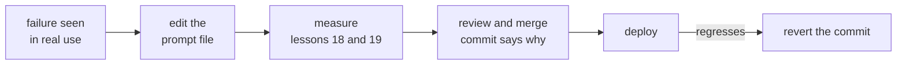

# Leçon 16. Versionner les prompts

**Lien avec la mission :** Un prompt dont d'autres dépendent doit pouvoir être modifié et annulé. Il vit donc sous contrôle de version à côté du modèle exact contre lequel il a été réglé, et toute modification de l'un ou de l'autre est un commit relu.
**Source primaire :** [Doc : "Model IDs and versioning", Claude Platform Docs](https://platform.claude.com/docs/en/about-claude/models/model-ids-and-versions)
**Prérequis :** [Leçon 15](0015-prompt-templates.md), [Gabarit de prompt](../GLOSSARY.md)

## Échauffement

1. ▢ La leçon 5 a montré qu'un changement de formatage sans signification peut faire varier la précision. Que devient alors chaque modification d'un prompt ?

<details markdown="1"><summary>Vérifier</summary>

Une affirmation à tester. Parce qu'une modification d'apparence anodine peut changer les résultats, on ne peut pas la juger en la lisant, et il faut la traiter comme un changement de comportement.

</details>

2. ▢ La leçon 2 plaçait certaines instructions dans le system prompt et d'autres dans le tour de l'utilisateur. Dans un fichier de gabarit, lequel des deux est la partie stable et lequel contient les emplacements propres à chaque requête ?

<details markdown="1"><summary>Vérifier</summary>

Le system prompt contient la tâche, les contraintes et le contexte stables, donc c'est surtout du texte fixe. Le tour de l'utilisateur porte le contenu propre à la requête, donc la plupart des emplacements s'y trouvent.

</details>

## À savoir

### Une note honnête sur la source

Aucune étude évaluée par les pairs ne mesure le versionnement de prompts. Cette leçon l'enseigne à partir de deux choses : la documentation d'Anthropic sur le comportement de ses identifiants de modèle, et la pratique logicielle ordinaire (fichiers, relecture, historique). Les faits sur les identifiants de modèle sont ceux d'un seul éditeur. Le reste vaudrait pour n'importe quel prompt dans n'importe quelle base de code.

### Les prompts sont des fichiers sous contrôle de version

Gardez chaque gabarit de prompt de la leçon 15 dans son propre fichier du dépôt, chargé à l'exécution, plutôt qu'une chaîne enfouie dans une fonction. Une modification de prompt devient alors un diff : relisible ligne à ligne, attribuable à une personne, et annulable avec le même outil que n'importe quel autre code.

```text
prompts/
  summarise_ticket.txt        the template, fixed text and slots
  summarise_ticket.md         what it is for, what it was tuned on
config.py                     MODEL = the exact model ID the prompt was tested on
```

Le prompt et le réglage du modèle sont versionnés ensemble comme une paire testée, car les mêmes mots peuvent se comporter différemment sur un autre modèle. Une modification de l'un reste son propre commit, de sorte qu'une régression peut être retracée.

### Épinglez le modèle, pas le surnom

La documentation d'Anthropic dit que chaque identifiant de modèle désigne une version épinglée du modèle, dont les poids sont constants pendant toute la vie de cet identifiant. Cela vaut pour les identifiants, pas pour les alias de commodité. Les modèles antérieurs à la génération 4.6 portent une date de snapshot dans l'identifiant, comme `claude-sonnet-4-5-20250929`, et ont aussi un alias plus court comme `claude-sonnet-4-5` qui pointe vers le snapshot daté le plus récent. Un alias peut donc se mettre à désigner un autre modèle sans aucun changement dans votre dépôt. À partir de la génération 4.6, la documentation dit que l'identifiant sans date est lui-même le snapshot figé, pas un alias.

La règle est donc : mettez dans la configuration l'identifiant exact, jamais un nom qui peut bouger. Deux limites issues de la même page. L'infrastructure de serving autour d'un modèle figé, comme le routeur et la logique d'échantillonnage, peut changer et modifie parfois légèrement le comportement. Et chaque identifiant a son propre calendrier de retrait, donc un épinglage n'est pas permanent : passer à un nouveau modèle est une modification de prompt à part entière, et passe par la mesure des leçons 18 et 19.

### Relecture, journal des modifications, retour en arrière



Le message de commit est le journal des modifications, écrivez-le donc comme tel : quel échec la modification traite, et quels cas du jeu de régression elle a corrigés ou déplacés. Un relecteur juge alors l'affirmation, pas seulement la formulation. Le retour en arrière est un `git revert` sur le commit, et il restaure une paire testée parce que le fichier de prompt et l'épinglage du modèle vivent dans le même dépôt. Ne modifiez pas un prompt déployé sur place dans un tableau de bord ou une base de données : cela ne laisse ni diff ni annulation possible.

## Pratique

1. ▢ Un dépôt contient `MODEL = "claude-sonnet-4-5"` dans sa configuration. D'après la documentation ci-dessus, qu'est-ce qui peut changer dans le système sans que personne ne modifie le dépôt, et quel est le correctif ?

<details markdown="1"><summary>Vérifier</summary>

Ce nom est un alias, que la documentation dit pointer vers le snapshot daté le plus récent de cette version mineure, donc il peut finir par désigner un autre modèle. Le correctif est d'épingler l'identifiant daté, `claude-sonnet-4-5-20250929`.

</details>

2. ▢ Un coéquipier modifie un prompt déployé directement dans une page d'administration et la qualité baisse le lendemain. Nommez deux choses que ce flux de travail a rendues plus difficiles qu'un fichier de prompt dans git.

<details markdown="1"><summary>Vérifier</summary>

Il n'y a aucun diff montrant ce qui a changé, et aucune relecture avant la mise en ligne. Revenir en arrière suppose de se souvenir de l'ancien texte, alors que dans git c'est un seul revert. Aucun message de commit n'existe pour dire pourquoi la modification a été faite.

</details>

3. ▢ Un nouvel identifiant de modèle est publié et l'équipe veut changer le modèle épinglé tout en gardant le prompt inchangé. Pourquoi n'est-ce pas un changement sans risque ?

<details markdown="1"><summary>Vérifier</summary>

Le modèle est la moitié de ce qui a produit le comportement, et le même prompt peut se comporter différemment sur un autre modèle. Changer l'épinglage est un changement de comportement : il est donc relu et mesuré contre le jeu de régression comme une modification du texte du prompt.

</details>

4. ▢ Quel commit constitue le meilleur journal des modifications d'un prompt ?

    - a) Update the summariser prompt and the pinned model in one commit, tests pass
    - b) Reword the summary instruction for clarity, no behaviour change is intended
    - c) Fix refund tickets summarised as complaints, add case 14, all 14 cases pass
    - d) Tweak the summariser instructions after feedback from the support team lead

<details markdown="1"><summary>Vérifier</summary>

**c)** Il nomme l'échec et le cas qui le couvre désormais, et un relecteur peut le vérifier. (a) regroupe un changement de modèle avec un changement de prompt, donc une régression ne pourrait être attribuée à aucun des deux. (b) affirme l'absence de changement de comportement, ce que la leçon 5 dit qu'on ne peut pas supposer d'une reformulation. (d) ne nomme ni l'échec ni un cas qui le couvre, donc un relecteur n'a rien à vérifier.

</details>

## Exercices en situation réelle

- [ ] Ouvrez la configuration d'un projet qui appelle un LLM et notez si le nom du modèle est un identifiant exact ou un alias, en vous appuyant sur la documentation du fournisseur pour en décider.
- [ ] Trouvez où un prompt est stocké dans ce projet (code, fichier, base de données) et notez si une modification de celui-ci laisse un diff relisible.
- [ ] Demain : pour un prompt, écrivez le message de commit que vous voudriez pour sa dernière modification, avec l'échec qu'elle traitait, et voyez si vous pouvez le remplir de mémoire.

## Pour aller plus loin

- [Doc : "Model IDs and versioning", Claude Platform Docs](https://platform.claude.com/docs/en/about-claude/models/model-ids-and-versions)
- [Prompts en production](../reference/prompts-in-production.md)
- [Ressources](../RESOURCES.md)

---

Ça ne passe pas ? Relisez la source primaire en haut de page, car cette leçon la condense et c'est dans la condensation que la compréhension s'échappe. Consultez le [glossaire](../GLOSSARY.md) pour tout terme qui vous a paru glissant.

Si c'est la leçon elle-même qui n'est pas claire plutôt que la matière, c'est un défaut : [ouvrez une issue](https://github.com/TokenCemetery/teach/issues).
