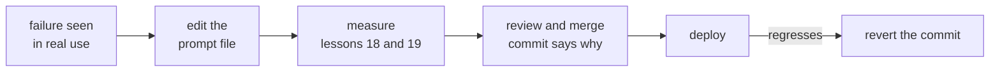

# पाठ 16. Prompts की Versioning

**मिशन से संबंध:** जिस prompt पर दूसरे निर्भर हैं, उसे बदला जा सकना और पलटा जा सकना चाहिए। इसलिए वह version control में उसी सटीक model के बगल में रहता है जिसके ख़िलाफ़ उसे ट्यून किया गया था, और दोनों में से किसी का बदलाव एक reviewed commit है।
**मुख्य स्रोत:** [Docs: "Model IDs and versioning", Claude Platform Docs](https://platform.claude.com/docs/en/about-claude/models/model-ids-and-versions)
**पूर्व-आवश्यकताएँ:** [पाठ 15](0015-prompt-templates.md), [Prompt template](../GLOSSARY.md)

## वार्म-अप

1. ▢ पाठ 5 ने दिखाया था कि बिना अर्थ वाला formatting बदलाव accuracy हिला सकता है। यह prompt के हर edit को क्या बना देता है?

<details markdown="1"><summary>जाँचें</summary>

एक परखने लायक दावा। क्योंकि हानिरहित दिखने वाला edit नतीजे बदल सकता है, उसे पढ़कर नहीं परखा जा सकता, और उसे व्यवहार का बदलाव मानना चाहिए।

</details>

2. ▢ पाठ 2 ने कुछ instructions को system prompt में और कुछ को user turn में रखा था। Template file में, दोनों में से कौन स्थिर हिस्सा है और किसमें हर request के slots रहते हैं?

<details markdown="1"><summary>जाँचें</summary>

System prompt में स्थिर task, constraints और context रहते हैं, इसलिए वह ज़्यादातर स्थिर text है। User turn हर request की सामग्री लाता है, इसलिए ज़्यादातर slots वहीं बैठते हैं।

</details>

## यह जानें

### स्रोत पर एक ईमानदार नोट

कोई peer-reviewed अध्ययन prompt versioning को नहीं मापता। यह पाठ इसे दो चीज़ों से सिखाता है: Anthropic का दस्तावेज़ कि उसके model IDs कैसे व्यवहार करते हैं, और सामान्य software अभ्यास (files, review, इतिहास)। Model-ID के तथ्य एक vendor के हैं। बाक़ी किसी भी codebase के किसी भी prompt पर लागू होगा।

### Prompts version control में files हैं

पाठ 15 के हर prompt template को repository में उसकी अपनी file में रखें, जिसे runtime पर load किया जाए, किसी function में दबी string के रूप में नहीं। तब prompt का बदलाव एक diff है: पंक्ति-दर-पंक्ति review के लायक, किसी व्यक्ति के नाम चढ़ने लायक, और किसी भी दूसरे code की तरह उसी tool से पलटने लायक।

```text
prompts/
  summarise_ticket.txt        the template, fixed text and slots
  summarise_ticket.md         what it is for, what it was tuned on
config.py                     MODEL = the exact model ID the prompt was tested on
```

Prompt और model की setting को एक परखी हुई जोड़ी के रूप में साथ version किया जाता है, क्योंकि वही शब्द दूसरे model पर अलग व्यवहार कर सकते हैं। फिर भी एक का बदलाव अपना अलग commit है, ताकि regression का पता लगाया जा सके।

### Model को pin करें, उसके उपनाम को नहीं

Anthropic का दस्तावेज़ कहता है कि हर model ID model के एक pin किए हुए version की पहचान कराता है, जिसके weights उस ID के पूरे जीवन में स्थिर रहते हैं। यह IDs पर लागू होता है, सुविधाजनक aliases पर नहीं। 4.6 generation से पहले के models की ID में snapshot की तारीख़ होती है, जैसे `claude-sonnet-4-5-20250929`, और उनका एक छोटा alias भी होता है, जैसे `claude-sonnet-4-5`, जो सबसे हाल के dated snapshot की ओर इशारा करता है। इसलिए alias आपके repository में बिना किसी बदलाव के एक अलग model का मतलब देने लग सकता है। 4.6 generation से आगे, दस्तावेज़ कहता है कि बिना तारीख़ की ID ख़ुद तय snapshot है, alias नहीं।

इसलिए नियम यह है: configuration में सटीक ID रखें, ऐसा नाम कभी नहीं जो खिसक सके। उसी पेज की दो सीमाएँ। तय model के आसपास का serving infrastructure, जैसे router और sampling logic, बदल सकता है और कभी-कभी व्यवहार को थोड़ा खिसका देता है। और हर ID का अपना retirement schedule है, इसलिए pin स्थायी नहीं है: नए model पर जाना अपने-आप में prompt का बदलाव है, और पाठ 18 और 19 के माप से गुज़रता है।

### Review, changelog, rollback



Commit message ही changelog है, इसलिए उसे वैसे ही लिखें: बदलाव किस विफलता को संबोधित करता है, और regression-set के कौन-से cases उसने ठीक किए या खिसकाए। तब reviewer सिर्फ़ शब्दों को नहीं, दावे को परखता है। Rollback उस commit पर `git revert` है, और वह एक परखी हुई जोड़ी बहाल करता है क्योंकि prompt file और model pin एक ही repository में रहते हैं। तैनात prompt को dashboard या database में सीधे बदलें नहीं: उससे न कोई diff बचता है न कोई revert।

## अभ्यास

1. ▢ एक repository की config में `MODEL = "claude-sonnet-4-5"` है। ऊपर के दस्तावेज़ के आधार पर, बिना किसी के repository बदले system के बारे में क्या बदल सकता है, और सुधार क्या है?

<details markdown="1"><summary>जाँचें</summary>

वह नाम alias है, जिसके बारे में दस्तावेज़ कहता है कि वह उस minor version के सबसे हाल के dated snapshot की ओर इशारा करता है, इसलिए वह एक अलग model का मतलब देने लग सकता है। सुधार dated ID `claude-sonnet-4-5-20250929` को pin करना है।

</details>

2. ▢ एक साथी admin page पर सीधे तैनात prompt को edit करता है और अगले दिन गुणवत्ता गिर जाती है। दो चीज़ें बताएँ जिन्हें इस workflow ने git में prompt file के मुक़ाबले ज़्यादा कठिन बनाया।

<details markdown="1"><summary>जाँचें</summary>

कोई diff नहीं है जो दिखाए कि क्या बदला, और live होने से पहले कोई review नहीं हुआ। Rollback का मतलब पुराना text याद रखना है, जबकि git में वह एक revert है। कोई commit message नहीं है जो बताए कि edit क्यों किया गया।

</details>

3. ▢ एक नया model ID जारी होता है और टीम pin किया हुआ model बदलना चाहती है पर prompt को वैसा ही रखना चाहती है। यह सुरक्षित no-op बदलाव क्यों नहीं है?

<details markdown="1"><summary>जाँचें</summary>

Model उस व्यवहार का आधा हिस्सा है जिसने उसे पैदा किया, और वही prompt दूसरे model पर अलग व्यवहार कर सकता है। Pin बदलना व्यवहार का बदलाव है, इसलिए उसे prompt text के edit की तरह review किया जाता है और regression set पर मापा जाता है।

</details>

4. ▢ कौन-सा commit सबसे अच्छा prompt changelog है?

    - a) Update the summariser prompt and the pinned model in one commit, tests pass
    - b) Reword the summary instruction for clarity, no behaviour change is intended
    - c) Fix refund tickets summarised as complaints, add case 14, all 14 cases pass
    - d) Tweak the summariser instructions after feedback from the support team lead

<details markdown="1"><summary>जाँचें</summary>

**c)** यह विफलता और उस case का नाम लेता है जो अब उसे कवर करता है, और reviewer इसे जाँच सकता है। (a) model का बदलाव और prompt का बदलाव एक साथ बाँध देता है, इसलिए regression को किसी एक तक नहीं पहुँचाया जा सकता। (b) व्यवहार में कोई बदलाव न होने का दावा करता है, जिसे पाठ 5 कहता है कि शब्द बदलने पर नहीं माना जा सकता। (d) न विफलता का नाम लेता है न किसी case का जो उसे कवर करे, इसलिए reviewer के पास जाँचने को कुछ नहीं है।

</details>

## असली दुनिया का अभ्यास

- [ ] ऐसे project की config खोलें जो LLM को call करता है और लिखें कि model का नाम सटीक ID है या alias, फ़ैसला provider के दस्तावेज़ से करते हुए।
- [ ] उस project में खोजें कि एक prompt कहाँ रखा है (code, file, database) और नोट करें कि उसमें बदलाव review लायक diff छोड़ता है या नहीं।
- [ ] कल: एक prompt के लिए, उसके आख़िरी edit का वह commit message लिखें जो आप चाहेंगे, उस विफलता के साथ जिसे उसने संबोधित किया, और देखें कि क्या आप उसे याददाश्त से भर सकते हैं।

## आगे बढ़ने के लिए

- [Docs: "Model IDs and versioning", Claude Platform Docs](https://platform.claude.com/docs/en/about-claude/models/model-ids-and-versions)
- [Production में Prompts](../reference/prompts-in-production.md)
- [संसाधन](../RESOURCES.md)

---

बात नहीं बन रही? ऊपर दिए primary source को दोबारा पढ़ें, क्योंकि यह पाठ उसे संक्षिप्त करता है और समझ संक्षेप में ही रिसती है। जो शब्द फिसलन भरा लगे, उसके लिए [शब्दावली](../GLOSSARY.md) देखें।

अगर दिक़्क़त सामग्री की नहीं बल्कि पाठ की ही है, तो वह एक खोट है: [issue खोलें](https://github.com/TokenCemetery/teach/issues)।
