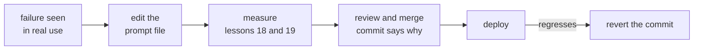

# Lesson 16. Versioning Prompts

**Mission link:** A prompt that others depend on has to be changeable and reversible, so it lives in version control next to the exact model it was tuned against, and a change to either is a reviewed commit.
**Primary source:** [Docs: "Model IDs and versioning", Claude Platform Docs](https://platform.claude.com/docs/en/about-claude/models/model-ids-and-versions)
**Prerequisites:** [Lesson 15](0015-prompt-templates.md), [Prompt template](../GLOSSARY.md)

## Warm-up

1. ▢ Lesson 5 showed that a formatting change with no meaning can move accuracy. What does that make every edit to a prompt?

<details markdown="1"><summary>Check</summary>

A claim to test. Because a harmless-looking edit can change results, it cannot be judged by reading it, and it should be treated as a behaviour change.

</details>

2. ▢ Lesson 2 put some instructions in the system prompt and others in the user turn. In a template file, which of the two is the stable part and which holds the per-request slots?

<details markdown="1"><summary>Check</summary>

The system prompt holds the stable task, constraints and context, so it is mostly fixed text. The user turn carries the per-request content, so most slots sit there.

</details>

## Know this

### An honest note on the source

No peer-reviewed study measures prompt versioning. This lesson teaches it from two things: Anthropic's documentation of how its model IDs behave, and ordinary software practice (files, review, history). The model-ID facts are one vendor's. The rest would apply to any prompt in any codebase.

### Prompts are files under version control

Keep each prompt template from lesson 15 in its own file in the repository, loaded at runtime, rather than as a string buried in a function. Then a prompt change is a diff: reviewable line by line, attributable to a person, and revertable with the same tool as any other code.

```text
prompts/
  summarise_ticket.txt        the template, fixed text and slots
  summarise_ticket.md         what it is for, what it was tuned on
config.py                     MODEL = the exact model ID the prompt was tested on
```

The prompt and the model setting are versioned together as one tested pair, because the same words can behave differently on a different model. A change to one is still its own commit, so a regression can be traced.

### Pin the model, not the nickname

Anthropic's documentation says each model ID identifies a pinned version of the model, with the weights constant for the lifetime of that ID. That holds for IDs, not for convenience aliases. Models before the 4.6 generation carry a snapshot date in the ID, such as `claude-sonnet-4-5-20250929`, and also have a shorter alias such as `claude-sonnet-4-5` that points to the most recent dated snapshot. An alias can therefore start meaning a different model with no change in your repository. From the 4.6 generation on, the documentation says the dateless ID is itself the fixed snapshot, not an alias.

So the rule is: put the exact ID, never a name that can move, in configuration. Two limits from the same page. The serving infrastructure around a fixed model, such as the router and sampling logic, can change and occasionally shifts behaviour slightly. And every ID has its own retirement schedule, so a pin is not permanent: moving to a new model is a prompt change in its own right, and goes through the measurement in lessons 18 and 19.

### Review, changelog, rollback



The commit message is the changelog, so write it as one: which failure the change addresses, and which regression-set cases it fixed or moved. A reviewer then judges the claim, not just the wording. Rollback is `git revert` on the commit, and it restores a tested pair because the prompt file and the model pin live in the same repository. Do not edit a deployed prompt in place in a dashboard or database: that leaves no diff and no revert.

## Practice

1. ▢ A repository has `MODEL = "claude-sonnet-4-5"` in its config. Using the documentation above, what can change about the system without anyone editing the repository, and what is the fix?

<details markdown="1"><summary>Check</summary>

That name is an alias, which the documentation says points to the most recent dated snapshot for that minor version, so it can come to mean a different model. The fix is to pin the dated ID, `claude-sonnet-4-5-20250929`.

</details>

2. ▢ A teammate edits a deployed prompt directly in an admin page and quality drops the next day. Name two things this workflow made harder than a prompt file in git would have.

<details markdown="1"><summary>Check</summary>

There is no diff showing what changed, and there is no review before it went live. Rolling back means remembering the old text, where in git it is one revert. No commit message exists to say why the edit was made.

</details>

3. ▢ A new model ID is released and the team wants to move the pinned model but keep the prompt unchanged. Why is that not a safe no-op change?

<details markdown="1"><summary>Check</summary>

The model is half of what produced the behaviour, and the same prompt can behave differently on another model. Changing the pin is a behaviour change, so it is reviewed and measured against the regression set like an edit to the prompt text.

</details>

4. ▢ Which commit is the best prompt changelog?

    - a) Update the summariser prompt and the pinned model in one commit, tests pass
    - b) Reword the summary instruction for clarity, no behaviour change is intended
    - c) Fix refund tickets summarised as complaints, add case 14, all 14 cases pass
    - d) Tweak the summariser instructions after feedback from the support team lead

<details markdown="1"><summary>Check</summary>

**c)** It names the failure and the case that now covers it, and a reviewer can check it. (a) bundles a model change with a prompt change, so a regression could not be traced to either. (b) claims no behaviour change, which lesson 5 says cannot be assumed of a reword. (d) names neither the failure nor a case that covers it, so a reviewer has nothing to check.

</details>

## Real-world reps

- [ ] Open the config of a project that calls an LLM and write down whether the model name is an exact ID or an alias, using the provider's documentation to decide.
- [ ] Find where one prompt is stored in that project (code, file, database) and note whether a change to it leaves a reviewable diff.
- [ ] Tomorrow: for one prompt, write the commit message you would want for its last edit, with the failure it addressed, and see whether you can fill it in from memory.

## Going further

- [Docs: "Model IDs and versioning", Claude Platform Docs](https://platform.claude.com/docs/en/about-claude/models/model-ids-and-versions)
- [Prompts in Production](../reference/prompts-in-production.md)
- [Resources](../RESOURCES.md)

---

Not landing? Reread the primary source at the top, since this lesson compresses it and compression is where understanding leaks. Check the [glossary](../GLOSSARY.md) for any term that felt slippery.

If the lesson itself is unclear rather than the material, that is a defect: [open an issue](https://github.com/TokenCemetery/teach/issues).
