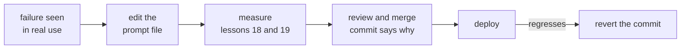

# Lição 16. Versionando prompts

**Ligação com a missão:** Um prompt do qual outros dependem precisa poder ser alterado e revertido, então ele vive no controle de versão ao lado do modelo exato contra o qual foi ajustado, e uma mudança em qualquer um dos dois é um commit revisado.
**Fonte principal:** [Docs: "Model IDs and versioning", Claude Platform Docs](https://platform.claude.com/docs/en/about-claude/models/model-ids-and-versions)
**Pré-requisitos:** [Lição 15](0015-prompt-templates.md), [Template de prompt](../GLOSSARY.md)

## Aquecimento

1. ▢ A lição 5 mostrou que uma mudança de formatação sem significado pode mover a acurácia. O que isso faz de toda edição em um prompt?

<details markdown="1"><summary>Verificação</summary>

Uma afirmação a ser testada. Como uma edição de aparência inofensiva pode mudar os resultados, ela não pode ser julgada lendo-a, e deve ser tratada como uma mudança de comportamento.

</details>

2. ▢ A lição 2 colocou algumas instruções no system prompt e outras no turno do usuário. Em um arquivo de template, qual dos dois é a parte estável e qual guarda os campos por requisição?

<details markdown="1"><summary>Verificação</summary>

O system prompt guarda a tarefa, as restrições e o contexto estáveis, então é na maior parte texto fixo. O turno do usuário carrega o conteúdo por requisição, então a maioria dos campos fica ali.

</details>

## Saiba isto

### Uma nota honesta sobre a fonte

Nenhum estudo revisado por pares mede o versionamento de prompts. Esta lição o ensina a partir de duas coisas: a documentação da Anthropic sobre como os seus IDs de modelo se comportam e a prática comum de software (arquivos, revisão, histórico). Os fatos sobre IDs de modelo são de um único fornecedor. O resto valeria para qualquer prompt em qualquer base de código.

### Prompts são arquivos sob controle de versão

Mantenha cada template de prompt da lição 15 em seu próprio arquivo no repositório, carregado em tempo de execução, e não como uma string enterrada em uma função. Assim, uma mudança de prompt é um diff: revisável linha a linha, atribuível a uma pessoa e revertível com a mesma ferramenta de qualquer outro código.

```text
prompts/
  summarise_ticket.txt        the template, fixed text and slots
  summarise_ticket.md         what it is for, what it was tuned on
config.py                     MODEL = the exact model ID the prompt was tested on
```

O prompt e a configuração do modelo são versionados juntos como um par testado, porque as mesmas palavras podem se comportar de forma diferente em outro modelo. Uma mudança em um deles continua sendo seu próprio commit, para que uma regressão possa ser rastreada.

### Fixe o modelo, não o apelido

A documentação da Anthropic diz que cada ID de modelo identifica uma versão fixada do modelo, com os pesos constantes durante toda a vida desse ID. Isso vale para IDs, não para aliases de conveniência. Os modelos anteriores à geração 4.6 trazem uma data de snapshot no ID, como `claude-sonnet-4-5-20250929`, e também têm um alias mais curto, como `claude-sonnet-4-5`, que aponta para o snapshot datado mais recente. Um alias pode, portanto, passar a significar outro modelo sem nenhuma mudança no seu repositório. A partir da geração 4.6, a documentação diz que o ID sem data é, ele mesmo, o snapshot fixo, e não um alias.

Então a regra é: coloque na configuração o ID exato, nunca um nome que possa se mover. Dois limites da mesma página. A infraestrutura de serviço em torno de um modelo fixo, como o roteador e a lógica de sampling, pode mudar e ocasionalmente desloca o comportamento um pouco. E cada ID tem seu próprio cronograma de aposentadoria, então uma fixação não é permanente: migrar para um novo modelo é uma mudança de prompt por mérito próprio, e passa pela medição das lições 18 e 19.

### Revisão, changelog, rollback



A mensagem do commit é o changelog, então escreva-a como tal: qual falha a mudança trata e quais casos do conjunto de regressão ela corrigiu ou moveu. Assim, quem revisa julga a afirmação, e não só a redação. O rollback é um `git revert` no commit, e ele restaura um par testado porque o arquivo do prompt e a fixação do modelo vivem no mesmo repositório. Não edite um prompt implantado diretamente em um painel ou banco de dados: isso não deixa diff nem reversão.

## Prática

1. ▢ Um repositório tem `MODEL = "claude-sonnet-4-5"` na configuração. Usando a documentação acima, o que pode mudar no sistema sem que ninguém edite o repositório, e qual é a correção?

<details markdown="1"><summary>Verificação</summary>

Esse nome é um alias, que a documentação diz apontar para o snapshot datado mais recente daquela versão menor, então ele pode passar a significar outro modelo. A correção é fixar o ID datado, `claude-sonnet-4-5-20250929`.

</details>

2. ▢ Um colega edita um prompt implantado diretamente em uma página de administração e a qualidade cai no dia seguinte. Cite duas coisas que esse fluxo tornou mais difíceis do que um arquivo de prompt no git teria tornado.

<details markdown="1"><summary>Verificação</summary>

Não há diff mostrando o que mudou, e não houve revisão antes de ir ao ar. Reverter significa lembrar do texto antigo, enquanto no git é um único revert. Não existe mensagem de commit para dizer por que a edição foi feita.

</details>

3. ▢ Um novo ID de modelo é lançado e a equipe quer mover o modelo fixado mantendo o prompt inalterado. Por que isso não é uma mudança segura sem efeito?

<details markdown="1"><summary>Verificação</summary>

O modelo é metade do que produziu o comportamento, e o mesmo prompt pode se comportar de forma diferente em outro modelo. Mudar a fixação é uma mudança de comportamento, então ela é revisada e medida contra o conjunto de regressão como uma edição no texto do prompt.

</details>

4. ▢ Qual commit é o melhor changelog de prompt?

    - a) Atualiza o prompt do resumidor e o modelo fixado em um só commit, testes passam
    - b) Reescreve a instrução do resumo para clareza, nenhuma mudança de comportamento é pretendida
    - c) Corrige tickets de reembolso resumidos como reclamações, adiciona o caso 14, todos os 14 casos passam
    - d) Ajusta as instruções do resumidor após feedback do líder da equipe de suporte

<details markdown="1"><summary>Verificação</summary>

**c)** Ele nomeia a falha e o caso que agora a cobre, e quem revisa pode conferir. (a) junta uma mudança de modelo com uma mudança de prompt, então uma regressão não poderia ser rastreada a nenhuma das duas. (b) afirma nenhuma mudança de comportamento, o que a lição 5 diz que não se pode presumir de uma reescrita. (d) não nomeia nem a falha nem um caso que a cubra, então quem revisa não tem o que conferir.

</details>

## Prática no mundo real

- [ ] Abra a configuração de um projeto que chama um LLM e anote se o nome do modelo é um ID exato ou um alias, usando a documentação do provedor para decidir.
- [ ] Encontre onde um prompt é guardado nesse projeto (código, arquivo, banco de dados) e anote se uma mudança nele deixa um diff revisável.
- [ ] Amanhã: para um prompt, escreva a mensagem de commit que você gostaria de ter para a última edição dele, com a falha que ela tratou, e veja se consegue preenchê-la de memória.

## Para ir além

- [Docs: "Model IDs and versioning", Claude Platform Docs](https://platform.claude.com/docs/en/about-claude/models/model-ids-and-versions)
- [Prompts em Produção](../reference/prompts-in-production.md)
- [Recursos](../RESOURCES.md)

---

Não está entrando? Releia a fonte principal no topo, pois esta lição a comprime e é na compressão que a compreensão vaza. Consulte o [glossário](../GLOSSARY.md) para qualquer termo que pareceu escorregadio.

Se o problema é a própria lição, e não o material, isso é um defeito: [abra uma issue](https://github.com/TokenCemetery/teach/issues).
