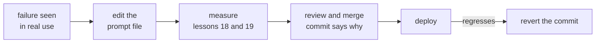

# Урок 16. Версионирование промптов

**Связь с целью курса:** Промпт, от которого зависят другие, должен быть изменяемым и обратимым. Поэтому он живёт в системе контроля версий рядом с точной моделью, под которую настроен, а изменение любого из двух это ревьюируемый коммит.
**Первоисточник:** [Документация: «Model IDs and versioning», Claude Platform Docs](https://platform.claude.com/docs/en/about-claude/models/model-ids-and-versions)
**Предварительные требования:** [Урок 15](0015-prompt-templates.md), [Шаблон промпта](../GLOSSARY.md)

## Разминка

1. ▢ Урок 5 показал, что бессмысленное изменение форматирования может сдвинуть точность. Чем это делает любую правку промпта?

<details markdown="1"><summary>Проверка</summary>

Утверждением, которое нужно проверить. Поскольку безобидная на вид правка может изменить результаты, судить о ней по прочтению нельзя, и к ней надо относиться как к изменению поведения.

</details>

2. ▢ Урок 2 поместил одни инструкции в системный промпт, а другие в ход пользователя. Какая из двух частей в файле шаблона стабильна, а в какой лежат слоты на каждый запрос?

<details markdown="1"><summary>Проверка</summary>

Системный промпт содержит стабильную задачу, ограничения и контекст, так что это в основном неизменный текст. Ход пользователя несёт содержимое на каждый запрос, поэтому большинство слотов находится там.

</details>

## Что нужно знать

### Честная заметка об источнике

Рецензируемого исследования, которое измеряло бы версионирование промптов, нет. Этот урок учит ему на двух основаниях: документации Anthropic о поведении её идентификаторов моделей и обычной практике разработки программ (файлы, ревью, история). Факты об идентификаторах моделей относятся к одному вендору. Остальное применимо к любому промпту в любой кодовой базе.

### Промпты это файлы под контролем версий

Храните каждый шаблон промпта из урока 15 в отдельном файле репозитория, загружаемом во время выполнения, а не строкой, закопанной в функции. Тогда изменение промпта становится диффом: его можно ревьюировать построчно, оно приписывается человеку и откатывается тем же инструментом, что и любой другой код.

```text
prompts/
  summarise_ticket.txt        the template, fixed text and slots
  summarise_ticket.md         what it is for, what it was tuned on
config.py                     MODEL = the exact model ID the prompt was tested on
```

Промпт и настройка модели версионируются вместе как одна проверенная пара, потому что одни и те же слова на другой модели могут вести себя иначе. Изменение одного из них всё равно отдельный коммит, чтобы регрессию можно было проследить.

### Привязывайте модель, а не прозвище

Документация Anthropic говорит, что каждый идентификатор модели обозначает зафиксированную версию модели, веса которой постоянны всё время жизни этого идентификатора. Это верно для идентификаторов, но не для удобных псевдонимов. Модели до поколения 4.6 несут в идентификаторе дату снапшота, например `claude-sonnet-4-5-20250929`, а также имеют более короткий псевдоним, например `claude-sonnet-4-5`, который указывает на самый свежий снапшот с датой. Поэтому псевдоним может начать означать другую модель без единого изменения в вашем репозитории. Начиная с поколения 4.6, по документации, идентификатор без даты сам является зафиксированным снапшотом, а не псевдонимом.

Отсюда правило: кладите в конфигурацию точный идентификатор, а не имя, которое может сместиться. Два ограничения с той же страницы. Инфраструктура, обслуживающая зафиксированную модель, например маршрутизатор и логика сэмплирования, может меняться и иногда слегка сдвигает поведение. И у каждого идентификатора своё расписание вывода из эксплуатации, так что привязка не вечна: переход на новую модель сам по себе является изменением промпта и проходит через измерение из уроков 18 и 19.

### Ревью, журнал изменений, откат



Сообщение коммита служит журналом изменений, поэтому пишите его как журнал: какой сбой устраняет изменение и какие случаи регрессионного набора оно исправило или сдвинуло. Тогда ревьюер оценивает утверждение, а не только формулировку. Откат это `git revert` для коммита, и он восстанавливает проверенную пару, потому что файл промпта и привязка модели лежат в одном репозитории. Не правьте развёрнутый промпт на месте в панели управления или в базе данных: это не оставляет ни диффа, ни возможности отката.

## Практика

1. ▢ В репозитории в конфигурации стоит `MODEL = "claude-sonnet-4-5"`. Согласно документации выше, что в системе может измениться без правок репозитория и как это исправить?

<details markdown="1"><summary>Проверка</summary>

Это имя является псевдонимом, который, по документации, указывает на самый свежий снапшот с датой для этой минорной версии, так что он может начать означать другую модель. Исправление: привязать идентификатор с датой, `claude-sonnet-4-5-20250929`.

</details>

2. ▢ Коллега правит развёрнутый промпт прямо на странице администратора, и на следующий день качество падает. Назовите две вещи, которые этот процесс затруднил по сравнению с файлом промпта в git.

<details markdown="1"><summary>Проверка</summary>

Нет диффа, показывающего, что изменилось, и нет ревью перед запуском в работу. Откат означает необходимость помнить старый текст, тогда как в git это один revert. Нет сообщения коммита, которое говорило бы, зачем сделана правка.

</details>

3. ▢ Выходит новый идентификатор модели, и команда хочет сменить привязанную модель, оставив промпт без изменений. Почему это не безопасное изменение «без последствий»?

<details markdown="1"><summary>Проверка</summary>

Модель это половина того, что породило поведение, и один и тот же промпт на другой модели может вести себя иначе. Смена привязки это изменение поведения, поэтому её ревьюируют и измеряют на регрессионном наборе, как правку текста промпта.

</details>

4. ▢ Какой коммит лучше всего служит журналом изменений промпта?

    - a) Обновить промпт суммаризатора и привязанную модель одним коммитом, тесты проходят
    - b) Переформулировать инструкцию по краткому изложению для ясности, изменений поведения не планируется
    - c) Исправить обращения о возврате, сведённые к жалобам, добавить случай 14, все 14 случаев проходят
    - d) Подправить инструкции суммаризатора после отзыва руководителя службы поддержки

<details markdown="1"><summary>Проверка</summary>

**c)** Он называет сбой и случай, который теперь его покрывает, и ревьюер может это проверить. (a) объединяет смену модели с изменением промпта, так что регрессию нельзя было бы отнести ни к одному из них. (b) заявляет об отсутствии изменений поведения, а урок 5 говорит, что для переформулировки этого предполагать нельзя. (d) не называет ни сбоя, ни случая, который его покрывает, так что ревьюеру нечего проверять.

</details>

## Практика в реальной работе

- [ ] Откройте конфигурацию проекта, который вызывает LLM, и запишите, является ли имя модели точным идентификатором или псевдонимом, опираясь на документацию провайдера.
- [ ] Найдите, где в этом проекте хранится один из промптов (код, файл, база данных), и отметьте, оставляет ли его изменение ревьюируемый дифф.
- [ ] Завтра: для одного промпта напишите сообщение коммита, которое вы хотели бы видеть для его последней правки, с описанием устранённого сбоя, и проверьте, сможете ли вы заполнить его по памяти.

## Что почитать дальше

- [Документация: «Model IDs and versioning», Claude Platform Docs](https://platform.claude.com/docs/en/about-claude/models/model-ids-and-versions)
- [Промпты в продакшене](../reference/prompts-in-production.md)
- [Ресурсы](../RESOURCES.md)

---

Не доходит? Перечитайте первоисточник в начале: этот урок его сжимает, а при сжатии понимание как раз и утекает. Загляните в [глоссарий](../GLOSSARY.md), если какой-то термин оказался скользким.

Если неясен сам урок, а не материал, это дефект: [откройте issue](https://github.com/TokenCemetery/teach/issues).
