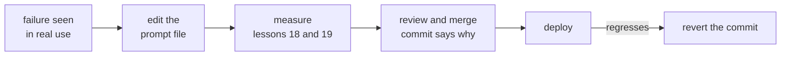

# 第 16 课：提示词的版本管理

**使命关联:** 被他人依赖的提示词必须可修改、可回退，所以它要和调优时所用的确切模型一起放在版本控制里，对其中任何一方的改动都是一次经过评审的提交。
**主要来源:** [文档：“Model IDs and versioning”，Claude Platform Docs](https://platform.claude.com/docs/en/about-claude/models/model-ids-and-versions)
**前置知识:** [第 15 课](0015-prompt-templates.md)、[提示词模板](../GLOSSARY.md)

## 热身

1. ▢ 第 5 课表明，一处没有含义的格式改动也能让准确率波动。这使得对提示词的每一次编辑成了什么？

<details markdown="1"><summary>检查</summary>

成了一个待检验的论断。看似无害的编辑也可能改变结果，所以不能靠阅读来判断它，而应当把它当作一次行为变更。

</details>

2. ▢ 第 2 课把一些指令放在系统提示词里，另一些放在用户轮次里。在模板文件中，这两者里哪个是稳定的部分，哪个放着每次请求的槽位？

<details markdown="1"><summary>检查</summary>

系统提示词放稳定的任务、约束和上下文，所以它大部分是固定文本。用户轮次承载每次请求的内容，所以大多数槽位在那里。

</details>

## 要点

### 关于来源的一点坦白

没有任何经同行评审的研究衡量过提示词的版本管理。本课依据两样东西来讲它：Anthropic 对其模型 ID 行为的文档，以及普通的软件实践（文件、评审、历史记录）。模型 ID 方面的事实出自一家厂商。其余部分适用于任何代码库中的任何提示词。

### 提示词是受版本控制的文件

把第 15 课中的每个提示词模板放在仓库里各自的文件中，在运行时加载，而不是做成埋在某个函数里的字符串。这样，对提示词的修改就是一份 diff：可以逐行评审，可以追溯到具体的人，也可以用与其他代码相同的工具回退。

```text
prompts/
  summarise_ticket.txt        the template, fixed text and slots
  summarise_ticket.md         what it is for, what it was tuned on
config.py                     MODEL = the exact model ID the prompt was tested on
```

提示词和模型设置作为一个经过测试的组合一起做版本管理，因为同样的措辞在不同的模型上可能表现不同。对其中一方的改动仍然是独立的一次提交，这样出现回归时可以追踪。

### 固定模型，而不是它的昵称

Anthropic 的文档说，每个模型 ID 标识的是模型的一个固定版本，在该 ID 的整个生命周期内权重不变。这对 ID 成立，对图方便的别名不成立。4.6 代之前的模型在 ID 里带有快照日期，比如 `claude-sonnet-4-5-20250929`，同时还有一个更短的别名，比如 `claude-sonnet-4-5`，指向最新的带日期快照。因此，别名可能在你的仓库没有任何改动的情况下，开始指向另一个模型。从 4.6 代起，文档说不带日期的 ID 本身就是固定的快照，而不是别名。

所以规则是：在配置中写入确切的 ID，而不是一个可能变动的名称。同一页还有两点限制。固定模型周围的服务基础设施，比如路由器和采样逻辑，可能会变化，偶尔会让行为发生轻微的偏移。而且每个 ID 都有自己的退役时间表，所以固定并不是永久的：换到新模型本身就是一次提示词变更，要经过第 18 课和第 19 课中的测量。

### 评审、变更记录、回滚



提交信息就是变更记录，所以要按变更记录来写：这次改动针对的是哪个失败，以及它修复或改变了回归集中的哪些用例。这样评审者评判的就是这个论断，而不只是措辞。回滚就是对该提交执行 `git revert`，它能恢复一个经过测试的组合，因为提示词文件和模型的固定都在同一个仓库里。不要在管理后台或数据库里就地编辑已部署的提示词：那样既没有 diff，也没法回退。

## 练习

1. ▢ 某个仓库的配置里写着 `MODEL = "claude-sonnet-4-5"`。根据上面的文档，在没有人编辑仓库的情况下，系统的什么可能发生变化？该怎么修复？

<details markdown="1"><summary>检查</summary>

这个名称是别名，文档说它指向该小版本最新的带日期快照，所以它可能变成指向另一个模型。修复办法是固定带日期的 ID，`claude-sonnet-4-5-20250929`。

</details>

2. ▢ 一位同事直接在管理页面上编辑了已部署的提示词，第二天质量下降了。说出这种工作方式比 git 里的提示词文件多带来的两个困难。

<details markdown="1"><summary>检查</summary>

没有 diff 显示改了什么，上线之前也没有评审。回滚要靠记住旧文本，而在 git 里只需一次 revert。也没有提交信息来说明为什么做这次编辑。

</details>

3. ▢ 新的模型 ID 发布了，团队想更换固定的模型，但保持提示词不变。为什么这不是一次安全的“空操作”？

<details markdown="1"><summary>检查</summary>

模型是产生这种行为的一半原因，同样的提示词在另一个模型上可能表现不同。更改固定的模型就是一次行为变更，所以要像编辑提示词文本一样，经过评审，并对照回归集测量。

</details>

4. ▢ 下面哪个提交是最好的提示词变更记录？

    - a) 在一次提交中同时更新摘要器提示词和固定的模型，测试通过
    - b) 为清晰起见改写摘要指令，不打算改变行为
    - c) 修复退款工单被总结成投诉的问题，新增用例 14，14 个用例全部通过
    - d) 根据支持团队负责人的反馈调整摘要器的指令

<details markdown="1"><summary>检查</summary>

**c)** 它写明了失败和现在覆盖它的用例，评审者可以核实。(a) 把模型变更和提示词变更捆在一起，出现回归时无法追溯到其中任何一个。(b) 声称没有行为变化，而第 5 课说过，对于改写，这一点不能想当然。(d) 既没有写明失败，也没有写明覆盖它的用例，评审者无从核实。

</details>

## 实战练习

- [ ] 打开一个调用 LLM 的项目的配置，写下其中的模型名称是确切的 ID 还是别名，判断时以提供方的文档为准。
- [ ] 找出该项目中某个提示词存放在哪里（代码、文件、数据库），并记下对它的修改是否会留下可以评审的 diff。
- [ ] 明天：为某个提示词写出你希望它最近一次编辑所拥有的提交信息，包括它所针对的失败，看看你能否凭记忆把它填出来。

## 延伸阅读

- [文档：“Model IDs and versioning”，Claude Platform Docs](https://platform.claude.com/docs/en/about-claude/models/model-ids-and-versions)
- [生产环境中的提示词](../reference/prompts-in-production.md)
- [资源](../RESOURCES.md)

---

没学明白？请重读顶部的主要来源，因为本课是对它的压缩，而理解正是在压缩中流失的。如果有哪个术语觉得含糊，可以查看[术语表](../GLOSSARY.md)。

如果问题出在课程本身，而不是学习材料，那就是一个缺陷：[提交 issue](https://github.com/TokenCemetery/teach/issues)。
