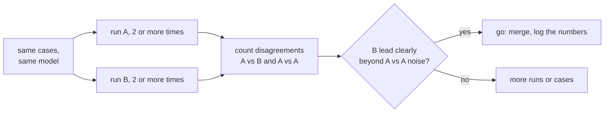

# Lección 19. Comparar dos prompts

**Vínculo con la misión:** Cerrar la etapa 8 significa poder decir "B supera a A" con un número que resista la pregunta "¿eso es solo ruido?", usando el conjunto de regresión de la lección 18 y las herramientas del track de evals.
**Fuente principal:** [Docs: "Define success criteria and build evaluations", Claude Platform Docs](https://platform.claude.com/docs/en/test-and-evaluate/develop-tests)
**Requisitos previos:** [Lección 18](0018-a-regression-set-for-a-prompt.md), [Conjunto de regresión](../GLOSSARY.md)

## Calentamiento

1. ▢ La lección 9 muestreó varias rutas de razonamiento y tomó la respuesta mayoritaria. ¿Qué te dice eso sobre una sola ejecución de un prompt con una temperatura distinta de cero?

<details markdown="1"><summary>Comprobación</summary>

Del mismo prompt salen completions distintas, así que una ejecución es una muestra de un abanico de resultados posibles. Una sola puntuación puede ser mayor o menor que la puntuación típica del prompt sin que haya cambiado nada.

</details>

2. ▢ La lección 16 hizo que un cambio de modelo fuera un cambio por derecho propio, separado de una edición del prompt. ¿Por qué importa eso para una comparación?

<details markdown="1"><summary>Comprobación</summary>

Una comparación solo tiene sentido si lo único que difiere es lo que estás probando. Si cambiaron tanto el prompt como el modelo, una mejor puntuación no puede atribuirse a ninguno de los dos.

</details>

## Qué debes saber

### Qué usa esta lección y qué no enseña

Esta lección aplica el track de evals. Cómo leer una diferencia frente a su ruido, y por qué una comparación pareada es la herramienta más afilada, está en la [lección 9 de ese track](../../evals/lessons/0009-statistical-significance-vs-noise.md) y en su hoja de referencia [Go/No-Go](../../evals/reference/go-no-go.md). Aquí se aplica a dos prompts. La guía de Anthropic sobre cómo construir evaluaciones también enumera la comparación con una línea base o una versión anterior como método estándar.

### Mismos casos, mismo modelo, una sola diferencia

Ejecuta el prompt A y el prompt B sobre el mismo conjunto de regresión, con el mismo modelo fijado, cambiando solo el prompt. Registra aprobado o fallido por caso, no solo los totales. Si un modelo califica las salidas, calibra primero ese calificador: [diseño y calibración de prompts de juez](../../evals/lessons/0005-judge-prompt-design-and-calibration.md).

### Cuenta los desacuerdos

Dos totales pueden esconder dónde difieren. Cuenta los casos que B pasa y A falla, y los casos que A pasa y B falla. Los casos que ambos pasan o ambos fallan no dicen nada sobre cuál prompt es mejor.

```python
def compare(a: dict, b: dict) -> dict:
    """a and b map case id to pass (True) or fail (False), same case ids."""
    only_b = [i for i in a if b[i] and not a[i]]
    only_a = [i for i in a if a[i] and not b[i]]
    return {"b_only": len(only_b), "a_only": len(only_a), "agree": len(a) - len(only_a) - len(only_b)}
```

Lee los dos conteos juntos. B pasa 44 de 50 y A pasa 41, así que B lidera por 3. Los conteos de `compare` podrían ser `b_only` 7, `a_only` 4 y `agree` 39: la ventaja de 3 casos se apoya en 11 casos que realmente cambiaron, y los 4 que se movieron en contra de B importan tanto como los 7 que se movieron a su favor.

### Mide el ruido en tu propio conjunto

Ejecuta A dos veces y compara las dos ejecuciones con `compare`. No cambió nada entre ellas, así que cada desacuerdo es ruido entre ejecuciones con una temperatura distinta de cero. Supón que la comparación de A contra A da 5 desacuerdos, repartidos 3 y 2. La ventaja de B contra A, de 7 frente a 4, no es entonces claramente mayor que lo que un prompt sin cambios hace por sí solo. Según la lección 9 del track de evals, eso no es evidencia de que no haya diferencia, es que todavía no hay evidencia suficiente. Ejecuta cada prompt más de una vez, añade casos o aplica una prueba de significancia a los desacuerdos.



Fija el umbral antes de ejecutar, como exige la hoja de go/no-go.

## Práctica

1. ▢ El prompt A pasa 41 de 50 casos y B pasa 44. De los casos que difieren, 7 son aprobados solo de B y 4 son aprobados solo de A. ¿Cuántos casos coinciden y por qué "B va 3 por delante" es un resumen incompleto?

<details markdown="1"><summary>Comprobación</summary>

Coinciden 39, ya que 50 menos 7 menos 4 es 39. La ventaja de 3 viene de 11 casos que cambiaron, y 4 de ellos empeoran con B. El resumen oculta cuánto se movió y en qué dirección.

</details>

2. ▢ Ejecutas A dos veces sobre los mismos 50 casos y las ejecuciones discrepan en 5 casos, 3 en una dirección y 2 en la otra. ¿Qué te dice esto sobre la comparación del punto anterior?

<details markdown="1"><summary>Comprobación</summary>

Un prompt sin cambios movió 5 casos por sí solo, así que los 11 desacuerdos de B, repartidos 7 y 4, no están claramente más allá de eso. El resultado es no concluyente en lugar de negativo: ejecuta cada prompt más veces, añade casos o prueba los desacuerdos.

</details>

3. ▢ Predice `compare(a, b)` para `a = {"c1": True, "c2": True, "c3": False, "c4": False, "c5": True}` y `b = {"c1": True, "c2": False, "c3": True, "c4": True, "c5": True}`.

<details markdown="1"><summary>Pista</summary>

Revisa cada caso, uno por uno, para ver si los dos resultados difieren y cuál pasó.

</details>

<details markdown="1"><summary>Comprobación</summary>

`{"b_only": 2, "a_only": 1, "agree": 2}`. Los casos `c3` y `c4` son aprobados solo de B, `c2` es un aprobado solo de A, y `c1` y `c5` coinciden. B lidera por un caso sobre tres que cambiaron.

</details>

4. ▢ Un equipo compara dos prompts, pero el prompt B además se ejecuta en un modelo más nuevo. B obtiene una puntuación más alta. ¿Qué conclusión está justificada?

    - a) El prompt de B es mejor, ya que la puntuación es más alta sobre los mismos casos
    - b) El modelo más nuevo es mejor, porque los modelos importan más que los prompts
    - c) Todavía nada sobre el prompt, ya que cambiaron dos cosas y no pueden separarse
    - d) La comparación es válida una vez que ambos prompts se ejecutan con temperatura cero

<details markdown="1"><summary>Comprobación</summary>

**c)** El prompt y el modelo difieren a la vez, así que la mejora no puede atribuirse a ninguno. Ejecuta el prompt de B en el modelo antiguo para aislarlo. (a) ignora el segundo cambio. (b) comete el mismo error en la dirección contraria. (d) elimina parte del ruido de muestreo pero no elimina el factor de confusión, y el método de la lección es medir el ruido, no darlo por descartado.

</details>

## Prácticas en el mundo real

- [ ] Toma un cambio de prompt que hayas hecho recientemente y ejecuta ambas versiones sobre un mismo conjunto de casos, y luego enumera los casos que difieren en cada dirección.
- [ ] Ejecuta el prompt original dos veces sobre ese conjunto y cuenta cuántos casos discrepan entre las dos ejecuciones.
- [ ] Mañana: escribe, antes de ejecutar nada, la ventaja que B debe mostrar sobre el ruido de A contra A para que lo publiques.

## Para profundizar

- [Lección 9 del track de evals: Significancia estadística frente a ruido](../../evals/lessons/0009-statistical-significance-vs-noise.md)
- [Go/No-Go](../../evals/reference/go-no-go.md)
- [Docs: "Define success criteria and build evaluations", Claude Platform Docs](https://platform.claude.com/docs/en/test-and-evaluate/develop-tests)
- [Prompts en producción](../reference/prompts-in-production.md)
- [Recursos](../RESOURCES.md)

---

¿No terminas de entenderlo? Vuelve a leer la fuente principal del principio, ya que esta lección la comprime y en la compresión es donde se escapa la comprensión. Consulta el [glosario](../GLOSSARY.md) para cualquier término que te haya resultado resbaladizo.

Si lo poco claro es la propia lección y no el material, eso es un defecto: [abre un issue](https://github.com/TokenCemetery/teach/issues).
