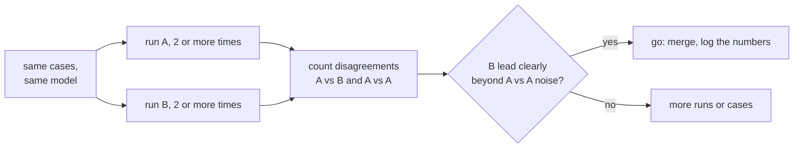

# Leçon 19. Comparer deux prompts

**Lien avec la mission :** Clore l'étape 8, c'est pouvoir dire « B bat A » avec un chiffre qui résiste à la question « n'est-ce que du bruit ? », en utilisant le jeu de régression de la leçon 18 et les outils du parcours sur les évaluations.
**Source primaire :** [Doc : "Define success criteria and build evaluations", Claude Platform Docs](https://platform.claude.com/docs/en/test-and-evaluate/develop-tests)
**Prérequis :** [Leçon 18](0018-a-regression-set-for-a-prompt.md), [Jeu de régression](../GLOSSARY.md)

## Échauffement

1. ▢ La leçon 9 échantillonnait plusieurs chemins de raisonnement et retenait une réponse majoritaire. Qu'est-ce que cela vous apprend sur une exécution unique d'un prompt à température non nulle ?

<details markdown="1"><summary>Vérifier</summary>

Des complétions différentes sortent du même prompt, donc une exécution est un échantillon unique parmi un éventail de résultats possibles. Un score isolé peut être plus haut ou plus bas que le score typique du prompt sans que rien n'ait changé.

</details>

2. ▢ La leçon 16 faisait d'un changement de modèle un changement à part entière, distinct d'une modification de prompt. Pourquoi cela compte-t-il pour une comparaison ?

<details markdown="1"><summary>Vérifier</summary>

Une comparaison n'a de sens que si l'unique chose qui diffère est celle que vous testez. Si le prompt et le modèle ont tous deux changé, un meilleur score ne peut être attribué à aucun des deux.

</details>

## À savoir

### Ce que cette leçon utilise, et n'enseigne pas

Cette leçon applique le parcours sur les évaluations. Comment lire un écart par rapport à son bruit, et pourquoi une comparaison appariée est l'outil le plus précis, relève de la [leçon 9 de ce parcours](../../evals/lessons/0009-statistical-significance-vs-noise.md) et de sa [fiche go/no-go](../../evals/reference/go-no-go.md). Ici, elle est appliquée à deux prompts. Le guide d'Anthropic sur la construction d'évaluations liste aussi la comparaison à une référence ou à une version antérieure comme méthode standard.

### Mêmes cas, même modèle, une seule différence

Exécutez le prompt A et le prompt B sur le même jeu de régression, avec le même modèle épinglé, en ne changeant que le prompt. Enregistrez réussite ou échec par cas, pas seulement les totaux. Si un modèle note les sorties, calibrez d'abord ce juge : [conception et calibration d'un prompt de juge](../../evals/lessons/0005-judge-prompt-design-and-calibration.md).

### Compter les désaccords

Deux totaux peuvent cacher où ils diffèrent. Comptez les cas que B réussit et que A échoue, et les cas que A réussit et que B échoue. Les cas que les deux réussissent ou que les deux échouent ne disent rien sur lequel des deux prompts est meilleur.

```python
def compare(a: dict, b: dict) -> dict:
    """a and b map case id to pass (True) or fail (False), same case ids."""
    only_b = [i for i in a if b[i] and not a[i]]
    only_a = [i for i in a if a[i] and not b[i]]
    return {"b_only": len(only_b), "a_only": len(only_a), "agree": len(a) - len(only_a) - len(only_b)}
```

Lisez les deux comptes ensemble. B réussit 44 cas sur 50 et A en réussit 41, donc B mène de 3. Les comptes de `compare` pourraient être `b_only` 7, `a_only` 4 et `agree` 39 : l'avance de 3 cas repose sur 11 cas qui ont réellement changé, et les 4 qui ont évolué contre B comptent autant que les 7 qui ont évolué pour lui.

### Mesurer le bruit sur votre propre jeu

Exécutez A deux fois et comparez les deux exécutions avec `compare`. Rien n'a changé entre elles, donc chaque désaccord est du bruit d'une exécution à l'autre à température non nulle. Supposons que la comparaison A contre A donne 5 désaccords, répartis 3 et 2. L'avance de B sur A, 7 contre 4, n'est alors pas clairement supérieure à ce que fait par lui-même un prompt inchangé. Selon la leçon 9 du parcours sur les évaluations, ce n'est pas la preuve d'une absence de différence, c'est une preuve pas encore suffisante. Exécutez chaque prompt plusieurs fois, ajoutez des cas, ou lancez un test de significativité sur les désaccords.



Fixez le seuil avant d'exécuter, comme l'exige la fiche go/no-go.

## Pratique

1. ▢ Le prompt A réussit 41 cas sur 50 et B en réussit 44. Parmi les cas qui diffèrent, 7 sont des réussites propres à B et 4 des réussites propres à A. Combien de cas concordent, et pourquoi « B a 3 d'avance » est-il un résumé incomplet ?

<details markdown="1"><summary>Vérifier</summary>

39 concordent, puisque 50 moins 7 moins 4 font 39. L'avance de 3 vient de 11 cas qui ont changé, dont 4 se dégradent avec B. Le résumé cache l'ampleur du mouvement et son sens.

</details>

2. ▢ Vous exécutez A deux fois sur les mêmes 50 cas et les exécutions divergent sur 5 cas, 3 dans un sens et 2 dans l'autre. Que cela vous apprend-il sur la comparaison de l'élément précédent ?

<details markdown="1"><summary>Vérifier</summary>

Un prompt inchangé a déplacé 5 cas de lui-même, donc les 11 désaccords de B, répartis 7 et 4, ne sont pas clairement au-delà. Le résultat est non concluant plutôt que négatif : exécutez chaque prompt davantage de fois, ajoutez des cas, ou testez les désaccords.

</details>

3. ▢ Prédisez `compare(a, b)` pour `a = {"c1": True, "c2": True, "c3": False, "c4": False, "c5": True}` et `b = {"c1": True, "c2": False, "c3": True, "c4": True, "c5": True}`.

<details markdown="1"><summary>Indice</summary>

Vérifiez chaque cas, un à un, pour voir si les deux résultats diffèrent et lequel a réussi.

</details>

<details markdown="1"><summary>Vérifier</summary>

`{"b_only": 2, "a_only": 1, "agree": 2}`. Les cas `c3` et `c4` sont des réussites propres à B, `c2` est une réussite propre à A, et `c1` et `c5` concordent. B mène d'un cas sur trois qui ont changé.

</details>

4. ▢ Une équipe compare deux prompts, mais le prompt B tourne aussi sur un modèle plus récent. B obtient un meilleur score. Quelle conclusion est justifiée ?

    - a) Le prompt de B est meilleur, puisque le score est plus élevé sur les mêmes cas
    - b) Le modèle plus récent est meilleur, parce que les modèles comptent plus que les prompts
    - c) Rien encore sur le prompt, puisque deux choses ont changé et ne peuvent être séparées
    - d) La comparaison est valide dès que les deux prompts tournent à une température de zéro

<details markdown="1"><summary>Vérifier</summary>

**c)** Le prompt et le modèle diffèrent tous deux, donc le gain ne peut être attribué à aucun des deux. Exécutez le prompt de B sur l'ancien modèle pour l'isoler. (a) ignore le second changement. (b) commet la même erreur dans l'autre sens. (d) retire une partie du bruit d'échantillonnage mais pas le facteur de confusion, et la méthode de la leçon consiste à mesurer le bruit, pas à le supposer évacué.

</details>

## Exercices en situation réelle

- [ ] Prenez une modification de prompt que vous avez faite récemment et exécutez les deux versions sur un même jeu de cas, puis listez les cas qui diffèrent dans chaque sens.
- [ ] Exécutez deux fois le prompt d'origine sur ce jeu et comptez combien de cas divergent entre les deux exécutions.
- [ ] Demain : écrivez, avant d'exécuter quoi que ce soit, l'avance que B doit montrer au-delà du bruit A contre A pour que vous le livriez.

## Pour aller plus loin

- [Leçon 9 du parcours sur les évaluations : Significativité statistique et bruit](../../evals/lessons/0009-statistical-significance-vs-noise.md)
- [Go/No-Go](../../evals/reference/go-no-go.md)
- [Doc : "Define success criteria and build evaluations", Claude Platform Docs](https://platform.claude.com/docs/en/test-and-evaluate/develop-tests)
- [Prompts en production](../reference/prompts-in-production.md)
- [Ressources](../RESOURCES.md)

---

Ça ne passe pas ? Relisez la source primaire en haut de page, car cette leçon la condense et c'est dans la condensation que la compréhension s'échappe. Consultez le [glossaire](../GLOSSARY.md) pour tout terme qui vous a paru glissant.

Si c'est la leçon elle-même qui n'est pas claire plutôt que la matière, c'est un défaut : [ouvrez une issue](https://github.com/TokenCemetery/teach/issues).
