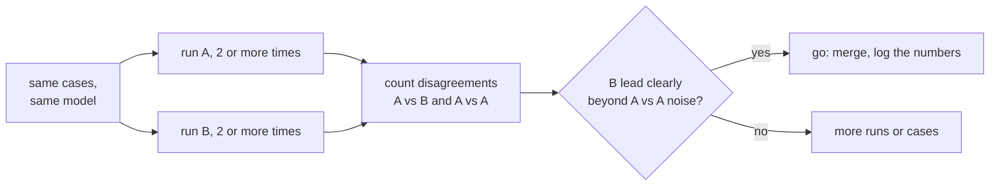

# पाठ 19. दो Prompts की तुलना

**मिशन से संबंध:** चरण 8 को पूरा करने का मतलब है "B, A से बेहतर है" ऐसी संख्या के साथ कह पाना जो "क्या यह बस noise है?" वाले सवाल के आगे टिके, पाठ 18 के regression set और evals track के औज़ारों का इस्तेमाल करके।
**मुख्य स्रोत:** [Docs: "Define success criteria and build evaluations", Claude Platform Docs](https://platform.claude.com/docs/en/test-and-evaluate/develop-tests)
**पूर्व-आवश्यकताएँ:** [पाठ 18](0018-a-regression-set-for-a-prompt.md), [Regression set](../GLOSSARY.md)

## वार्म-अप

1. ▢ पाठ 9 ने कई reasoning paths sample किए और बहुमत का उत्तर लिया। शून्य से ज़्यादा temperature पर prompt के एक run के बारे में यह क्या बताता है?

<details markdown="1"><summary>जाँचें</summary>

उसी prompt से अलग-अलग completions निकलती हैं, इसलिए एक run संभावित नतीजों के फैलाव में से एक sample है। एक अकेला score prompt के सामान्य score से ऊँचा या नीचा हो सकता है, बिना कुछ बदले।

</details>

2. ▢ पाठ 16 ने model के बदलाव को prompt के edit से अलग, अपने-आप में एक बदलाव बनाया। तुलना के लिए यह क्यों मायने रखता है?

<details markdown="1"><summary>जाँचें</summary>

तुलना तभी सार्थक है जब अकेली चीज़ जो अलग है वही हो जिसे आप परख रहे हैं। अगर prompt और model दोनों बदले, तो बेहतर score किसी एक के नाम नहीं चढ़ाया जा सकता।

</details>

## यह जानें

### यह पाठ क्या इस्तेमाल करता है, और क्या नहीं सिखाता

यह पाठ evals track को लागू करता है। अंतर को उसके noise के सामने कैसे पढ़ें, और paired comparison ज़्यादा तेज़ औज़ार क्यों है, यह [उस track का पाठ 9](../../evals/lessons/0009-statistical-significance-vs-noise.md) और उसकी [go/no-go sheet](../../evals/reference/go-no-go.md) है। यहाँ उसे दो prompts पर लागू किया गया है। Evaluations बनाने पर Anthropic की गाइड भी baseline या पहले के version से तुलना को एक मानक विधि के रूप में गिनाती है।

### वही cases, वही model, एक फ़र्क़

Prompt A और prompt B को उसी regression set पर, उसी pin किए हुए model पर चलाएँ, सिर्फ़ prompt बदलते हुए। हर case का pass या fail दर्ज करें, सिर्फ़ कुल नहीं। अगर कोई model outputs को grade करता है, तो पहले उस grader को calibrate करें: [judge-prompt का डिज़ाइन और calibration](../../evals/lessons/0005-judge-prompt-design-and-calibration.md)।

### असहमतियाँ गिनें

दो कुल यह छिपा सकते हैं कि वे कहाँ अलग हैं। वे cases गिनें जो B pass करता है और A fail, और वे जो A pass करता है और B fail। जिन cases को दोनों pass करते हैं या दोनों fail, वे नहीं बताते कि कौन-सा prompt बेहतर है।

```python
def compare(a: dict, b: dict) -> dict:
    """a and b map case id to pass (True) or fail (False), same case ids."""
    only_b = [i for i in a if b[i] and not a[i]]
    only_a = [i for i in a if a[i] and not b[i]]
    return {"b_only": len(only_b), "a_only": len(only_a), "agree": len(a) - len(only_a) - len(only_b)}
```

दोनों गिनतियों को साथ पढ़ें। B 50 में से 44 pass करता है और A 41, इसलिए B 3 से आगे है। `compare` की गिनतियाँ `b_only` 7, `a_only` 4 और `agree` 39 हो सकती हैं: 3-case की बढ़त उन 11 cases पर टिकी है जो सचमुच बदले, और जो 4 B के ख़िलाफ़ गए वे उतने ही मायने रखते हैं जितने 7 जो उसके पक्ष में गए।

### अपने सेट पर noise मापें

A को दो बार चलाएँ और दोनों runs की `compare` से तुलना करें। उनके बीच कुछ नहीं बदला, इसलिए हर असहमति शून्य से ज़्यादा temperature पर हर-run का noise है। मान लें A-बनाम-A तुलना 5 असहमतियाँ देती है, 3 और 2 में बँटी हुई। तब B-बनाम-A की 7 बनाम 4 की बढ़त साफ़ तौर पर उससे बड़ी नहीं है जो बिना बदला prompt अपने-आप कर देता है। Evals track के पाठ 9 के अनुसार, यह अंतर न होने का प्रमाण नहीं है, यह अभी पर्याप्त प्रमाण नहीं है। हर prompt को एक से ज़्यादा बार चलाएँ, cases जोड़ें, या असहमतियों पर significance test चलाएँ।



चलाने से पहले पैमाना तय करें, जैसा go/no-go sheet माँगती है।

## अभ्यास

1. ▢ Prompt A 50 में से 41 cases pass करता है और B 44। जो cases अलग हैं उनमें, 7 B-only pass हैं और 4 A-only pass। कितने cases सहमत हैं, और "B 3 आगे है" अधूरा सारांश क्यों है?

<details markdown="1"><summary>जाँचें</summary>

39 सहमत हैं, क्योंकि 50 में से 7 और 4 घटाने पर 39 बचते हैं। 3 की बढ़त उन 11 cases से आती है जो बदले, जिनमें से 4 B के तहत बदतर हुए। सारांश यह छिपाता है कि कितना हिला और किस दिशा में।

</details>

2. ▢ आप A को उन्हीं 50 cases पर दो बार चलाते हैं और runs 5 cases पर असहमत हैं, एक दिशा में 3 और दूसरी में 2। पिछले आइटम की तुलना के बारे में यह आपको क्या बताता है?

<details markdown="1"><summary>जाँचें</summary>

बिना बदले prompt ने अपने-आप 5 cases हिला दिए, इसलिए B की 11 असहमतियाँ, 7 और 4 में बँटी, साफ़ तौर पर उससे आगे नहीं हैं। नतीजा नकारात्मक नहीं बल्कि अनिर्णायक है: हर prompt को ज़्यादा बार चलाएँ, cases जोड़ें, या असहमतियों को परखें।

</details>

3. ▢ `a = {"c1": True, "c2": True, "c3": False, "c4": False, "c5": True}` और `b = {"c1": True, "c2": False, "c3": True, "c4": True, "c5": True}` के लिए `compare(a, b)` का अनुमान लगाएँ।

<details markdown="1"><summary>संकेत</summary>

हर case को एक-एक करके जाँचें कि दोनों नतीजे अलग हैं या नहीं और कौन-सा pass हुआ।

</details>

<details markdown="1"><summary>जाँचें</summary>

`{"b_only": 2, "a_only": 1, "agree": 2}`. Cases `c3` और `c4` B-only pass हैं, `c2` A-only pass है, और `c1` व `c5` सहमत हैं। B तीन बदले हुए cases पर एक की बढ़त रखता है।

</details>

4. ▢ एक टीम दो prompts की तुलना करती है, पर prompt B नए model पर भी चलता है। B ऊँचा score करता है। कौन-सा निष्कर्ष उचित है?

    - a) B का prompt बेहतर है, क्योंकि उन्हीं cases पर score ऊँचा है
    - b) नया model बेहतर है, क्योंकि models prompts से ज़्यादा मायने रखते हैं
    - c) अभी prompt के बारे में कुछ नहीं, क्योंकि दो चीज़ें बदलीं और अलग नहीं की जा सकतीं
    - d) तुलना तब वैध है जब दोनों prompts शून्य temperature पर चलें

<details markdown="1"><summary>जाँचें</summary>

**c)** Prompt और model दोनों अलग हैं, इसलिए बढ़त किसी एक के नाम नहीं चढ़ सकती। B के prompt को पुराने model पर चलाकर उसे अलग करें। (a) दूसरे बदलाव को नज़रअंदाज़ करता है। (b) वही ग़लती दूसरी दिशा में करता है। (d) कुछ sampling noise हटाता है पर confound नहीं हटाता, और पाठ की विधि noise को मापना है, उसे मानकर हटा देना नहीं।

</details>

## असली दुनिया का अभ्यास

- [ ] हाल में किया हुआ कोई prompt बदलाव लें और दोनों versions को cases के एक सेट पर चलाएँ, फिर हर दिशा में अलग cases की सूची बनाएँ।
- [ ] मूल prompt को उस सेट पर दो बार चलाएँ और गिनें कि दोनों runs के बीच कितने cases असहमत हैं।
- [ ] कल: कुछ भी चलाने से पहले लिखें कि A-बनाम-A noise के ऊपर B को कितनी बढ़त दिखानी चाहिए ताकि आप उसे ship करें।

## आगे बढ़ने के लिए

- [evals track का पाठ 9: Statistical Significance बनाम Noise](../../evals/lessons/0009-statistical-significance-vs-noise.md)
- [Go/No-Go](../../evals/reference/go-no-go.md)
- [Docs: "Define success criteria and build evaluations", Claude Platform Docs](https://platform.claude.com/docs/en/test-and-evaluate/develop-tests)
- [Production में Prompts](../reference/prompts-in-production.md)
- [संसाधन](../RESOURCES.md)

---

बात नहीं बन रही? ऊपर दिए primary source को दोबारा पढ़ें, क्योंकि यह पाठ उसे संक्षिप्त करता है और समझ संक्षेप में ही रिसती है। जो शब्द फिसलन भरा लगे, उसके लिए [शब्दावली](../GLOSSARY.md) देखें।

अगर दिक़्क़त सामग्री की नहीं बल्कि पाठ की ही है, तो वह एक खोट है: [issue खोलें](https://github.com/TokenCemetery/teach/issues)।
