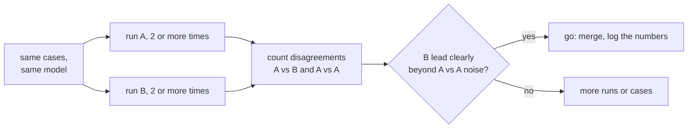

# Lesson 19. Comparing Two Prompts

**Mission link:** Closing stage 8 means being able to say "B beats A" with a number that survives the question "is that just noise?", using the regression set from lesson 18 and the evals track's tools.
**Primary source:** [Docs: "Define success criteria and build evaluations", Claude Platform Docs](https://platform.claude.com/docs/en/test-and-evaluate/develop-tests)
**Prerequisites:** [Lesson 18](0018-a-regression-set-for-a-prompt.md), [Regression set](../GLOSSARY.md)

## Warm-up

1. ▢ Lesson 9 sampled several reasoning paths and took a majority answer. What does that tell you about a single run of a prompt at a nonzero temperature?

<details markdown="1"><summary>Check</summary>

Different completions come out of the same prompt, so one run is one sample from a spread of possible results. A single score can be higher or lower than the prompt's typical score without anything having changed.

</details>

2. ▢ Lesson 16 made a model change a change in its own right, separate from a prompt edit. Why does that matter for a comparison?

<details markdown="1"><summary>Check</summary>

A comparison is only meaningful if the single thing that differs is the thing you are testing. If the prompt and the model both changed, a better score cannot be assigned to either.

</details>

## Know this

### What this lesson uses, and does not teach

This lesson applies the evals track. How to read a gap against its noise, and why a paired comparison is the sharper tool, is [lesson 9 of that track](../../evals/lessons/0009-statistical-significance-vs-noise.md) and its [go/no-go sheet](../../evals/reference/go-no-go.md). Here it is applied to two prompts. Anthropic's guide on building evaluations also lists comparing against a baseline or earlier version as a standard method.

### Same cases, same model, one difference

Run prompt A and prompt B on the same regression set, on the same pinned model, changing only the prompt. Record pass or fail per case, not just the totals. If a model grades the outputs, calibrate that grader first: [judge-prompt design and calibration](../../evals/lessons/0005-judge-prompt-design-and-calibration.md).

### Count the disagreements

Two totals can hide where they differ. Count the cases B passes and A fails, and the cases A passes and B fails. Cases both pass or both fail say nothing about which prompt is better.

```python
def compare(a: dict, b: dict) -> dict:
    """a and b map case id to pass (True) or fail (False), same case ids."""
    only_b = [i for i in a if b[i] and not a[i]]
    only_a = [i for i in a if a[i] and not b[i]]
    return {"b_only": len(only_b), "a_only": len(only_a), "agree": len(a) - len(only_a) - len(only_b)}
```

Read the two counts together. B passes 44 of 50 and A passes 41, so B leads by 3. The `compare` counts might be `b_only` 7, `a_only` 4 and `agree` 39: the 3-case lead sits on 11 cases that actually changed, and the 4 that moved against B matter as much as the 7 that moved for it.

### Measure the noise on your own set

Run A twice and compare the two runs with `compare`. Nothing changed between them, so every disagreement is run-to-run noise at nonzero temperature. Suppose the A-against-A comparison gives 5 disagreements, split 3 and 2. The B-against-A lead of 7 against 4 is then not clearly bigger than what an unchanged prompt does by itself. Per lesson 9 of the evals track, that is not evidence of no difference, it is not enough evidence yet. Run each prompt more than once, add cases, or run a significance test on the disagreements.



Set the bar before you run, as the go/no-go sheet requires.

## Practice

1. ▢ Prompt A passes 41 of 50 cases and B passes 44. Of the cases that differ, 7 are B-only passes and 4 are A-only passes. How many cases agree, and why is "B is 3 ahead" an incomplete summary?

<details markdown="1"><summary>Check</summary>

39 agree, since 50 minus 7 minus 4 is 39. The lead of 3 comes from 11 cases that changed, with 4 of them getting worse under B. The summary hides how much moved and in which direction.

</details>

2. ▢ You run A twice on the same 50 cases and the runs disagree on 5 cases, 3 in one direction and 2 in the other. What does this tell you about the comparison in the previous item?

<details markdown="1"><summary>Check</summary>

An unchanged prompt moved 5 cases on its own, so B's 11 disagreements split 7 and 4 is not clearly beyond that. The result is inconclusive rather than negative: run each prompt more times, add cases, or test the disagreements.

</details>

3. ▢ Predict `compare(a, b)` for `a = {"c1": True, "c2": True, "c3": False, "c4": False, "c5": True}` and `b = {"c1": True, "c2": False, "c3": True, "c4": True, "c5": True}`.

<details markdown="1"><summary>Hint</summary>

Check each case, one at a time, for whether the two results differ and which one passed.

</details>

<details markdown="1"><summary>Check</summary>

`{"b_only": 2, "a_only": 1, "agree": 2}`. Cases `c3` and `c4` are B-only passes, `c2` is an A-only pass, and `c1` and `c5` agree. B leads by one case on three that changed.

</details>

4. ▢ A team compares two prompts, but prompt B also runs on a newer model. B scores higher. Which conclusion is justified?

    - a) B's prompt is better, since the score is higher on the same cases
    - b) The newer model is better, because models matter more than prompts
    - c) Nothing yet about the prompt, since two things changed and cannot be separated
    - d) The comparison is valid once both prompts run at a temperature of zero

<details markdown="1"><summary>Check</summary>

**c)** The prompt and the model both differ, so the gain cannot be assigned to either. Run B's prompt on the old model to isolate it. (a) ignores the second change. (b) makes the same error in the other direction. (d) removes some sampling noise but does not remove the confound, and the lesson's method is to measure noise, not assume it away.

</details>

## Real-world reps

- [ ] Take a prompt change you made recently and run both versions on one set of cases, then list the cases that differ in each direction.
- [ ] Run the original prompt twice on that set and count how many cases disagree between the two runs.
- [ ] Tomorrow: write down, before running anything, the lead B must show over the A-against-A noise for you to ship it.

## Going further

- [Lesson 9 of the evals track: Statistical Significance vs Noise](../../evals/lessons/0009-statistical-significance-vs-noise.md)
- [Go/No-Go](../../evals/reference/go-no-go.md)
- [Docs: "Define success criteria and build evaluations", Claude Platform Docs](https://platform.claude.com/docs/en/test-and-evaluate/develop-tests)
- [Prompts in Production](../reference/prompts-in-production.md)
- [Resources](../RESOURCES.md)

---

Not landing? Reread the primary source at the top, since this lesson compresses it and compression is where understanding leaks. Check the [glossary](../GLOSSARY.md) for any term that felt slippery.

If the lesson itself is unclear rather than the material, that is a defect: [open an issue](https://github.com/TokenCemetery/teach/issues).
