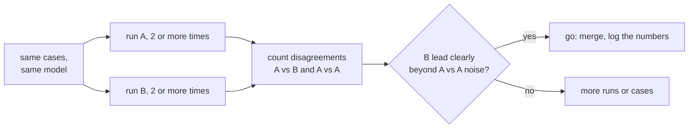

# Lição 19. Comparando dois prompts

**Ligação com a missão:** Concluir o estágio 8 significa conseguir dizer "B supera A" com um número que sobreviva à pergunta "isso é só ruído?", usando o conjunto de regressão da lição 18 e as ferramentas da trilha de evals.
**Fonte principal:** [Docs: "Define success criteria and build evaluations", Claude Platform Docs](https://platform.claude.com/docs/en/test-and-evaluate/develop-tests)
**Pré-requisitos:** [Lição 18](0018-a-regression-set-for-a-prompt.md), [Conjunto de regressão](../GLOSSARY.md)

## Aquecimento

1. ▢ A lição 9 amostrou vários caminhos de raciocínio e ficou com a resposta da maioria. O que isso diz sobre uma única execução de um prompt com temperatura diferente de zero?

<details markdown="1"><summary>Verificação</summary>

Completions diferentes saem do mesmo prompt, então uma execução é uma amostra de uma dispersão de resultados possíveis. Uma única pontuação pode ficar acima ou abaixo da pontuação típica do prompt sem que nada tenha mudado.

</details>

2. ▢ A lição 16 fez da troca de modelo uma mudança por si só, separada da edição de um prompt. Por que isso importa para uma comparação?

<details markdown="1"><summary>Verificação</summary>

Uma comparação só faz sentido se a única coisa que difere é aquilo que você está testando. Se o prompt e o modelo mudaram, uma pontuação melhor não pode ser atribuída a nenhum dos dois.

</details>

## Saiba isto

### O que esta lição usa e o que ela não ensina

Esta lição aplica a trilha de evals. Como ler uma diferença diante do seu ruído, e por que uma comparação pareada é a ferramenta mais precisa, está na [lição 9 da trilha de evals](../../evals/lessons/0009-statistical-significance-vs-noise.md) e na sua folha [Go/No-Go](../../evals/reference/go-no-go.md). Aqui ela é aplicada a dois prompts. O guia da Anthropic sobre como construir avaliações também lista a comparação com uma linha de base ou com uma versão anterior como método padrão.

### Mesmos casos, mesmo modelo, uma diferença

Execute o prompt A e o prompt B no mesmo conjunto de regressão, no mesmo modelo fixado, mudando apenas o prompt. Registre aprovado ou reprovado por caso, não só os totais. Se um modelo avalia as saídas, calibre esse avaliador primeiro: [lição 5 da trilha de evals](../../evals/lessons/0005-judge-prompt-design-and-calibration.md).

### Conte as discordâncias

Dois totais podem esconder onde eles diferem. Conte os casos que B aprova e A reprova, e os casos que A aprova e B reprova. Casos que ambos aprovam ou ambos reprovam não dizem nada sobre qual prompt é melhor.

```python
def compare(a: dict, b: dict) -> dict:
    """a and b map case id to pass (True) or fail (False), same case ids."""
    only_b = [i for i in a if b[i] and not a[i]]
    only_a = [i for i in a if a[i] and not b[i]]
    return {"b_only": len(only_b), "a_only": len(only_a), "agree": len(a) - len(only_a) - len(only_b)}
```

Leia as duas contagens juntas. B aprova 44 de 50 e A aprova 41, então B lidera por 3. As contagens de `compare` podem ser `b_only` 7, `a_only` 4 e `agree` 39: a vantagem de 3 casos se apoia em 11 casos que de fato mudaram, e os 4 que se moveram contra B importam tanto quanto os 7 que se moveram a favor.

### Meça o ruído no seu próprio conjunto

Execute A duas vezes e compare as duas execuções com `compare`. Nada mudou entre elas, então toda discordância é ruído entre execuções com temperatura diferente de zero. Suponha que a comparação de A contra A dê 5 discordâncias, divididas em 3 e 2. A vantagem de 7 contra 4 de B sobre A então não é claramente maior do que aquilo que um prompt inalterado faz sozinho. Segundo a lição 9 da trilha de evals, isso não é evidência de ausência de diferença, é evidência ainda insuficiente. Execute cada prompt mais de uma vez, adicione casos ou rode um teste de significância sobre as discordâncias.



Defina o critério antes de executar, como a folha de go/no-go exige.

## Prática

1. ▢ O prompt A aprova 41 de 50 casos e B aprova 44. Entre os casos que diferem, 7 são aprovações só de B e 4 são aprovações só de A. Quantos casos concordam, e por que "B está 3 à frente" é um resumo incompleto?

<details markdown="1"><summary>Verificação</summary>

39 concordam, pois 50 menos 7 menos 4 dá 39. A vantagem de 3 vem de 11 casos que mudaram, 4 deles piorando com B. O resumo esconde quanto se moveu e em que direção.

</details>

2. ▢ Você executa A duas vezes nos mesmos 50 casos e as execuções discordam em 5 casos, 3 em uma direção e 2 na outra. O que isso diz sobre a comparação do item anterior?

<details markdown="1"><summary>Verificação</summary>

Um prompt inalterado moveu 5 casos por conta própria, então as 11 discordâncias de B, divididas em 7 e 4, não estão claramente além disso. O resultado é inconclusivo, não negativo: execute cada prompt mais vezes, adicione casos ou teste as discordâncias.

</details>

3. ▢ Preveja `compare(a, b)` para `a = {"c1": True, "c2": True, "c3": False, "c4": False, "c5": True}` e `b = {"c1": True, "c2": False, "c3": True, "c4": True, "c5": True}`.

<details markdown="1"><summary>Dica</summary>

Verifique cada caso, um de cada vez, para ver se os dois resultados diferem e qual deles passou.

</details>

<details markdown="1"><summary>Verificação</summary>

`{"b_only": 2, "a_only": 1, "agree": 2}`. Os casos `c3` e `c4` são aprovações só de B, `c2` é uma aprovação só de A, e `c1` e `c5` concordam. B lidera por um caso entre três que mudaram.

</details>

4. ▢ Uma equipe compara dois prompts, mas o prompt B também roda em um modelo mais novo. B pontua mais alto. Qual conclusão se justifica?

    - a) O prompt de B é melhor, já que a pontuação é maior nos mesmos casos
    - b) O modelo mais novo é melhor, porque modelos importam mais que prompts
    - c) Ainda nada sobre o prompt, pois duas coisas mudaram e não podem ser separadas
    - d) A comparação é válida quando os dois prompts rodam com temperatura zero

<details markdown="1"><summary>Verificação</summary>

**c)** O prompt e o modelo diferem, então o ganho não pode ser atribuído a nenhum dos dois. Execute o prompt de B no modelo antigo para isolá-lo. (a) ignora a segunda mudança. (b) comete o mesmo erro na direção oposta. (d) remove parte do ruído de amostragem, mas não remove o fator de confusão, e o método da lição é medir o ruído, não presumir que ele não existe.

</details>

## Prática no mundo real

- [ ] Pegue uma mudança de prompt que você fez recentemente e execute as duas versões em um conjunto de casos, depois liste os casos que diferem em cada direção.
- [ ] Execute o prompt original duas vezes nesse conjunto e conte quantos casos discordam entre as duas execuções.
- [ ] Amanhã: anote, antes de executar qualquer coisa, a vantagem que B precisa mostrar sobre o ruído de A contra A para você colocá-lo em produção.

## Para ir além

- [lição 9 da trilha de evals](../../evals/lessons/0009-statistical-significance-vs-noise.md)
- [Go/No-Go](../../evals/reference/go-no-go.md)
- [Docs: "Define success criteria and build evaluations", Claude Platform Docs](https://platform.claude.com/docs/en/test-and-evaluate/develop-tests)
- [Prompts em Produção](../reference/prompts-in-production.md)
- [Recursos](../RESOURCES.md)

---

Não ficou claro? Releia a fonte principal no topo, pois esta lição a comprime e é na compressão que o entendimento se perde. Consulte o [glossário](../GLOSSARY.md) para qualquer termo que tenha parecido escorregadio.

Se a lição em si é que não está clara, e não o material, isso é um defeito: [abra uma issue](https://github.com/TokenCemetery/teach/issues).
