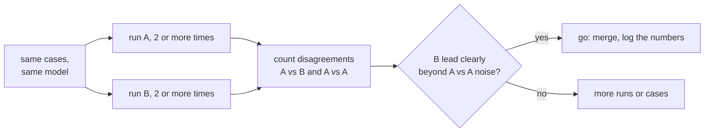

# Урок 19. Сравнение двух промптов

**Связь с целью курса:** Завершить этап 8 значит уметь сказать «B лучше A» числом, которое выдерживает вопрос «а не шум ли это?», используя регрессионный набор из урока 18 и инструменты трека про оценки.
**Первоисточник:** [Документация: «Define success criteria and build evaluations», Claude Platform Docs](https://platform.claude.com/docs/en/test-and-evaluate/develop-tests)
**Предварительные требования:** [Урок 18](0018-a-regression-set-for-a-prompt.md), [Регрессионный набор](../GLOSSARY.md)

## Разминка

1. ▢ В уроке 9 мы сэмплировали несколько путей рассуждения и брали ответ большинства. Что это говорит об одном запуске промпта при ненулевой температуре?

<details markdown="1"><summary>Проверка</summary>

Один и тот же промпт даёт разные ответы, поэтому один запуск даёт одну выборку из разброса возможных результатов. Единичная оценка может быть выше или ниже типичной оценки промпта, хотя ничего не менялось.

</details>

2. ▢ Урок 16 сделал смену модели самостоятельным изменением, отдельным от правки промпта. Почему это важно для сравнения?

<details markdown="1"><summary>Проверка</summary>

Сравнение осмысленно, только если единственное отличие совпадает с тем, что вы проверяете. Если изменились и промпт, и модель, лучший результат нельзя отнести ни к одному из них.

</details>

## Что нужно знать

### Что этот урок использует и чему не учит

Этот урок применяет трек про оценки. Как читать разрыв на фоне шума и почему парное сравнение является более острым инструмент, объясняет [урок 9 того трека](../../evals/lessons/0009-statistical-significance-vs-noise.md) и его [лист go/no-go](../../evals/reference/go-no-go.md). Здесь это применяется к двум промптам. Руководство Anthropic по построению оценок тоже называет стандартным методом сравнение с базовой или предыдущей версией.

### Те же случаи, та же модель, одно отличие

Прогоните промпт A и промпт B на одном и том же регрессионном наборе, на одной и той же зафиксированной модели, меняя только промпт. Записывайте прохождение или падение по каждому случаю, а не только итоги. Если выводы оценивает модель, сначала откалибруйте этого оценщика: [проектирование и калибровка промпта-судьи](../../evals/lessons/0005-judge-prompt-design-and-calibration.md).

### Считайте расхождения

Два итога могут скрывать, где именно они различаются. Посчитайте случаи, которые B проходит, а A проваливает, и случаи, которые A проходит, а B проваливает. Случаи, которые оба проходят или оба проваливают, ничего не говорят о том, какой промпт лучше.

```python
def compare(a: dict, b: dict) -> dict:
    """a and b map case id to pass (True) or fail (False), same case ids."""
    only_b = [i for i in a if b[i] and not a[i]]
    only_a = [i for i in a if a[i] and not b[i]]
    return {"b_only": len(only_b), "a_only": len(only_a), "agree": len(a) - len(only_a) - len(only_b)}
```

Читайте оба числа вместе. B проходит 44 из 50, A проходит 41, так что B впереди на 3. Результат `compare` может быть таким: `b_only` 7, `a_only` 4 и `agree` 39. Преимущество в 3 случая опирается на 11 случаев, которые действительно изменились, и 4 случая, сдвинувшихся не в пользу B, важны так же, как 7, сдвинувшихся в его пользу.

### Измерьте шум на своём наборе

Прогоните A дважды и сравните два запуска через `compare`. Между ними ничего не менялось, поэтому каждое расхождение является шумом между запусками при ненулевой температуре. Допустим, сравнение A с A даёт 5 расхождений, разделённых как 3 и 2. Тогда преимущество B над A (7 против 4) явно не больше того, что делает сам по себе неизменённый промпт. Согласно уроку 9 трека про оценки, это не доказательство отсутствия различия, а пока недостаточное доказательство. Прогоните каждый промпт больше одного раза, добавьте случаи или проведите тест значимости на расхождениях.



Задайте порог до запуска, как того требует лист go/no-go.

## Практика

1. ▢ Промпт A проходит 41 из 50 случаев, B проходит 44. Среди различающихся случаев 7 проходит только B и 4 проходит только A. Сколько случаев совпадает и почему «B впереди на 3» является неполным резюме?

<details markdown="1"><summary>Проверка</summary>

Совпадает 39, так как 50 минус 7 минус 4 равно 39. Преимущество в 3 получено из 11 изменившихся случаев, и 4 из них стали хуже под B. Такое резюме скрывает, сколько случаев сдвинулось и в какую сторону.

</details>

2. ▢ Вы прогоняете A дважды на тех же 50 случаях, и запуски расходятся в 5 случаях: 3 в одну сторону и 2 в другую. Что это говорит о сравнении из предыдущего пункта?

<details markdown="1"><summary>Проверка</summary>

Неизменённый промпт сам сдвинул 5 случаев, поэтому 11 расхождений B, разделённые как 7 и 4, явно не выходят за эти рамки. Результат неопределённый, а не отрицательный: прогоните каждый промпт больше раз, добавьте случаи или проверьте расхождения тестом.

</details>

3. ▢ Предскажите `compare(a, b)` для `a = {"c1": True, "c2": True, "c3": False, "c4": False, "c5": True}` и `b = {"c1": True, "c2": False, "c3": True, "c4": True, "c5": True}`.

<details markdown="1"><summary>Подсказка</summary>

Проверьте каждый случай по очереди: различаются ли два результата и какой из них прошёл.

</details>

<details markdown="1"><summary>Проверка</summary>

`{"b_only": 2, "a_only": 1, "agree": 2}`. Случаи `c3` и `c4` проходит только B, `c2` проходит только A, а `c1` и `c5` совпадают. B впереди на один случай из трёх изменившихся.

</details>

4. ▢ Команда сравнивает два промпта, но промпт B ещё и выполняется на более новой модели. B получает более высокую оценку. Какой вывод оправдан?

    - a) Промпт B лучше, так как оценка выше на тех же случаях
    - b) Новая модель лучше, потому что модели важнее промптов
    - c) О промпте пока ничего, так как изменились две вещи, и их нельзя разделить
    - d) Сравнение корректно, как только оба промпта выполняются при температуре ноль

<details markdown="1"><summary>Проверка</summary>

**c)** И промпт, и модель различаются, поэтому прирост нельзя отнести ни к одному из них. Прогоните промпт B на старой модели, чтобы изолировать его. Вариант (a) игнорирует второе изменение. Вариант (b) совершает ту же ошибку в другую сторону. Вариант (d) убирает часть шума сэмплирования, но не устраняет смешивающий фактор, а метод урока состоит в том, чтобы измерять шум, а не отметать его допущением.

</details>

## Практика в реальной работе

- [ ] Возьмите изменение промпта, которое вы недавно сделали, прогоните обе версии на одном наборе случаев и перечислите случаи, различающиеся в каждую сторону.
- [ ] Прогоните исходный промпт на этом наборе дважды и посчитайте, сколько случаев расходится между двумя запусками.
- [ ] Завтра: запишите до запуска чего-либо, какое преимущество B должен показать над шумом A против A, чтобы вы выкатили его.

## Что почитать дальше

- [Урок 9 трека про оценки: Статистическая значимость и шум](../../evals/lessons/0009-statistical-significance-vs-noise.md)
- [Go/No-Go](../../evals/reference/go-no-go.md)
- [Документация: «Define success criteria and build evaluations», Claude Platform Docs](https://platform.claude.com/docs/en/test-and-evaluate/develop-tests)
- [Промпты в продакшене](../reference/prompts-in-production.md)
- [Ресурсы](../RESOURCES.md)

---

Не получается? Перечитайте первоисточник в начале: этот урок сжимает его, а при сжатии понимание как раз и утекает. Загляните в [глоссарий](../GLOSSARY.md), если какой-то термин показался скользким.

Если неясен сам урок, а не материал, это дефект: [откройте issue](https://github.com/TokenCemetery/teach/issues).
