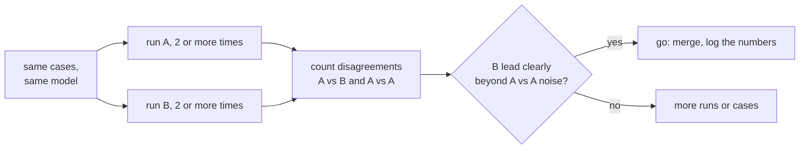

# 第 19 课：比较两个提示词

**使命关联:** 完成第 8 阶段，意味着你能用第 18 课的回归集和评测系列的工具，说出“B 胜过 A”，并且这个数字经得起“这只是噪声吧？”的追问。
**主要来源:** [文档：“Define success criteria and build evaluations”，Claude Platform Docs](https://platform.claude.com/docs/en/test-and-evaluate/develop-tests)
**前置知识:** [第 18 课](0018-a-regression-set-for-a-prompt.md)、[回归集](../GLOSSARY.md)

## 热身

1. ▢ 第 9 课对多条推理路径进行采样，并取多数答案。这对于在非零温度下只运行一次提示词，说明了什么？

<details markdown="1"><summary>检查</summary>

同一个提示词会产生不同的补全，所以一次运行只是从一片可能结果中取出的一个样本。单次得分可能比这个提示词的典型得分更高或更低，而什么都没有改变。

</details>

2. ▢ 第 16 课把更换模型视为一种独立的改动，与提示词的编辑区分开。这对比较为什么重要？

<details markdown="1"><summary>检查</summary>

只有当唯一不同的东西正是你要测试的东西时，比较才有意义。如果提示词和模型都变了，更好的得分就无法归功于其中任何一个。

</details>

## 要点

### 本课用到什么，不教什么

本课应用的是评测系列的内容。如何对照噪声来解读差距，以及为什么成对比较是更锐利的工具，见[评测系列第 9 课：统计显著性与噪声](../../evals/lessons/0009-statistical-significance-vs-noise.md)和它的[通过与否速查表](../../evals/reference/go-no-go.md)。这里把它应用到两个提示词上。Anthropic 的评测构建指南也把与基线或早期版本对比列为一种标准方法。

### 相同的用例，相同的模型，只有一处不同

在同一个回归集、同一个固定的模型上运行提示词 A 和提示词 B，只改变提示词。记录每个用例的通过或失败，而不只是总数。如果由模型来给输出评分，要先校准这个评分器：[评测系列第 5 课：评判提示词的设计与校准](../../evals/lessons/0005-judge-prompt-design-and-calibration.md)。

### 数一数分歧

两个总数可能掩盖它们到底在哪里不同。数一数 B 通过而 A 失败的用例，以及 A 通过而 B 失败的用例。两者都通过或都失败的用例，不能说明哪个提示词更好。

```python
def compare(a: dict, b: dict) -> dict:
    """a and b map case id to pass (True) or fail (False), same case ids."""
    only_b = [i for i in a if b[i] and not a[i]]
    only_a = [i for i in a if a[i] and not b[i]]
    return {"b_only": len(only_b), "a_only": len(only_a), "agree": len(a) - len(only_a) - len(only_b)}
```

要把这两个计数放在一起看。B 通过了 50 个中的 44 个，A 通过 41 个，所以 B 领先 3 个。`compare` 的计数可能是 `b_only` 为 7、`a_only` 为 4、`agree` 为 39：这 3 个用例的领先，建立在 11 个真正发生变化的用例上，而朝着不利于 B 的方向变化的那 4 个，与朝着有利于 B 的方向变化的 7 个同样重要。

### 在你自己的集合上测量噪声

把 A 运行两次，用 `compare` 比较这两次运行。两次之间什么都没变，所以每一个分歧都是非零温度下每次运行之间的噪声。假设 A 对 A 的比较给出 5 个分歧，分成 3 和 2。那么 B 对 A 的 7 比 4 的领先，就并不明显大于一个没变的提示词自己造成的波动。按评测系列第 9 课的说法，这不是没有差异的证据，而是证据还不够。把每个提示词多运行几次，增加用例，或者对这些分歧做显著性检验。



要在运行之前就把门槛定好，通过与否判定表就是这样要求的。

## 练习

1. ▢ 提示词 A 通过了 50 个用例中的 41 个，B 通过 44 个。在有差异的用例中，7 个是只有 B 通过，4 个是只有 A 通过。有多少个用例是一致的？为什么“B 领先 3 个”是一个不完整的概括？

<details markdown="1"><summary>检查</summary>

39 个一致，因为 50 减 7 再减 4 等于 39。这 3 个的领先来自 11 个发生变化的用例，其中 4 个在 B 下变差了。这个概括掩盖了有多少用例发生了变化，以及朝哪个方向变化。

</details>

2. ▢ 你把 A 在同样的 50 个用例上运行两次，两次运行在 5 个用例上不一致，一个方向 3 个，另一个方向 2 个。这对上一题的比较说明了什么？

<details markdown="1"><summary>检查</summary>

一个没有变化的提示词自己就让 5 个用例发生了变动，所以 B 的 11 个分歧分成 7 和 4，并不明显超出这个范围。这个结果是没有定论，而不是否定的：把每个提示词多运行几次，增加用例，或者对分歧做检验。

</details>

3. ▢ 对于 `a = {"c1": True, "c2": True, "c3": False, "c4": False, "c5": True}` 和 `b = {"c1": True, "c2": False, "c3": True, "c4": True, "c5": True}`，预测 `compare(a, b)` 的结果。

<details markdown="1"><summary>提示</summary>

逐个用例检查两个结果是否不同，以及是哪一个通过了。

</details>

<details markdown="1"><summary>检查</summary>

`{"b_only": 2, "a_only": 1, "agree": 2}`。用例 `c3` 和 `c4` 是只有 B 通过，`c2` 是只有 A 通过，`c1` 和 `c5` 一致。在发生变化的三个用例里，B 领先一个。

</details>

4. ▢ 一个团队比较两个提示词，但提示词 B 还运行在一个更新的模型上。B 的得分更高。哪个结论是站得住脚的？

    - a) B 的提示词更好，因为在同样的用例上得分更高
    - b) 更新的模型更好，因为模型比提示词更重要
    - c) 关于提示词暂时什么也说不了，因为有两样东西变了，无法分开
    - d) 只要两个提示词都在温度为零的条件下运行，这个比较就有效

<details markdown="1"><summary>检查</summary>

**c)** 提示词和模型都不同，所以这个提升无法归功于任何一方。把 B 的提示词放在旧模型上运行，才能把它单独分离出来。(a) 忽略了第二处改动。(b) 犯了同样的错误，只是方向相反。(d) 去掉了一部分采样噪声，但没有去掉混杂因素，而且本课的方法是测量噪声，而不是想当然地假设它不存在。

</details>

## 实战练习

- [ ] 拿一个你最近做过的提示词改动，在同一组用例上运行两个版本，然后列出两个方向上各有哪些用例不同。
- [ ] 在那组用例上把原来的提示词运行两次，数一数两次运行之间有多少个用例不一致。
- [ ] 明天：在运行任何东西之前，先写下你要上线 B，它必须比 A 对 A 的噪声领先多少。

## 延伸阅读

- [评测系列第 9 课：统计显著性与噪声](../../evals/lessons/0009-statistical-significance-vs-noise.md)
- [通过与否速查表](../../evals/reference/go-no-go.md)
- [文档：“Define success criteria and build evaluations”，Claude Platform Docs](https://platform.claude.com/docs/en/test-and-evaluate/develop-tests)
- [生产环境中的提示词](../reference/prompts-in-production.md)
- [资源](../RESOURCES.md)

---

没学明白？请重读顶部的主要来源，因为本课是对它的压缩，而理解正是在压缩中流失的。如果有哪个术语觉得含糊，可以查看[术语表](../GLOSSARY.md)。

如果问题出在课程本身，而不是学习材料，那就是一个缺陷：[提交 issue](https://github.com/TokenCemetery/teach/issues)。
