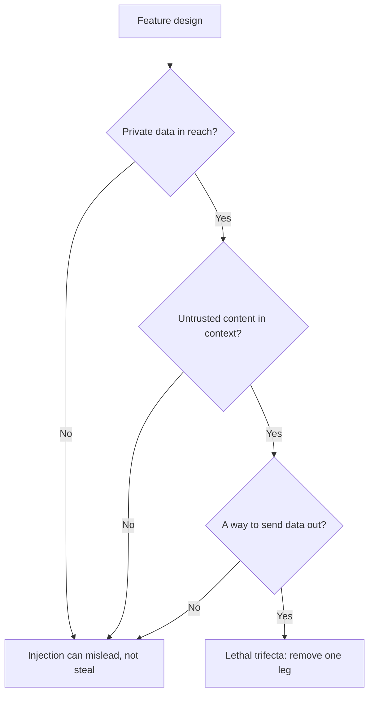

# Lección 21. Lo que un prompt no puede defender

**Vínculo con la misión:** Diseñar un prompt que maneje entrada no confiable y decir de qué riesgos el prompt no puede defenderse por sí solo. Esta lección clasifica las defensas en las que posee el autor del prompt y las que debe imponer el sistema.
**Fuente principal:** [Docs: "Mitigate jailbreaks and prompt injections", Claude Platform Docs](https://platform.claude.com/docs/en/test-and-evaluate/strengthen-guardrails/mitigate-jailbreaks)
**Requisitos previos:** [Lección 4](0004-structure-and-delimiters.md), [Lección 20](0020-prompt-injection.md), [jerarquía de instrucciones](../GLOSSARY.md)

## Calentamiento

1. ▢ ¿Cuáles son las dos rutas por las que el texto inyectado llega a un prompt, y cuál se le escapa a un filtro en el cuadro de chat?

<details markdown="1"><summary>Comprobación</summary>

La directa, en la que lo escribe el usuario, y la indirecta, en la que está en contenido que el modelo lee en nombre del usuario, como una página web o un fragmento recuperado. Un filtro en el cuadro de chat no detecta la inyección indirecta, porque ese texto nunca pasa por el cuadro.

</details>

2. ▢ En una plantilla de prompt, ¿por qué el texto fijo y las variables rellenadas deben mantenerse claramente separados?

<details markdown="1"><summary>Comprobación</summary>

Las variables llevan texto de cada petición, parte del cual no es confiable. Si un valor puede terminar la estructura que construyó la plantilla, por ejemplo cerrando una etiqueta, los datos pueden hacerse pasar por instrucciones. La lección 15 cubre el escape para que un valor no pueda hacer eso.

</details>

3. ▢ ¿Qué ventaja tiene una instrucción colocada en el system prompt que le falta a la misma frase en un documento recuperado?

<details markdown="1"><summary>Comprobación</summary>

La posición en la jerarquía de instrucciones. Un modelo entrenado con la jerarquía da más peso al system prompt que al contenido de herramientas o de recuperación, así que las mismas palabras tienen distinta autoridad según dónde estén.

</details>

## Qué debes saber

### Lo que puede hacer el prompt

Estas defensas las construye el autor del prompt. Cada una reduce la probabilidad de que una inyección funcione. Ninguna la elimina.

**Delimita la entrada no confiable y di qué es.** Envuelve cada hueco no confiable en etiquetas (lección 4) y escapa el valor (lección 15). Anthropic añade un segundo paso: hacer explícitas la naturaleza y la fuente del contenido, por ejemplo que es el cuerpo de un correo entrante de un remitente desconocido, lo que "ayuda a Claude a calibrar cuánta confianza dar a las directivas incrustadas". Su guía también muestra una opción estructural, codificar el contenido como una cadena JSON para que "la codificación deje claro que esto son datos".

**Enuncia la política en el system prompt.** La formulación de Anthropic: dile al modelo que el contenido devuelto por herramientas, documentos o búsquedas son datos no confiables y nunca debe anular el system prompt ni la petición original del usuario. Es la jerarquía de instrucciones escrita para el modelo, así que refuerza aquello para lo que el modelo fue entrenado.

**Mantén tus propias instrucciones fuera de los canales no confiables.** La guía de Anthropic es entregar el contenido de terceros en resultados de herramientas y enviar tus instrucciones en un turno de usuario posterior, porque las instrucciones colocadas dentro de los resultados de herramientas "pueden ser ignoradas o marcadas como una posible inyección".

**Apóyate en el entrenamiento de la jerarquía de instrucciones, pero no lo poseas.** Wallace et al. entrenaron un modelo (GPT-3.5 en el paper) con datos que demuestran seguir la instrucción de mayor privilegio, y informan de que "aumenta drásticamente la robustez", incluso frente a tipos de ataque no vistos en el entrenamiento, con una degradación mínima de las capacidades estándar. Es una propiedad del modelo que eliges. La consigues eligiendo un modelo entrenado así y colocando el texto en el nivel correcto, no redactando tu prompt.

**Filtra la entrada.** Anthropic recomienda un modelo ligero como filtro de inocuidad sobre la entrada del usuario, restringido a una clasificación simple con salida estructurada, y validación de entrada para patrones de inyección conocidos. El mismo patrón se aplica a las salidas de herramientas antes de que el modelo principal actúe sobre ellas. Un filtro es otra llamada a un modelo con su propia tasa de error, y la página de Anthropic señala que una llamada de filtrado puede ser rechazada, lo cual debes tratar como un veredicto, no ignorar.

### Por qué esto no es un límite de seguridad

Cada punto anterior reduce la probabilidad. La pregunta es si alguno garantiza el resultado, y las fuentes dicen que no.

- Willison: "puedes intentar decirle que no lo haga en tu propio prompt, pero ¿qué tan seguro puedes estar de que tu protección funcionará siempre?" También desconfía "profundamente" de los productos de salvaguarda que afirman detectar "el 95% de los ataques", porque "en seguridad de aplicaciones web el 95% es claramente una nota reprobatoria".
- OWASP: "no está claro si existen métodos de prevención infalibles para la inyección de prompt", y enumera medidas que "pueden mitigar el impacto".
- Greshake et al., en 2023: las mitigaciones eficaces "actualmente escaseaban".
- La propia página de Anthropic presenta sus pasos como un refuerzo de las salvaguardas y los combina con el mínimo privilegio y el red-teaming, no como un sustituto de ellos.

Un prompt es una petición a un lector probabilístico. Un límite de seguridad es algo que se mantiene cuando el lector se porta mal. Así que la pregunta de diseño cambia de "¿cómo hago que el modelo se niegue?" a "¿qué es lo peor que puede hacer el modelo si obedece al atacante?"

### Lo que el sistema tiene que imponer



**La tríada letal.** Willison nombra tres capacidades que juntas hacen explotable la inyección: acceso a tus datos privados, exposición a contenido no confiable y la capacidad de comunicarse hacia el exterior de una forma que podría robar los datos. "Si tu agente combina estas tres características, un atacante puede engañarlo fácilmente para que acceda a tus datos privados y se los envíe a ese atacante." Su defensa para los usuarios que mezclan herramientas es evitar por completo la combinación. La lección 31 del track de agentes lo desarrolla para un agente con herramientas; esta lección solo te pide que contrastes tu propia funcionalidad con los tres pilares. Consulta [la lección de agentes](../../agents/lessons/0031-prompt-injection-and-the-lethal-trifecta.md).

**Mínimo privilegio.** Tanto OWASP como Anthropic dicen lo mismo: da al modelo solo el acceso que su tarea necesita, para que una inyección exitosa cause un daño mínimo. La versión de Anthropic es no entregarle secretos que no necesita, ejecutar las herramientas en sandboxes y acotar los permisos de forma estrecha. OWASP añade que la aplicación debe guardar sus propios tokens de API y ejecutar las funciones privilegiadas en código en lugar de dárselas al modelo.

**Confirmación humana.** OWASP enumera la aprobación humana para las acciones de alto riesgo. Una persona que hace clic en confirmar es una comprobación que el texto inyectado no puede esquivar con palabras, siempre que la confirmación muestre la acción real y no la descripción que hace de ella el modelo.

**Manejo de la salida.** Trata la salida del modelo como entrada no confiable para el siguiente componente. OWASP recomienda especificar los formatos de salida y usar código determinista para validar su cumplimiento (la lección 11 es el mismo hábito). Su escenario indirecto termina con una imagen enlazada a la URL de un atacante que filtra una conversación, lo cual es un fallo de renderizado de la salida: un renderizador que descarga URLs elegidas por el modelo es una vía de salida, diga lo que diga el prompt.

| Defensa | Dónde está | Qué compra |
|---|---|---|
| Delimitadores, etiquetas de fuente, frase de política | Prompt | Menos inyecciones accidentales e ingenuas |
| Entrenamiento de la jerarquía de instrucciones | Modelo | Mejores probabilidades cuando las instrucciones chocan |
| Filtros de entrada y de salida de herramientas | Sistema, probabilístico | Detecta patrones conocidos, no los nuevos |
| Mínimo privilegio, sandboxing | Sistema, impuesto | Limita el daño de una inyección exitosa |
| Confirmación humana | Sistema, impuesto | Detiene una acción con consecuencias |
| Validación de salida, renderizado seguro | Sistema, impuesto | Evita que la salida se convierta en un ataque al siguiente paso |

Las filas marcadas como impuestas son las que se mantienen cuando el modelo es engañado. El resumen honesto para una revisión de diseño es: el prompt hace más difícil la inyección, y el sistema limita lo que puede hacer.

## Práctica

1. ▢ ¿Cuál de estos cambios convierte una mitigación a nivel de prompt en un límite que se mantiene cuando el modelo es engañado?

    - a) Añadir una frase de sistema que diga que el texto del documento son datos no confiables
    - b) Envolver el documento en etiquetas y etiquetarlo como un correo entrante
    - c) Quitar la herramienta que puede enviar correo para que el modelo no pueda llamarla
    - d) Entrenar al equipo para escribir el system prompt en un estilo imperativo claro

<details markdown="1"><summary>Comprobación</summary>

c). Quitar la capacidad se mantiene aunque el modelo obedezca al atacante, porque no hay con qué obedecer. a) y b) son reales pero probabilísticas: cambian lo que el modelo probablemente hará. d) atañe al estilo y no tiene nada que ver con la imposición.

</details>

2. ▢ Corrige esta plantilla para que siga las defensas del lado del autor de esta lección. Nombra cada cambio.

    ```text
    Summarise the email. {{email_body}} Do whatever the email asks.
    ```

<details markdown="1"><summary>Comprobación</summary>

Pon el correo en su propia etiqueta, etiquétalo ("cuerpo de un correo entrante de un remitente desconocido"), escapa el valor para que no pueda cerrar la etiqueta, y enuncia en el system prompt que el correo son datos que no deben anular la tarea. Elimina "Do whatever the email asks": entrega al texto del atacante la autoridad del autor. Estos cambios reducen las probabilidades de una inyección exitosa y no la eliminan, así que el diseño sigue necesitando los controles del lado del sistema de más abajo.

</details>

3. ▢ Un asistente puede leer la bandeja de entrada del usuario, resumir páginas web a partir de enlaces en los correos y renderizar imágenes markdown en sus respuestas. ¿Qué pilares de la tríada están presentes y cuál es el más barato de quitar?

<details markdown="1"><summary>Comprobación</summary>

Los tres. La bandeja de entrada son datos privados, las páginas web son contenido no confiable y una imagen renderizada con una URL elegida por el modelo es una vía de salida. Normalmente el pilar más barato de cortar es la salida: no renderices URLs de imágenes aportadas por el modelo, o permite solo una lista de hosts permitidos. Eso deja al modelo capaz de resumir y de engañar, pero no de sacar la bandeja de entrada fuera del sistema.

</details>

4. ▢ Un proveedor afirma que su filtro bloquea el 95% de los intentos de inyección. Con las fuentes de esta lección, explica por qué eso no zanja si debes confiar en él.

<details markdown="1"><summary>Comprobación</summary>

El punto de Willison es que en seguridad de aplicaciones web el 95% es una nota reprobatoria, y señala que hay un número ilimitado de formas de redactar instrucciones maliciosas, así que una tasa de detección sobre patrones conocidos dice poco sobre la siguiente redacción. Un filtro reduce la tasa de patrones conocidos y merece la pena tenerlo, pero sigue siendo una capa probabilística delante de una funcionalidad que debe ser segura cuando la capa falla. Pregunta cuál es el peor resultado en el 5% y acótalo con el mínimo privilegio.

</details>

5. ▢ Un compañero quiere añadir confirmación humana a una funcionalidad en la que el modelo redacta y envía correos de reembolso. El diálogo de confirmación muestra "¿Enviar correo de reembolso al cliente?" ¿Qué tiene de malo?

<details markdown="1"><summary>Comprobación</summary>

El diálogo muestra una descripción, no la acción. Si el texto inyectado cambió el destinatario, el importe o el cuerpo, el usuario confirma una frase que ya no coincide con lo que se enviará. Una confirmación solo es un límite cuando muestra la acción real y final: el destinatario, el importe y el texto reales, producidos por código y no resumidos por el modelo.

</details>

## Prácticas en el mundo real

- [ ] Elige una funcionalidad con LLM que uses o construyas y anota, para cada pilar de la tríada, si está presente. Si están los tres, nombra el pilar que quitarías primero.
- [ ] Lee la sección "Indirect prompt injection" de la página de mitigación de Anthropic y marca cuáles de sus puntos son a nivel de prompt y cuáles a nivel de sistema.
- [ ] Mañana: comprueba cómo un producto que uses renderiza un enlace o una imagen en una respuesta del modelo, y anota si la URL podría elegirla texto no confiable.

## Para profundizar

- [Seguridad de prompts](../reference/prompt-security.md)
- [Docs: "Mitigate jailbreaks and prompt injections", Claude Platform Docs](https://platform.claude.com/docs/en/test-and-evaluate/strengthen-guardrails/mitigate-jailbreaks)
- [Artículo: "The lethal trifecta for AI agents", Simon Willison](https://simonwillison.net/2025/Jun/16/the-lethal-trifecta/)
- [Paper: "The Instruction Hierarchy: Training LLMs to Prioritize Privileged Instructions", Wallace et al., 2024](https://arxiv.org/abs/2404.13208)
- [Recursos](../RESOURCES.md)

---

¿No terminas de entenderlo? Vuelve a leer la fuente principal del principio, ya que esta lección la comprime y en la compresión es donde se escapa la comprensión. Consulta el [glosario](../GLOSSARY.md) para cualquier término que te haya resultado resbaladizo.

Si lo poco claro es la propia lección y no el material, eso es un defecto: [abre un issue](https://github.com/TokenCemetery/teach/issues).
