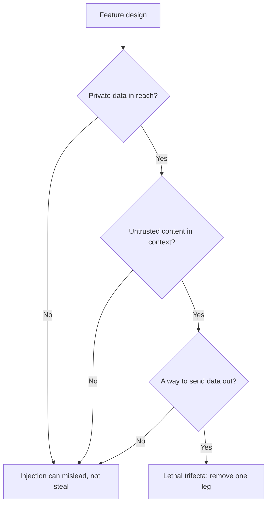

# पाठ 21. Prompt किससे नहीं बचा सकता

**मिशन से संबंध:** ऐसा prompt डिज़ाइन करें जो untrusted input संभाले, और बताएँ कि कौन-से जोखिमों से prompt अकेला नहीं बचा सकता। यह पाठ बचावों को उनमें छाँटता है जिनका मालिक prompt का लेखक है और उनमें जिन्हें system को लागू करना होता है।
**मुख्य स्रोत:** [Docs: "Mitigate jailbreaks and prompt injections", Claude Platform Docs](https://platform.claude.com/docs/en/test-and-evaluate/strengthen-guardrails/mitigate-jailbreaks)
**पूर्व-आवश्यकताएँ:** [पाठ 4](0004-structure-and-delimiters.md), [पाठ 20](0020-prompt-injection.md), [instruction hierarchy](../GLOSSARY.md)

## वार्म-अप

1. ▢ Injected text किन दो रास्तों से prompt तक पहुँचता है, और chat box पर लगी छानबीन किसे चूक जाती है?

<details markdown="1"><summary>जाँचें</summary>

Direct, जहाँ उपयोगकर्ता उसे टाइप करता है, और indirect, जहाँ वह उस content में बैठा होता है जिसे model उपयोगकर्ता की ओर से पढ़ता है, जैसे web page या retrieve किया गया chunk। Chat box की छानबीन indirect injection को चूक जाती है, क्योंकि वह text कभी box से गुज़रता ही नहीं।

</details>

2. ▢ Prompt template में स्थिर text और भरे जाने वाले variables को साफ़ तौर पर अलग क्यों रहना चाहिए?

<details markdown="1"><summary>जाँचें</summary>

Variables हर request का text लाते हैं, जिसका कुछ हिस्सा untrusted है। अगर कोई मान उस structure को ख़त्म कर सके जो template ने बनाया, उदाहरण के लिए tag बंद करके, तो data instructions के रूप में चल सकता है। पाठ 15 escaping को कवर करता है ताकि कोई मान ऐसा न कर सके।

</details>

3. ▢ System prompt में रखे instruction के पास क्या है जो retrieved document के उसी वाक्य के पास नहीं?

<details markdown="1"><summary>जाँचें</summary>

Instruction hierarchy में position। Hierarchy पर train किया गया model system prompt को tools या retrieval के content से ज़्यादा वज़न देता है, इसलिए वही शब्द इस पर निर्भर करके अलग अधिकार रखते हैं कि वे कहाँ बैठे हैं।

</details>

## यह जानें

### Prompt क्या कर सकता है

ये बचाव prompt के लेखक के बनाने के हैं। हर एक injection के काम करने की संभावना घटाता है। कोई भी उसे हटाता नहीं।

**Untrusted input को delimit करें और बताएँ कि वह क्या है।** हर untrusted slot को tags में लपेटें (पाठ 4) और मान को escape करें (पाठ 15)। Anthropic दूसरा चरण जोड़ता है: content की प्रकृति और स्रोत को स्पष्ट करें, उदाहरण के लिए कि वह किसी अनजान भेजने वाले के आए हुए email का मुख्य भाग है, जो "helps Claude calibrate how much to trust embedded directives"। उसकी गाइड एक संरचनात्मक विकल्प भी दिखाती है, content को JSON string के रूप में encode करना ताकि "the encoding makes it unambiguous that this is data"।

**System prompt में नीति बताएँ।** Anthropic के शब्द: model को बताएँ कि tools, documents या searches से लौटा content untrusted data है और system prompt या उपयोगकर्ता की मूल request को कभी override नहीं करना चाहिए। यह instruction hierarchy को model के लिए लिखकर कहना है, इसलिए यह उसे मज़बूत करता है जो model को करना सिखाया गया था।

**अपने instructions को untrusted channels से बाहर रखें।** Anthropic की मार्गदर्शिका है कि तीसरे पक्ष का content tool results में दें और अपने instructions उसके बाद के user turn में भेजें, क्योंकि tool results के भीतर रखे instructions "may be ignored or flagged as a potential injection"।

**Instruction hierarchy की training पर टिकें, पर उसके मालिक न बनें।** Wallace et al. ने एक model (पेपर में GPT-3.5) को ऐसे data पर train किया जो ऊँचे privilege वाले instruction को मानना दिखाता है, और बताते हैं कि यह "drastically increases robustness", ऐसे हमलों के प्रकारों के लिए भी जो training में नहीं देखे गए, मानक क्षमताओं में न्यूनतम गिरावट के साथ। यह उस model की ख़ासियत है जो आप चुनते हैं। यह आपको ऐसा model चुनकर और text को सही स्तर पर रखकर मिलता है, अपने prompt के शब्दों से नहीं।

**Input की छानबीन करें।** Anthropic उपयोगकर्ता के input पर harmlessness screen के रूप में हल्का model सुझाता है, जो structured output के साथ सरल classification तक सीमित हो, और ज्ञात injection patterns के लिए input validation। यही पैटर्न tool outputs पर लागू होता है, मुख्य model के उन पर कार्रवाई करने से पहले। छानबीन एक और model call है जिसकी अपनी त्रुटि दर है, और Anthropic का पेज नोट करता है कि छानबीन वाली call ख़ुद इनकार कर सकती है, जिसे आपको फ़ैसले के रूप में संभालना होगा, नज़रअंदाज़ नहीं करना है।

### यह security boundary क्यों नहीं है

ऊपर की हर चीज़ संभावना घटाती है। सवाल यह है कि क्या उनमें से कोई नतीजे की गारंटी देती है, और स्रोत कहते हैं कि नहीं।

- Willison: "you can try telling it not to in your own prompt, but how confident can you be that your protection will work every time?" वे ऐसे guardrail products पर भी "deeply suspicious" हैं जो "95% of attacks" पकड़ने का दावा करते हैं, क्योंकि "in web application security 95% is very much a failing grade"।
- OWASP: "it is unclear if there are fool-proof methods of prevention for prompt injection", और वह ऐसे उपाय गिनाता है जो "can mitigate the impact"।
- Greshake et al., 2023 में: प्रभावी उपाय "currently lacking" थे।
- Anthropic का अपना पेज अपने चरणों को guardrails मज़बूत करने के रूप में रखता है और उन्हें least privilege और red-teaming के साथ जोड़ता है, उनकी जगह के रूप में नहीं।

Prompt एक संभाव्य पाठक से अनुरोध है। Security boundary वह चीज़ है जो पाठक के बिगड़ने पर भी टिकी रहे। इसलिए डिज़ाइन का सवाल "model से इनकार कैसे करवाऊँ?" से बदलकर "अगर model हमलावर की बात मान ले तो वह सबसे बुरा क्या कर सकता है?" हो जाता है।

### System को क्या लागू करना होता है



**Lethal trifecta।** Willison तीन क्षमताओं के नाम बताते हैं जो मिलकर injection को exploit करने लायक बनाती हैं: आपके private data तक पहुँच, untrusted content का सामना, और ऐसे तरीक़े से बाहर संवाद करने की क्षमता जो data चुरा सके। "If your agent combines these three features, an attacker can easily trick it into accessing your private data and sending it to that attacker." Tools मिलाने वाले उपयोगकर्ताओं के लिए उनका बचाव इस मेल से पूरी तरह बचना है। Agents track का पाठ 31 इसे tools वाले agent के लिए करके दिखाता है; यह पाठ बस इतना माँगता है कि आप अपने फ़ीचर को तीनों पायों से जाँचें। [agents वाला पाठ](../../agents/lessons/0031-prompt-injection-and-the-lethal-trifecta.md) देखें।

**Least privilege।** OWASP और Anthropic दोनों यही कहते हैं: model को सिर्फ़ उतनी पहुँच दें जितनी उसके task को चाहिए, ताकि सफल injection न्यूनतम नुक़सान करे। Anthropic का रूप यह है कि उसे ऐसे secrets न दें जिनकी उसे ज़रूरत नहीं, tools को sandboxes में चलाएँ, और permissions को संकरा रखें। OWASP जोड़ता है कि application अपने API tokens ख़ुद रखे और privileged functions को model को देने के बजाय code में करे।

**मानवीय पुष्टि।** OWASP ऊँचे जोखिम वाली कार्रवाइयों के लिए मानवीय मंज़ूरी गिनाता है। किसी व्यक्ति का confirm दबाना ऐसी जाँच है जिसे injected text बातों से पार नहीं कर सकता, बशर्ते पुष्टि असली कार्रवाई दिखाए, model का उसका वर्णन नहीं।

**Output की हैंडलिंग।** Model के output को अगले component के लिए untrusted input मानें। OWASP output formats बताने और पालन को validate करने के लिए deterministic code इस्तेमाल करने की सिफ़ारिश करता है (पाठ 11 वही आदत है)। उसका indirect परिदृश्य हमलावर के URL से जुड़ी image पर ख़त्म होता है जो बातचीत लीक करती है, जो output-rendering की विफलता है: model के चुने URLs fetch करने वाला renderer निकास का रास्ता है, prompt ने कुछ भी कहा हो।

| बचाव | कहाँ बैठता है | क्या ख़रीदता है |
|---|---|---|
| Delimiters, स्रोत labels, नीति का वाक्य | Prompt | कम आकस्मिक और भोले injections |
| Instruction hierarchy training | Model | Instructions टकराने पर बेहतर संभावना |
| Input और tool-output की छानबीन | System, संभाव्य | ज्ञात patterns पकड़ती है, नए चूक जाती है |
| Least privilege, sandboxing | System, लागू किया हुआ | सफल injection का नुक़सान सीमित करता है |
| मानवीय पुष्टि | System, लागू किया हुआ | परिणामकारी कार्रवाई रोकती है |
| Output validation, सुरक्षित rendering | System, लागू किया हुआ | Output को अगले चरण पर हमला बनने से रोकती है |

जिन पंक्तियों पर "लागू किया हुआ" है वे वही हैं जो model के छले जाने पर भी टिकती हैं। Design review के लिए ईमानदार सार यह है: prompt injection को कठिन बनाता है, और system सीमित करता है कि वह क्या कर सकता है।

## अभ्यास

1. ▢ इनमें से कौन-सा बदलाव prompt-स्तर के उपाय को ऐसी सीमा में बदलता है जो model के छले जाने पर टिकती है?

    - a) एक system वाक्य जोड़ना जो कहे कि document का text untrusted data है
    - b) Document को tags में लपेटना और उसे आए हुए email के रूप में label करना
    - c) वह tool हटाना जो email भेज सकता है ताकि model उसे call न कर सके
    - d) टीम को system prompt साफ़ आदेशात्मक शैली में लिखना सिखाना

<details markdown="1"><summary>जाँचें</summary>

c)। क्षमता हटाना तब भी टिकता है जब model हमलावर की बात मान ले, क्योंकि मानने के लिए कुछ बचा ही नहीं। a) और b) असली हैं पर संभाव्य: वे बदलते हैं कि model के क्या करने की संभावना है। d) शैली की बात है और लागू करने से उसका कोई लेना-देना नहीं।

</details>

2. ▢ इस template को ठीक करें ताकि वह इस पाठ के लेखक-पक्ष के बचावों का पालन करे। हर बदलाव का नाम बताएँ।

    ```text
    Summarise the email. {{email_body}} Do whatever the email asks.
    ```

<details markdown="1"><summary>जाँचें</summary>

Email को उसके अपने tag में रखें, उसे label करें ("body of an inbound email from an unknown sender"), मान को escape करें ताकि वह tag बंद न कर सके, और system prompt में बताएँ कि email data है जो task को override नहीं कर सकता। "Do whatever the email asks" हटा दें: वह हमलावर के text को लेखक का अधिकार थमा देता है। ये बदलाव सफल injection की संभावना घटाते हैं और हटाते नहीं, इसलिए डिज़ाइन को अब भी नीचे के system-पक्ष के controls चाहिए।

</details>

3. ▢ एक assistant उपयोगकर्ता का inbox पढ़ सकता है, emails के links से web pages का सार बना सकता है, और अपने replies में markdown images render करता है। कौन-से trifecta पाये मौजूद हैं, और कौन-सा हटाना सबसे सस्ता है?

<details markdown="1"><summary>जाँचें</summary>

तीनों। Inbox private data है, web pages untrusted content हैं, और model के चुने URL वाली rendered image बाहर निकलने का रास्ता है। आमतौर पर सबसे सस्ता पाया निकास है: model के दिए image URLs render न करें, या सिर्फ़ hosts की allow-list की अनुमति दें। तब model सार बना और भ्रमित कर सकता है, पर inbox को system से बाहर नहीं ले जा सकता।

</details>

4. ▢ एक vendor दावा करता है कि उसका filter 95% injection कोशिशें रोकता है। इस पाठ के स्रोतों से बताएँ कि इससे यह क्यों तय नहीं होता कि उस पर निर्भर रहें या नहीं।

<details markdown="1"><summary>जाँचें</summary>

Willison की बात यह है कि web application security में 95% फेल होने का ग्रेड है, और वे नोट करते हैं कि दुर्भावनापूर्ण instructions को शब्द देने के अनगिनत तरीक़े हैं, इसलिए ज्ञात patterns पर पकड़ की दर अगले शब्दांकन के बारे में बहुत कम बताती है। Filter ज्ञात patterns की दर घटाता है और रखने लायक है, पर वह फिर भी ऐसे फ़ीचर के सामने संभाव्य परत है जिसे परत के विफल होने पर भी सुरक्षित रहना चाहिए। पूछें कि बाक़ी 5% पर सबसे बुरा नतीजा क्या है, और उसे least privilege से सीमित करें।

</details>

5. ▢ एक साथी ऐसे फ़ीचर में मानवीय पुष्टि जोड़ना चाहता है जहाँ model refund emails का मसौदा बनाता और भेजता है। पुष्टि का dialog "Send refund email to customer?" दिखाता है। इसमें क्या ग़लत है?

<details markdown="1"><summary>जाँचें</summary>

Dialog वर्णन दिखाता है, कार्रवाई नहीं। अगर injected text ने प्राप्तकर्ता, राशि या मुख्य भाग बदल दिया, तो उपयोगकर्ता ऐसे वाक्य को confirm करता है जो अब उससे मेल नहीं खाता जो भेजा जाएगा। पुष्टि तभी सीमा है जब वह असली, अंतिम कार्रवाई दिखाए: असली प्राप्तकर्ता, राशि और text, जो code से बने हों और model से सारांशित न हों।

</details>

## असली दुनिया का अभ्यास

- [ ] कोई एक LLM फ़ीचर चुनें जिसे आप इस्तेमाल करते या बनाते हैं और हर trifecta पाये के लिए लिखें कि वह मौजूद है या नहीं। अगर तीनों हैं, तो उस पाये का नाम बताएँ जिसे आप सबसे पहले हटाएँगे।
- [ ] Anthropic के mitigation पेज का "Indirect prompt injection" खंड पढ़ें और चिह्नित करें कि उसके कौन-से बिंदु prompt-स्तर के हैं और कौन-से system-स्तर के।
- [ ] कल: जाँचें कि कोई product जो आप इस्तेमाल करते हैं model के reply में link या image कैसे render करता है, और नोट करें कि क्या URL untrusted text से चुना जा सकता है।

## आगे बढ़ने के लिए

- [Prompt Security](../reference/prompt-security.md)
- [Docs: "Mitigate jailbreaks and prompt injections", Claude Platform Docs](https://platform.claude.com/docs/en/test-and-evaluate/strengthen-guardrails/mitigate-jailbreaks)
- [Article: "The lethal trifecta for AI agents", Simon Willison](https://simonwillison.net/2025/Jun/16/the-lethal-trifecta/)
- [Paper: "The Instruction Hierarchy: Training LLMs to Prioritize Privileged Instructions", Wallace et al., 2024](https://arxiv.org/abs/2404.13208)
- [संसाधन](../RESOURCES.md)

---

बात नहीं बन रही? ऊपर दिए primary source को दोबारा पढ़ें, क्योंकि यह पाठ उसे संक्षिप्त करता है और समझ संक्षेप में ही रिसती है। जो शब्द फिसलन भरा लगे, उसके लिए [शब्दावली](../GLOSSARY.md) देखें।

अगर दिक़्क़त सामग्री की नहीं बल्कि पाठ की ही है, तो वह एक खोट है: [issue खोलें](https://github.com/TokenCemetery/teach/issues)।
