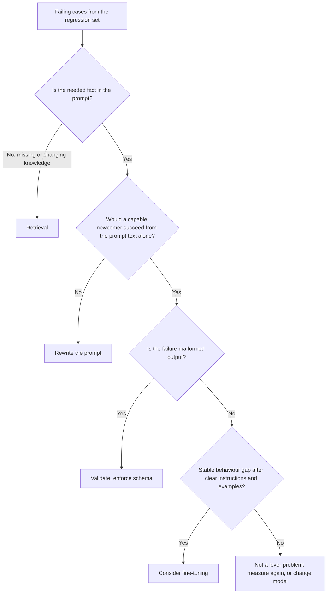

# Lección 22. Prompt, RAG o fine-tuning

**Vínculo con la misión:** Elegir entre un mejor prompt, la recuperación y el fine-tuning para un fallo dado. El error que previene esta lección es recurrir a la solución más pesada porque suena seria, cuando el fallo era una instrucción poco clara.
**Fuente principal:** [Paper: "Fine-Tuning or Retrieval? Comparing Knowledge Injection in LLMs", Ovadia et al., 2023](https://arxiv.org/abs/2312.05934)
**Requisitos previos:** [Lección 3](0003-clear-instructions.md), [Lección 18](0018-a-regression-set-for-a-prompt.md), [conjunto de regresión](../GLOSSARY.md)

## Calentamiento

1. ▢ ¿De qué se construye un conjunto de regresión y qué debe hacer ante un cambio de prompt?

Comprobación

Sobre todo de fallos vistos en uso real, cada uno emparejado con una comprobación sobre la salida. Un cambio de prompt no debe romper ninguno, así que el conjunto es lo que convierte "esto se ve mejor" en una afirmación que puedes comprobar.

2. ▢ ¿Qué dice la lección 3 que contiene una instrucción clara y cuál es la prueba práctica para saberlo?

Comprobación

El contexto, la tarea, las restricciones y cómo se ve el trabajo terminado. La prueba práctica es si un recién llegado capaz, con solo ese texto, podría hacer el trabajo. Cuando no podría, el fallo es del prompt, no del modelo.

3. ▢ Un modelo sigue devolviendo prosa cuando tu programa espera JSON. ¿Qué lección anterior dice qué hacer primero, antes de cambiar nada del modelo?

Comprobación

La lección 11. Pide el esquema en el prompt y valida el resultado en código, porque pedirlo no es una garantía. Solo después de eso el fallo es candidato a algo más pesado.

## Qué debes saber

### Empieza por el fallo, no por la herramienta

La visión general de Anthropic da por hecho que ya tienes "una definición clara de los criterios de éxito", "algunas formas de probar empíricamente contra esos criterios" y un primer borrador de prompt, y dice que hay que establecerlos primero. También dice que "no todo criterio de éxito o eval fallido se resuelve mejor con prompt engineering", con el ejemplo de que la latencia y el costo a veces se pueden mejorar más fácilmente eligiendo otro modelo ([Anthropic: prompt engineering overview](https://platform.claude.com/docs/en/build-with-claude/prompt-engineering/overview)).

Así que el primer movimiento es leer tus casos fallidos del conjunto de regresión y clasificarlos por lo que salió mal, no por la herramienta que te gustaría usar.

| Cómo se ve el fallo | Qué falta realmente | Palanca |
|---|---|---|
| La respuesta ignora o malinterpreta algo que contenía el prompt | Una instrucción clara y sin ambigüedad | Reescribir el prompt (lecciones 3 y 4) |
| El modelo inventa o enuncia mal hechos que nunca se le dieron: información privada, reciente o cambiante | Conocimiento | Recuperación |
| La forma o el tono de la salida es correcta en los ejemplos del prompt y se desvía en un enorme volumen de peticiones | Comportamiento consistente, o una forma más barata de conseguirlo | Primero few-shot, luego fine-tuning |
| La salida está malformada, aunque las instrucciones son claras | Imposición | Validación, salidas estructuradas, decodificación restringida |
| La tarea necesita un cálculo o una acción | Una capacidad de la que carece el modelo | Una herramienta |
| La calidad es buena pero es lento o caro | Otro punto de costo | Otro modelo o un prompt más corto |

### El conocimiento que falta es un problema de recuperación

Un prompt solo puede reordenar lo que el modelo ya tiene más lo que tú pones en él. Ovadia et al. compararon dos formas de añadir conocimiento: el fine-tuning no supervisado y la generación aumentada por recuperación. Su hallazgo: el fine-tuning "ofrece cierta mejora", pero la recuperación "lo supera de forma consistente, tanto para el conocimiento existente encontrado durante el entrenamiento como para el conocimiento completamente nuevo". También informan de que los modelos "tienen dificultades para aprender información factual nueva mediante fine-tuning no supervisado", y de que mostrar numerosas variaciones del mismo hecho durante el entrenamiento podría facilitarlo.

Dos advertencias al usar esto. El estudio trata del fine-tuning no supervisado para conocimiento, no del fine-tuning para comportamiento, así que no dice que el fine-tuning sea una mala palanca en general. Y mide la precisión, así que guarda silencio sobre el costo, que es donde los datos cambiantes inclinan aún más la balanza hacia la recuperación: un hecho que cambia cada semana implicaría reentrenar cada semana.

Para el caso de la recuperación, consulta el [track de RAG](../../rag/README.md) y su hoja de referencia [Generación a partir de la recuperación](../../rag/reference/generation-from-retrieval.md).

### El comportamiento a escala es donde el fine-tuning merece una mirada

El [track de fine-tuning con adapters](../../finetuning/README.md) pone un mejor prompt en primer lugar entre las opciones y enumera el fine-tuning como lo que resuelve "comportamiento consistente, costo del prompt, suficiencia de un modelo pequeño", al costo de datos, evaluación y mantenimiento. Su propia lección 27 se titula "When Not to Fine-Tune" y dice que la mayoría de quienes quieren hacer fine-tuning tienen un problema que una opción anterior resuelve más rápido. Lee ese track antes de comprometerte, ya que es la autoridad sobre el lado del fine-tuning de esta elección.

Las señales del lado del prompt que conviene registrar antes de ir allí:

- Probaste una instrucción clara y unos pocos ejemplos bien elegidos (lecciones 3 y 6), y el conjunto de regresión muestra una brecha restante estable.
- La brecha es de comportamiento: formato, estilo, una política de etiquetas. No es un hecho que falta.
- El prompt ha crecido hasta ser largo solo para enseñar el comportamiento, así que cada petición lo paga.

### Se combinan

Las tres palancas no son excluyentes. Un producto puede usar la recuperación para los hechos, un prompt para la tarea y el tono, y un modelo pequeño con fine-tuning para el comportamiento. Lo que importa es que cada fallo se dirija a la palanca que aborda su causa, y que puedas mostrar la brecha antes y después con el conjunto de regresión.

Una cosa que ninguna de las tres compra: OWASP afirma que RAG y el fine-tuning, aunque buscan que las salidas sean más relevantes y precisas, "no mitigan por completo las vulnerabilidades de inyección de prompt" ([OWASP LLM01:2025](https://genai.owasp.org/llmrisk/llm01-prompt-injection/)). Añadir recuperación para arreglar el conocimiento también añade una ruta de inyección indirecta (lección 20).

## Práctica

1. ▢ Dirige cada fallo a una palanca: (a) el bot cita la lista de precios del trimestre pasado, que cambia cada trimestre, (b) las respuestas del bot son precisas pero a veces amables y a veces secas, (c) el modelo devuelve dos objetos JSON y tu parser falla.

Comprobación

(a) Recuperación: el hecho cambia, y el modelo no puede conocer una lista de precios que nunca se le dio. (b) Empieza con una instrucción más clara sobre el tono y uno o dos ejemplos. Solo una brecha restante estable a escala lo convierte en candidato a fine-tuning. (c) Validación y un esquema, ya que la instrucción probablemente es clara y lo que falta es imposición.

2. ▢ Un equipo propone hacer fine-tuning de un modelo con su documentación interna para que pueda responder preguntas sobre ella. ¿Qué afirmación coincide mejor con la fuente principal?

    - a) El fine-tuning añade hechos nuevos con más fiabilidad que la recuperación, porque los pesos los retienen
    - b) La recuperación superó al fine-tuning no supervisado tanto para conocimiento nuevo como existente
    - c) El fine-tuning y la recuperación dieron la misma precisión una vez limpiados los datos
    - d) La recuperación solo ayuda con hechos que el modelo vio durante el preentrenamiento

Comprobación

b). Ovadia et al. encontraron que la recuperación superó de forma consistente al fine-tuning no supervisado, tanto para el conocimiento existente como para el conocimiento completamente nuevo. a) invierte el hallazgo. c) no es lo que informan. d) es incorrecta, ya que su resultado incluye conocimiento completamente nuevo.

3. ▢ El estudio detrás del punto anterior a veces se cita como "la recuperación vence al fine-tuning". Nombra lo que omite ese resumen.

Comprobación

Compara el fine-tuning no supervisado para añadir conocimiento. No prueba el fine-tuning para comportamiento, como el estilo o el formato de salida, donde el fine-tuning puede ser la palanca correcta. El abstract también señala que la exposición a muchas variaciones del mismo hecho podría aliviar el problema, así que "nunca" exagera. Comprueba las condiciones antes de usar un resultado en un argumento.

4. ▢ Un bot de soporte usa en cada llamada un prompt de 2,000 tokens con reglas y ejemplos. Las respuestas son consistentemente buenas. El volumen es alto y la queja es el costo. ¿Es el fine-tuning la respuesta, y qué compruebas primero?

Comprobación

Quizá, pero no primero. El fallo es el costo, así que primero comprueba si el prompt puede ser más corto sin mover el conjunto de regresión, y si otro modelo alcanza el nivel de calidad a menor costo (la visión general nombra esa vía). El fine-tuning es candidato cuando el comportamiento es estable y el prompt es largo solo para enseñarlo, y el track de fine-tuning dice que se calculen los costos de datos, evaluación y mantenimiento antes de comprometerse. Decide con el conjunto de regresión, antes y después.

5. ▢ Te dan 30 casos fallidos. Describe lo mínimo que haces antes de elegir una palanca y qué resultado te haría parar y no cambiar nada.

Comprobación

Clasifica los 30 por causa: hecho que falta, instrucción poco clara, salida malformada, deriva de comportamiento, brecha de capacidad, costo. Elige la palanca para el grupo más grande y arregla eso primero, midiendo en el conjunto de regresión. Para si resulta que los fallos son respuestas esperadas incorrectas o ambiguas en el propio conjunto, porque entonces quien necesita reparación es el conjunto, no el sistema. Un montón mixto es normal y suele necesitar más de una palanca.

## Prácticas en el mundo real

- [ ] Toma cinco fallos reales de cualquier funcionalidad con LLM que conozcas y escribe una línea para cada uno: qué faltaba y qué palanca lo aborda.
- [ ] Lee la lección 27 del track de fine-tuning y anota la primera de sus preguntas que habría suspendido tu última idea de "deberíamos hacer fine-tuning".
- [ ] Mañana: abre el abstract de Ovadia et al. y reescribe su hallazgo principal en una frase que enuncie las condiciones bajo las que se cumple.

## Para profundizar

- [Lista de revisión de prompts](../reference/prompt-review-checklist.md)
- [Paper: "Fine-Tuning or Retrieval? Comparing Knowledge Injection in LLMs", Ovadia et al., 2023](https://arxiv.org/abs/2312.05934)
- [Docs: "Prompt engineering overview", Claude Platform Docs](https://platform.claude.com/docs/en/build-with-claude/prompt-engineering/overview)
- [track de fine-tuning con adapters](../../finetuning/README.md)
- [track de RAG](../../rag/README.md)
- [Recursos](../RESOURCES.md)

---

¿No terminas de entenderlo? Vuelve a leer la fuente principal del principio, ya que esta lección la comprime y en la compresión es donde se escapa la comprensión. Consulta el [glosario](../GLOSSARY.md) para cualquier término que te haya resultado resbaladizo.

Si lo poco claro es la propia lección y no el material, eso es un defecto: [abre un issue](https://github.com/TokenCemetery/teach/issues).
