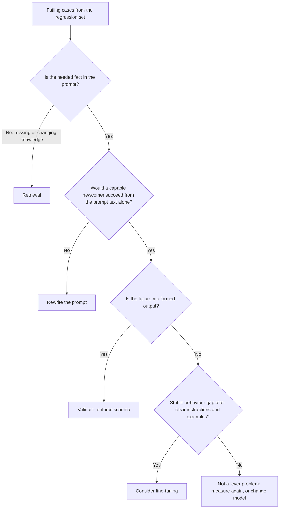

# Leçon 22. Prompt, RAG ou fine-tuning

**Lien avec la mission :** Choisir entre un meilleur prompt, la récupération et le fine-tuning pour un échec donné. L'erreur que cette leçon évite est de recourir à la correction la plus lourde parce qu'elle sonne sérieux, alors que l'échec venait d'une instruction peu claire.
**Source primaire :** [Article : "Fine-Tuning or Retrieval? Comparing Knowledge Injection in LLMs", Ovadia et al., 2023](https://arxiv.org/abs/2312.05934)
**Prérequis :** [Leçon 3](0003-clear-instructions.md), [Leçon 18](0018-a-regression-set-for-a-prompt.md), [jeu de régression](../GLOSSARY.md)

## Échauffement

1. ▢ De quoi un jeu de régression est-il construit, et que doit-il faire pour une modification de prompt ?

Vérifier

Surtout d'échecs observés en usage réel, chacun associé à une vérification sur la sortie. Une modification de prompt ne doit casser aucun d'eux : l'ensemble est donc ce qui transforme « cela a l'air meilleur » en une affirmation que vous pouvez tester.

2. ▢ Que contient une instruction claire selon la leçon 3, et quel est le test pratique ?

Vérifier

Le contexte, la tâche, les contraintes et à quoi ressemble « terminé ». Le test pratique consiste à se demander si un débutant capable, à qui l'on ne donnerait que ce texte, pourrait faire le travail. Là où il ne le pourrait pas, l'échec vient du prompt, pas du modèle.

3. ▢ Un modèle renvoie sans cesse de la prose alors que votre programme attend du JSON. Quelle leçon antérieure dit quoi faire en premier, avant de modifier quoi que ce soit au modèle ?

Vérifier

La leçon 11. Demander le schéma dans le prompt et valider le résultat dans le code, car demander n'est pas une garantie. Ce n'est qu'après cela que l'échec devient candidat à quelque chose de plus lourd.

## À savoir

### Partir de l'échec, pas de l'outil

La vue d'ensemble d'Anthropic suppose que vous avez déjà « une définition claire des critères de succès », « des moyens de tester empiriquement par rapport à ces critères » et un premier brouillon de prompt, et dit de les établir d'abord. Elle dit aussi que « tout critère de succès ou toute évaluation en échec ne se résout pas au mieux par le prompt engineering », avec l'exemple que la latence et le coût peuvent parfois être améliorés plus facilement en choisissant un autre modèle ([Anthropic : prompt engineering overview](https://platform.claude.com/docs/en/build-with-claude/prompt-engineering/overview)).

Le premier geste consiste donc à lire vos cas en échec dans le jeu de régression et à les trier selon ce qui a mal tourné, pas selon l'outil que vous aimeriez utiliser.

| À quoi ressemble l'échec | Ce qui manque réellement | Levier |
|---|---|---|
| La réponse ignore ou comprend mal quelque chose que le prompt contenait | Une instruction claire et sans ambiguïté | Réécrire le prompt (leçons 3 et 4) |
| Le modèle invente ou déforme des faits qu'on ne lui a jamais donnés : informations privées, récentes ou changeantes | De la connaissance | Récupération |
| La forme ou le ton de la sortie est bon dans les exemples du prompt et dérive sur un énorme volume de requêtes | Un comportement constant, ou un moyen moins cher de l'obtenir | Few-shot d'abord, puis fine-tuning |
| La sortie est mal formée, alors que les instructions sont claires | De l'application stricte | Validation, sorties structurées, décodage contraint |
| La tâche demande un calcul ou une action | Une capacité que le modèle n'a pas | Un outil |
| La qualité est correcte mais lente ou chère | Un autre point de coût | Un autre modèle ou un prompt plus court |

### Une connaissance manquante est un problème de récupération

Un prompt ne peut que réordonner ce que le modèle possède déjà plus ce que vous y placez. Ovadia et al. ont comparé deux façons d'ajouter des connaissances : le fine-tuning non supervisé et la génération augmentée par récupération. Leur constat : le fine-tuning « offre une certaine amélioration », mais la récupération le « surpasse systématiquement, aussi bien pour les connaissances existantes rencontrées pendant l'entraînement que pour des connaissances entièrement nouvelles ». Ils rapportent aussi que les modèles « peinent à apprendre de nouvelles informations factuelles par fine-tuning non supervisé », et que montrer de nombreuses variations d'un même fait pendant l'entraînement pourrait faciliter les choses.

Deux précautions pour l'utiliser. L'étude porte sur le fine-tuning non supervisé pour la connaissance, pas sur le fine-tuning pour le comportement : elle ne dit donc pas que le fine-tuning est un mauvais levier en général. Et elle mesure la précision, donc elle est muette sur le coût, où la variabilité des données fait pencher encore plus vers la récupération : un fait qui change chaque semaine impliquerait de réentraîner chaque semaine.

Pour le cas de la récupération, voir le [parcours RAG](../../rag/README.md) et sa [fiche sur la génération à partir de la récupération](../../rag/reference/generation-from-retrieval.md).

### Le comportement à grande échelle est là où le fine-tuning mérite un regard

Le [parcours fine-tuning](../../finetuning/README.md) place un meilleur prompt en tête des options et présente le fine-tuning comme ce qui résout « comportement constant, coût du prompt, suffisance d'un petit modèle », au prix de données, d'évaluation et de maintenance. Sa propre leçon 27 s'intitule « Quand ne pas fine-tuner » et dit que la plupart de ceux qui veulent fine-tuner ont un problème qu'une option antérieure résout plus vite. Lisez ce parcours avant de vous engager, car il fait autorité sur le côté fine-tuning de ce choix.

Les signaux côté prompt à consigner avant d'y aller :

- Vous avez essayé une instruction claire et quelques exemples bien choisis (leçons 3 et 6), et le jeu de régression montre un écart restant stable.
- L'écart est comportemental : format, style, politique de labels. Ce n'est pas un fait manquant.
- Le prompt n'est devenu long que pour enseigner le comportement, donc chaque requête le paie.

### Ils se combinent

Les trois leviers ne s'excluent pas. Un produit peut utiliser la récupération pour les faits, un prompt pour la tâche et le ton, et un petit modèle fine-tuné pour le comportement. Ce qui compte, c'est que chaque échec soit orienté vers le levier qui traite sa cause, et que vous puissiez montrer l'écart avant et après avec le jeu de régression.

Une chose qu'aucun des trois n'apporte : OWASP affirme que le RAG et le fine-tuning, bien qu'ils visent à rendre les sorties plus pertinentes et précises, « ne atténuent pas entièrement les vulnérabilités d'injection de prompt » ([OWASP LLM01:2025](https://genai.owasp.org/llmrisk/llm01-prompt-injection/)). Ajouter de la récupération pour corriger la connaissance ajoute aussi une voie d'injection indirecte (leçon 20).

## Pratique

1. ▢ Orientez chaque échec vers un levier : (a) le bot cite la liste de prix du trimestre dernier, qui change chaque trimestre, (b) les réponses du bot sont exactes mais tantôt aimables, tantôt sèches, (c) le modèle renvoie deux objets JSON et votre parseur échoue.

Vérifier

(a) Récupération : le fait change, et le modèle ne peut pas connaître une liste de prix qu'on ne lui a jamais donnée. (b) Commencez par une instruction plus claire sur le ton et un ou deux exemples. Seul un écart restant stable à grande échelle en fait un candidat au fine-tuning. (c) Validation et schéma, puisque l'instruction est probablement claire et que ce qui manque est de l'application stricte.

2. ▢ Une équipe propose de fine-tuner un modèle sur sa documentation interne pour qu'il réponde aux questions à son sujet. Quelle affirmation correspond le mieux à la source primaire ?

    - a) Le fine-tuning ajoute des faits nouveaux de façon plus fiable que la récupération, parce que les poids les retiennent
    - b) La récupération a surpassé le fine-tuning non supervisé pour les connaissances nouvelles et existantes
    - c) Le fine-tuning et la récupération ont donné la même précision une fois les données nettoyées
    - d) La récupération n'aide que pour les faits que le modèle a vus pendant le pré-entraînement

Vérifier

b). Ovadia et al. ont constaté que la récupération surpassait systématiquement le fine-tuning non supervisé, aussi bien pour les connaissances existantes que pour des connaissances entièrement nouvelles. a) inverse le constat. c) n'est pas ce qu'ils rapportent. d) est faux, puisque leur résultat inclut des connaissances entièrement nouvelles.

3. ▢ L'étude derrière l'élément précédent est parfois citée comme « la récupération bat le fine-tuning ». Nommez ce que ce résumé omet.

Vérifier

Elle compare le fine-tuning non supervisé pour ajouter des connaissances. Elle ne teste pas le fine-tuning pour le comportement, comme le style ou le format de sortie, où le fine-tuning peut être le bon levier. L'abstract note aussi que l'exposition à de nombreuses variations d'un même fait pourrait atténuer le problème, donc « jamais » exagère. Vérifiez les conditions avant d'utiliser un résultat dans un argument.

4. ▢ Un bot de support utilise à chaque appel un prompt de 2 000 tokens de règles et d'exemples. Les réponses sont constamment bonnes. Le volume est élevé et le coût fait l'objet de la plainte. Le fine-tuning est-il la réponse, et que vérifiez-vous d'abord ?

Vérifier

Peut-être, mais pas en premier. L'échec est le coût : voyez d'abord si le prompt peut être plus court sans faire bouger le jeu de régression, et si un autre modèle atteint le seuil de qualité à moindre coût (la vue d'ensemble nomme cette voie). Le fine-tuning est un candidat quand le comportement est stable et que le prompt n'est long que pour l'enseigner, et le parcours fine-tuning dit de chiffrer les données, l'évaluation et la maintenance avant de s'engager. Décidez avec le jeu de régression, avant et après.

5. ▢ On vous donne 30 cas en échec. Décrivez le minimum que vous faites avant de choisir un levier, et quel résultat vous ferait vous arrêter sans rien changer.

Vérifier

Triez les 30 par cause : fait manquant, instruction peu claire, sortie mal formée, dérive de comportement, lacune de capacité, coût. Choisissez le levier du groupe le plus important et corrigez-le en premier, en mesurant sur le jeu de régression. Arrêtez-vous si les échecs se révèlent être des réponses attendues fausses ou ambiguës dans le jeu lui-même, car alors c'est le jeu, pas le système, qui doit être réparé. Un tas mélangé est normal et demande généralement plus d'un levier.

## Exercices en situation réelle

- [ ] Prenez cinq vrais échecs d'une fonctionnalité LLM que vous connaissez et écrivez une ligne pour chacun : ce qui manquait, et quel levier y répond.
- [ ] Lisez la leçon 27 du parcours fine-tuning et notez la première de ses questions que votre dernière idée du type « nous devrions fine-tuner » aurait échouée.
- [ ] Demain : ouvrez l'abstract d'Ovadia et al. et réécrivez son constat principal en une phrase qui énonce les conditions dans lesquelles il tient.

## Pour aller plus loin

- [Liste de contrôle de relecture d'un prompt](../reference/prompt-review-checklist.md)
- [Article : "Fine-Tuning or Retrieval? Comparing Knowledge Injection in LLMs", Ovadia et al., 2023](https://arxiv.org/abs/2312.05934)
- [Doc : "Prompt engineering overview", Claude Platform Docs](https://platform.claude.com/docs/en/build-with-claude/prompt-engineering/overview)
- [Parcours fine-tuning par adaptateurs](../../finetuning/README.md)
- [Parcours RAG](../../rag/README.md)
- [Ressources](../RESOURCES.md)

---

Ça ne passe pas ? Relisez la source primaire en haut de page, car cette leçon la condense et c'est dans la condensation que la compréhension s'échappe. Consultez le [glossaire](../GLOSSARY.md) pour tout terme qui vous a paru glissant.

Si c'est la leçon elle-même qui n'est pas claire plutôt que la matière, c'est un défaut : [ouvrez une issue](https://github.com/TokenCemetery/teach/issues).
