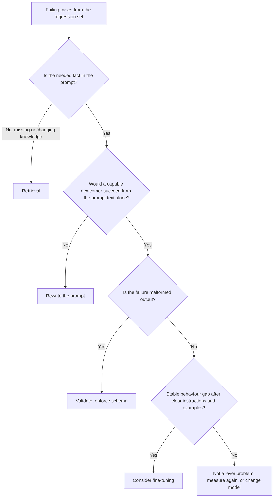

# पाठ 22. Prompt, RAG या Fine-Tune

**मिशन से संबंध:** किसी दी गई विफलता के लिए बेहतर prompt, retrieval और fine-tuning में से चुनें। यह पाठ जिस ग़लती से बचाता है वह यह है कि सबसे भारी उपाय इसलिए उठा लिया जाए क्योंकि वह गंभीर सुनाई देता है, जबकि विफलता किसी अस्पष्ट instruction की थी।
**मुख्य स्रोत:** [Paper: "Fine-Tuning or Retrieval? Comparing Knowledge Injection in LLMs", Ovadia et al., 2023](https://arxiv.org/abs/2312.05934)
**पूर्व-आवश्यकताएँ:** [पाठ 3](0003-clear-instructions.md), [पाठ 18](0018-a-regression-set-for-a-prompt.md), [regression set](../GLOSSARY.md)

## वार्म-अप

1. ▢ Regression set किससे बनता है, और उसे prompt के बदलाव के लिए क्या करना चाहिए?

जाँचें

ज़्यादातर असली उपयोग में दिखी विफलताओं से, हर एक के साथ output पर एक जाँच। Prompt का बदलाव उनमें से किसी को तोड़ना नहीं चाहिए, इसलिए सेट ही "यह बेहतर दिखता है" को ऐसे दावे में बदलता है जिसे आप परख सकें।

2. ▢ पाठ 3 के अनुसार स्पष्ट instruction में क्या होता है, और उसकी व्यावहारिक कसौटी क्या है?

जाँचें

Context, task, constraints, और पूरा होना कैसा दिखता है। व्यावहारिक कसौटी यह है कि क्या सिर्फ़ वही text मिलने पर कोई सक्षम नया व्यक्ति काम कर सकता। जहाँ वह नहीं कर सकता, वहाँ विफलता prompt की है, model की नहीं।

3. ▢ जब आपका program JSON की उम्मीद करता है तब model बार-बार गद्य लौटाता है। model के बारे में कुछ भी बदलने से पहले, पहले क्या करना है यह कौन-सा पिछला पाठ बताता है?

जाँचें

पाठ 11। Prompt में schema माँगें और नतीजे को code में validate करें, क्योंकि माँगना गारंटी नहीं है। उसके बाद ही विफलता किसी भारी चीज़ की उम्मीदवार बनती है।

## यह जानें

### विफलता से शुरू करें, औज़ार से नहीं

Anthropic का overview मानता है कि आपके पास पहले से "a clear definition of the success criteria", "some ways to empirically test against those criteria" और prompt का पहला मसौदा है, और कहता है कि पहले वे तय करें। वह यह भी कहता है कि "not every success criteria or failing eval is best solved by prompt engineering", उदाहरण के साथ कि latency और लागत कभी-कभी दूसरा model चुनकर ज़्यादा आसानी से सुधारी जा सकती हैं ([Anthropic: prompt engineering overview](https://platform.claude.com/docs/en/build-with-claude/prompt-engineering/overview))।

इसलिए पहला क़दम regression set से अपने विफल cases पढ़ना और उन्हें इस आधार पर छाँटना है कि क्या ग़लत हुआ, इस आधार पर नहीं कि आप कौन-सा औज़ार इस्तेमाल करना चाहेंगे।

| विफलता कैसी दिखती है | असल में क्या ग़ायब है | उपाय |
|---|---|---|
| उत्तर prompt में मौजूद किसी चीज़ को नज़रअंदाज़ या ग़लत पढ़ता है | साफ़, असंदिग्ध instruction | Prompt दोबारा लिखें (पाठ 3 और 4) |
| Model वे तथ्य गढ़ता या ग़लत बताता है जो उसे कभी दिए ही नहीं गए: निजी, हाल की या बदलती जानकारी | ज्ञान | Retrieval |
| Prompt के examples में output का आकार या tone सही है और बहुत बड़ी संख्या की requests में भटकता है | एकसमान व्यवहार, या उसे पाने का सस्ता तरीक़ा | पहले few-shot, फिर fine-tuning |
| Instructions साफ़ होते हुए भी output ख़राब बना है | Enforcement | Validation, structured outputs, constrained decoding |
| Task को गणना या कार्रवाई चाहिए | वह क्षमता जो model में नहीं है | Tool |
| गुणवत्ता ठीक है पर धीमी या महँगी | अलग लागत बिंदु | अलग model या छोटा prompt |

### ग़ायब ज्ञान retrieval की समस्या है

Prompt सिर्फ़ उसे नए क्रम में रख सकता है जो model के पास पहले से है और जो आप उसमें रखते हैं। Ovadia et al. ने ज्ञान जोड़ने के दो तरीक़ों की तुलना की: unsupervised fine-tuning और retrieval-augmented generation। उनकी खोज: fine-tuning "offers some improvement", पर retrieval "consistently outperforms it, both for existing knowledge encountered during training and entirely new knowledge"। वे यह भी बताते हैं कि models "struggle to learn new factual information through unsupervised fine-tuning", और कि training में एक ही तथ्य के कई रूप दिखाने से यह आसान हो सकता है।

इसे इस्तेमाल करते समय दो सावधानियाँ। अध्ययन ज्ञान के लिए unsupervised fine-tuning के बारे में है, व्यवहार के लिए fine-tuning के बारे में नहीं, इसलिए वह यह नहीं कहता कि fine-tuning आम तौर पर बुरा उपाय है। और वह accuracy मापता है, इसलिए लागत पर चुप है, जहाँ बदलता data retrieval की ओर और झुकाव देता है: जो तथ्य हर हफ़्ते बदलता है उसका मतलब हर हफ़्ते दोबारा training होता।

Retrieval के मामले के लिए, [RAG ट्रैक](../../rag/README.md) और उसकी [Retrieval से Generation शीट](../../rag/reference/generation-from-retrieval.md) देखें।

### बड़े पैमाने पर व्यवहार वह जगह है जहाँ fine-tuning पर नज़र डालना बनता है

[Fine-tuning ट्रैक](../../finetuning/README.md) विकल्पों में बेहतर prompt को पहले रखता है और fine-tuning को उस चीज़ के रूप में गिनाता है जो "consistent behaviour, prompt cost, small-model sufficiency" हल करती है, data, मूल्यांकन और रखरखाव की क़ीमत पर। उसका अपना पाठ 27 "When Not to Fine-Tune" शीर्षक का है और कहता है कि fine-tune करना चाहने वाले ज़्यादातर लोगों की समस्या को पहले का कोई विकल्प तेज़ी से हल कर देता है। प्रतिबद्ध होने से पहले वह track पढ़ें, क्योंकि इस चुनाव के fine-tuning वाले पक्ष का अधिकार वही है।

वहाँ जाने से पहले दर्ज करने लायक prompt-पक्ष के संकेत:

- आपने साफ़ instruction और कुछ अच्छे से चुने examples आज़माए (पाठ 3 और 6), और regression set बाक़ी बचा स्थिर अंतर दिखाता है।
- अंतर व्यवहार का है: format, शैली, label नीति। वह ग़ायब तथ्य नहीं है।
- Prompt सिर्फ़ व्यवहार सिखाने के लिए लंबा हो गया है, इसलिए हर request उसकी क़ीमत चुकाती है।

### वे मिल सकते हैं

तीनों उपाय एक-दूसरे को बाहर नहीं करते। कोई product तथ्यों के लिए retrieval, task और tone के लिए prompt, और व्यवहार के लिए fine-tuned छोटा model इस्तेमाल कर सकता है। मायने यह रखता है कि हर विफलता उस उपाय की ओर भेजी जाए जो उसके कारण को संबोधित करता है, और आप regression set से पहले और बाद का अंतर दिखा सकें।

एक चीज़ जो तीनों में से कोई नहीं ख़रीदता: OWASP कहता है कि RAG और fine-tuning, भले ही उनका लक्ष्य outputs को ज़्यादा प्रासंगिक और सटीक बनाना है, "do not fully mitigate prompt injection vulnerabilities" ([OWASP LLM01:2025](https://genai.owasp.org/llmrisk/llm01-prompt-injection/))। ज्ञान सुधारने के लिए retrieval जोड़ना indirect injection का रास्ता भी जोड़ता है (पाठ 20)।

## अभ्यास

1. ▢ हर विफलता को एक उपाय की ओर भेजें: (a) bot पिछली तिमाही की मूल्य सूची उद्धृत करता है, जो हर तिमाही बदलती है, (b) bot के replies सटीक हैं पर कभी दोस्ताना और कभी रूखे, (c) model दो JSON objects लौटाता है और आपका parser विफल होता है।

जाँचें

(a) Retrieval: तथ्य बदलता है, और model वह मूल्य सूची नहीं जान सकता जो उसे कभी दी ही नहीं गई। (b) Tone के बारे में साफ़ instruction और एक-दो examples से शुरू करें। बड़े पैमाने पर सिर्फ़ बाक़ी बचा स्थिर अंतर इसे fine-tune का उम्मीदवार बनाता है। (c) Validation और schema, क्योंकि instruction शायद साफ़ है और जो ग़ायब है वह enforcement है।

2. ▢ एक टीम किसी model को अपने आंतरिक दस्तावेज़ों पर fine-tune करने का प्रस्ताव रखती है ताकि वह उनके बारे में सवालों के जवाब दे सके। कौन-सा कथन primary source से सबसे अच्छी तरह मेल खाता है?

    - a) Fine-tuning नए तथ्य retrieval से ज़्यादा भरोसे से जोड़ती है, क्योंकि weights उन्हें रखते हैं
    - b) Retrieval ने नए और मौजूदा ज्ञान, दोनों के लिए unsupervised fine-tuning से बेहतर प्रदर्शन किया
    - c) Data साफ़ होने पर fine-tuning और retrieval की accuracy एक जैसी थी
    - d) Retrieval सिर्फ़ उन तथ्यों के लिए मदद करता है जिन्हें model ने pre-training में देखा

जाँचें

b)। Ovadia et al. ने पाया कि retrieval ने मौजूदा ज्ञान और पूरी तरह नए ज्ञान, दोनों के लिए unsupervised fine-tuning से लगातार बेहतर प्रदर्शन किया। a) खोज को उलट देता है। c) वह नहीं है जो वे बताते हैं। d) ग़लत है, क्योंकि उनके नतीजे में पूरी तरह नया ज्ञान शामिल है।

3. ▢ पिछले आइटम के पीछे के अध्ययन को कभी-कभी "retrieval beats fine-tuning" के रूप में उद्धृत किया जाता है। बताएँ कि वह सारांश क्या छोड़ देता है।

जाँचें

वह ज्ञान जोड़ने के लिए unsupervised fine-tuning की तुलना करता है। वह व्यवहार, जैसे शैली या output format, के लिए fine-tuning को नहीं परखता, जहाँ fine-tuning सही उपाय हो सकती है। Abstract यह भी नोट करता है कि एक ही तथ्य के कई रूपों का सामना समस्या को आसान कर सकता है, इसलिए "कभी नहीं" बढ़ा-चढ़ाकर कहना है। किसी नतीजे को तर्क में इस्तेमाल करने से पहले उसकी शर्तें जाँचें।

4. ▢ एक support bot हर call पर नियमों और examples का 2,000-token का prompt इस्तेमाल करता है। Replies लगातार अच्छे हैं। Volume ज़्यादा है और शिकायत लागत की है। क्या fine-tuning जवाब है, और आप पहले क्या जाँचते हैं?

जाँचें

शायद, पर पहले नहीं। विफलता लागत की है, इसलिए पहले देखें कि क्या prompt को regression set हिलाए बिना छोटा किया जा सकता है, और क्या कोई अलग model गुणवत्ता का पैमाना सस्ते में पूरा करता है (overview उस रास्ते का नाम लेता है)। Fine-tuning तब उम्मीदवार है जब व्यवहार स्थिर हो और prompt सिर्फ़ उसे सिखाने के लिए लंबा हो, और fine-tuning track कहता है कि प्रतिबद्ध होने से पहले data, मूल्यांकन और रखरखाव की क़ीमत जोड़ लें। फ़ैसला regression set से, पहले और बाद, करें।

5. ▢ आपको 30 विफल cases दिए गए हैं। उपाय चुनने से पहले आप न्यूनतम क्या करते हैं, और कौन-सा नतीजा आपको रुकने और कुछ न बदलने पर मजबूर करेगा?

जाँचें

30 को कारण के आधार पर छाँटें: ग़ायब तथ्य, अस्पष्ट instruction, बिगड़ा output, व्यवहार का भटकाव, क्षमता की कमी, लागत। सबसे बड़े समूह का उपाय चुनें और पहले उसे ठीक करें, regression set पर मापते हुए। अगर विफलताएँ ख़ुद सेट में ग़लत या अस्पष्ट अपेक्षित उत्तर निकलें तो रुकें, क्योंकि तब system नहीं, सेट की मरम्मत चाहिए। मिला-जुला ढेर सामान्य है और आमतौर पर एक से ज़्यादा उपाय माँगता है।

## असली दुनिया का अभ्यास

- [ ] किसी ऐसे LLM फ़ीचर की पाँच असली विफलताएँ लें जिसे आप जानते हैं और हर एक के लिए एक पंक्ति लिखें: क्या ग़ायब था, और कौन-सा उपाय उसे संबोधित करता है।
- [ ] Fine-tuning track का पाठ 27 पढ़ें और लिखें कि उसके सवालों में से पहला कौन-सा है जिस पर आपका पिछला "हमें fine-tune करना चाहिए" वाला विचार विफल रहता।
- [ ] कल: Ovadia et al. का abstract खोलें और उसकी मुख्य खोज को एक वाक्य में दोबारा लिखें जो उन शर्तों को बताए जिनके तहत वह सही है।

## आगे बढ़ने के लिए

- [Prompt Review Checklist](../reference/prompt-review-checklist.md)
- [Paper: "Fine-Tuning or Retrieval? Comparing Knowledge Injection in LLMs", Ovadia et al., 2023](https://arxiv.org/abs/2312.05934)
- [Docs: "Prompt engineering overview", Claude Platform Docs](https://platform.claude.com/docs/en/build-with-claude/prompt-engineering/overview)
- [Adapter Fine-Tuning ट्रैक](../../finetuning/README.md)
- [RAG ट्रैक](../../rag/README.md)
- [संसाधन](../RESOURCES.md)

---

बात नहीं बन रही? ऊपर दिए primary source को दोबारा पढ़ें, क्योंकि यह पाठ उसे संक्षिप्त करता है और समझ संक्षेप में ही रिसती है। जो शब्द फिसलन भरा लगे, उसके लिए [शब्दावली](../GLOSSARY.md) देखें।

अगर दिक़्क़त सामग्री की नहीं बल्कि पाठ की ही है, तो वह एक खोट है: [issue खोलें](https://github.com/TokenCemetery/teach/issues)।
