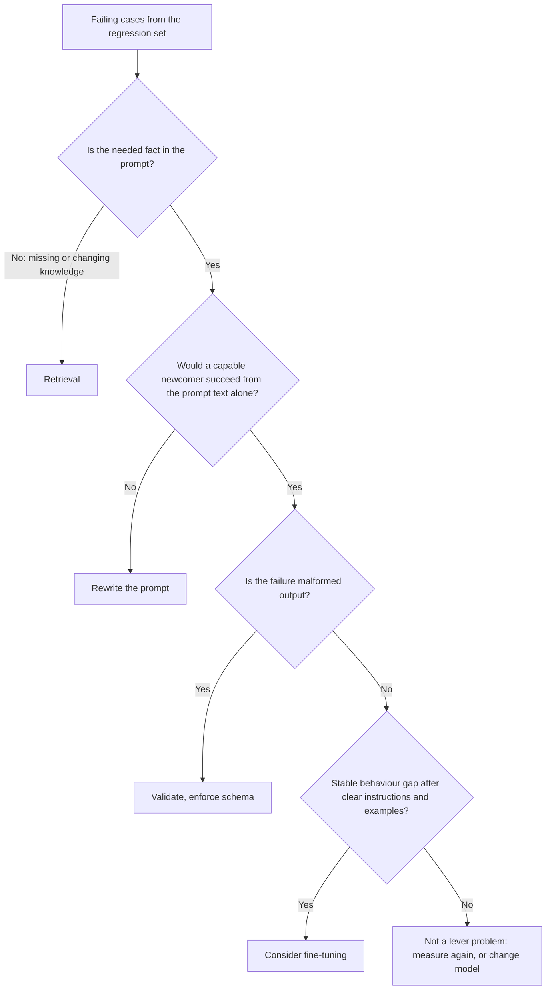

# Lesson 22. Prompt, RAG or Fine-Tune

**Mission link:** Choose between a better prompt, retrieval and fine-tuning for a given failure. The mistake this lesson prevents is reaching for the heaviest fix because it sounds serious, when the failure was an unclear instruction.
**Primary source:** [Paper: "Fine-Tuning or Retrieval? Comparing Knowledge Injection in LLMs", Ovadia et al., 2023](https://arxiv.org/abs/2312.05934)
**Prerequisites:** [Lesson 3](0003-clear-instructions.md), [Lesson 18](0018-a-regression-set-for-a-prompt.md), [regression set](../GLOSSARY.md)

## Warm-up

1. ▢ What is a regression set built from, and what must it do for a prompt change?

Check

Mostly failures seen in real use, each paired with a check on the output. A prompt change must not break any of them, so the set is what turns "this looks better" into a claim you can test.

2. ▢ What does lesson 3 say a clear instruction contains, and what is the practical test for it?

Check

The context, the task, the constraints, and what done looks like. The practical test is whether a capable newcomer handed only that text could do the job. Where they could not, the failure is the prompt, not the model.

3. ▢ A model keeps returning prose when your program expects JSON. Which earlier lesson says what to do first, before changing anything about the model?

Check

Lesson 11. Ask for the schema in the prompt and validate the result in code, because asking is not a guarantee. Only after that is the failure a candidate for something heavier.

## Know this

### Start from the failure, not the tool

Anthropic's overview assumes you already have "a clear definition of the success criteria", "some ways to empirically test against those criteria" and a first draft prompt, and says to establish those first. It also says "not every success criteria or failing eval is best solved by prompt engineering", with the example that latency and cost can sometimes be improved more easily by choosing a different model ([Anthropic: prompt engineering overview](https://platform.claude.com/docs/en/build-with-claude/prompt-engineering/overview)).

So the first move is to read your failing cases from the regression set and sort them by what went wrong, not by which tool you would like to use.

| What the failure looks like | What is actually missing | Lever |
|---|---|---|
| The answer ignores or misreads something the prompt contained | A clear, unambiguous instruction | Rewrite the prompt (lessons 3 and 4) |
| The model invents or misstates facts it was never given: private, recent or changing information | Knowledge | Retrieval |
| Output shape or tone is right in the prompt's examples and drifts across a huge volume of requests | Consistent behaviour, or a cheaper way to get it | Few-shot first, then fine-tuning |
| Output is malformed, though the instructions are clear | Enforcement | Validation, structured outputs, constrained decoding |
| The task needs calculation or an action | A capability the model lacks | A tool |
| Quality is fine but slow or expensive | A different cost point | A different model or a shorter prompt |

### Missing knowledge is a retrieval problem

A prompt can only reorder what the model already has plus what you place in it. Ovadia et al. compared two ways to add knowledge: unsupervised fine-tuning and retrieval-augmented generation. Their finding: fine-tuning "offers some improvement", but retrieval "consistently outperforms it, both for existing knowledge encountered during training and entirely new knowledge". They also report that models "struggle to learn new factual information through unsupervised fine-tuning", and that showing numerous variations of the same fact during training could ease it.

Two cautions when you use this. The study is about unsupervised fine-tuning for knowledge, not about fine-tuning for behaviour, so it does not say fine-tuning is a bad lever in general. And it measures accuracy, so it is silent on cost, which is where changing data tilts further toward retrieval: a fact that changes weekly would mean retraining weekly.

For the retrieval case, see the [RAG track](../../rag/README.md) and its [generation-from-retrieval sheet](../../rag/reference/generation-from-retrieval.md).

### Behaviour at scale is where fine-tuning earns a look

The [fine-tuning track](../../finetuning/README.md) puts a better prompt first among the options and lists fine-tuning as what solves "consistent behaviour, prompt cost, small-model sufficiency", at the cost of data, evaluation and maintenance. Its own lesson 27 is titled "When Not to Fine-Tune" and says most people who want to fine-tune have a problem an earlier option solves faster. Read that track before committing, since it is the authority on the fine-tuning side of this choice.

The prompt-side signals worth recording before you go there:

- You tried a clear instruction and a few well-chosen examples (lessons 3 and 6), and the regression set shows a stable remaining gap.
- The gap is behavioural: format, style, a label policy. It is not a missing fact.
- The prompt has grown long only to teach the behaviour, so every request pays for it.

### They combine

The three levers are not exclusive. A product can use retrieval for facts, a prompt for the task and tone, and a fine-tuned small model for the behaviour. What matters is that each failure is routed to the lever that addresses its cause, and that you can show the gap before and after with the regression set.

One thing none of the three buys: OWASP states that RAG and fine-tuning, while they aim to make outputs more relevant and accurate, "do not fully mitigate prompt injection vulnerabilities" ([OWASP LLM01:2025](https://genai.owasp.org/llmrisk/llm01-prompt-injection/)). Adding retrieval to fix knowledge also adds an indirect injection route (lesson 20).

## Practice

1. ▢ Route each failure to a lever: (a) the bot quotes last quarter's price list, which changes every quarter, (b) the bot's replies are accurate but sometimes friendly and sometimes curt, (c) the model returns two JSON objects and your parser fails.

Check

(a) Retrieval: the fact changes, and the model cannot know a price list it was never given. (b) Start with a clearer instruction about tone and one or two examples. Only a stable remaining gap at scale makes it a fine-tune candidate. (c) Validation and a schema, since the instruction is probably clear and what is missing is enforcement.

2. ▢ A team proposes fine-tuning a model on its internal documentation so it can answer questions about it. Which statement best matches the primary source?

    - a) Fine-tuning adds new facts more reliably than retrieval, because weights hold them
    - b) Retrieval outperformed unsupervised fine-tuning for new and existing knowledge
    - c) Fine-tuning and retrieval gave the same accuracy once the data was cleaned
    - d) Retrieval helps only for facts the model saw during pre-training

Check

b). Ovadia et al. found retrieval consistently outperformed unsupervised fine-tuning, for both existing knowledge and entirely new knowledge. a) reverses the finding. c) is not what they report. d) is wrong, since their result includes entirely new knowledge.

3. ▢ The study behind the previous item is sometimes quoted as "retrieval beats fine-tuning". Name what that summary leaves out.

Check

It compares unsupervised fine-tuning for adding knowledge. It does not test fine-tuning for behaviour, such as style or output format, where fine-tuning can be the right lever. The abstract also notes that exposure to many variations of the same fact could ease the problem, so "never" overstates it. Check the conditions before using a result in an argument.

4. ▢ A support bot uses a 2,000-token prompt of rules and examples on every call. Replies are consistently good. Volume is high and cost is the complaint. Is fine-tuning the answer, and what do you check first?

Check

Maybe, but not first. The failure is cost, so first see whether the prompt can be shorter without moving the regression set, and whether a different model meets the quality bar cheaper (the overview names that route). Fine-tuning is a candidate when the behaviour is stable and the prompt is long only to teach it, and the fine-tuning track says to cost the data, evaluation and maintenance before committing. Decide with the regression set, before and after.

5. ▢ You are given 30 failing cases. Describe the minimum you do before choosing a lever, and what result would make you stop and not change anything.

Check

Sort the 30 by cause: missing fact, unclear instruction, malformed output, behaviour drift, capability gap, cost. Pick the lever for the largest group and fix that first, measuring on the regression set. Stop if the failures turn out to be wrong or ambiguous expected answers in the set itself, because then the set, not the system, needs repair. A mixed pile is normal and usually needs more than one lever.

## Real-world reps

- [ ] Take five real failures from any LLM feature you know and write one line for each: what was missing, and which lever addresses it.
- [ ] Read the fine-tuning track's lesson 27 and write down the first of its questions that your last "we should fine-tune" idea would have failed.
- [ ] Tomorrow: Open the abstract of Ovadia et al. and rewrite its main finding in one sentence that states the conditions it holds under.

## Going further

- [Prompt Review Checklist](../reference/prompt-review-checklist.md)
- [Paper: "Fine-Tuning or Retrieval? Comparing Knowledge Injection in LLMs", Ovadia et al., 2023](https://arxiv.org/abs/2312.05934)
- [Docs: "Prompt engineering overview", Claude Platform Docs](https://platform.claude.com/docs/en/build-with-claude/prompt-engineering/overview)
- [Adapter Fine-Tuning track](../../finetuning/README.md)
- [RAG track](../../rag/README.md)
- [Resources](../RESOURCES.md)

---

Not landing? Reread the primary source at the top, since this lesson compresses it and compression is where understanding leaks. Check the [glossary](../GLOSSARY.md) for any term that felt slippery.

If the lesson itself is unclear rather than the material, that is a defect: [open an issue](https://github.com/TokenCemetery/teach/issues).
