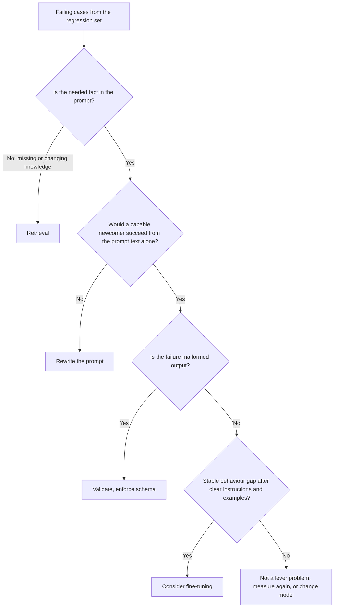

# Lição 22. Prompt, RAG ou fine-tuning

**Ligação com a missão:** Escolher entre um prompt melhor, recuperação e fine-tuning para uma falha específica. O erro que esta lição evita é recorrer à correção mais pesada porque ela soa séria, quando a falha era uma instrução pouco clara.
**Fonte principal:** [Paper: "Fine-Tuning or Retrieval? Comparing Knowledge Injection in LLMs", Ovadia et al., 2023](https://arxiv.org/abs/2312.05934)
**Pré-requisitos:** [Lição 3](0003-clear-instructions.md), [Lição 18](0018-a-regression-set-for-a-prompt.md), [Conjunto de regressão](../GLOSSARY.md)

## Aquecimento

1. ▢ De que é feito um conjunto de regressão, e o que ele precisa fazer diante de uma mudança de prompt?

Verificação

Principalmente de falhas vistas em uso real, cada uma pareada com uma verificação sobre a saída. Uma mudança de prompt não pode quebrar nenhuma delas, então o conjunto é o que transforma "isto parece melhor" em uma afirmação que você pode testar.

2. ▢ O que a lição 3 diz que uma instrução clara contém, e qual é o teste prático para isso?

Verificação

O contexto, a tarefa, as restrições e como é o resultado pronto. O teste prático é se um recém-chegado competente, recebendo apenas esse texto, conseguiria fazer o trabalho. Onde ele não conseguiria, a falha é do prompt, não do modelo.

3. ▢ Um modelo continua devolvendo prosa quando o seu programa espera JSON. Qual lição anterior diz o que fazer primeiro, antes de mudar qualquer coisa no modelo?

Verificação

A lição 11. Peça o schema no prompt e valide o resultado em código, porque pedir não é garantia. Só depois disso a falha passa a ser candidata a algo mais pesado.

## Saiba isto

### Comece pela falha, não pela ferramenta

A visão geral da Anthropic pressupõe que você já tem "a clear definition of the success criteria" (uma definição clara dos critérios de sucesso), "some ways to empirically test against those criteria" (algumas formas de testar empiricamente contra esses critérios) e um primeiro rascunho de prompt, e diz para estabelecer essas coisas primeiro. Ela também diz que "not every success criteria or failing eval is best solved by prompt engineering" (nem todo critério de sucesso ou eval com falha é melhor resolvido com prompt engineering), com o exemplo de que latência e custo às vezes podem ser melhorados com mais facilidade escolhendo outro modelo ([Anthropic: prompt engineering overview](https://platform.claude.com/docs/en/build-with-claude/prompt-engineering/overview)).

Então o primeiro passo é ler os seus casos com falha do conjunto de regressão e separá-los pelo que deu errado, não pela ferramenta que você gostaria de usar.

| Como a falha se apresenta | O que realmente falta | Alavanca |
|---|---|---|
| A resposta ignora ou interpreta mal algo que o prompt continha | Uma instrução clara e inequívoca | Reescrever o prompt (lições 3 e 4) |
| O modelo inventa ou distorce fatos que nunca recebeu: informação privada, recente ou que muda | Conhecimento | Recuperação |
| O formato ou o tom da saída está certo nos exemplos do prompt e se desvia em um volume enorme de requisições | Comportamento consistente, ou uma forma mais barata de obtê-lo | Few-shot primeiro, depois fine-tuning |
| A saída está malformada, embora as instruções sejam claras | Imposição | Validação, saídas estruturadas, decodificação restrita |
| A tarefa exige cálculo ou uma ação | Uma capacidade que o modelo não tem | Uma ferramenta |
| A qualidade é boa, mas é lento ou caro | Outro ponto de custo | Outro modelo ou um prompt mais curto |

### Conhecimento ausente é um problema de recuperação

Um prompt só pode reordenar o que o modelo já tem mais o que você coloca nele. Ovadia et al. compararam duas formas de adicionar conhecimento: fine-tuning não supervisionado e geração aumentada por recuperação (RAG). A conclusão deles: o fine-tuning "offers some improvement" (oferece alguma melhora), mas a recuperação "consistently outperforms it, both for existing knowledge encountered during training and entirely new knowledge" (o supera consistentemente, tanto para o conhecimento existente encontrado durante o treinamento quanto para conhecimento inteiramente novo). Eles também relatam que os modelos "struggle to learn new factual information through unsupervised fine-tuning" (têm dificuldade de aprender informação factual nova por fine-tuning não supervisionado), e que mostrar numerosas variações do mesmo fato durante o treinamento poderia facilitar isso.

Duas ressalvas ao usar isso. O estudo trata de fine-tuning não supervisionado para conhecimento, não de fine-tuning para comportamento, então não diz que o fine-tuning é uma má alavanca em geral. E ele mede acurácia, então é silencioso sobre custo, que é onde dados que mudam inclinam ainda mais a balança para a recuperação: um fato que muda toda semana significaria retreinar toda semana.

Para o caso da recuperação, veja a [trilha de RAG](../../rag/README.md) e sua folha [Geração a partir da recuperação](../../rag/reference/generation-from-retrieval.md).

### Comportamento em escala é onde o fine-tuning merece um olhar

A [trilha de fine-tuning](../../finetuning/README.md) coloca um prompt melhor em primeiro lugar entre as opções e lista o fine-tuning como o que resolve "consistent behaviour, prompt cost, small-model sufficiency" (comportamento consistente, custo do prompt, suficiência de um modelo pequeno), ao custo de dados, avaliação e manutenção. A própria lição 27 dela se chama "When Not to Fine-Tune" e diz que a maioria das pessoas que querem fazer fine-tuning tem um problema que uma opção anterior resolve mais rápido. Leia essa trilha antes de se comprometer, pois ela é a autoridade sobre o lado do fine-tuning desta escolha.

Os sinais do lado do prompt que vale registrar antes de ir para lá:

- Você tentou uma instrução clara e alguns exemplos bem escolhidos (lições 3 e 6), e o conjunto de regressão mostra uma lacuna estável remanescente.
- A lacuna é comportamental: formato, estilo, uma política de rótulos. Não é um fato ausente.
- O prompt ficou longo só para ensinar o comportamento, então toda requisição paga por isso.

### Elas se combinam

As três alavancas não são exclusivas. Um produto pode usar recuperação para os fatos, um prompt para a tarefa e o tom, e um modelo pequeno com fine-tuning para o comportamento. O que importa é que cada falha seja encaminhada para a alavanca que trata a sua causa, e que você consiga mostrar a lacuna antes e depois com o conjunto de regressão.

Uma coisa que nenhuma das três compra: a OWASP afirma que RAG e fine-tuning, embora busquem tornar as saídas mais relevantes e precisas, "do not fully mitigate prompt injection vulnerabilities" (não mitigam totalmente as vulnerabilidades de injeção de prompt) ([OWASP LLM01:2025](https://genai.owasp.org/llmrisk/llm01-prompt-injection/)). Adicionar recuperação para resolver conhecimento também adiciona uma rota de injeção indireta (lição 20).

## Prática

1. ▢ Encaminhe cada falha para uma alavanca: (a) o bot cita a tabela de preços do trimestre passado, que muda a cada trimestre, (b) as respostas do bot são precisas, mas às vezes simpáticas e às vezes ríspidas, (c) o modelo devolve dois objetos JSON e o seu parser falha.

Verificação

(a) Recuperação: o fato muda, e o modelo não pode conhecer uma tabela de preços que nunca recebeu. (b) Comece com uma instrução mais clara sobre o tom e um ou dois exemplos. Só uma lacuna estável remanescente em escala a torna candidata a fine-tuning. (c) Validação e um schema, já que a instrução provavelmente é clara e o que falta é imposição.

2. ▢ Uma equipe propõe fazer fine-tuning de um modelo na sua documentação interna para que ele responda perguntas sobre ela. Qual afirmação melhor corresponde à fonte principal?

    - a) O fine-tuning adiciona fatos novos de forma mais confiável que a recuperação, porque os pesos os guardam
    - b) A recuperação superou o fine-tuning não supervisionado para conhecimento novo e existente
    - c) Fine-tuning e recuperação deram a mesma acurácia depois que os dados foram limpos
    - d) A recuperação só ajuda para fatos que o modelo viu no pré-treinamento

Verificação

b). Ovadia et al. constataram que a recuperação superou consistentemente o fine-tuning não supervisionado, tanto para conhecimento existente quanto para conhecimento inteiramente novo. a) inverte a conclusão. c) não é o que eles relatam. d) está errada, pois o resultado deles inclui conhecimento inteiramente novo.

3. ▢ O estudo por trás do item anterior às vezes é citado como "a recuperação vence o fine-tuning". Diga o que esse resumo deixa de fora.

Verificação

Ele compara fine-tuning não supervisionado para adicionar conhecimento. Não testa fine-tuning para comportamento, como estilo ou formato de saída, onde o fine-tuning pode ser a alavanca certa. O abstract também observa que a exposição a muitas variações do mesmo fato poderia aliviar o problema, então "nunca" é exagero. Confira as condições antes de usar um resultado em um argumento.

4. ▢ Um bot de suporte usa um prompt de 2.000 tokens de regras e exemplos em toda chamada. As respostas são consistentemente boas. O volume é alto e o custo é a reclamação. O fine-tuning é a resposta, e o que você verifica primeiro?

Verificação

Talvez, mas não primeiro. A falha é custo, então primeiro veja se o prompt pode ficar mais curto sem mexer no conjunto de regressão, e se outro modelo atinge o nível de qualidade mais barato (a visão geral cita esse caminho). O fine-tuning é candidato quando o comportamento é estável e o prompt é longo só para ensiná-lo, e a trilha de fine-tuning diz para levantar o custo de dados, avaliação e manutenção antes de se comprometer. Decida com o conjunto de regressão, antes e depois.

5. ▢ Você recebe 30 casos com falha. Descreva o mínimo que você faz antes de escolher uma alavanca, e que resultado faria você parar e não mudar nada.

Verificação

Separe os 30 por causa: fato ausente, instrução pouco clara, saída malformada, desvio de comportamento, lacuna de capacidade, custo. Escolha a alavanca para o maior grupo e corrija isso primeiro, medindo no conjunto de regressão. Pare se as falhas se revelarem respostas esperadas erradas ou ambíguas no próprio conjunto, porque então o conjunto, e não o sistema, é que precisa de conserto. Uma pilha mista é normal e geralmente precisa de mais de uma alavanca.

## Prática no mundo real

- [ ] Pegue cinco falhas reais de qualquer recurso de LLM que você conheça e escreva uma linha para cada: o que faltava e qual alavanca resolve isso.
- [ ] Leia a lição 27 da trilha de fine-tuning e anote a primeira das perguntas dela que a sua última ideia de "deveríamos fazer fine-tuning" teria reprovado.
- [ ] Amanhã: abra o abstract de Ovadia et al. e reescreva a conclusão principal em uma frase que declare as condições em que ela vale.

## Para ir além

- [Checklist de Revisão de Prompt](../reference/prompt-review-checklist.md)
- [Paper: "Fine-Tuning or Retrieval? Comparing Knowledge Injection in LLMs", Ovadia et al., 2023](https://arxiv.org/abs/2312.05934)
- [Docs: "Prompt engineering overview", Claude Platform Docs](https://platform.claude.com/docs/en/build-with-claude/prompt-engineering/overview)
- [trilha de fine-tuning](../../finetuning/README.md)
- [trilha de RAG](../../rag/README.md)
- [Recursos](../RESOURCES.md)

---

Não ficou claro? Releia a fonte principal no topo, pois esta lição a comprime e é na compressão que o entendimento se perde. Consulte o [glossário](../GLOSSARY.md) para qualquer termo que tenha parecido escorregadio.

Se a lição em si é que não está clara, e não o material, isso é um defeito: [abra uma issue](https://github.com/TokenCemetery/teach/issues).
