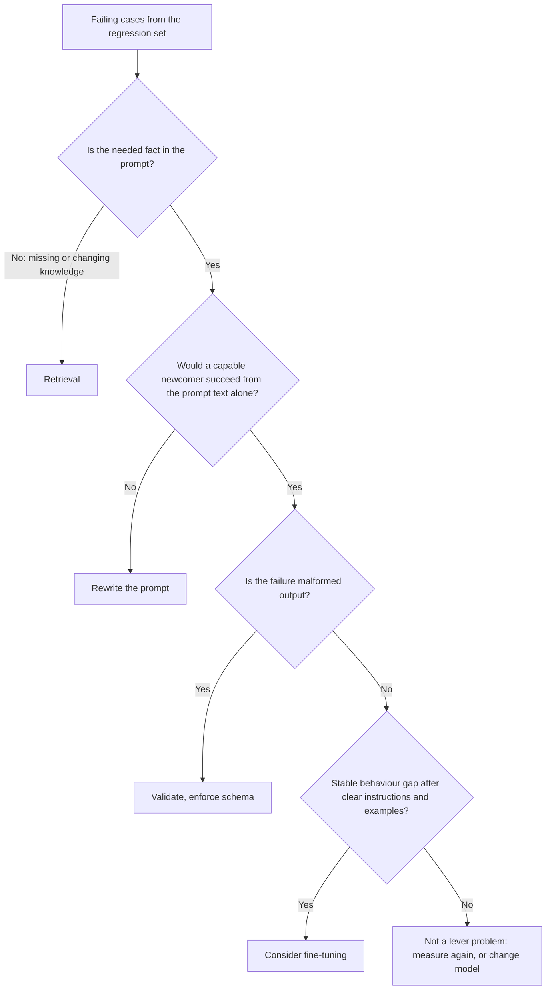

# Урок 22. Промпт, RAG или дообучение

**Связь с целью курса:** Выберите между улучшением промпта, поиском и дообучением для конкретного сбоя. Урок предотвращает такую ошибку: вы хватаетесь за самое тяжёлое решение, потому что оно звучит солидно, хотя сбой был вызван нечёткой инструкцией.
**Первоисточник:** [Статья: «Fine-Tuning or Retrieval? Comparing Knowledge Injection in LLMs», Ovadia et al., 2023](https://arxiv.org/abs/2312.05934)
**Предварительные требования:** [Урок 3](0003-clear-instructions.md), [урок 18](0018-a-regression-set-for-a-prompt.md), [регрессионный набор](../GLOSSARY.md)

## Разминка

1. ▢ Из чего строится регрессионный набор и что он должен делать при изменении промпта?

Проверка

В основном из сбоев, замеченных в реальной работе, к каждому из которых привязана проверка вывода. Изменение промпта не должно сломать ни один из них, поэтому набор превращает «так выглядит лучше» в утверждение, которое можно проверить.

2. ▢ Что, по уроку 3, содержит ясная инструкция и какова практическая проверка на это?

Проверка

Контекст, задачу, ограничения и то, как выглядит готовый результат. Практическая проверка: справился бы способный новичок, получивший только этот текст. Если нет, сбой в промпте, а не в модели.

3. ▢ Модель продолжает возвращать прозу, когда ваша программа ждёт JSON. Какой из прошлых уроков говорит, что делать в первую очередь, до любых изменений в модели?

Проверка

Урок 11. Попросите схему в промпте и проверьте результат в коде, потому что просьба не даёт гарантии. Только после этого сбой становится кандидатом на что-то более тяжёлое.

## Что нужно знать

### Начинайте со сбоя, а не с инструмента

Обзор Anthropic исходит из того, что у вас уже есть «чёткое определение критериев успеха», «способы эмпирически проверять их» и первый черновик промпта, и говорит сначала установить всё это. Там же сказано, что «не каждый критерий успеха или провалившийся eval лучше всего решается промпт-инженерией», например задержку и стоимость иногда проще улучшить выбором другой модели ([Anthropic: обзор промпт-инженерии](https://platform.claude.com/docs/en/build-with-claude/prompt-engineering/overview)).

Поэтому первый шаг такой: прочитайте проваленные случаи из регрессионного набора и рассортируйте их по тому, что пошло не так, а не по тому, каким инструментом вам хочется воспользоваться.

| Как выглядит сбой | Чего на самом деле не хватает | Рычаг |
|---|---|---|
| Ответ игнорирует или неверно читает то, что было в промпте | Чёткой однозначной инструкции | Переписать промпт (уроки 3 и 4) |
| Модель выдумывает или искажает факты, которые ей не давали: частные, свежие или меняющиеся сведения | Знаний | Поиск |
| Форма вывода или тон верны в примерах промпта и «плывут» на огромном потоке запросов | Стабильного поведения или более дешёвого способа его получить | Сначала few-shot, затем дообучение |
| Вывод искажён, хотя инструкции ясны | Принудительного соблюдения | Валидация, структурированный вывод, ограниченное декодирование |
| Задаче нужен расчёт или действие | Возможности, которой у модели нет | Инструмент |
| Качество в порядке, но медленно или дорого | Другой ценовой точки | Другая модель или более короткий промпт |

### Недостаток знаний это задача для поиска

Промпт может лишь переупорядочить то, что у модели уже есть, плюс то, что вы в него положили. Ovadia et al. сравнили два способа добавить знания: обучение без учителя (unsupervised fine-tuning) и генерацию с дополнением поиском (RAG). Их вывод: дообучение «даёт некоторое улучшение», но поиск «стабильно превосходит его, как для знаний, встречавшихся при обучении, так и для совершенно новых». Они также сообщают, что модели «с трудом усваивают новую фактическую информацию через обучение без учителя», и что показ множества вариаций одного и того же факта во время обучения мог бы это облегчить.

Две оговорки при использовании. Исследование посвящено дообучению без учителя ради знаний, а не дообучению ради поведения, поэтому оно не утверждает, что дообучение вообще плохой рычаг. И оно измеряет точность, так что о стоимости молчит, а именно там меняющиеся данные ещё сильнее склоняют чашу к поиску: факт, меняющийся каждую неделю, означал бы переобучение каждую неделю.

О случае с поиском см. [трек по RAG](../../rag/README.md) и его [шпаргалку по генерации на основе поиска](../../rag/reference/generation-from-retrieval.md).

### Поведение в масштабе: здесь дообучение заслуживает внимания

[Трек по дообучению](../../finetuning/README.md) ставит лучший промпт первым среди вариантов и называет дообучение тем, что решает «стабильное поведение, стоимость промпта, достаточность небольшой модели», ценой данных, оценки и сопровождения. Его собственный урок 27 называется «When Not to Fine-Tune» и говорит, что у большинства тех, кто хочет дообучать, есть проблема, которую быстрее решает более ранний вариант. Прочитайте этот трек, прежде чем принимать решение: именно он авторитетен по той стороне выбора, что касается дообучения.

Сигналы со стороны промпта, которые стоит зафиксировать, прежде чем идти туда:

- Вы попробовали ясную инструкцию и несколько удачно подобранных примеров (уроки 3 и 6), а регрессионный набор показывает устойчивый остаточный разрыв.
- Разрыв поведенческий: формат, стиль, политика меток. Это не недостающий факт.
- Промпт стал длинным только ради того, чтобы научить поведению, и теперь за это платит каждый запрос.

### Они сочетаются

Три рычага не исключают друг друга. Продукт может использовать поиск для фактов, промпт для задачи и тона, а дообученную небольшую модель для поведения. Важно, чтобы каждый сбой направлялся к рычагу, который устраняет его причину, и чтобы вы могли показать разрыв до и после на регрессионном наборе.

Одного не даёт ни один из трёх: OWASP утверждает, что RAG и дообучение, хотя и призваны сделать выводы более релевантными и точными, «не смягчают полностью уязвимости к промпт-инъекции» ([OWASP LLM01:2025](https://genai.owasp.org/llmrisk/llm01-prompt-injection/)). Добавляя поиск ради знаний, вы добавляете и путь для косвенной инъекции (урок 20).

## Практика

1. ▢ Направьте каждый сбой к рычагу: (а) бот цитирует прошлоквартальный прайс-лист, который меняется каждый квартал, (б) ответы бота точны, но иногда дружелюбны, а иногда сухи, (в) модель возвращает два JSON-объекта, и ваш парсер падает.

Проверка

(а) Поиск: факт меняется, а модель не может знать прайс-лист, который ей не давали. (б) Начните с более ясной инструкции о тоне и одного-двух примеров. Только устойчивый остаточный разрыв в масштабе делает это кандидатом на дообучение. (в) Валидация и схема: инструкция, вероятно, ясна, а не хватает принудительного соблюдения.

2. ▢ Команда предлагает дообучить модель на внутренней документации, чтобы она отвечала на вопросы по ней. Какое утверждение лучше всего соответствует первоисточнику?

    - a) Дообучение добавляет новые факты надёжнее, чем поиск, потому что их хранят веса
    - b) Поиск превзошёл дообучение без учителя и для новых, и для существующих знаний
    - c) Дообучение и поиск дали одинаковую точность после очистки данных
    - d) Поиск помогает только с фактами, которые модель видела при предобучении

Проверка

b). Ovadia et al. обнаружили, что поиск стабильно превосходил дообучение без учителя как для существующих, так и для совершенно новых знаний. a) переворачивает вывод. c) не то, о чём они сообщают. d) неверно, так как их результат включает совершенно новые знания.

3. ▢ Исследование из предыдущего пункта иногда цитируют как «поиск побеждает дообучение». Назовите, что в этом пересказе опущено.

Проверка

Сравнивается дообучение без учителя как способ добавить знания. Дообучение ради поведения, например стиля или формата вывода, где оно может быть правильным рычагом, не проверялось. В аннотации также отмечено, что показ многих вариаций одного и того же факта мог бы облегчить проблему, поэтому «никогда» преувеличивает. Проверяйте условия, прежде чем использовать результат в споре.

4. ▢ Бот поддержки использует на каждом вызове промпт из 2000 токенов с правилами и примерами. Ответы стабильно хорошие. Объём высокий, жалоба на стоимость. Дообучение ли это решение и что вы проверяете первым?

Проверка

Возможно, но не первым делом. Сбой в стоимости, поэтому сначала выясните, можно ли сократить промпт, не сдвинув регрессионный набор, и достигает ли требуемого качества более дешёвая другая модель (этот путь называет обзор). Дообучение становится кандидатом, когда поведение стабильно, а промпт длинный только ради того, чтобы его привить, и трек по дообучению велит оценить стоимость данных, оценки и сопровождения до принятия решения. Решайте по регрессионному набору, до и после.

5. ▢ Вам дали 30 проваленных случаев. Опишите минимум, который вы сделаете перед выбором рычага, и какой результат заставил бы вас остановиться и ничего не менять.

Проверка

Разложите 30 случаев по причинам: недостающий факт, нечёткая инструкция, искажённый вывод, дрейф поведения, нехватка возможности, стоимость. Выберите рычаг для самой большой группы и исправьте её первой, измеряя на регрессионном наборе. Остановитесь, если окажется, что неверны или неоднозначны ожидаемые ответы в самом наборе, потому что тогда чинить надо набор, а не систему. Смешанная куча это нормально, и обычно ей нужен не один рычаг.

## Практика в реальной работе

- [ ] Возьмите пять реальных сбоев любой известной вам LLM-функции и напишите для каждого одну строку: чего не хватало и какой рычаг это устраняет.
- [ ] Прочитайте урок 27 трека по дообучению и запишите первый из его вопросов, который провалила бы ваша последняя идея «надо дообучить».
- [ ] Завтра: откройте аннотацию Ovadia et al. и перепишите её главный вывод одним предложением, в котором названы условия, при которых он верен.

## Что почитать дальше

- [Чек-лист ревью промпта](../reference/prompt-review-checklist.md)
- [Статья: «Fine-Tuning or Retrieval? Comparing Knowledge Injection in LLMs», Ovadia et al., 2023](https://arxiv.org/abs/2312.05934)
- [Документация: «Prompt engineering overview», Claude Platform Docs](https://platform.claude.com/docs/en/build-with-claude/prompt-engineering/overview)
- [Трек по адаптерному дообучению](../../finetuning/README.md)
- [Трек по RAG](../../rag/README.md)
- [Ресурсы](../RESOURCES.md)

---

Не получается? Перечитайте первоисточник в начале: этот урок его сжимает, а при сжатии понимание и утекает. Загляните в [глоссарий](../GLOSSARY.md) за любым термином, который показался скользким.

Если неясен сам урок, а не материал, это дефект: [откройте issue](https://github.com/TokenCemetery/teach/issues).
