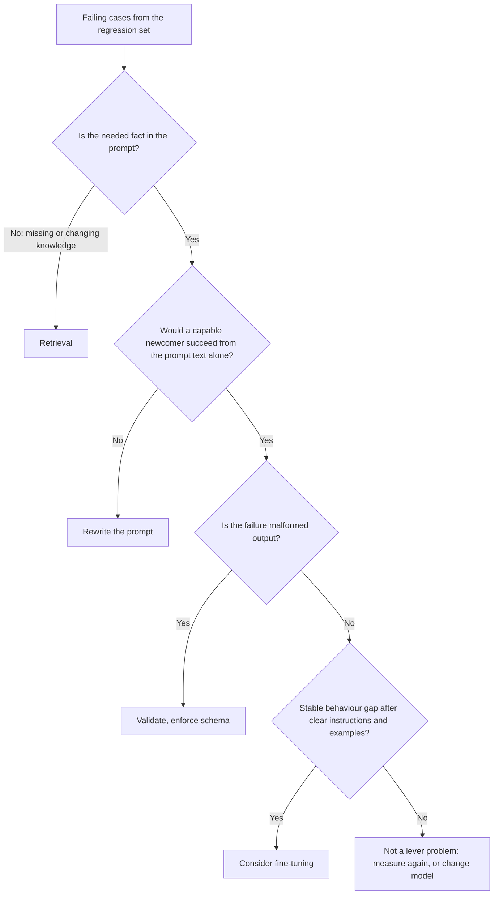

# 第 22 课：提示词、RAG 还是微调

**使命关联:** 针对某个具体的失败，在更好的提示词、检索和微调之间做选择。本课要防止的错误是：失败的原因只是一条不清楚的指令，却因为听起来分量重而去用最重的办法。
**主要来源:** [论文：“Fine-Tuning or Retrieval? Comparing Knowledge Injection in LLMs”，Ovadia 等，2023](https://arxiv.org/abs/2312.05934)
**前置知识:** [第 3 课](0003-clear-instructions.md)、[第 18 课](0018-a-regression-set-for-a-prompt.md)、[回归集](../GLOSSARY.md)

## 热身

1. ▢ 回归集是用什么建成的？对于一次提示词改动，它必须起到什么作用？

检查

主要由真实使用中见到的失败构成，每个都配有一项对输出的检查。提示词的改动不能破坏其中任何一个，所以这个集合能把“这看起来更好”变成一个可以测试的论断。

2. ▢ 第 3 课说清晰的指令包含什么？实际的检验办法是什么？

检查

上下文、任务、约束，以及完成后的样子。实际的检验办法是：只把这段文字交给一个能干的新人，他能不能把活干完。如果做不到，失败出在提示词上，而不是模型上。

3. ▢ 你的程序期望 JSON，模型却一直返回散文。在改动模型的任何方面之前，应当先按哪一课说的去做？

检查

第 11 课。在提示词里要求给出 schema，并在代码里校验结果，因为提出要求并不是保证。只有做完这一步，这个失败才轮得到考虑更重的办法。

## 要点

### 从失败出发，而不是从工具出发

Anthropic 的概述假定你已经有了“对成功标准的清晰定义”、“一些对照这些标准做实证测试的方法”和一份提示词初稿，并说应当先把这些建立起来。它还说“并非每一条成功标准或失败的评测，都最适合用提示词工程来解决”，例子是延迟和成本有时更容易通过换一个模型来改善（[文档：“Prompt engineering overview”，Claude Platform Docs](https://platform.claude.com/docs/en/build-with-claude/prompt-engineering/overview)）。

所以第一步，是读回归集里失败的用例，按出了什么问题来分类，而不是按你想用哪个工具来分。

| 失败看起来像什么 | 实际缺少什么 | 杠杆 |
|---|---|---|
| 回答忽略或误读了提示词里包含的内容 | 清晰、无歧义的指令 | 重写提示词（第 3 和第 4 课） |
| 模型捏造或错述了它从未被告知的事实：私有的、最新的或会变化的信息 | 知识 | 检索 |
| 输出的形态或语气在提示词的示例里是对的，但在海量请求中逐渐偏离 | 一致的行为，或获得它的更便宜办法 | 先用少样本，再考虑微调 |
| 指令明明很清楚，输出却格式错误 | 强制执行 | 校验、结构化输出、约束解码 |
| 任务需要计算或执行操作 | 模型所缺的能力 | 工具 |
| 质量没问题，但又慢又贵 | 不同的成本点 | 换一个模型，或缩短提示词 |

### 缺少知识是检索问题

提示词只能重新排列模型已有的东西，加上你放进去的内容。Ovadia 等人比较了两种添加知识的方式：无监督微调和检索增强生成。他们的发现是：微调“带来了一些改进”，但检索“始终优于它，无论是对训练中遇到过的已有知识，还是全新的知识”。他们还报告说，模型“很难通过无监督微调学到新的事实信息”，而在训练中展示同一事实的大量变体，或许能减轻这个问题。

使用时有两点需要注意。这项研究针对的是为获取知识而做的无监督微调，不是为调整行为而做的微调，所以它并没有说微调总体上是个糟糕的杠杆。而且它衡量的是准确率，对成本只字未提，而数据一旦变化，天平会进一步向检索倾斜：每周变一次的事实，意味着每周都得重新训练。

关于检索的情形，参见 [RAG 系列](../../rag/README.md)及其[基于检索的生成速查表](../../rag/reference/generation-from-retrieval.md)。

### 规模化的行为问题，才值得考虑微调

[微调系列](../../finetuning/README.md)把更好的提示词排在各种选项之首，并把微调列为解决“行为一致性、提示词成本、小模型够用”的办法，代价是数据、评估和维护。它自己的第 27 课题为“何时不该微调”，指出大多数想做微调的人，遇到的问题用前面的选项就能更快解决。在做决定之前，请先读那个系列，因为在这个选择的微调一侧，它才是权威。

在走到那一步之前，值得记录的提示词侧信号有：

- 你试过清晰的指令和几个精心挑选的示例（第 3 和第 6 课），而回归集显示仍有一个稳定的差距。
- 这个差距是行为上的：格式、风格、标签策略，而不是缺少某个事实。
- 提示词变长只是为了教会这种行为，因此每次请求都在为此付费。

### 它们可以组合使用

这三个杠杆并不互斥。一个产品可以用检索提供事实，用提示词规定任务和语气，用微调过的小模型承担行为。重要的是，把每个失败引向能解决其成因的杠杆，并且能用回归集展示前后的差距。

有一件事是三者都买不到的：OWASP 指出，RAG 和微调虽然旨在让输出更相关、更准确，但“并不能完全缓解提示词注入漏洞”（[OWASP LLM01:2025](https://genai.owasp.org/llmrisk/llm01-prompt-injection/)）。为修复知识问题而加入检索，也同时增加了一条间接注入的途径（第 20 课）。

## 练习

1. ▢ 把每个失败分到一个杠杆：(a) 机器人引用了上个季度的价目表，而价目表每个季度都会变；(b) 机器人的回复准确，但有时友好有时生硬；(c) 模型返回了两个 JSON 对象，你的解析器出错了。

检查

(a) 检索：事实在变，而模型不可能知道一份从未交给它的价目表。(b) 先写一条关于语气的更清晰指令，再加一两个示例。只有在规模化时仍留有稳定的差距，才成为微调的候选。(c) 校验和 schema，因为指令多半是清楚的，缺少的是强制执行。

2. ▢ 一个团队提议用内部文档来微调模型，好让它回答有关文档的问题。下面哪项陈述与主要来源最吻合？

    - a) 微调比检索更可靠地添加新事实，因为权重会保存它们
    - b) 检索在新知识和已有知识上都优于无监督微调
    - c) 数据清洗之后，微调和检索的准确率相同
    - d) 检索只对模型在预训练时见过的事实有帮助

检查

b)。Ovadia 等人发现，检索始终优于无监督微调，无论是已有知识还是全新的知识。a) 把结论说反了。c) 不是他们报告的结果。d) 是错的，因为他们的结果包含全新的知识。

3. ▢ 上一题背后的研究，有时被引述成“检索胜过微调”。说出这个概括遗漏了什么。

检查

它比较的是用于添加知识的无监督微调。它没有测试为行为（比如风格或输出格式）所做的微调，而在那里微调可能是正确的杠杆。摘要还指出，接触同一事实的多种变体，可能缓解这个问题，所以说“永远不行”就言过其实了。在把一个结果用于论证之前，先核对它成立的条件。

4. ▢ 一个客服机器人每次调用都使用一个 2,000 token 的、由规则和示例构成的提示词。回复一直都很好。调用量大，抱怨的是成本。微调是答案吗？你先检查什么？

检查

也许是，但不是第一步。失败在于成本，所以先看提示词能不能缩短而不动回归集的结果，以及换一个模型能不能更便宜地达到质量要求（概述里提到了这条路）。当行为稳定、提示词变长只是为了教会它时，微调才是候选；而微调系列说，在做决定之前，要先核算数据、评估和维护的成本。用回归集来决定，看前后对比。

5. ▢ 你拿到 30 个失败的用例。描述在选择杠杆之前你至少要做什么，以及什么结果会让你停下来、什么都不改。

检查

按成因给这 30 个分类：缺少事实、指令不清、输出格式错误、行为偏离、能力缺口、成本。给最大的一组选定杠杆，先修复它，并在回归集上度量。如果发现失败其实来自回归集本身错误或有歧义的期望答案，就停下来，因为这时需要修复的是这个集合，而不是系统。混杂的一堆是常态，通常需要不止一个杠杆。

## 实战练习

- [ ] 从你了解的任一 LLM 功能里取五个真实的失败，为每个写一行：缺少了什么，哪个杠杆能解决它。
- [ ] 阅读微调系列的第 27 课，写下你上一个“我们应该微调”的想法会在它的哪个问题上第一个过不了关。
- [ ] 明天：打开 Ovadia 等人的摘要，用一句话重写它的主要发现，并写明这个发现成立的条件。

## 延伸阅读

- [提示词评审检查清单](../reference/prompt-review-checklist.md)
- [论文：“Fine-Tuning or Retrieval? Comparing Knowledge Injection in LLMs”，Ovadia 等，2023](https://arxiv.org/abs/2312.05934)
- [文档：“Prompt engineering overview”，Claude Platform Docs](https://platform.claude.com/docs/en/build-with-claude/prompt-engineering/overview)
- [微调系列](../../finetuning/README.md)
- [RAG 系列](../../rag/README.md)
- [资源](../RESOURCES.md)

---

没学明白？请重读顶部的主要来源，因为本课是对它的压缩，而理解正是在压缩中流失的。如果有哪个术语觉得含糊，可以查看[术语表](../GLOSSARY.md)。

如果问题出在课程本身，而不是学习材料，那就是一个缺陷：[提交 issue](https://github.com/TokenCemetery/teach/issues)。
