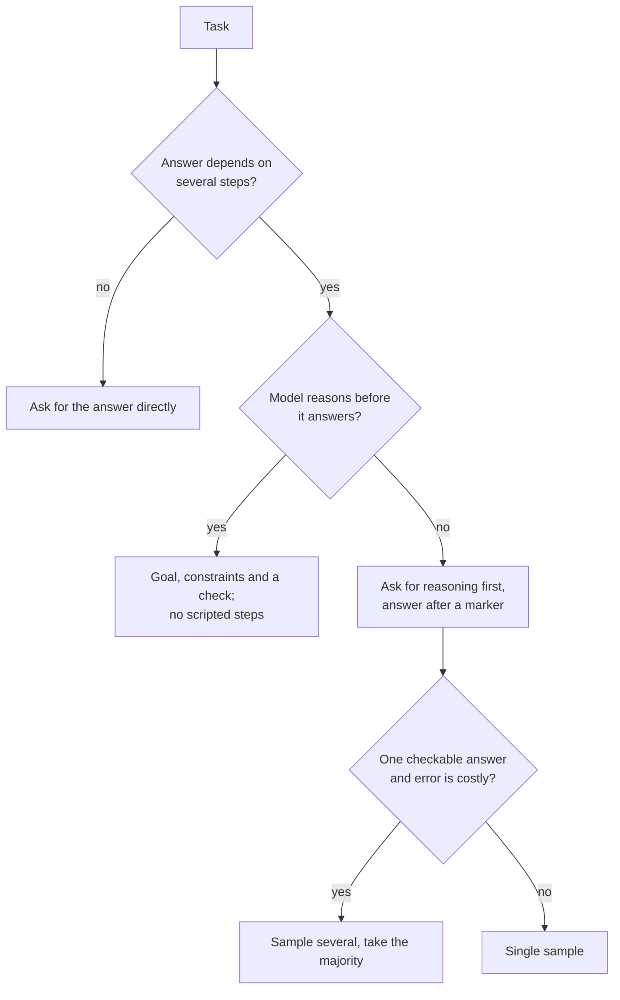

# Few-Shot y razonamiento: elegir ejemplos y decidir sobre el razonamiento

Las etapas 3 y 4 condensadas para consulta rápida. La [lección 6](../lessons/0006-what-examples-teach.md) cubre lo que enseñan los ejemplos, la [lección 7](../lessons/0007-few-shot-biases.md) sus sesgos, la [lección 8](../lessons/0008-chain-of-thought.md) el chain-of-thought, la [lección 9](../lessons/0009-self-consistency-and-faithfulness.md) la autoconsistencia y la fidelidad, y la [lección 10](../lessons/0010-prompting-reasoning-models.md) cómo escribir prompts para modelos de razonamiento.

## Qué enseñan los ejemplos

| Las demostraciones aportan | Comprobación |
|---|---|
| El formato: entrada y luego salida, repetido | Todos los ejemplos comparten un mismo diseño y una misma grafía de las etiquetas |
| El espacio de etiquetas | Cada respuesta permitida aparece al menos una vez |
| La distribución de las entradas | Las entradas se parecen a las reales, no a textos inventados y ordenados |
| La correspondencia entre entrada y etiqueta | Es lo que menos importa en Min et al., pero mantén las etiquetas correctas |

La evidencia proviene de modelos de la época de GPT-2 a GPT-3, en tareas de clasificación y de opción múltiple. Tómala como una hipótesis previa y prueba tu modelo.

## Elegir y ordenar los ejemplos

| Riesgo | Fuente | Respuesta |
|---|---|---|
| Sesgo hacia la etiqueta mayoritaria | Zhao et al. | Equilibra las etiquetas entre los ejemplos |
| Sesgo de recencia | Zhao et al. | No termines con una racha de una misma etiqueta |
| Sesgo hacia tokens comunes | Zhao et al. | Comprueba si se están perdiendo respuestas correctas poco frecuentes |
| Sensibilidad al orden | Lu et al. | Prueba varios órdenes sobre casos conocidos y repite la prueba al cambiar de modelo |
| Ejemplos duplicados o fuera de distribución | Guía de Anthropic | Elige ejemplos relevantes, diversos y etiquetados, de 3 a 5 (consejo de un solo proveedor) |

## ¿Pedir razonamiento?

## Técnicas de razonamiento

| Técnica | Qué hace | Evidencia | Costo o límite |
|---|---|---|---|
| Chain-of-thought few-shot | Ejemplos con el razonamiento resuelto | Wei et al.: mejoras a partir de unos 100B de parámetros, mayores en problemas más difíciles | Requiere buenos ejemplos y tokens de salida adicionales |
| Chain-of-thought zero-shot | "Let's think step by step" | Kojima et al.: MultiArith pasa de 17,7 % a 78,7 % en text-davinci-002 | Sin mejora en las tareas de un solo paso y de sentido común que se probaron |
| Autoconsistencia | Muestrea caminos y vota la respuesta | Wang et al.: GSM8K +17,9 % frente a la decodificación greedy | Necesita una respuesta final comparable y varias veces los tokens |
| Pasos guionizados para un modelo de razonamiento | Fija la ruta | Guía de Anthropic: las instrucciones generales suelen superar a los planes prescritos | Limita al modelo a tu ruta |

## Qué es y qué no es el razonamiento escrito

- Mejora la respuesta cuando la tarea requiere pasos, y para ayudar debe venir antes de la respuesta (Wei et al.).
- Puede omitir lo que impulsó la respuesta. Turpin et al.: la precisión cayó hasta un 36 % ante rasgos sesgadores que el razonamiento nunca mencionó, en GPT-3.5 y Claude 1.0.
- Para comprobar qué influye en una respuesta, cambia la entrada y vuelve a ejecutar. No le pidas al modelo que se explique.

## Modelos de razonamiento (comportamiento documentado por un proveedor)

- Prefiere instrucciones generales a pasos prescriptivos.
- Los ejemplos resueltos influyen en cómo el modelo aborda problemas similares durante su fase de razonamiento.
- Una línea final de verificación ayuda, pero las líneas de verificación antiguas pueden provocar un exceso de verificación en algunos modelos, así que vuelve a probar.
- La cantidad de razonamiento es un ajuste aparte. Razonamiento extendido manual: `budget_tokens` con un mínimo de 1.024, es un objetivo y no un tope, y cuenta para `max_tokens`.
- Razonamiento dentro de un bucle de agente: [llm/agents lección 17](../../agents/lessons/0017-self-critique-and-reasoning-models.md).

## Antes de publicar un prompt few-shot o de razonamiento

- Los ejemplos comparten un mismo diseño y la grafía exacta de las etiquetas.
- Aparecen todas las etiquetas, sin una mayoritaria y sin una racha final.
- Se puntuaron varios órdenes sobre casos conocidos y la dispersión es pequeña.
- El razonamiento se usa solo en tareas que necesitan pasos, y la respuesta va después de un marcador que un programa pueda encontrar.
- Se comparó con el prompt simple y se vuelve a ejecutar tras cualquier cambio de modelo.
