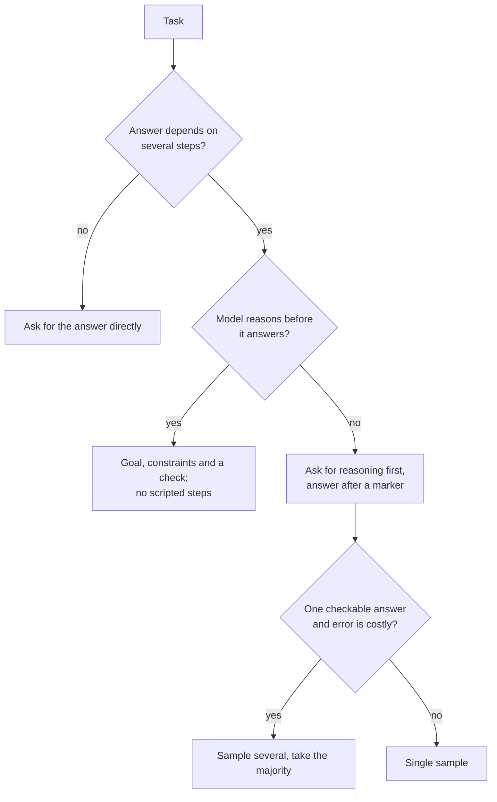

# Few-shot et raisonnement : choisir les exemples et décider du raisonnement

Les étapes 3 et 4 condensées pour la consultation. La [leçon 6](../lessons/0006-what-examples-teach.md) traite de ce qu'enseignent les exemples, la [leçon 7](../lessons/0007-few-shot-biases.md) de leurs biais, la [leçon 8](../lessons/0008-chain-of-thought.md) du chain-of-thought, la [leçon 9](../lessons/0009-self-consistency-and-faithfulness.md) de la self-consistency et de la fidélité, et la [leçon 10](../lessons/0010-prompting-reasoning-models.md) du prompting des modèles de raisonnement.

## Ce qu'enseignent les exemples

| Les démonstrations fournissent | Vérification |
|---|---|
| Le format : entrée puis sortie, répétés | Tous les exemples partagent une mise en page et une orthographe de label |
| L'espace des labels | Chaque réponse autorisée apparaît au moins une fois |
| La distribution des entrées | Les entrées ressemblent à de vraies entrées, pas à du texte inventé et soigné |
| La correspondance entrée-label | C'est ce qui compte le moins chez Min et al., mais gardez des labels corrects |

Les preuves viennent de modèles de l'ère GPT-2 à GPT-3 sur des tâches de classification et de choix multiple. Voyez-y un a priori et testez votre modèle.

## Choisir et ordonner les exemples

| Risque | Source | Réponse |
|---|---|---|
| Biais de label majoritaire | Zhao et al. | Équilibrer les labels entre les exemples |
| Biais de récence | Zhao et al. | Ne pas terminer sur une série d'un même label |
| Biais de token commun | Zhao et al. | Vérifier si des bonnes réponses rares sont manquées |
| Sensibilité à l'ordre | Lu et al. | Tester plusieurs ordres sur des cas connus, retester à chaque changement de modèle |
| Exemples en double ou hors distribution | Guide d'Anthropic | Choisir des exemples pertinents, variés et balisés, 3 à 5 (conseil d'un seul éditeur) |

## Demander du raisonnement ?

## Techniques de raisonnement

| Technique | Ce qu'elle fait | Preuves | Coût ou limite |
|---|---|---|---|
| Chain-of-thought few-shot | Des exemples avec raisonnement détaillé | Wei et al. : gains à partir d'environ 100 Md de paramètres, plus grands sur les problèmes plus difficiles | Demande de bons exemples, des tokens de sortie en plus |
| Chain-of-thought zero-shot | « Let's think step by step » | Kojima et al. : MultiArith de 17,7 % à 78,7 % sur text-davinci-002 | Aucun gain sur les tâches en une étape et de bon sens testées |
| Self-consistency | Échantillonner des chemins, voter sur la réponse | Wang et al. : GSM8K +17,9 % par rapport au glouton | Demande une réponse finale comparable, plusieurs fois les tokens |
| Étapes scénarisées pour un modèle de raisonnement | Fige l'itinéraire | Guide d'Anthropic : les instructions générales battent souvent les plans prescrits | Limite le modèle à votre itinéraire |

## Ce qu'est et n'est pas le raisonnement écrit

- Il aide la réponse quand la tâche demande des étapes, et il doit venir avant la réponse pour aider (Wei et al.).
- Il peut omettre ce qui a motivé la réponse. Turpin et al. : la précision a chuté jusqu'à 36 % sous des facteurs de biais que le raisonnement ne mentionnait jamais, sur GPT-3.5 et Claude 1.0.
- Pour tester ce qui influence une réponse, changez l'entrée et relancez. Ne demandez pas au modèle de s'expliquer.

## Modèles de raisonnement (comportement documenté d'un seul éditeur)

- Préférez les instructions générales aux étapes prescriptives.
- Des exemples détaillés façonnent la façon dont le modèle aborde des problèmes similaires dans sa réflexion.
- Une ligne de vérification finale aide, mais d'anciennes lignes de vérification peuvent sur-vérifier sur certains modèles : retestez.
- La quantité de réflexion est un réglage distinct. Extended thinking manuel : `budget_tokens` minimum 1 024, une cible et non un plafond, compté dans `max_tokens`.
- Le raisonnement dans une boucle d'agent : [leçon 17 de llm/agents](../../agents/lessons/0017-self-critique-and-reasoning-models.md).

## Avant de livrer un prompt few-shot ou de raisonnement

- Les exemples partagent une mise en page et l'orthographe exacte des labels.
- Chaque label apparaît, sans majorité et sans série finale.
- Plusieurs ordres ont été évalués sur des cas connus et l'écart est faible.
- Le raisonnement n'est présent que sur les tâches qui demandent des étapes, et la réponse se trouve après un marqueur qu'un programme peut repérer.
- Il a été comparé au prompt simple, et relancé après tout changement de modèle.
