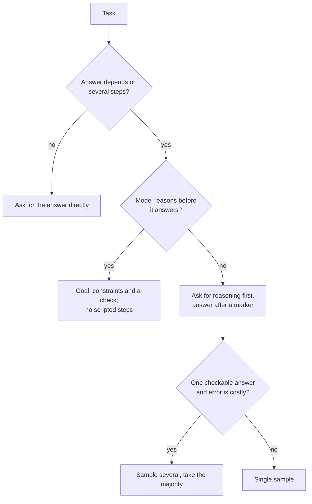

# Few-Shot और Reasoning: Examples चुनना और Reasoning पर फ़ैसला

चरण 3 और 4 का संक्षिप्त रूप, खोजने के लिए। [पाठ 6](../lessons/0006-what-examples-teach.md) बताता है कि examples क्या सिखाते हैं, [पाठ 7](../lessons/0007-few-shot-biases.md) उनके biases, [पाठ 8](../lessons/0008-chain-of-thought.md) chain-of-thought, [पाठ 9](../lessons/0009-self-consistency-and-faithfulness.md) self-consistency और faithfulness, और [पाठ 10](../lessons/0010-prompting-reasoning-models.md) reasoning models को prompt करना।

## Examples क्या सिखाते हैं

| Demonstrations क्या देते हैं | जाँच |
|---|---|
| Format: input फिर output, दोहराया हुआ | हर example का एक layout और label की एक spelling है |
| Label space | हर अनुमत उत्तर कम से कम एक बार आता है |
| Input distribution | Inputs असली जैसे दिखते हैं, साफ़-सुथरे गढ़े हुए text जैसे नहीं |
| Input से label का मैपिंग | Min et al. में सबसे कम मायने रखता है, फिर भी labels सही रखें |

प्रमाण GPT-2 से GPT-3 युग के models पर classification और multi-choice tasks से हैं। इसे पूर्वधारणा मानें और अपने model को परखें।

## Examples चुनना और क्रम देना

| जोखिम | स्रोत | जवाब |
|---|---|---|
| Majority-label bias | Zhao et al. | Examples में labels को संतुलित करें |
| Recency bias | Zhao et al. | एक label की क़तार पर ख़त्म न करें |
| Common-token bias | Zhao et al. | जाँचें कि दुर्लभ सही उत्तर छूट तो नहीं रहे |
| क्रम के प्रति संवेदनशीलता | Lu et al. | ज्ञात cases पर कई क्रम परखें, model बदलने पर दोबारा परखें |
| दोहराए या distribution से बाहर के examples | Anthropic की गाइड | प्रासंगिक, विविध, tag किए हुए 3 से 5 examples चुनें (एक vendor की सलाह) |

## Reasoning माँगें?

## Reasoning की techniques

| Technique | क्या करती है | प्रमाण | क़ीमत या सीमा |
|---|---|---|---|
| Few-shot chain-of-thought | हल की हुई reasoning वाले examples | Wei et al.: लगभग 100B parameters और उससे ऊपर फ़ायदे, कठिन समस्याओं पर बड़े | अच्छे examples चाहिए, अतिरिक्त output tokens |
| Zero-shot chain-of-thought | "Let's think step by step" | Kojima et al.: text-davinci-002 पर MultiArith 17.7% से 78.7% | परखे गए एक-चरण और commonsense tasks पर कोई फ़ायदा नहीं |
| Self-consistency | Paths sample करें, उत्तर पर वोट करें | Wang et al.: greedy के ऊपर GSM8K +17.9% | तुलना लायक अंतिम उत्तर चाहिए, कई गुना tokens |
| Reasoning model के लिए लिखे हुए चरण | रास्ता तय कर देते हैं | Anthropic की गाइड: सामान्य instructions अक्सर निर्देशात्मक योजनाओं से बेहतर | Model को आपके रास्ते तक सीमित करते हैं |

## लिखी हुई reasoning क्या है और क्या नहीं

- Task को चरण चाहिए तो वह उत्तर की मदद करती है, और मदद के लिए उसे उत्तर से पहले आना होगा (Wei et al.)।
- वह उसे छोड़ सकती है जिसने उत्तर चलाया। Turpin et al.: पक्षपाती features के तहत, जिनका reasoning ने कभी ज़िक्र नहीं किया, GPT-3.5 और Claude 1.0 पर accuracy 36% तक गिरी।
- यह परखने के लिए कि उत्तर पर क्या असर डालता है, input बदलें और दोबारा चलाएँ। Model से ख़ुद को समझाने को न कहें।

## Reasoning models (एक vendor का दस्तावेज़ी व्यवहार)

- निर्देशात्मक चरणों के बजाय सामान्य instructions को तरजीह दें।
- हल किए हुए examples तय करते हैं कि model अपनी thinking में मिलती-जुलती समस्याओं तक कैसे पहुँचे।
- अंत की सत्यापन पंक्ति मदद करती है, पर पुरानी सत्यापन पंक्तियाँ कुछ models पर ज़रूरत से ज़्यादा सत्यापन करवा सकती हैं, इसलिए दोबारा परखें।
- Thinking की मात्रा अलग setting है। Manual extended thinking: `budget_tokens` का न्यूनतम 1,024, एक लक्ष्य न कि सीमा, `max_tokens` में गिना जाता है।
- Agent loop के भीतर reasoning: [llm/agents पाठ 17](../../agents/lessons/0017-self-critique-and-reasoning-models.md)।

## Few-shot या reasoning prompt ship करने से पहले

- Examples का एक layout और label की सटीक spelling है।
- हर label आता है, बिना बहुमत और बिना अंत की क़तार के।
- कई क्रम ज्ञात cases पर score किए गए और फैलाव छोटा है।
- Reasoning सिर्फ़ उन tasks पर है जिन्हें चरण चाहिए, और उत्तर ऐसे marker के बाद बैठता है जिसे program पा सके।
- इसकी तुलना सादे prompt से की गई, और model बदलने पर दोबारा चलाया गया।
