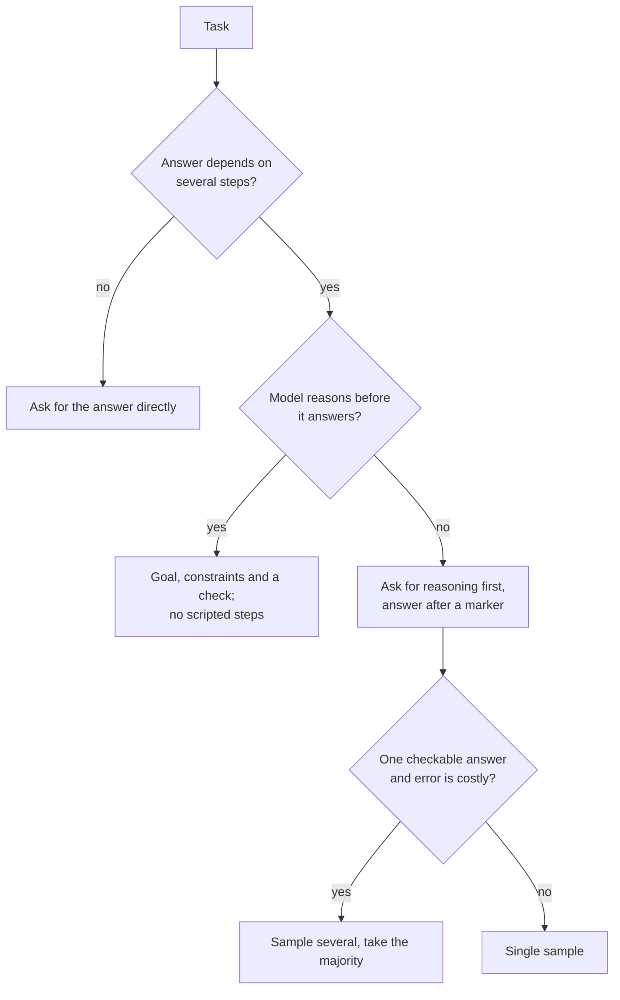

# Few-Shot and Reasoning: Choosing Examples and Deciding on Reasoning

Stages 3 and 4 compressed for lookup. [Lesson 6](../lessons/0006-what-examples-teach.md) covers what examples teach, [lesson 7](../lessons/0007-few-shot-biases.md) their biases, [lesson 8](../lessons/0008-chain-of-thought.md) chain-of-thought, [lesson 9](../lessons/0009-self-consistency-and-faithfulness.md) self-consistency and faithfulness, and [lesson 10](../lessons/0010-prompting-reasoning-models.md) prompting reasoning models.

## What examples teach

| Demonstrations provide | Check |
|---|---|
| The format: input then output, repeated | Every example shares one layout and one label spelling |
| The label space | Every allowed answer appears at least once |
| The input distribution | Inputs look like real ones, not tidy invented text |
| The input-to-label mapping | Matters least in Min et al., but keep labels correct |

The evidence is from GPT-2 to GPT-3 era models on classification and multi-choice tasks. Treat it as a prior and test your model.

## Choosing and ordering examples

| Risk | Source | Response |
|---|---|---|
| Majority-label bias | Zhao et al. | Balance labels across examples |
| Recency bias | Zhao et al. | Do not end on a run of one label |
| Common-token bias | Zhao et al. | Check whether rare correct answers are being missed |
| Order sensitivity | Lu et al. | Test several orders on known cases, re-test on a model change |
| Duplicate or off-distribution examples | Anthropic guide | Pick relevant, diverse, tagged examples, 3 to 5 (one vendor's advice) |

## Ask for reasoning?

## Reasoning techniques

| Technique | What it does | Evidence | Cost or limit |
|---|---|---|---|
| Few-shot chain-of-thought | Examples with worked reasoning | Wei et al.: gains at about 100B parameters and up, larger on harder problems | Needs good examples, extra output tokens |
| Zero-shot chain-of-thought | "Let's think step by step" | Kojima et al.: MultiArith 17.7% to 78.7% on text-davinci-002 | No gain on the one-step and commonsense tasks tested |
| Self-consistency | Sample paths, vote on the answer | Wang et al.: GSM8K +17.9% over greedy | Needs a comparable final answer, several times the tokens |
| Scripted steps for a reasoning model | Fixes the route | Anthropic guide: general instructions often beat prescribed plans | Limits the model to your route |

## What written reasoning is and is not

- It helps the answer when the task needs steps, and it must come before the answer to help (Wei et al.).
- It can omit what drove the answer. Turpin et al.: accuracy dropped by up to 36% under biasing features that the reasoning never mentioned, on GPT-3.5 and Claude 1.0.
- To test what influences an answer, change the input and rerun. Do not ask the model to explain itself.

## Reasoning models (one vendor's documented behaviour)

- Prefer general instructions to prescriptive steps.
- Worked examples shape how the model approaches similar problems in its thinking.
- A final verification line helps, but old verification lines can over-verify on some models, so retest.
- Thinking amount is a separate setting. Manual extended thinking: `budget_tokens` minimum 1,024, a target not a cap, counted toward `max_tokens`.
- Reasoning inside an agent loop: [llm/agents lesson 17](../../agents/lessons/0017-self-critique-and-reasoning-models.md).

## Before shipping a few-shot or reasoning prompt

- Examples share one layout and exact label spelling.
- Every label appears, with no majority and no ending run.
- Several orders were scored on known cases and the spread is small.
- Reasoning is only on tasks that need steps, and the answer sits after a marker a program can find.
- It was compared against the plain prompt, and re-run after any model change.
