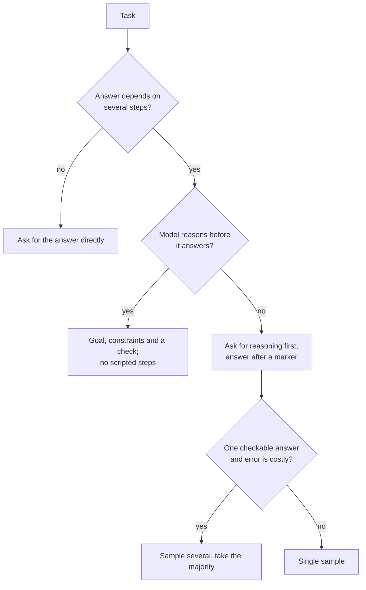

# Few-Shot e Raciocínio: Escolhendo Exemplos e Decidindo sobre Raciocínio

Os estágios 3 e 4 condensados para consulta. A [lição 6](../lessons/0006-what-examples-teach.md) trata do que os exemplos ensinam, a [lição 7](../lessons/0007-few-shot-biases.md) de seus vieses, a [lição 8](../lessons/0008-chain-of-thought.md) de chain-of-thought, a [lição 9](../lessons/0009-self-consistency-and-faithfulness.md) de autoconsistência e fidelidade, e a [lição 10](../lessons/0010-prompting-reasoning-models.md) de prompting para modelos de raciocínio.

## O que os exemplos ensinam

| As demonstrações fornecem | Verificação |
|---|---|
| O formato: entrada e depois saída, repetidas | Todo exemplo usa o mesmo layout e a mesma grafia de rótulo |
| O espaço de rótulos | Toda resposta permitida aparece ao menos uma vez |
| A distribuição das entradas | As entradas se parecem com as reais, não com textos inventados e arrumados |
| O mapeamento entrada-rótulo | É o que menos importa em Min et al., mas mantenha os rótulos corretos |

A evidência vem de modelos da era GPT-2 a GPT-3, em tarefas de classificação e de múltipla escolha. Trate-a como um prior e teste o seu modelo.

## Escolhendo e ordenando exemplos

| Risco | Fonte | Resposta |
|---|---|---|
| Viés do rótulo majoritário | Zhao et al. | Equilibre os rótulos entre os exemplos |
| Viés de recência | Zhao et al. | Não termine com uma sequência de um mesmo rótulo |
| Viés de token comum | Zhao et al. | Verifique se respostas corretas raras estão sendo perdidas |
| Sensibilidade à ordem | Lu et al. | Teste várias ordens em casos conhecidos e teste de novo quando o modelo mudar |
| Exemplos duplicados ou fora da distribuição | Guia da Anthropic | Escolha exemplos relevantes, diversos e marcados com tags, de 3 a 5 (conselho de um único fornecedor) |

## Pedir raciocínio?

## Técnicas de raciocínio

| Técnica | O que faz | Evidência | Custo ou limite |
|---|---|---|---|
| Chain-of-thought few-shot | Exemplos com raciocínio resolvido | Wei et al.: ganhos a partir de cerca de 100B de parâmetros, maiores em problemas mais difíceis | Exige bons exemplos e tokens de saída extras |
| Chain-of-thought zero-shot | "Let's think step by step" | Kojima et al.: MultiArith de 17,7% para 78,7% no text-davinci-002 | Nenhum ganho nas tarefas de um passo e de senso comum testadas |
| Autoconsistência | Amostra caminhos e vota na resposta | Wang et al.: GSM8K +17,9% sobre a decodificação greedy | Exige uma resposta final comparável e várias vezes mais tokens |
| Passos roteirizados para um modelo de raciocínio | Fixa o caminho | Guia da Anthropic: instruções gerais costumam superar planos prescritos | Limita o modelo ao seu caminho |

## O que o raciocínio escrito é e o que não é

- Ele ajuda a resposta quando a tarefa exige passos, e precisa vir antes da resposta para ajudar (Wei et al.).
- Ele pode omitir o que motivou a resposta. Turpin et al.: a acurácia caiu em até 36% sob características de viés que o raciocínio nunca mencionou, no GPT-3.5 e no Claude 1.0.
- Para testar o que influencia uma resposta, altere a entrada e rode de novo. Não peça ao modelo que se explique.

## Modelos de raciocínio (comportamento documentado por um único fornecedor)

- Prefira instruções gerais a passos prescritivos.
- Exemplos resolvidos moldam como o modelo aborda problemas parecidos no seu thinking.
- Uma linha final de verificação ajuda, mas linhas de verificação antigas podem causar verificação em excesso em alguns modelos, então teste de novo.
- A quantidade de thinking é uma configuração separada. Extended thinking manual: `budget_tokens` com mínimo de 1.024, é uma meta e não um teto, e conta para `max_tokens`.
- Raciocínio dentro de um loop de agente: [lição 17 da trilha de agentes](../../agents/lessons/0017-self-critique-and-reasoning-models.md).

## Antes de entregar um prompt few-shot ou de raciocínio

- Os exemplos compartilham um mesmo layout e a grafia exata dos rótulos.
- Todo rótulo aparece, sem maioria e sem sequência no final.
- Várias ordens foram pontuadas em casos conhecidos e a dispersão é pequena.
- O raciocínio só está nas tarefas que exigem passos, e a resposta fica depois de um marcador que um programa consiga encontrar.
- Foi comparado com o prompt simples e rodado de novo após qualquer mudança de modelo.
