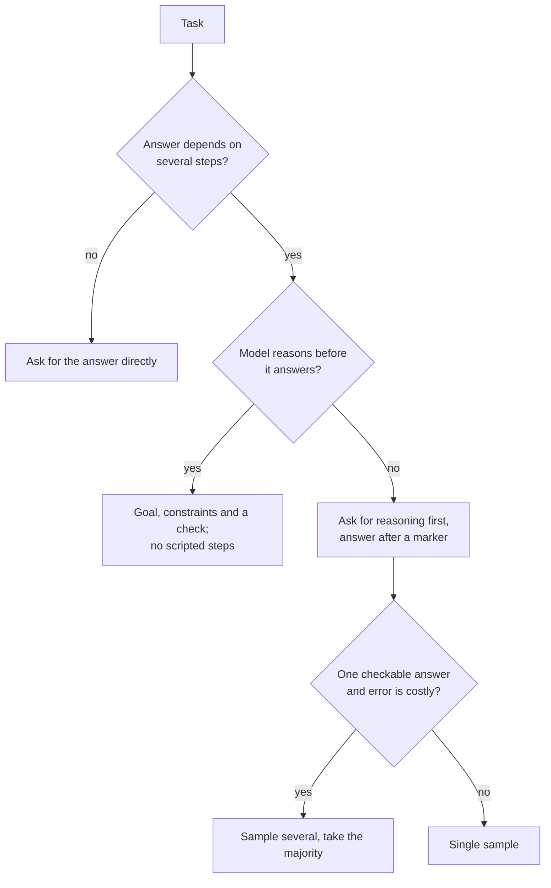

# Few-shot и рассуждения: выбор примеров и решение о рассуждении

Этапы 3 и 4 в сжатом виде для быстрого поиска. [Урок 6](../lessons/0006-what-examples-teach.md) рассказывает, чему учат примеры, [урок 7](../lessons/0007-few-shot-biases.md) о их смещениях, [урок 8](../lessons/0008-chain-of-thought.md) о цепочке рассуждений, [урок 9](../lessons/0009-self-consistency-and-faithfulness.md) о самосогласованности и достоверности, а [урок 10](../lessons/0010-prompting-reasoning-models.md) о промптах для рассуждающих моделей.

## Чему учат примеры

| Демонстрации дают | Проверка |
|---|---|
| Формат: вход, затем выход, повторяется | У всех примеров одна раскладка и одно написание меток |
| Пространство меток | Каждый допустимый ответ встречается хотя бы раз |
| Распределение входов | Входы похожи на настоящие, а не на аккуратный выдуманный текст |
| Соответствие вход-метка | Меньше всего влияет у Min et al., но метки всё равно должны быть верными |

Данные получены на моделях эпохи от GPT-2 до GPT-3 на задачах классификации и выбора из вариантов. Считайте их априорной оценкой и проверяйте свою модель.

## Выбор и порядок примеров

| Риск | Источник | Что делать |
|---|---|---|
| Смещение к самой частой метке | Zhao et al. | Сбалансируйте метки по примерам |
| Смещение к недавнему | Zhao et al. | Не заканчивайте серией одной и той же метки |
| Смещение к частым токенам | Zhao et al. | Проверьте, не пропускаются ли редкие правильные ответы |
| Чувствительность к порядку | Lu et al. | Проверьте несколько порядков на известных случаях, перепроверяйте при смене модели |
| Дубликаты или примеры не из того распределения | Руководство Anthropic | Выбирайте релевантные, разнообразные, размеченные тегами примеры, от 3 до 5 (совет одного вендора) |

## Просить ли рассуждение?

## Приёмы рассуждения

| Приём | Что делает | Свидетельства | Цена или предел |
|---|---|---|---|
| Few-shot chain-of-thought | Примеры с разобранным рассуждением | Wei et al.: выигрыш примерно от 100 млрд параметров, больше на сложных задачах | Нужны хорошие примеры, дополнительные выходные токены |
| Zero-shot chain-of-thought | «Let's think step by step» | Kojima et al.: MultiArith с 17,7% до 78,7% на text-davinci-002 | Нет выигрыша на проверенных одношаговых задачах и задачах на здравый смысл |
| Самосогласованность | Сэмплировать пути, голосовать за ответ | Wang et al.: GSM8K +17,9% к жадному декодированию | Нужен сопоставимый окончательный ответ, в несколько раз больше токенов |
| Заданные шаги для рассуждающей модели | Фиксирует маршрут | Руководство Anthropic: общие инструкции часто лучше предписанных планов | Ограничивает модель вашим маршрутом |

## Чем письменное рассуждение является и чем не является

- Оно помогает ответу, когда задаче нужны шаги, и помогает только тогда, когда стоит перед ответом (Wei et al.).
- Оно может умолчать о том, что на самом деле определило ответ. Turpin et al.: точность падала до 36% под действием смещающих признаков, которые рассуждение ни разу не упоминало, на GPT-3.5 и Claude 1.0.
- Чтобы проверить, что влияет на ответ, измените вход и перезапустите. Не просите модель объяснить себя.

## Рассуждающие модели (документированное поведение одного вендора)

- Предпочитайте общие инструкции предписывающим шагам.
- Разобранные примеры формируют, как модель подходит к похожим задачам в своём мышлении.
- Завершающая строка с проверкой помогает, но старые строки проверки на некоторых моделях могут приводить к избыточной проверке, поэтому перетестируйте.
- Объём мышления это отдельная настройка. Ручное расширенное мышление: `budget_tokens` минимум 1 024, это цель, а не потолок, и он входит в `max_tokens`.
- Рассуждение внутри цикла агента: [урок 17 курса llm/agents](../../agents/lessons/0017-self-critique-and-reasoning-models.md).

## Перед выпуском few-shot-промпта или промпта с рассуждением

- У примеров одна раскладка и точное написание меток.
- Встречается каждая метка, нет доминирующей и нет завершающей серии.
- Несколько порядков оценены на известных случаях, разброс мал.
- Рассуждение включено только для задач, которым нужны шаги, а ответ стоит после маркера, который программа может найти.
- Промпт сравнён с простым вариантом и перезапущен после любой смены модели.
