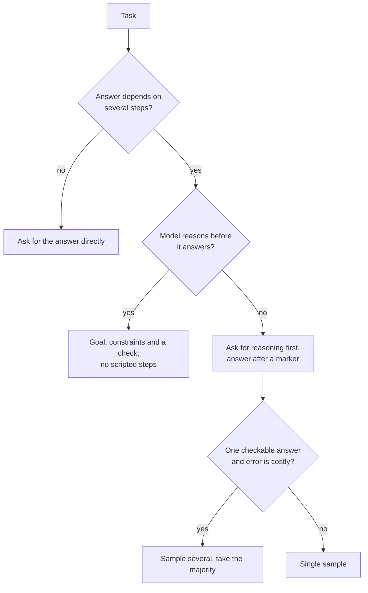

# 少样本与推理：选择示例与决定是否要求推理

第 3、4 阶段的内容，压缩成便于查阅的形式。[第 6 课](../lessons/0006-what-examples-teach.md)讲示例教会模型什么，[第 7 课](../lessons/0007-few-shot-biases.md)讲它们的偏差，[第 8 课](../lessons/0008-chain-of-thought.md)讲思维链，[第 9 课](../lessons/0009-self-consistency-and-faithfulness.md)讲自洽性与忠实性，[第 10 课](../lessons/0010-prompting-reasoning-models.md)讲给推理模型写提示词。

## 示例教会模型什么

| 示例提供的是 | 检查项 |
|---|---|
| 格式：先输入后输出，反复出现 | 每个示例使用同一种布局和同一种标签写法 |
| 标签空间 | 每个允许的答案至少出现一次 |
| 输入分布 | 输入看起来像真实的输入，而不是整洁的编造文本 |
| 从输入到标签的映射 | 在 Min 等人的研究中影响最小，但仍要保证标签正确 |

这些证据来自 GPT-2 到 GPT-3 时代的模型，任务是分类和多项选择。请把它当作先验，并在你的模型上测试。

## 选择并排序示例

| 风险 | 来源 | 对策 |
|---|---|---|
| 多数标签偏差 | Zhao 等 | 让各个示例的标签保持均衡 |
| 近因偏差 | Zhao 等 | 不要以同一个标签的连续一串示例收尾 |
| 常见 token 偏差 | Zhao 等 | 检查是否漏掉了罕见的正确答案 |
| 顺序敏感性 | Lu 等 | 在已知用例上测试多种顺序，换模型时重新测试 |
| 重复的或偏离分布的示例 | Anthropic 指南 | 选择相关、多样、带标签的示例，3 到 5 个（一家厂商的建议） |

## 要不要要求推理？

## 推理技术

| 技术 | 作用 | 证据 | 代价或局限 |
|---|---|---|---|
| 少样本思维链 | 带有完整推理过程的示例 | Wei 等：约 1000 亿参数及以上才有收益，问题越难收益越大 | 需要好的示例，并增加输出 token |
| 零样本思维链 | “Let's think step by step” | Kojima 等：在 text-davinci-002 上，MultiArith 从 17.7% 提升到 78.7% | 在所测试的一步推理和常识任务上没有收益 |
| 自洽性 | 采样多条路径，对答案投票 | Wang 等：GSM8K 比贪心解码高 17.9% | 需要可比较的最终答案，token 用量是原来的数倍 |
| 为推理模型写死步骤 | 固定推理路线 | Anthropic 指南：通用的指令往往胜过规定好的方案 | 把模型限制在你的路线上 |

## 写出来的推理是什么，不是什么

- 任务需要多个步骤时，它有助于得出答案，而且必须出现在答案之前才有帮助（Wei 等）。
- 它可能遗漏真正驱动答案的因素。Turpin 等：在 GPT-3.5 和 Claude 1.0 上，当存在带偏见的特征而推理中从未提及它时，准确率最多下降了 36%。
- 要检验是什么影响了答案，就改变输入后重新运行。不要让模型自己解释自己。

## 推理模型（一家厂商文档记载的行为）

- 优先用通用的指令，而不是规定好的步骤。
- 完整的示例会影响模型在思考中处理类似问题的方式。
- 最后加一行验证有帮助，但旧的验证语句在某些模型上可能导致过度验证，所以要重新测试。
- 思考量是一个单独的设置。手动的 extended thinking：`budget_tokens` 最小为 1,024，它是目标而不是上限，并计入 `max_tokens`。
- 智能体循环中的推理：[智能体系列第 17 课：自我批评与推理模型带来的变化](../../agents/lessons/0017-self-critique-and-reasoning-models.md)。

## 上线少样本或推理提示词之前

- 各示例使用同一种布局和完全一致的标签写法。
- 每个标签都出现过，没有占多数的标签，也没有以连续一串收尾。
- 在已知用例上给多种顺序打过分，差距很小。
- 只在需要多个步骤的任务上启用推理，并且答案放在程序可以找到的标记之后。
- 已与朴素版提示词做过比较，且在任何模型变更之后重新运行过。
