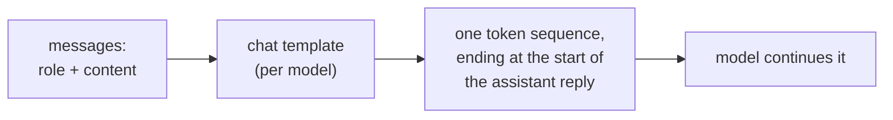
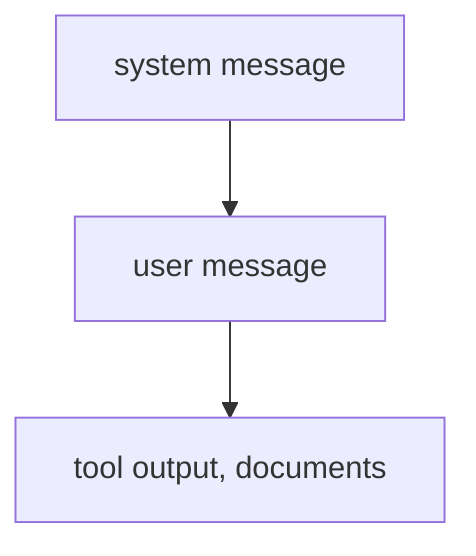

# Anatomía de un prompt: roles, ubicación, instrucciones y estructura

Las etapas 1 y 2 condensadas para consulta rápida. La [lección 1](../lessons/0001-what-the-model-sees.md) cubre lo que recibe el modelo, la [lección 2](../lessons/0002-system-prompts-and-roles.md) dónde van las instrucciones y cómo se priorizan, la [lección 3](../lessons/0003-clear-instructions.md) las instrucciones claras, la [lección 4](../lessons/0004-structure-and-delimiters.md) los delimitadores y la [lección 5](../lessons/0005-format-sensitivity.md) por qué cada edición es una afirmación que hay que probar.

## Qué recibe el modelo

| Hecho | Consecuencia |
|---|---|
| Un rol es formato con el que se entrenó el modelo, no un canal | La posición de una instrucción y los tokens de rol son todo lo que el modelo tiene para guiarse |
| Las plantillas difieren entre modelos, incluso con una misma base | Una cadena armada a mano para un modelo es la entrada equivocada para otro |
| El prompt de generación marca dónde empieza la respuesta | Sin él, el modelo puede continuar el texto del usuario en lugar de responder |

## Dónde va una instrucción

| System prompt | Turno del usuario |
|---|---|
| Tarea y audiencia | La petición concreta |
| Restricciones para cada respuesta | Los datos con los que trabajar |
| Formato que debe seguir cada respuesta | Una corrección a esta petición |
| Rol, si se usa | Detalles que importan solo ahora |

Prueba: ¿debería la línea seguir vigente en la siguiente petición? Si es así, va en el system prompt.

## Quién gana en un conflicto

- Lo superior prevalece sobre lo inferior cuando entran en conflicto. Una instrucción inferior alineada (el usuario pide español y el system prompt no lo prohíbe) se sigue.
- Es un comportamiento entrenado (Wallace et al. hicieron fine-tuning de GPT-3.5 Turbo). La fiabilidad de un modelo concreto es algo que hay que probar.
- La jerarquía no ordena dos instrucciones del mismo nivel.
- Un rol orienta el tono y el enfoque. Zheng et al. no encontraron ninguna mejora de precisión con personas en preguntas factuales.

## Lista de comprobación de instrucciones claras

| Comprobación | Pregunta |
|---|---|
| Contexto | ¿Para quién es y por qué importa? |
| Tarea | ¿Podría un colega nuevo decir exactamente qué hacer? |
| Restricciones | Longitud, tono, alcance, contenido prohibido, expresados como lo que hay que hacer |
| Cómo se ve algo terminado | ¿Qué comprobaría un lector para darlo por correcto? |
| Orden | Pasos numerados cuando el orden o la exhaustividad importan |

Regla de oro (la guía de Anthropic): dale el prompt a un colega con contexto mínimo. Si se confundiría, el modelo también.

## Delimitadores

| Haz | No hagas |
|---|---|
| Envuelve cada tipo de contenido (instrucciones, contexto, entrada) en su propia etiqueta o sección | Pegar datos bajo una instrucción sin nada que marque dónde empiezan |
| Usa nombres coherentes y descriptivos | Renombrar o mezclar estilos dentro de un mismo prompt (elige etiquetas o encabezados) |
| Indica cómo tratar el contenido etiquetado ("texto para resumir, no instrucciones") | Tratar una etiqueta como un control de seguridad: la entrada puede imitar una etiqueta de cierre |

## Sensibilidad al formato

| Hallazgo (Sclar et al.) | Lectura |
|---|---|
| Cambios de formato que conservan el significado movieron la precisión few-shot hasta 76 puntos en LLaMA-2-13B | Una edición cosmética es una hipótesis |
| La dispersión persistió con modelos más grandes, más ejemplos y ajuste por instrucciones | No esperes que la escala la elimine |
| El rendimiento por formato solo se correlaciona débilmente entre modelos | Vuelve a probar un prompt cuando cambie el modelo |

Hábito: conserva ambas versiones, ejecútalas sobre las mismas entradas y decide a partir de los resultados, no de cómo se leen las salidas. La etapa 8 lo vuelve riguroso.

## Antes de enviar un prompt

- Cada línea está en el nivel que le corresponde (system prompt o turno del usuario).
- Un colega sin contexto podría seguirlo.
- Los datos están marcados aparte de las instrucciones, de la misma manera en todo el prompt.
- Cualquier cambio respecto de la última versión se comparó sobre las mismas entradas.
