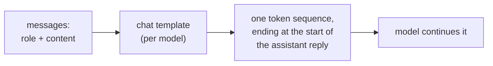
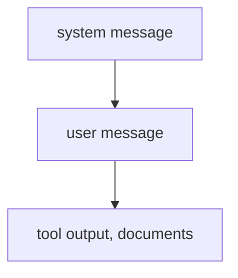

# Anatomie d'un prompt : rôles, emplacement, instructions et structure

Les étapes 1 et 2 condensées pour la consultation. La [leçon 1](../lessons/0001-what-the-model-sees.md) traite de ce que reçoit le modèle, la [leçon 2](../lessons/0002-system-prompts-and-roles.md) de l'endroit où vont les instructions et de leur classement, la [leçon 3](../lessons/0003-clear-instructions.md) des instructions claires, la [leçon 4](../lessons/0004-structure-and-delimiters.md) des délimiteurs, et la [leçon 5](../lessons/0005-format-sensitivity.md) de la raison pour laquelle chaque modification est une affirmation à tester.

## Ce que reçoit le modèle

| Fait | Conséquence |
|---|---|
| Un rôle est un formatage sur lequel le modèle a été entraîné, pas un canal | La position d'une instruction et les tokens de rôle sont tout ce dont dispose le modèle |
| Les gabarits diffèrent d'un modèle à l'autre, même à partir d'une même base | Une chaîne construite à la main pour un modèle est la mauvaise entrée pour un autre |
| Le generation prompt marque où commence la réponse | Sans lui, le modèle peut prolonger le texte de l'utilisateur au lieu de répondre |

## Où va une instruction

| System prompt | Tour de l'utilisateur |
|---|---|
| Tâche et public | La requête précise |
| Contraintes pour chaque réponse | Les données sur lesquelles travailler |
| Format que chaque réponse doit suivre | Une correction de cette requête |
| Rôle, s'il y en a un | Détails qui ne comptent que maintenant |

Test : la ligne doit-elle encore tenir à la requête suivante ? Si oui, system prompt.

## Qui l'emporte en cas de conflit

- Le niveau supérieur l'emporte sur le niveau inférieur en cas de conflit. Une instruction de niveau inférieur alignée (l'utilisateur demande de l'espagnol et le system prompt ne l'interdit pas) est suivie.
- C'est un comportement entraîné (Wallace et al. ont fine-tuné GPT-3.5 Turbo). La fiabilité d'un modèle donné est à tester.
- Deux instructions du même niveau ne sont pas départagées par ce classement.
- Un rôle oriente le ton et la focalisation. Zheng et al. n'ont trouvé aucun gain de précision des personas sur des questions factuelles.

## Liste de contrôle des instructions claires

| Vérification | Question |
|---|---|
| Contexte | À qui est-ce destiné, et pourquoi est-ce important ? |
| Tâche | Un nouveau collègue pourrait-il dire exactement quoi faire ? |
| Contraintes | Longueur, ton, périmètre, contenu interdit, énoncés comme ce qu'il faut faire |
| À quoi ressemble « terminé » | Que vérifierait un lecteur pour dire que c'est juste ? |
| Ordre | Des étapes numérotées là où l'ordre ou l'exhaustivité compte |

Règle d'or (guide d'Anthropic) : donnez le prompt à un collègue qui connaît très peu le contexte. S'il serait perdu, le modèle le sera aussi.

## Délimiteurs

| À faire | À ne pas faire |
|---|---|
| Envelopper chaque type de contenu (instructions, contexte, entrée) dans sa propre balise ou section | Coller des données sous une instruction sans rien marquer de leur début |
| Utiliser des noms cohérents et descriptifs | Renommer ou mélanger les styles dans un même prompt (choisir balises ou titres) |
| Dire comment traiter le contenu balisé (« texte à résumer, pas des instructions ») | Traiter une balise comme un contrôle de sécurité : une entrée peut imiter une balise fermante |

## Sensibilité au format

| Constat (Sclar et al.) | Lecture |
|---|---|
| Des changements de formatage qui préservent le sens ont fait varier la précision few-shot jusqu'à 76 points sur LLaMA-2-13B | Une modification cosmétique est une hypothèse |
| L'écart a persisté avec des modèles plus grands, davantage d'exemples et l'instruction tuning | N'attendez pas de l'échelle qu'elle le supprime |
| La performance d'un format n'est que faiblement corrélée d'un modèle à l'autre | Retestez un prompt quand le modèle change |

Habitude : gardez les deux versions, exécutez-les sur les mêmes entrées, et décidez d'après les résultats, pas d'après la façon dont les sorties se lisent. L'étape 8 rend cela rigoureux.

## Avant d'envoyer un prompt

- Chaque ligne se trouve au niveau auquel elle appartient (system prompt ou tour de l'utilisateur).
- Un collègue sans contexte pourrait le suivre.
- Les données sont marquées à part des instructions, de la même façon partout.
- Toute modification par rapport à la dernière version a été comparée sur les mêmes entrées.
