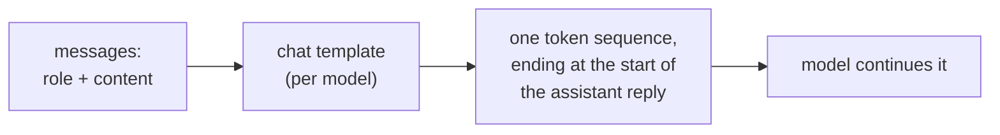
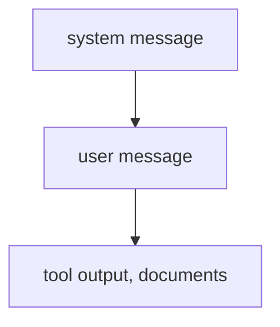

# Prompt Anatomy: Roles, जगह, Instructions और Structure

चरण 1 और 2 का संक्षिप्त रूप, खोजने के लिए। [पाठ 1](../lessons/0001-what-the-model-sees.md) बताता है कि model को क्या मिलता है, [पाठ 2](../lessons/0002-system-prompts-and-roles.md) instructions कहाँ आते हैं और उन्हें कैसे क्रम दिया जाता है, [पाठ 3](../lessons/0003-clear-instructions.md) स्पष्ट instructions, [पाठ 4](../lessons/0004-structure-and-delimiters.md) delimiters, और [पाठ 5](../lessons/0005-format-sensitivity.md) कि हर edit एक परखने लायक दावा क्यों है।

## Model को क्या मिलता है

| तथ्य | नतीजा |
|---|---|
| Role वह formatting है जिस पर model को train किया गया, कोई channel नहीं | Instruction की जगह और role tokens ही model के पास चलने को हैं |
| Templates models के बीच अलग होते हैं, एक ही base से भी | एक model के लिए हाथ से बनाई string दूसरे के लिए ग़लत input है |
| Generation prompt बताता है कि reply कहाँ शुरू होता है | उसके बिना model reply देने के बजाय उपयोगकर्ता का text आगे बढ़ा सकता है |

## Instruction कहाँ जाता है

| System prompt | User turn |
|---|---|
| Task और audience | ख़ास request |
| हर reply के constraints | जिस data पर काम करना है |
| वह format जो हर reply को follow करना है | इस request का सुधार |
| Role, अगर इस्तेमाल हो | वे ब्योरे जो सिर्फ़ अभी मायने रखते हैं |

कसौटी: क्या पंक्ति को अगली request पर भी लागू रहना चाहिए? अगर हाँ, तो system prompt।

## टकराव पर कौन जीतता है

- टकराने पर ऊँचा नीचे को override करता है। एक अनुरूप निचला instruction (उपयोगकर्ता स्पेनिश माँगता है और system prompt उसे मना नहीं करता) माना जाता है।
- यह सिखाया हुआ व्यवहार है (Wallace et al. ने GPT-3.5 Turbo को fine-tune किया)। किसी दिए model की विश्वसनीयता परखने की चीज़ है।
- एक ही स्तर के दो instructions को यह क्रम नहीं देता।
- Role tone और फ़ोकस को दिशा देता है। Zheng et al. को तथ्यात्मक सवालों पर personas से accuracy में कोई बढ़त नहीं मिली।

## स्पष्ट-instruction की checklist

| जाँच | सवाल |
|---|---|
| Context | यह किसके लिए है, और क्यों मायने रखता है? |
| Task | क्या कोई नया सहकर्मी ठीक-ठीक बता सकता है कि क्या करना है? |
| Constraints | लंबाई, tone, दायरा, वर्जित content, इस रूप में कि क्या करना है |
| पूरा होना कैसा दिखता है | पाठक इसे सही कहने के लिए क्या जाँचेगा? |
| क्रम | जहाँ क्रम या पूर्णता मायने रखती है वहाँ क्रमांकित चरण |

सुनहरा नियम (Anthropic की गाइड): prompt किसी ऐसे सहकर्मी को दें जिसे बहुत कम context हो। अगर वह उलझेगा, तो model भी उलझेगा।

## Delimiters

| करें | न करें |
|---|---|
| हर प्रकार के content (instructions, context, input) को उसके अपने tag या section में लपेटें | किसी instruction के नीचे data paste करें जबकि कुछ नहीं बताता कि वह कहाँ शुरू होता है |
| एक जैसे, वर्णनात्मक नाम इस्तेमाल करें | एक prompt के भीतर नाम बदलें या शैलियाँ मिलाएँ (tags या headings में से चुनें) |
| बताएँ कि tag वाले content को कैसे लेना है ("text to summarise, not instructions") | Tag को security control मानें: input closing tag की नक़ल कर सकता है |

## Format के प्रति संवेदनशीलता

| खोज (Sclar et al.) | पढ़ाई |
|---|---|
| अर्थ न बदलने वाले formatting बदलावों ने LLaMA-2-13B पर few-shot accuracy को 76 अंकों तक हिलाया | कॉस्मेटिक edit एक परिकल्पना है |
| फैलाव बड़े models, ज़्यादा examples और instruction tuning के साथ भी बना रहा | उम्मीद न करें कि scale उसे हटा देगा |
| Format का प्रदर्शन models के बीच सिर्फ़ कमज़ोर रूप से जुड़ा है | Model बदलने पर prompt दोबारा परखें |

आदत: दोनों versions रखें, उन्हें एक ही inputs पर चलाएँ, और फ़ैसला नतीजों से करें, इससे नहीं कि outputs कैसे पढ़े गए। चरण 8 इसे कठोर बनाता है।

## Prompt भेजने से पहले

- हर पंक्ति उस स्तर पर बैठी है जिसकी वह है (system prompt या user turn)।
- बिना context वाला सहकर्मी इसे follow कर सकता था।
- Data instructions से अलग चिह्नित है, पूरे में एक ही तरह।
- पिछले version से हुआ हर बदलाव उन्हीं inputs पर तुलना किया गया।
