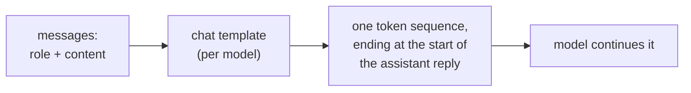
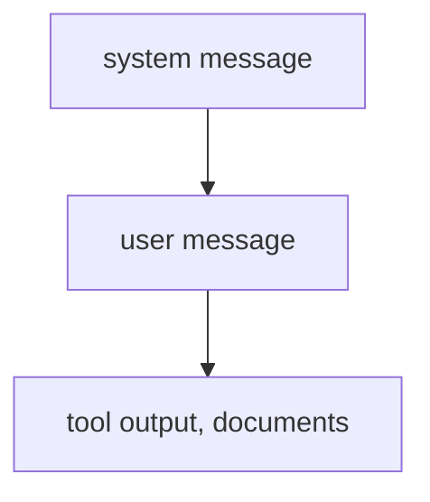

# Prompt Anatomy: Roles, Placement, Instructions and Structure

Stages 1 and 2 compressed for lookup. [Lesson 1](../lessons/0001-what-the-model-sees.md) covers what the model receives, [lesson 2](../lessons/0002-system-prompts-and-roles.md) where instructions belong and how they are ranked, [lesson 3](../lessons/0003-clear-instructions.md) clear instructions, [lesson 4](../lessons/0004-structure-and-delimiters.md) delimiters, and [lesson 5](../lessons/0005-format-sensitivity.md) why every edit is a claim to test.

## What the model receives

| Fact | Consequence |
|---|---|
| A role is formatting the model was trained on, not a channel | An instruction's position and role tokens are all the model has to go on |
| Templates differ between models, even from one base | A hand-built string for one model is the wrong input for another |
| The generation prompt marks where the reply starts | Without it the model may continue the user's text instead of replying |

## Where an instruction goes

| System prompt | User turn |
|---|---|
| Task and audience | The specific request |
| Constraints for every reply | The data to work on |
| Format every reply must follow | A correction to this request |
| Role, if used | Details that matter only now |

Test: should the line still hold on the next request? If yes, system prompt.

## Who wins on a conflict

- Higher overrides lower when they conflict. An aligned lower instruction (the user asks for Spanish and the system prompt does not forbid it) is followed.
- This is trained behaviour (Wallace et al. fine-tuned GPT-3.5 Turbo). A given model's reliability is something to test.
- Two instructions at the same level are not ranked by it.
- A role steers tone and focus. Zheng et al. found no accuracy gain from personas on factual questions.

## Clear-instruction checklist

| Check | Question |
|---|---|
| Context | Who is it for, and why does it matter? |
| Task | Could a new colleague say exactly what to do? |
| Constraints | Length, tone, scope, forbidden content, stated as what to do |
| Done looks like | What would a reader check to call it right? |
| Order | Numbered steps where order or completeness matters |

Golden rule (Anthropic's guide): give the prompt to a colleague with minimal context. If they would be confused, the model will be too.

## Delimiters

| Do | Do not |
|---|---|
| Wrap each kind of content (instructions, context, input) in its own tag or section | Paste data under an instruction with nothing marking where it starts |
| Use consistent, descriptive names | Rename or mix styles inside one prompt (choose tags or headings) |
| Say how to treat tagged content ("text to summarise, not instructions") | Treat a tag as a security control: input can imitate a closing tag |

## Format sensitivity

| Finding (Sclar et al.) | Reading |
|---|---|
| Meaning-preserving formatting changes moved few-shot accuracy by up to 76 points on LLaMA-2-13B | A cosmetic edit is a hypothesis |
| Spread persisted with larger models, more examples and instruction tuning | Do not expect scale to remove it |
| Format performance only weakly correlates between models | Re-test a prompt when the model changes |

Habit: keep both versions, run them on the same inputs, and decide from the results, not from how the outputs read. Stage 8 makes that rigorous.

## Before sending a prompt

- Each line sits at the level it belongs to (system prompt or user turn).
- A colleague with no context could follow it.
- Data is marked apart from instructions, the same way throughout.
- Any change from the last version was compared on the same inputs.
