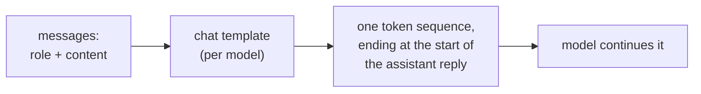
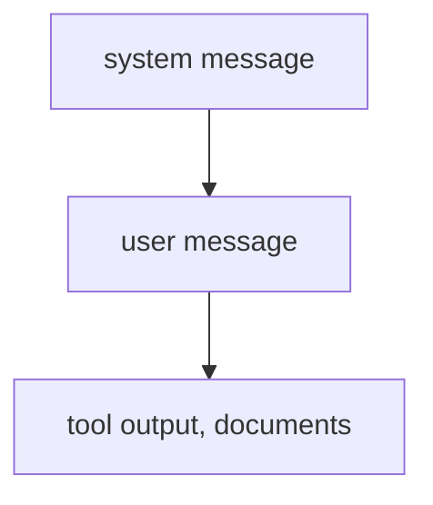

# Anatomia do Prompt: Papéis, Posição, Instruções e Estrutura

Os estágios 1 e 2 condensados para consulta. A [lição 1](../lessons/0001-what-the-model-sees.md) trata do que o modelo recebe, a [lição 2](../lessons/0002-system-prompts-and-roles.md) de onde as instruções devem ficar e como são priorizadas, a [lição 3](../lessons/0003-clear-instructions.md) de instruções claras, a [lição 4](../lessons/0004-structure-and-delimiters.md) de delimitadores e a [lição 5](../lessons/0005-format-sensitivity.md) de por que toda edição é uma afirmação a ser testada.

## O que o modelo recebe

| Fato | Consequência |
|---|---|
| Um papel é uma formatação com a qual o modelo foi treinado, não um canal | A posição de uma instrução e os tokens de papel são tudo o que o modelo tem para se guiar |
| Os templates diferem entre modelos, mesmo partindo da mesma base | Uma string montada à mão para um modelo é a entrada errada para outro |
| O generation prompt marca onde a resposta começa | Sem ele, o modelo pode continuar o texto do usuário em vez de responder |

## Onde cada instrução fica

| System prompt | Turno do usuário |
|---|---|
| Tarefa e público | A solicitação específica |
| Restrições para toda resposta | Os dados a processar |
| Formato que toda resposta deve seguir | Uma correção a esta solicitação |
| Papel, se for usado | Detalhes que importam só agora |

Teste: a linha ainda deve valer na próxima solicitação? Se sim, system prompt.

## Quem vence em um conflito

- O nível mais alto sobrepõe o mais baixo quando há conflito. Uma instrução alinhada de nível mais baixo (o usuário pede espanhol e o system prompt não proíbe) é seguida.
- Esse é um comportamento treinado (Wallace et al. fizeram fine-tuning do GPT-3.5 Turbo). A confiabilidade em um dado modelo é algo a testar.
- Duas instruções no mesmo nível não são ordenadas por essa hierarquia.
- Um papel orienta o tom e o foco. Zheng et al. não encontraram ganho de acurácia com personas em perguntas factuais.

## Checklist de instruções claras

| Verificação | Pergunta |
|---|---|
| Contexto | Para quem é e por que importa? |
| Tarefa | Um colega novo saberia dizer exatamente o que fazer? |
| Restrições | Tamanho, tom, escopo, conteúdo proibido, escritos como o que fazer |
| Como é o pronto | O que um leitor verificaria para considerar correto? |
| Ordem | Passos numerados quando a ordem ou a completude importam |

Regra de ouro (guia da Anthropic): entregue o prompt a um colega com o mínimo de contexto. Se ele ficaria confuso, o modelo também ficará.

## Delimitadores

| Faça | Não faça |
|---|---|
| Envolva cada tipo de conteúdo (instruções, contexto, entrada) em sua própria tag ou seção | Cole dados abaixo de uma instrução sem nada que marque onde eles começam |
| Use nomes consistentes e descritivos | Renomeie ou misture estilos dentro de um mesmo prompt (escolha tags ou títulos) |
| Diga como tratar o conteúdo marcado ("texto a resumir, não instruções") | Trate uma tag como controle de segurança: a entrada pode imitar uma tag de fechamento |

## Sensibilidade ao formato

| Achado (Sclar et al.) | Leitura |
|---|---|
| Mudanças de formatação que preservam o significado alteraram a acurácia few-shot em até 76 pontos no LLaMA-2-13B | Uma edição cosmética é uma hipótese |
| A dispersão persistiu com modelos maiores, mais exemplos e instruction tuning | Não espere que a escala a elimine |
| O desempenho de um formato só se correlaciona fracamente entre modelos | Teste o prompt de novo quando o modelo mudar |

Hábito: guarde as duas versões, rode-as nas mesmas entradas e decida pelos resultados, não pela impressão que as saídas causam. O estágio 8 torna isso rigoroso.

## Antes de enviar um prompt

- Cada linha está no nível a que pertence (system prompt ou turno do usuário).
- Um colega sem contexto conseguiria segui-lo.
- Os dados estão separados das instruções, do mesmo modo ao longo de todo o prompt.
- Qualquer mudança em relação à última versão foi comparada nas mesmas entradas.
